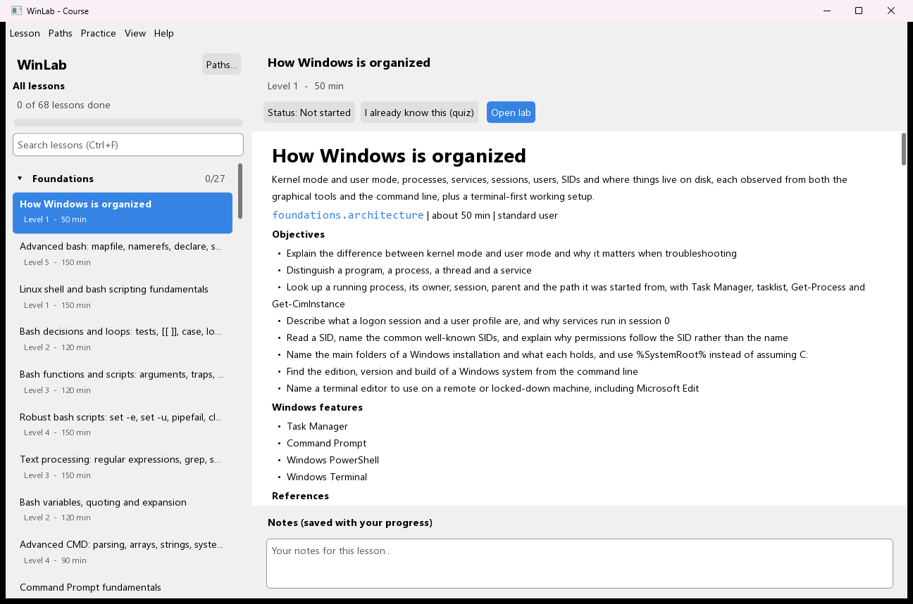

# WinLab

Offline-first Windows and Linux administration course. Written in Zig with DVUI; it runs on **Windows 10/11 and Linux**
(x86-64). Product contract: `ai/specs.md`; engineering rules: `ai/AGENTS.md`. Design decisions are in `docs/decisions/`
(0001-0007). The course outline (a draft for review) is `outline.md`.

## Download

Beta builds are on the [Releases page](https://github.com/BearzRobotics/winlab/releases): a Windows installer (per user, no admin rights;
unsigned, so SmartScreen warns), a Windows portable zip, and a Linux tarball (unpack and run `./winlab`; nothing to install but QEMU and
OpenSSH for the labs). Check downloads against `SHA256SUMS`. Please report problems as [issues](https://github.com/BearzRobotics/winlab/issues);
see `CONTRIBUTING.md`.

## Required software

The lessons, quizzes, search, notes and progress need nothing but WinLab itself. The hands-on labs run real virtual machines,
so they need the software below. WinLab finds it at run time and never installs or bundles it, which is why a distribution
package should **depend on all of it**.

| Needed for | Windows | Linux (package names vary by distribution) |
| --- | --- | --- |
| Lab VMs: **QEMU** (`qemu-system-x86_64`, `qemu-img`, `qemu-io`) | winget `SoftwareFreedomConservancy.QEMU` | `qemu-system-x86` + `qemu-utils` (Debian, Ubuntu); `qemu-system-x86` + `qemu-img` (Fedora, RHEL, Alma); `qemu-full` (Arch); `qemu-system-x86_64` + `qemu-img` (Alpine) |
| Lab control: **OpenSSH client** (`ssh`, `ssh-keygen`) | built in (optional Windows feature) | `openssh-client` / `openssh-clients` / `openssh` |
| Downloading images: **curl** | built in (`curl.exe`) | `curl` |
| Window: **SDL3** | not needed (Direct3D 11) | nothing for the prebuilt tarball (SDL3 is linked in; it loads X11 or Wayland at run time). A distribution package may use its own `libsdl3` with `-fsys=sdl3` |
| Disk space check: **df** | not needed | `coreutils` |
| Building from source: **Zig 0.17.1** and, on Linux, (optionally, for `-fsys=sdl3`) the SDL3 development files + `pkg-config` | Zig only | `libsdl3-dev` / `SDL3-devel` + `pkgconf` |

Optional: PowerShell 7 (`pwsh`, for the PowerShell lessons on Linux), **bsdtar** (`libarchive-tools`; only to build the
Chimera Linux lab, which reads a live ISO), and **KVM** acceleration on Linux (`/dev/kvm` readable and writable by you,
normally by joining the `kvm` group; without it labs still run, only slowly in software emulation). Windows uses WHPX
(Windows Features > Windows Hypervisor Platform). A terminal emulator (`x-terminal-emulator`, gnome-terminal, konsole,
xfce4-terminal, kitty, alacritty, foot or xterm) is used for the Practice menu on Linux.

## Build, run, test

    zig build                                # Windows: build (Direct3D 11 window)
    zig build                                # Linux: also works; SDL3 is fetched (hash-pinned) on the first build and linked in
    zig build run                            # version, shell and QEMU capability status
    zig build run -- browse course           # the course browser (lessons, search, notes, terminal, labs)
    zig build check-content                  # validate course/ and labs/ (manifests, prerequisites, scenarios)
    zig build test                           # unit tests (some need QEMU and are reported as skipped without it)

Building needs no network: the Zig dependencies (md, toml, pdf, dvui and its helpers) are pinned in `build.zig.zon` and
extracted into `zig-pkg/`, which release tarballs keep (ADR 0003).

**Windows release:** `powershell -File installer\build-installer.ps1` makes the installer and the portable zip.

**Linux package:**

    zig build -Doptimize=ReleaseSafe -Dshare-content=true --prefix "$DESTDIR/usr"

installs `bin/winlab`, the lessons, labs, paths, quizzes and catalogs under `share/winlab/`, a desktop entry and the
licence. WinLab finds the content in `<exe folder>/../share/winlab`, `/usr/share/winlab` or `/usr/local/share/winlab`.
For a generic x86-64 CPU add `-Dcpu=x86_64_v2` (a default build uses the build machine's own CPU).
## Commands (`winlab <command>`)
| Command | What it does |
| --- | --- |
| `browse [course-dir]` | Course browser: lessons, search (Ctrl+F), progress, notes, "Open terminal...", "Lab..." |
| `view <file.md>` | One Markdown file in the reader |
| `check <course-dir>` | Validate lesson manifests and the sibling `labs/` folder |
| `terminal <cmd\|powershell\|pwsh\|bash>` | A real shell: a ConPTY terminal window on Windows (ADR 0005), your terminal emulator on Linux |
| `image list` / `image fetch <id>` | Installation media WinLab can download (asks first, HTTPS via curl.exe) |
| `image editions <iso>` / `image add <id> <iso> <server\|client> <index>` | Use an ISO you already have |
| `vm install <image-id> <vm-id>` | Build a lab VM (Windows Server unattended, or Ubuntu / AlmaLinux from a cloud image); runs until the guest answers over SSH |
| `vm resume\|list\|remove <vm-id>` | Continue an install, list VMs and scenarios, delete a VM WinLab created |
| `vm snapshot\|restore\|delete-snapshot <vm-id> <name>` | Snapshots of a stopped training VM |
| `vm reboot-test <vm-id>` | Prove a session survives a guest restart |
| `lab build\|verify <lab.toml> <vm-id>` | Author commands: bake a scenario, prove it works |
| `lab verify-set <vm-id> <lab.toml>...` | Prove several scripting labs in one boot |
| `coverage [exam-id]` | Show which certification domains have lessons and labs tagged to them |
| `lab start\|check\|reset\|end <lab.toml> <vm-id>` | The learner flow on the command line (the app's Lab window does the same) |
| `lab selftest <lab.toml> <vm-id>` | Run a lab live (inject, fix, validate, roll back) |

Settings are read from `%APPDATA%\WinLab\settings.toml` on Windows and `~/.config/WinLab/settings.toml` on Linux (`$XDG_CONFIG_HOME` is honoured) (`theme`, `text-scale`, `content-path`,
`qemu-path`, `lab-vm`, `setup-done`, `badges`); a bad key is reported and ignored. WinLab writes the file only to record that the first-run setup window was seen (`setup-done`).
Progress and notes live in `progress.toml` beside it (ADR 0004); registered VMs in `vms.toml`.
VM disks, keys and installation media are under `%LOCALAPPDATA%\WinLab\` (Windows) or `~/.local/share/WinLab/` (Linux, `$XDG_DATA_HOME` is honoured).

## Layout
- `src/content/` Markdown to RTF, links, lesson manifests, catalog, search
- `src/storage/` settings, progress (atomic TOML files)
- `src/platform.zig` everything that differs between Windows and Linux (config and data folders, PATH, helper programs)
- `src/terminal/` ConPTY session and the VT screen model (Windows; Linux opens your own terminal emulator instead)
- `src/vm/` provider interface, in-memory mock, QEMU provider and session supervisor, VM registry,
  image catalog and download, unattended-install answer files, ISO builder, guest control over SSH
- `src/labs/` lab manifests, scenario builder/runner, scripting-lab harness generator
- `src/ui/` the DVUI window (Direct3D 11 on Windows, SDL3 on Linux), the Windows terminal window, the lesson renderer
- `course/` lessons; `labs/` lab files; `images/catalog.toml` downloadable media; `docs/decisions/` ADRs

**First run.** A setup window opens once. It lists what WinLab found (shells, the OpenSSH client, QEMU) and, if QEMU is
missing, your choices: a winget command to copy, the QEMU download page, or a `qemu-path` setting. WinLab never installs
software by itself. Reopen it from Help > Setup and requirements. The lessons need none of this; only the labs need QEMU.

## Status (2026-11-22)

`winlab check course` reports **68 lessons, 69 labs, 68 quiz files (2,441 questions) and 13 learning paths** with no
problems and no path-ordering warnings.
**Every lesson is a draft for the course owner's review**; each states what was tested and what was not, and cites
official documentation. Tracks: Windows administration, CMD, PowerShell (9 lessons), bash and POSIX sh, Linux
administration (systemd, dinit), networking, security fundamentals, cybersecurity (7), home lab (4), package
repositories (4), and certification-mapped paths.

**Tested on this machine** (Windows 11 Home, QEMU 11.1.1 with WHPX; the Windows installer and portable zip were built and tested here too): badges (Lesson > Badges, derived from progress, off with `badges = false`), the course browser, search, notes and progress,
quizzes, learning paths, the embedded terminal (CMD and Windows PowerShell 5.1), the first-run setup window, text scaling to
200%, and the Copy and plain-text view features. Lab VMs built by WinLab: Windows Server 2022, Ubuntu 24.04, AlmaLinux 9
and Chimera Linux, with SSH guest control, snapshots and rollback. Baked scenarios pass `winlab lab verify`
(see `docs/HANDOFF.md`, appendix B, for the few that are still unverified).

**Linux (new, 2026-11-22; Ubuntu 26.04 under WSL2 with KVM, QEMU 10.2.1):** the first Linux tests used the system SDL2 2.32; the shipped build now links SDL3 statically (cross-compiled from Windows with no Linux libraries, glibc 2.31 floor, and its window was checked in WSLg). The unit
tests pass (107, one Windows-only test skipped); `winlab check course` and `winlab status` work; the window opens and shows the
lesson list and the setup window; `image fetch ubuntu-2404-cloud` and `vm install` build an Ubuntu lab VM under KVM in about a
minute; `lab build` and `lab verify` pass all five stages on `linux-file-permissions` (37 s); the package install
(`-Dshare-content=true`) finds its content under `share/winlab`. Linux bugs found and fixed by that testing: Linux guests were
sent the Windows `shutdown /s` command, and `qemu-img` refused to list snapshots of a running VM because Linux QEMU takes image locks.

**Not tested on Linux:** the Practice menu's terminal launcher (no desktop terminal in the test distro), clicking through the
first-run window (automated clicks do not reach WSLg windows), the saved settings file on a fresh account, Wayland versus X11
behaviour on a real desktop, the Chimera Linux and Windows Server VMs (they need `bsdtar` and a Windows ISO), AlmaLinux and
other distributions as the *host*, and ARM. Fonts: Linux uses DVUI's bundled font, not Segoe UI. The `system` theme cannot read
the desktop theme (it honours `GTK_THEME=...:dark`; otherwise set `theme = "dark"`).

**Not tested:** Windows 10 and the Windows 11 client install path (no client ISO here), Narrator and other screen readers,
typing into quiz answers by automation (blocked in the test environment), and macOS (not supported).

**Not done:** the Sysinternals advanced track (ADR 0007), an OPNsense lesson (dropped for now: OPNsense 26.7 crashed under QEMU
with WHPX), distribution packages, code signing of the Windows installer.
**Known limits and surprises** (details in the ADRs): QEMU on Windows takes no disk lock, so WinLab detects a running VM
itself; a guest restart inside one QEMU process hangs the BIOS under WHPX, so QEMU runs with `-no-reboot` and is
relaunched; baked faults must survive a reboot; Windows reserves moving TCP port ranges, so ports are test-bound before
use; a lab file's expected-value snippets are code in the guest's own language (a bare word is a command, not a string).

## Licence

WinLab is free software under the GNU General Public License, version 2 (see `LICENSE`). Course text and quizzes are covered by the same licence unless a file says otherwise.

Third-party material keeps its own licence: `zig-pkg/` holds the pinned dependencies (each with its licence file) and `reference/`
holds preservation copies of public documents (see `reference/MANIFEST.md` and its takedown notice). The GPL covers WinLab's own
code, lessons, quizzes and labs.

## Beta notice

This is a **beta**. Every lesson is a draft for review: each says what was tested and what was not. Please report mistakes,
crashes and confusing steps as issues. The Windows installer is not code-signed, so SmartScreen warns on first run.
