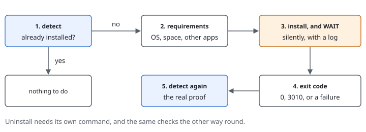

*Draft for owner review.* Managing many devices is a different job from fixing one: you describe the state devices **should** be in, a service applies it, and you check which ones are not in it. This lesson covers how a device is provisioned, joined, enrolled, configured and given applications, and how to check each of these **on the machine**.

**What was tested, and where.** Cloud services (Microsoft Intune, Microsoft Entra ID, Autopilot) need a subscription that WinLab does not provide, so **nothing about them was tested**: those parts summarise the linked Microsoft documentation. The commands and output come from a **Windows Server 2022** lab VM (Windows PowerShell 5.1, elevated), using `tests/verification/powershell/endpoint1.ps1`. Client editions of Windows may show more software and different tools.

| Stage | Question | Check on the device |
|---|---|---|
| Provision | How does a new device become usable? | |
| Join | Which identity system does it belong to? | `dsregcmd /status` |
| Enroll | Which service manages it? | `dsregcmd /status` (MDM lines) |
| Configure | Which settings must it have? | policy results (updates and policy lesson) |
| Applications | What must be installed? | an inventory and a detection rule |
| Updates | Is it current? | inventory and update history |

## Provisioning a device

| Approach | What happens | Fits | Watch out for |
|---|---|---|---|
| Manual install | A person installs and configures | One machine | No two come out the same |
| Imaging (a captured image) | A prepared disk image is applied | Many identical machines | The image ages; it must be rebuilt and patched |
| Unattended install ([answer file](https://learn.microsoft.com/windows-hardware/manufacture/desktop/update-windows-settings-and-scripts-create-your-own-answer-file-sxs)) | Setup reads its answers from a file | Repeatable builds | The file can contain passwords: protect it |
| [Provisioning package](https://learn.microsoft.com/windows/configuration/provisioning-packages/provisioning-packages) | Settings and apps applied to an existing Windows | Small fleets, no server | Applied once; it does not keep enforcing |
| [**Autopilot**](https://learn.microsoft.com/autopilot/overview) | A new device signs in, is recognised as the organisation's, and is configured by its services | Remote and new devices | Needs the cloud services and registered devices |

An **answer file** (often `unattend.xml` or `autounattend.xml`) supplies what Setup would otherwise ask. WinLab's own Windows lab installs use one: edition, account and options come from a file, not from clicking. That is why the result is **repeatable**, and why the file is something to keep in version control **without real passwords in it**.

## Identity and enrollment

Two different relationships are easy to confuse:

- **Joining** a device to an identity system (an Active Directory **domain**, or **Microsoft Entra ID**) answers *which organisation does this device belong to, and who can sign in to it?* See [device identity](https://learn.microsoft.com/entra/identity/devices/overview).
- **Enrolling** it in a management service such as Intune answers *who can push settings and apps to it?* ([enrollment guide](https://learn.microsoft.com/intune/intune-service/fundamentals/deployment-guide-enrollment)).

Joining often triggers enrollment, but they can exist separately. Windows **Home cannot join a domain**; Pro and above can.

### Reading a device's state

```powershell
Get-CimInstance Win32_ComputerSystem | Format-List PartOfDomain, Domain, Workgroup
dsregcmd /status
```

On the lab server:

```text
PartOfDomain : False
Domain       : WORKGROUP
Workgroup    : WORKGROUP

             AzureAdJoined : NO
          EnterpriseJoined : NO
              DomainJoined : NO
           WorkplaceJoined : NO
```

`PartOfDomain : False` means no domain, even though the `Domain` field has text in it (`WORKGROUP` there is the workgroup's name). `dsregcmd` prints much more than these lines. [Microsoft's table](https://learn.microsoft.com/entra/identity/devices/troubleshoot-device-dsregcmd) reads them together:

| AzureAdJoined | DomainJoined | State |
|---|---|---|
| YES | NO | Microsoft Entra joined |
| NO | YES | Domain joined |
| YES | YES | Microsoft Entra **hybrid** joined |
| NO | NO | Neither (`WorkplaceJoined : YES` would mean a work account is **registered** on a personal or unjoined device) |

The lab output had no management (MDM) address line, consistent with a device that is not enrolled. **`dsregcmd` output includes identifiers of the device and organisation**: remove them before you paste it into a ticket or a web page.

## Configuration

Settings arrive as **policies**: **Group Policy** for domain machines, **MDM** profiles for enrolled devices. The "Windows updates and policy settings" lesson shows where they land on a machine. Rules that keep a fleet manageable:

- **Target groups**, not individual machines.
- **Pilot** on a small group, and wait long enough to hear about problems.
- **Document** each setting's purpose and owner, and how to undo it.
- **Avoid two sources for one setting.** When a script, Group Policy and MDM all set it, the result is hard to predict and hard to explain.

## Applications

Applications come as installers (**MSI**, **EXE**, **MSIX**), from the Store, or from a package manager. A management tool needs more than a file. It needs to know how to **detect** the app, what it **requires**, how to **install** it silently, what each **exit code** means, and how to **uninstall** it.



```text
 detect --no--> requirements --> install (and WAIT) --> exit code --> detect again
   |
  yes --> nothing to do
```

The same shape as any safe change: check, change, verify. In Intune these appear as the detection rules, requirements, commands and return codes of a [Win32 app](https://learn.microsoft.com/intune/intune-service/apps/apps-win32-add).

### What is installed? The inventory

Programs register themselves for **Settings, Apps** under the [**Uninstall** registry key](https://learn.microsoft.com/windows/win32/msi/uninstall-registry-key). On 64-bit Windows there are **two** places, because 32-bit programs get their own:

```powershell
$keys = 'HKLM:\SOFTWARE\Microsoft\Windows\CurrentVersion\Uninstall\*',
        'HKLM:\SOFTWARE\WOW6432Node\Microsoft\Windows\CurrentVersion\Uninstall\*'
Get-ItemProperty $keys -ErrorAction SilentlyContinue |
    Where-Object DisplayName |
    Sort-Object DisplayName |
    Select-Object DisplayName, DisplayVersion, Publisher
```

The lab server showed:

```text
HKLM:\SOFTWARE\...\Uninstall\*              : 0 entries with a DisplayName
HKLM:\SOFTWARE\WOW6432Node\...\Uninstall\*  : 1 entries with a DisplayName

DisplayName    DisplayVersion Publisher
Microsoft Edge 157.0.4341.42  Microsoft Corporation
```

**The only entry was in the 32-bit branch.** A script that reads just the first key would report an empty server. Neither key covers everything: programs installed **for one user** register under that user's `HKCU`, Store (MSIX) apps are listed by `Get-AppxPackage`, and a program copied into a folder registers nowhere.

| Tool | Note |
|---|---|
| [`Get-Package`](https://learn.microsoft.com/powershell/module/packagemanagement/get-package) | Windows PowerShell 5.1 listed 1 item here, from the `Programs` provider |
| [`winget list`](https://learn.microsoft.com/windows/package-manager/winget/) | Where WinGet is present. It was **not** on this server |
| `wmic product get name`, or the CIM class `Win32_Product` | **Avoid.** Querying `Win32_Product` can make Windows Installer check and **reconfigure every installed MSI product**, which is slow and can change things ([Microsoft's article](https://learn.microsoft.com/troubleshoot/windows-server/admin-development/windows-installer-reconfigured-all-applications)). It also lists only MSI products |

### Silent installation: wait for it

```powershell
msiexec /i app.msi /qn /l*v install.log
```

`/i` installs, `/qn` shows no interface, `/l*v` writes a detailed log ([`msiexec`](https://learn.microsoft.com/windows-server/administration/windows-commands/msiexec)). **PowerShell does not wait for this line.** `msiexec` is a windowed program. I set `$LASTEXITCODE` to 0, ran it on a file that did not exist, and `$LASTEXITCODE` was **still 0**. Its error message turned up later, after my script had moved on. A script written this way "succeeds" whatever happens, and may use the app before it exists. **Start it and wait:**

```powershell
$p = Start-Process msiexec.exe -ArgumentList '/i C:\temp\app.msi /qn /l*v C:\temp\install.log' -Wait -PassThru
$p.ExitCode
```

With `-Wait -PassThru` I got a real code for each failure:

| What I ran | Exit code | Windows' message for the code |
|---|---|---|
| install a file that does not exist | **1619** | This installation package could not be opened. Verify that the package exists ... |
| install a text file named `.msi` | **1620** | This installation package could not be opened. Contact the application vendor ... |
| uninstall a product code that is not installed | **1605** | This action is only valid for products that are currently installed |

Turn any such number into text with `[ComponentModel.Win32Exception]::new(1619).Message`. Codes that mean **success** need care ([the full list](https://learn.microsoft.com/windows/win32/msi/error-codes)):

| Code | Meaning |
|---|---|
| 0 | Success |
| **3010** | Success, but a **restart is needed** to finish |
| **1641** | Success, and the installer **started a restart** |

A script that treats "not 0" as failure reports good installs as broken. **EXE** installers have their own switches and codes: read the vendor's documentation, and test. When an MSI fails, search the `/l*v` log for `return value 3`, the usual mark of the step that failed (my test files failed before reaching any step).

### A detection rule

"Is it installed, and new enough?" must be answerable **without** the installer:

```powershell
function Test-Installed([string]$Name, [version]$AtLeast) {
    $hit = Get-ItemProperty $keys -ErrorAction SilentlyContinue |
        Where-Object { $_.DisplayName -eq $Name }
    if (-not $hit) { return 'not installed' }
    $v = $null
    if ([version]::TryParse(@($hit)[0].DisplayVersion, [ref]$v) -and $v -ge $AtLeast) {
        "installed ($v)"
    } else {
        "too old or unreadable ($(@($hit)[0].DisplayVersion))"
    }
}
```

Run against the lab, it answered `installed (157.0.4341.42)` for Edge with a minimum of `0.1`, `too old or unreadable` with a minimum of `9999.0`, and `not installed` for a made-up name.

**Compare versions as versions.** As text, `'10.0' -gt '9.0'` is **False**; `[version]'10.0' -gt [version]'9.0'` is **True**. A text comparison would reinstall, or skip, the wrong machines.

A detection rule that is wrong has predictable symptoms: **too strict**, and the tool reinstalls again and again; **too loose** (a leftover folder counts as installed), and it reports success for a broken app.

## Update strategy

- Keep an **inventory** (which device, which software, which version, **when it last reported**) so you can answer "which machines have not updated?". A device that has not reported is **unknown**, not compliant.
- Roll out in **rings**: pilot, broad, last. Decide beforehand what would make you **stop**.
- Have a way **back**: an uninstall command, or a restore, that you have tried.

## Common mistakes

- **Confusing join with enrollment.**
- **Reading only the 64-bit Uninstall key.**
- **Querying `Win32_Product`** to list software.
- **Running `msiexec` without waiting**, and trusting `$LASTEXITCODE`.
- **Treating 3010 as a failure**, or forgetting the restart it asks for.
- **Comparing version numbers as text.**
- **Believing the install command's success** without detecting the app afterwards.
- **Putting real passwords in answer files** kept in shared places.
- **Deploying to everyone at once.**

## Check yourself

1. What is the difference between joining a device and enrolling it?
2. Why does an app deployment need a detection rule?
3. Why do answer files make installs repeatable?
4. Your inventory script reads one Uninstall key and says a program is missing, but it is installed. Name a likely reason.
5. A script runs `msiexec /i app.msi /qn` and then checks `$LASTEXITCODE`. What is wrong?
6. An install returns 3010. Did it work, and what remains to be done?

**Expected answers:** (1) join says which identity system and organisation the device belongs to; enrollment lets a management service push settings and apps; (2) to know whether it is already installed (and new enough) before acting, and to prove afterwards that it is; (3) the answers come from a file, the same each time, instead of from a person clicking; (4) it is 32-bit and registered under `WOW6432Node` (or it was installed for one user, or is an MSIX app); (5) PowerShell does not wait for `msiexec`, so the code is not its result; use `Start-Process -Wait -PassThru` and read `ExitCode`; (6) yes; a restart is needed to finish.
