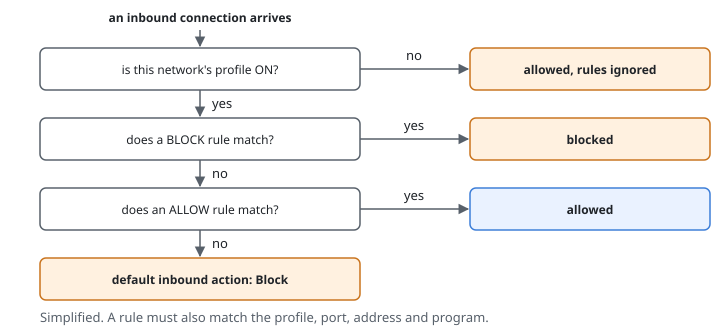

*Draft for owner review.* Protecting a Windows computer is done in **layers**: a firewall limits who can connect to it, antivirus looks for malicious files and behaviour, disk encryption protects the data if the machine is lost, and sign-in settings decide who can use it. No layer is enough alone. For each one, this lesson shows how to **check** it, how to **read** the answer, what is **normal**, and what to **do** when it is not. Built-in tools only.

**What was tested, and where.** The output marked as from the lab came from a **Windows Server 2022** evaluation VM (Windows PowerShell 5.1, elevated), using `tests/verification/powershell/protect1.ps1` and `protect2.ps1`; the VM was restored afterwards. **Not tested:** whether traffic is really blocked or allowed from a second computer (the rule behaviour described is from Microsoft's documentation), BitLocker (the VM has no TPM and the feature is not installed), a third-party antivirus, a management service, and Windows 10 or 11. Client Windows differs from Server in places the lesson points out.

| Layer | Protects against | First question to ask |
|---|---|---|
| Firewall | Unwanted network connections | Is every profile on? What is allowed in? |
| Antivirus | Malicious files and behaviour | Is it running, and are its signatures recent? |
| Disk encryption | A lost or stolen machine | Is the disk encrypted, and where is the recovery key? |
| Sign-in controls | Someone else using the machine or account | Who is an administrator? Does the screen lock? |

Run these commands in **PowerShell opened as administrator**. Reading some of this works without it, but changing it does not.

## Windows Defender Firewall

The firewall has **three profiles** (sets of settings). Windows picks one for **each network connection**:

| Profile | Used when |
|---|---|
| **Domain** | The computer can reach its organisation's domain controller on that network |
| **Private** | A network you marked as trusted, such as at home |
| **Public** | Everything else. Treat it as hostile |

### Which profile is in use?

Check this **first**, because a rule for the wrong profile does nothing.

```powershell
Get-NetConnectionProfile | Format-Table InterfaceAlias, NetworkCategory, IPv4Connectivity
```

```text
InterfaceAlias NetworkCategory IPv4Connectivity
-------------- --------------- ----------------
Ethernet                Public         Internet
```

The lab server treats its one network, `Ethernet`, as **Public**. So only rules that include the Public profile apply to connections arriving on it.

### Is it on, and what does it do by default?

[`Get-NetFirewallProfile`](https://learn.microsoft.com/powershell/module/netsecurity/get-netfirewallprofile) on its own shows the **stored** local settings:

```text
Name    Enabled DefaultInboundAction DefaultOutboundAction LogBlocked
----    ------- -------------------- --------------------- ----------
Domain     True        NotConfigured         NotConfigured      False
Private    True        NotConfigured         NotConfigured      False
Public     True        NotConfigured         NotConfigured      False
```

`NotConfigured` does not mean "no protection": it means nothing was set at this level, so a default applies. To see what is **in force**, ask the active policy store, which combines local settings, policy and defaults:

```powershell
Get-NetFirewallProfile -PolicyStore ActiveStore |
    Format-Table Name, Enabled, DefaultInboundAction, DefaultOutboundAction, LogBlocked
```

```text
Name    Enabled DefaultInboundAction DefaultOutboundAction LogBlocked
----    ------- -------------------- --------------------- ----------
Domain     True                Block                 Allow      False
Private    True                Block                 Allow      False
Public     True                Block                 Allow      False
```

| Column | Normal | Worry when |
|---|---|---|
| `Enabled` | `True` on all three | Any is `False` |
| `DefaultInboundAction` | `Block`: nothing gets in unless a rule allows it | `Allow` |
| `DefaultOutboundAction` | `Allow` on most machines | (`Block` is stricter and needs many rules) |
| `LogBlocked` | `False` by default, as here | You need to know **what** is being blocked and there is no log |

`netsh advfirewall show currentprofile` is the older view. In the lab it printed `State ON`, `Firewall Policy BlockInbound,AllowOutbound`, `LogDroppedConnections Disable` and the log file's path. You will meet it in older instructions.

### How it decides



```text
 profile off? ----------------> allowed (rules ignored)
 BLOCK rule matches? ---------> blocked
 ALLOW rule matches? ---------> allowed
 nothing matches -------------> default inbound action (normally Block)
```

Microsoft documents the [rule precedence](https://learn.microsoft.com/windows/security/operating-system-security/network-security/windows-firewall/rules): an allow rule overrides the default block, but **an explicit block rule wins over a conflicting allow rule**. So if you added an allow rule and the connection still fails, look for a block rule, and check the profile.

### Allow one port, not everything

Suppose a program needs TCP port 8088. Create **one** rule, only for the profiles that need it ([`New-NetFirewallRule`](https://learn.microsoft.com/powershell/module/netsecurity/new-netfirewallrule)):

```powershell
New-NetFirewallRule -DisplayName 'WinLab test 8088' -Direction Inbound -Protocol TCP `
    -LocalPort 8088 -Action Allow -Profile Private, Domain
```

Then **read it back**. A rule's details are split into separate objects:

```powershell
$r = Get-NetFirewallRule -DisplayName 'WinLab test 8088'
$r | Format-List DisplayName, Enabled, Direction, Action, Profile
$r | Get-NetFirewallPortFilter    | Format-List Protocol, LocalPort
$r | Get-NetFirewallAddressFilter | Format-List RemoteAddress
```

```text
DisplayName : WinLab test 8088
Enabled     : True
Direction   : Inbound
Action      : Allow
Profile     : Domain, Private

Protocol  : TCP
LocalPort : 8088

RemoteAddress : Any
```

Check every line: `Profile` (this rule does **nothing** on the lab's Public network), `LocalPort`, and `RemoteAddress : Any`, which means any computer may connect. Narrow it with `-RemoteAddress` when only some should.

**A trap:** the display name is not unique. I ran `New-NetFirewallRule` again with the same name (this time without `-Profile`) and there were **two** rules, the second for `Any` profile. A script that runs every day would add a rule every day. Check first:

```powershell
if (-not (Get-NetFirewallRule -DisplayName 'WinLab test 8088' -ErrorAction SilentlyContinue)) {
    # create it
}
```

To **audit** what is open on a port, start from the port filter:

```powershell
Get-NetFirewallPortFilter -Protocol TCP | Where-Object LocalPort -eq '8088' |
    Get-NetFirewallRule | Format-Table DisplayName, Enabled, Action, Profile
```

```text
DisplayName      Enabled Action         Profile
-----------      ------- ------         -------
WinLab test 8088    True  Allow Domain, Private
WinLab test 8088    True  Allow             Any
```

This finds rules that name exactly that port; a rule for a **range**, for **Any** port, or for a **program** can allow the same traffic without appearing here. `Remove-NetFirewallRule -DisplayName 'WinLab test 8088'` removed **both**. For scale, the lab server had 150 inbound rules, 52 of them enabled, all 52 of those allowing. You are not expected to know each: look for rules that are new, unexpected or wider than needed.

### When a profile is off

[`Set-NetFirewallProfile`](https://learn.microsoft.com/powershell/module/netsecurity/set-netfirewallprofile) turns it on again:

```powershell
Set-NetFirewallProfile -Profile Domain,Private,Public -Enabled True
Get-NetFirewallProfile -PolicyStore ActiveStore | Format-Table Name, Enabled   # verify
```

With a profile **off**, its filtering stops: nothing is blocked, and its rules, **including block rules**, have no effect. That is why "I turned it off to test" is a finding in a security audit. If turning it off "fixed" a program, that tells you a rule is missing: turn it back on and add that one rule.

### Who changed it?

The firewall writes changes to its own event log:

```powershell
Get-WinEvent -LogName 'Microsoft-Windows-Windows Firewall With Advanced Security/Firewall' -MaxEvents 10
```

In the lab, adding a rule logged event **2004**, deleting one **2006**, and switching the Public profile off logged **2003**:

```text
A Windows Defender Firewall setting in the Public profile has changed.
New Setting:
    Type:                   Enable Windows Defender Firewall
    Value:                  No
    Modifying User:         S-1-5-21-...-500
    Modifying Application:  C:\Windows\System32\wbem\WmiPrvSE.exe
```

`Modifying User` is a **SID** (an account's identifier); one ending in `-500` is the built-in Administrator account. `Modifying Application` is **not** `powershell.exe`: these cmdlets work through the management service WMI, so WMI's process is recorded. The log tells you **which account** and **when**, but not always which script.

## Microsoft Defender Antivirus

```powershell
Get-MpComputerStatus | Format-List AMRunningMode, AntivirusEnabled, RealTimeProtectionEnabled,
    BehaviorMonitorEnabled, IsTamperProtected, AntivirusSignatureLastUpdated,
    AntivirusSignatureAge, QuickScanAge, QuickScanEndTime
```

[`Get-MpComputerStatus`](https://learn.microsoft.com/powershell/module/defender/get-mpcomputerstatus) on the lab server:

```text
AMRunningMode                 : Normal
AntivirusEnabled              : True
RealTimeProtectionEnabled     : True
BehaviorMonitorEnabled        : True
IsTamperProtected             : False
AntivirusSignatureLastUpdated : 7/28/2020 7:44:27 PM
AntivirusSignatureAge         : 2312
QuickScanAge                  : 4294967295
QuickScanEndTime              :
```

**Read all of it.** Every "enabled" line says `True`, and this machine is still badly protected:

| Line | Meaning | Here |
|---|---|---|
| `AMRunningMode` | `Normal` means Defender is the active antivirus | Normal |
| `RealTimeProtectionEnabled` | Files are checked as they are used | On: good |
| `AntivirusSignatureAge` | Days since the **signatures** (the descriptions of known threats) were updated. Normally 0 or a few | **2312 days**: over six years old, because this evaluation image had not been updated |
| `QuickScanAge` | Days since the last quick scan. `4294967295` is the largest number this field can hold; with an empty `QuickScanEndTime` it means **no scan has been recorded** | Never scanned |
| `IsTamperProtected` | Whether Tamper Protection guards these settings against changes | `False` here |

The service itself is `WinDefend` (and the firewall's is `mpssvc`); both were `Running` and `Automatic`.

**What to do:** update, then check the date again, because the command succeeding is not the proof:

```powershell
Update-MpSignature
(Get-MpComputerStatus).AntivirusSignatureLastUpdated
Start-MpScan -ScanType QuickScan
Get-MpThreatDetection        # what has been found
```

(`Update-MpSignature` needs a connection to an update source; I did not run it.) A scan of a clean folder with `Start-MpScan -ScanType CustomScan -ScanPath C:\wltest` **printed nothing** and `Get-MpThreatDetection` returned nothing. Silence is normal for a scan, but with signatures this old, "nothing found" is weak evidence. The log `Microsoft-Windows-Windows Defender/Operational` and [its event IDs](https://learn.microsoft.com/defender-endpoint/troubleshoot-microsoft-defender-antivirus) record what the engine did.

### Another antivirus product

What Defender does when another product is installed **depends on the machine** ([compatibility](https://learn.microsoft.com/defender-endpoint/microsoft-defender-antivirus-compatibility)):

| Machine | With a non-Microsoft antivirus |
|---|---|
| Windows 10 or 11, **not** onboarded to Defender for Endpoint | Defender is **disabled** automatically (Windows 11 with Smart App Control may show **passive** mode instead) |
| **Windows Server**, not onboarded | Defender is **not** switched off for you: Microsoft's table says it is disabled **manually** |
| Onboarded to Microsoft Defender for Endpoint | Defender can run in **passive** mode; on Server this must be configured |

So "Defender is not active" can be expected, but only when you can **name the product that is protecting the machine** and show that it is running and up to date.

### Exclusions are a finding until explained

An **exclusion** tells Defender **not to check** a file, folder, process or file type. Software vendors sometimes ask for one, and attackers add them so their files are ignored.

```powershell
$p = Get-MpPreference                     # run elevated
$p.ExclusionPath; $p.ExclusionProcess; $p.ExclusionExtension
```

The lab server had none. When I added one with `Add-MpPreference -ExclusionPath C:\wltest`, Defender logged event **5007**:

```text
Microsoft Defender Antivirus Configuration has changed. If this is an unexpected event
you should review the settings as this may be the result of malware.
    Old value:
    New value: HKLM\SOFTWARE\Microsoft\Windows Defender\Exclusions\Paths\C:\wltest = 0x0
```

**Do not just take the newest 5007.** Many settings use that ID: in one run the newest was an unrelated internal value. Filter by text:

```powershell
Get-WinEvent -FilterHashtable @{ LogName = 'Microsoft-Windows-Windows Defender/Operational'; Id = 5007 } |
    Where-Object Message -match 'Exclusions'
```

Remove one with `Remove-MpPreference -ExclusionPath <path>`, after finding out why it was there ([about exclusions](https://learn.microsoft.com/defender-endpoint/configure-exclusions-microsoft-defender-antivirus)). An exclusion for a whole drive, a Temp folder or a user's Downloads folder is especially dangerous.

## Disk encryption

Signing in protects a **running** Windows. It does not protect a disk taken out of the machine and read elsewhere. **BitLocker** encrypts a volume so that the data cannot be read without a key ([overview](https://learn.microsoft.com/windows/security/operating-system-security/data-protection/bitlocker/)).

- A **key protector** is a way to unlock the volume. A **TPM** (a security chip) can unlock the system disk automatically when the startup process is unchanged. A **recovery password** (48 digits) is for when that fails, for example after some firmware or hardware changes.
- **The recovery key must be stored somewhere safe, away from that disk, before it is needed**, such as in Active Directory, Microsoft Entra ID or the management service. If every protector fails and nobody has the key, the data is gone.
- Microsoft lists **Pro, Enterprise and Education** editions for turning BitLocker on. **Device encryption** is a simpler, automatic form that is available on **all editions, including Home**, on hardware that qualifies.
- An unlocked, running computer is not protected by it: whoever is signed in can read the files.

### Checking it

```text
manage-bde -status
```

I could not run this in the lab: on the server the feature was only `Available` (not installed), so there was **no** `manage-bde.exe` and no `Get-BitLockerVolume`, and `Get-Tpm` reported `TpmPresent : False`. A missing command therefore means "BitLocker is not set up here", not "the disk is fine". This is the example output in Microsoft's [operations guide](https://learn.microsoft.com/windows/security/operating-system-security/data-protection/bitlocker/operations-guide):

```text
Volume C: [Local Disk]
[OS Volume]

    Size:                 1000 GB
    BitLocker Version:    2.0
    Conversion Status:    Used Space Only Encrypted
    Percentage Encrypted: 100.0%
    Encryption Method:    XTS-AES 128
    Protection Status:    Protection On
    Lock Status:          Unlocked
    Identification Field: Unknown
    Key Protectors:
        TPM
        Numerical Password
```

| Line | Read it as |
|---|---|
| `Percentage Encrypted` | How much is encrypted so far; encryption can still be in progress |
| `Protection Status` | **The line that matters.** A disk can be 100 % encrypted with protection **off** (suspended, as is done for some maintenance), and then it is not protected |
| `Key Protectors` | The ways to unlock it. `Numerical Password` is the recovery password; check that a copy has been saved |

## Sign-in and account protection

- **Fewer administrators, and standard accounts for daily work.** See who is in the group: `Get-LocalGroupMember Administrators`. On the lab server it listed only the built-in `Administrator`; `Get-LocalUser` showed `Guest` and `DefaultAccount` disabled, which is what you want.
- **Keep UAC on.** `(Get-ItemProperty 'HKLM:\SOFTWARE\Microsoft\Windows\CurrentVersion\Policies\System').EnableLUA` was `1` (on).
- **Lock the screen after inactivity.** The policy is [**Interactive logon: Machine inactivity limit**](https://learn.microsoft.com/previous-versions/windows/it-pro/windows-10/security/threat-protection/security-policy-settings/interactive-logon-machine-inactivity-limit). The value I expected to hold it, `InactivityTimeoutSecs` in the same registry key, was **absent** on the lab server; I did not set the policy to confirm the name. Absent does not prove that nothing locks the screen: a screen saver or a management policy can.
- **Password and lockout rules** for local accounts are shown by `net accounts`. This evaluation server reported `Minimum password length: 0` and `Lockout threshold: Never`: unlimited guesses, and no minimum. Fine for a throwaway lab, a finding anywhere else. In a domain these come from domain policy.
- **Stronger sign-in:** Windows Hello for Business (PIN or biometrics) or multifactor authentication (MFA) with a cloud identity.

## Compliance

A management service such as Microsoft Intune checks each device against rules (encryption on, firewall on, antivirus current, OS version recent) and marks it **compliant** or not; access to company data can then **require** a compliant device ([compliance policies](https://learn.microsoft.com/intune/intune-service/protect/device-compliance-get-started)). I had no management service to test.

The checks are about the same facts you can read yourself, so verify a "non-compliant" report by hand:

| The report says | Look at |
|---|---|
| Firewall | `Get-NetFirewallProfile -PolicyStore ActiveStore` |
| Antivirus off or out of date | `Get-MpComputerStatus`: running mode, real-time protection, signature **age** |
| Not encrypted | `manage-bde -status`: **Protection Status** |
| OS too old | `winver`, or `Get-CimInstance Win32_OperatingSystem \| Select-Object Caption, Version` |

A report shows what the service saw **the last time the device checked in**. If your reading disagrees, check when that was before changing the machine.

## Common mistakes

- **Reading only `Enabled : True`** and missing signatures that are years old.
- **Adding a rule to the wrong profile**, without checking `Get-NetConnectionProfile`.
- **Switching the firewall off to test**, and leaving it off.
- **Running a rule-creating script repeatedly** and piling up duplicate rules.
- **Treating `NotConfigured` as "off".**
- **Saying a disk is protected because it is 100 % encrypted** while protection is suspended.
- **Encrypting without checking that the recovery key was saved somewhere else.**
- **Ignoring exclusions** during a malware investigation.

## Check yourself

1. A scan says "firewall disabled". Which command shows which profile, and which fixes it?
2. Why must a BitLocker recovery key be saved before the drive is encrypted?
3. A server with another antivirus product still has Defender active. Is that surprising?
4. You added an inbound allow rule, but connections still fail. Name two things to check.
5. `RealTimeProtectionEnabled` is `True` and `AntivirusSignatureAge` is 2312. Is the machine well protected?
6. `manage-bde -status` shows `Percentage Encrypted: 100.0%` and `Protection Status: Protection Off`. What does it mean?

**Expected answers:** (1) `Get-NetFirewallProfile` (with `-PolicyStore ActiveStore` for what is in force); `Set-NetFirewallProfile -Profile Domain,Private,Public -Enabled True`, then read it again; (2) it is needed exactly when the normal way of unlocking fails, and then it cannot be recovered from the locked disk; (3) no: Windows Server does not switch Defender off or to passive mode by itself; it has to be configured; (4) that the rule's profile matches the connection's profile, and that no block rule also matches (and the port, address and program); (5) no: the signatures are more than six years old; update them and check the date; (6) the data is encrypted but protection is not active (for example suspended), so the disk is not protected until it is resumed.
