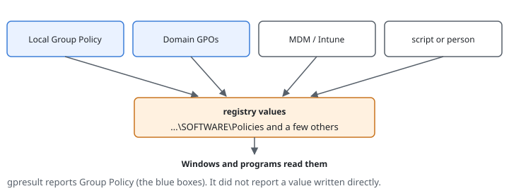

*Draft for owner review.* A fleet of Windows machines stays healthy when updates arrive on a schedule and settings are applied by policy instead of by hand. This lesson shows how to check whether a machine is really being updated, where policy settings live, how to work out **who set** a setting, and how to change registry policy without making things worse. Built-in tools only.

**What was tested, and where.** Output is from a **Windows Server 2022** evaluation VM (Windows PowerShell 5.1, elevated), using `tests/verification/powershell/update1.ps1`; the VM was restored afterwards. Policy experiments used a made-up key, `HKLM\SOFTWARE\Policies\WinLabDemo`. **Not tested:** searching for or installing updates on purpose, WSUS, Intune or other management services, domain Group Policy, `gpedit.msc`, and client Windows.

## How updates reach a machine

The **Windows Update** service (`wuauserv`) and its helpers find, download and install updates. They come from Microsoft directly, or from a managed source: a **WSUS** server, or [Windows Update client policies](https://learn.microsoft.com/windows/deployment/update/waas-manage-updates-wufb) set by Group Policy or a management service.

| Type | What it is |
|---|---|
| **Quality** update | Fixes, including security; usually monthly. Windows quality updates are **cumulative** ([guide](https://learn.microsoft.com/windows/deployment/update/waas-quick-start)) |
| **Feature** update | A new Windows version |
| **Driver** update | Hardware drivers |
| **Definition** update | Defender's threat signatures, several times a day |

**Deployment rings** and **deferrals** let an administrator send updates to a pilot group first and hold them back from others for a set number of days.

### Check the services

```powershell
Get-Service wuauserv, bits, cryptsvc, UsoSvc, TrustedInstaller |
    Format-Table Name, DisplayName, Status, StartType
```

```text
Name             DisplayName                              Status StartType
bits             Background Intelligent Transfer Service Stopped    Manual
cryptsvc         Cryptographic Services                  Running Automatic
TrustedInstaller Windows Modules Installer               Stopped    Manual
UsoSvc           Update Orchestrator Service             Stopped Automatic
wuauserv         Windows Update                          Running    Manual
```

**`Stopped` with `Manual` is not a fault.** Several of these start only when needed (`sc.exe qtriggerinfo wuauserv` lists events that start it), and stop again when idle. What is a fault: a start type of **`Disabled`**, which means nothing can start it. Change a start type only when you know what it should be on a healthy machine of the same version.

### What has been installed

```powershell
Get-HotFix | Sort-Object InstalledOn -Descending |
    Select-Object -First 5 HotFixID, Description, InstalledOn
```

```text
HotFixID  Description     InstalledOn
KB5010523 Update          3/3/2022 12:00:00 AM
KB5011497 Security Update 3/3/2022 12:00:00 AM
KB5008882 Update          3/3/2022 12:00:00 AM
```

**Read the dates.** The newest is from **March 2022**: this machine is years behind, which is expected for an evaluation image and alarming anywhere else. A `KB` number can be searched in Microsoft's update catalogue and support pages.

[`Get-HotFix`](https://learn.microsoft.com/powershell/module/microsoft.powershell.management/get-hotfix) is **not a complete list**: it reads the `Win32_QuickFixEngineering` class, which covers updates installed by Windows' component servicing, not everything (drivers and application updates, for example). The **Windows Update Agent** keeps its own history:

```powershell
$searcher = (New-Object -ComObject Microsoft.Update.Session).CreateUpdateSearcher()
$count = $searcher.GetTotalHistoryCount()
$searcher.QueryHistory(0, $count) | Select-Object -First 10 Date, ResultCode, HResult, Title
```

Here `GetTotalHistoryCount()` returned **0** while three hotfixes were listed: they had not been installed through the agent on this system, so **neither list alone is the whole truth**. When there are entries, each [history entry](https://learn.microsoft.com/windows/win32/api/wuapi/nn-wuapi-iupdatehistoryentry) has a [`ResultCode`](https://learn.microsoft.com/windows/win32/api/wuapi/ne-wuapi-operationresultcode): **2** succeeded, 3 succeeded with errors, **4 failed**, 5 aborted. For a failure, note `HResult` in hexadecimal (`'0x{0:X8}' -f $_.HResult`) and search for that code.

### The update log

```powershell
Get-WinEvent -LogName Microsoft-Windows-WindowsUpdateClient/Operational -MaxEvents 10
```

```text
TimeCreated           Id LevelDisplayName First line
11/26/2026 8:45:20 PM 26 Information      Windows Update successfully found 0 updates.
11/26/2026 8:45:14 PM 26 Information      Windows Update successfully found 1 updates.
11/8/2026 3:38:04 AM  41 Information      An update was downloaded.
```

Read it as a story, newest first: did it **search**, **find**, **download**, **install**? Find the **first step that is missing or fails**. "Successfully found 1 updates" means a search worked, **not** that anything was installed. For deeper detail, [`Get-WindowsUpdateLog`](https://learn.microsoft.com/powershell/module/windowsupdate/get-windowsupdatelog) turns the trace files into a text log (not run here).

### When updates stop

| Step | Check | Command |
|---|---|---|
| 1 | Service start types | `Get-Service wuauserv, bits, cryptsvc` |
| 2 | **Policy** that limits or redirects updates | `Get-ItemProperty` on the policy keys below; `gpresult /h` |
| 3 | Free disk space | `Get-PSDrive C` (the lab had 37.2 GB free) |
| 4 | The update log and history, for the failing step and code | the two commands above |
| 5 | A restart that is waiting to finish earlier updates | below |

On the lab server both of these common markers were `False`:

```powershell
Test-Path 'HKLM:\SOFTWARE\Microsoft\Windows\CurrentVersion\WindowsUpdate\Auto Update\RebootRequired'
Test-Path 'HKLM:\SOFTWARE\Microsoft\Windows\CurrentVersion\Component Based Servicing\RebootPending'
```

They are widely used indicators, not a complete or documented test: `False` does not guarantee that nothing is waiting.

## Where policy lives

A **policy** is a setting that an administrator wants **enforced**. Much of Windows' policy ends up as **registry values** that the system and programs read:

| Source | Applies to | Managed with |
|---|---|---|
| Local Group Policy | This machine | `gpedit.msc` (Pro and up) |
| Domain Group Policy | Users and computers in the domain | Group Policy Management |
| MDM, such as Intune | Enrolled devices | The management service |
| Direct registry write | One machine | `reg`, `Set-ItemProperty`: a script or a person |



```text
 Local GP    Domain GPO    MDM    script/person
      \          |          |         /
              registry values   (...\SOFTWARE\Policies and a few others)
                       |
          Windows and programs read them
```

Look first in `HKLM:\SOFTWARE\Policies` (the computer) and `HKCU:\SOFTWARE\Policies` (the signed-in user), and in older places such as `...\CurrentVersion\Policies\System`. A fresh lab server **already had** several keys under `HKLM:\SOFTWARE\Policies\Microsoft`, so **finding a key there does not show that someone changed anything**. Compare with a healthy machine, and read the **values**.

## Finding who set it

### `gpresult`

```text
gpresult /r /scope computer       a summary
gpresult /h report.html           a full report in HTML
```

([`gpresult`](https://learn.microsoft.com/windows-server/administration/windows-commands/gpresult); the computer part needs an elevated prompt.) The lab's summary, shortened:

```text
Last time Group Policy was applied: 11/26/2026 at 8:45:25 PM
Group Policy was applied from:      N/A

Applied Group Policy Objects
    N/A

The following GPOs were not applied because they were filtered out
    Local Group Policy
        Filtering:  Not Applied (Empty)
```

Read **when** policy was last applied, **from** which domain controller, the **applied** objects, and the **filtered out** ones with the reason. Here: no domain, and Local Group Policy is empty.

### What `gpresult` does not show

I wrote a value straight into the registry under `SOFTWARE\Policies`, then ran [`gpupdate /force`](https://learn.microsoft.com/windows-server/administration/windows-commands/gpupdate), which reapplies policy:

```text
Computer Policy update has completed successfully.
value after gpupdate: 1                           <- still there
gpresult report mentions WinLabDemo: False        <- not reported
```

So:

- **`gpresult` reporting nothing does not mean no policy value exists.**
- **`gpupdate` does not clean up** a value that Group Policy did not put there.

This is how a "temporary" registry tweak survives for years. To find such values, read the registry.

### Reading the clues

| You observe | It suggests |
|---|---|
| The value appears in a `gpresult` report | A Group Policy Object: change it **in that GPO** |
| You delete it, and it **comes back** after a policy refresh or restart | Something is re-applying it: Group Policy, a management service, a script or a scheduled task. **Fix it at the source** |
| It is not in `gpresult` and stays deleted | Probably a direct write |
| Settings says some settings are managed by your organization | Some policy or management source has set something |

## Editing registry policy safely

1. **Find out who set it.** If a GPO or a management service owns it, change it there.
2. **Export** the key ([`reg export`](https://learn.microsoft.com/windows-server/administration/windows-commands/reg-export)).
3. **Change one value.**
4. **Test the behaviour**, not just the registry, and write down what you changed.

```text
reg export HKLM\SOFTWARE\Policies\WinLabDemo before.reg /y
```

```text
Windows Registry Editor Version 5.00

[HKEY_LOCAL_MACHINE\SOFTWARE\Policies\WinLabDemo]
"Setting"=dword:00000001
```

### Importing a backup does not undo everything

After the export I changed `Setting` to `0` and added a new value, `AddedLater`. Then I imported the backup ([`reg import`](https://learn.microsoft.com/windows-server/administration/windows-commands/reg-import)):

```text
changed:       Setting=0   AddedLater=oops
after import:  Setting=1   AddedLater=oops      <- the new value is still there
```

**An import merges.** It puts back what is in the file and **leaves anything added since**. To undo a change completely, delete the values (or the key) **you** added, then import. Deleting a key removes everything under it, so do that only for a key whose whole contents you have in your export and understand. After deleting my demo key and importing, only `Setting : 1` remained. **Never delete a broad key such as `SOFTWARE\Policies`.**

### Absent, 0 and 1 are three different states

"Not configured" usually means the value is **absent**, and Windows uses its default. Setting `0` is an explicit setting, and for some policies it means something different. A PowerShell test can hide the difference:

| State | `$v` | `$v -eq 0` | `-not $v` | Value exists? |
|---|---|---|---|---|
| absent | empty | False | **True** | no |
| 0 | 0 | True | **True** | yes |
| 1 | 1 | False | False | yes |

`if (-not $v)` treats "not configured" and "set to 0" **as the same thing**. To ask whether a value **exists**:

```powershell
(Get-Item -LiteralPath $key).GetValueNames() -contains 'Setting'
```

To return a setting to "not configured", **remove the value** (`Remove-ItemProperty`); do not just set it to 0.

## Common mistakes

- **Treating a stopped, `Manual` update service as broken.**
- **Believing "found updates" means "installed".**
- **Trusting one list** of installed updates.
- **Assuming `gpresult` shows every policy value.**
- **Fixing on the machine** a setting that a GPO or management service will put back.
- **Thinking a `.reg` import removes added values.**
- **Setting a policy to 0** when you meant "not configured".

## Check yourself

1. Updates have stopped. What are three things to check, in order?
2. You delete a policy value and it comes back after a restart. What does that tell you?
3. Why export a registry key before editing it?
4. `wuauserv` shows `Stopped` and `Manual`. Is that the problem?
5. `gpresult` shows no applied policies. Can a policy value still be in the registry?
6. You export a key, add a value, then import the export. Is the new value gone?

**Expected answers:** (1) the services' start types, then policy that limits or redirects updates, then free disk space (then the log and history, and any pending restart); (2) something is re-applying it, such as Group Policy, a management service, a script or a task: change it at the source; (3) so that you have the earlier values to return to; (4) not by itself: it starts when needed; `Disabled` would be a fault; (5) yes: a direct write is not reported, and `gpupdate` leaves it; (6) no: import merges, so you must remove what you added.
