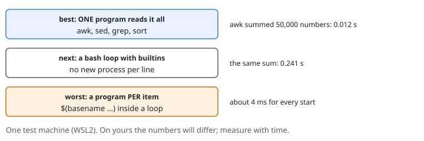

*Draft for owner review.* This lesson collects the bash features that make large scripts shorter, safer and faster: **`mapfile`** for reading lines into arrays, **namerefs** for passing arrays and variables by name, **`printf -v`** and the string operators that avoid starting programs, **`declare`** and its attributes, **`shopt`** options (globbing, `lastpipe`), **programmable completion**, a **measured** comparison of builtins against external programs, and a few more tools (`wait -n`, `coproc`, `BASH_REMATCH`, `read -t`). It ends with the question every advanced script must answer: **which bash versions does it need, and what does it do on a machine with an older one?**

**What was tested, and where.** Everything below was run on **Ubuntu 26.04 (WSL2)** with **bash 5.3.9** (`tests/verification/bash/adv1.sh`). **Not tested:** any other bash version: I had **no bash 3.2 or 4.x** to run. The table of "needs bash N" near the end is **not from my memory**: I looked every feature up in the bash project's own changelog, the [NEWS file](https://tiswww.case.edu/php/chet/bash/NEWS) (downloaded 2026-11-21, read by section), so it says when each feature was **added**, but I did not run the examples on those older versions. Also not tested: interactive completion at a real terminal (I tested the completion *function* and `compgen`, simulating what readline does), `select` at a terminal, and non-Linux systems. All timings are from **one machine**, where `basename`, `cat`, `wc`, `tr` and `sort` are the Rust **uutils** coreutils (`foundations.bash-text-processing`); numbers on GNU coreutils or a native Linux install will differ, the **ratios** are the point.

Everything here is **bash**, not POSIX `sh`: a script that uses it starts `#!/usr/bin/env bash` (or `#!/bin/bash`), never `#!/bin/sh` (`foundations.shells-and-posix`). Reference: the [Bash Reference Manual](https://tiswww.case.edu/php/chet/bash/bashref.html), in particular [Shell Parameter Expansion](https://tiswww.case.edu/php/chet/bash/bashref.html#Shell-Parameter-Expansion), [Arrays](https://tiswww.case.edu/php/chet/bash/bashref.html#Arrays), [Bash Builtins](https://tiswww.case.edu/php/chet/bash/bashref.html#Bash-Builtins) (`mapfile`, `declare`, `printf`, `read`, `shopt`), [The Shopt Builtin](https://tiswww.case.edu/php/chet/bash/bashref.html#The-Shopt-Builtin) and [Programmable Completion](https://tiswww.case.edu/php/chet/bash/bashref.html#Programmable-Completion). I checked that the manual's main page loads; I did not re-read each section, so the behaviour below comes from my own runs.

## Arrays with `mapfile`

`mapfile` (also called `readarray`) reads lines into an **indexed array** with no loop and no word splitting. A file with the lines `one`, `two words`, `three`:

```text
mapfile a < lines.txt;    printf "[%s]" "${a[@]}"     -> [one\n][two words\n][three\n]   n=3   (newlines kept)
mapfile -t a < lines.txt; printf "[%s]" "${a[@]}"     -> [one][two words][three]         n=3   (-t strips them)
a=($(cat lines.txt));     n=${#a[@]}                  -> n=4   [one][two][words][three]         (the word-splitting trap)
mapfile -t -n 2 a < lines.txt   -> one two words        (-n: at most 2 lines)
mapfile -t -s 1 a < lines.txt   -> two words three      (-s: skip the first 1)
```

**Use `mapfile -t`** whenever you need lines in an array; `a=($(cmd))` splits on spaces and expands globs (the lesson on expansion shows why).

### File names: NUL-separated

Names can contain newlines, but never a NUL byte. `find -print0` plus `mapfile -d ''` is the safe way to collect them:

```text
touch "a b" c
mapfile -d "" -t f < <(find . -maxdepth 1 -type f -name "[ac]*" -print0 | sort -z); printf "[%s]" "${f[@]}"
   -> [./a b][./c]
```

(`mapfile -d` was added in bash 4.4; see the version section.)

### Pipes lose the array; `< <(...)` and `lastpipe` keep it

Each part of a pipeline runs in a subshell, so what it sets is gone afterwards:

```text
echo x | mapfile -t a; echo "pipe: n=${#a[@]}"            -> pipe: n=0
mapfile -t a < <(echo x); echo "procsub: n=${#a[@]}"      -> procsub: n=1
shopt -s lastpipe; echo x | mapfile -t a; echo "lastpipe: n=${#a[@]}"   -> lastpipe: n=1
```

`< <(command)` (process substitution) works in every bash that has it. `shopt -s lastpipe` runs the **last** part of a pipeline in the current shell. I tested it only **in scripts**; the manual ties it to job control being off (as in a script), and I did not test an interactive shell. The same counter test:

```text
n=0; printf "a\nb\nc\n" | while read -r l; do n=$((n+1)); done; echo "n=$n"      -> n=0     (the loop was in a subshell)
shopt -s lastpipe; ...the same...                                                -> n=3
n=0; while read -r l; do n=$((n+1)); done < <(printf "a\nb\nc\n"); echo "n=$n"   -> n=3     (process substitution)
```

### Edge cases that matter

```text
mapfile -t a < /dev/null; echo "n=${#a[@]}"                      -> n=0
printf "a\nb" > nn.txt; mapfile -t a < nn.txt; echo "n=${#a[@]} last=[${a[1]}]"   -> n=2 last=[b]   (no trailing newline: kept)
printf "a\nb" | while read -r l; do echo "[$l]"; done                   -> [a]            (the unterminated last line is DROPPED)
printf "a\nb" | while read -r l || [ -n "$l" ]; do echo "[$l]"; done    -> [a] [b]        (the usual fix)
```

`mapfile` keeps a last line with no newline; a plain `while read` loop loses it unless you add `|| [ -n "$l" ]`. `mapfile -t -c 1 -C callback a < file` calls `callback INDEX LINE` every `-c` lines (the test printed `chunk at index 0`, `1`, `2`), useful for progress output on huge files.

## Namerefs

A **nameref** (`declare -n` or, inside a function, `local -n`) is a variable that **refers to another variable by name**. It lets a function fill or read the caller's variable or array without `eval` and without printing and capturing output:

```text
fill() { local -n out=$1; out=(x y z); }; fill result; echo "${result[@]}"     -> x y z
n=1; declare -n r=n; r=5; echo "n=$n"                                         -> n=5
a=(p q r); declare -n e=a[1]; e=Q; echo "${a[@]}"                             -> p Q r         (a nameref to one element)
a=(1 2); b=(3 4 5); for name in a b; do declare -n arr=$name; echo "$name has ${#arr[@]}"; unset -n arr; done
   -> a has 2 | b has 3          (one loop over several arrays by name)
```

Two details:

- **`unset r` removes the variable the nameref points to; `unset -n r` removes the nameref.** Tested: `unset r` left `x=[unset]`, `unset -n r` left `x=[1] r=[unset]`.
- **Name clashes.** If the function's own variable has the same name as the caller's, the reference points at itself. This run (bash 5.3.9) **printed warnings and lost the value**:

```text
f() { local -n out=$1; out=1; }; g() { local out; f out; echo "g: out=$out"; }; g
   -> local: warning: out: circular name reference | warning: out: circular name reference |
      warning: out: maximum nameref depth (8) exceeded | g: out=
declare -n a=b; declare -n b=a; echo "[$a]"      -> warning: a: circular name reference | []
```

Give the nameref a **name the callers will not use** (`local -n _out=$1`, with a leading underscore as a convention), and document that the caller must not pass a variable with that name. Before namerefs, scripts used `eval "$1=..."` or `printf -v "$1" ...`; the latter is still fine for a scalar (next section) and needs no extra version.

## `printf -v` and friends: build values without forks

`printf -v VAR format args` writes into a variable instead of to the terminal, so no `$( )` and no extra process:

```text
printf -v s "%05d-%s" 42 ab; echo "$s"          -> 00042-ab
printf -v "a[2]" "%s" X; declare -p a           -> declare -a a=([2]="X")
printf "[%s]" a b c; echo                       -> [a][b][c]          (the format is reused for extra arguments)
printf "%q\n" "it's a \"test\" \$HOME"          -> it\'s\ a\ \"test\"\ \$HOME     (quoted so it can be pasted back into bash)
printf "%(%Y-%m-%d)T\n" -1                      -> today's date, without running date
```

(`printf '%(%Y-%m-%d)T' 0` printed `1969-12-31`: the argument is a time in seconds since 1970, shown in the **local time zone**, and `-1` means "now"; I did not check what the other values depend on.) Related built-in variables: `$EPOCHSECONDS` (seconds since 1970; tested `> 1700000000`), `$EPOCHREALTIME` (with microseconds, tested format `NNN.NNNNNN`), `$SECONDS` (seconds since the shell started; settable: `SECONDS=0; sleep 1` gave `SECONDS=1`).

More parameter-expansion operators that replace `tr`, `sed`, `basename` (all tested on 5.3.9; `${v@U}` and `${v@L}` need bash 5.1 and `${v@Q}` 4.4 according to the NEWS file, see the version table):

```text
v="Hello"; echo "${v@U} ${v@L} ${v^^} ${v,,}"       -> HELLO hello HELLO hello
v="a b'c"; echo "${v@Q}"                             -> 'a b'\''c'                    (quoted for reuse)
app_a=1 app_b=2; echo "${!app_*}"                    -> app_a app_b                  (variable NAMES with a prefix)
a=(a b c d); echo "${a[@]:1:2} / ${a[-1]} / ${!a[@]}"  -> b c / d / 0 1 2 3          (slice, last element, indexes)
```

## `declare`: types and attributes

`declare` sets a variable's **attributes**; `declare -p` shows them (the quickest way to see what a variable really is):

```text
declare -a a=(1 "b c"); declare -A m=([k]=v); declare -i n=5; declare -r r=1; declare -x e=2; declare -p a m n r e
   declare -a a=([0]="1" [1]="b c")
   declare -A m=([k]="v" )
   declare -i n="5"
   declare -r r="1"
   declare -x e="2"
```

| Attribute | Meaning | Tested |
|---|---|---|
| `-a` / `-A` | indexed / associative array | see below |
| `-i` | integer: arithmetic on assignment | `declare -i n; n=2+3` gave `5`; `n=abc` gave `n=0` |
| `-r` | read-only | `r=2` failed: `r: readonly variable`, rc 1; `unset r` failed: `cannot unset: readonly variable` |
| `-l` / `-u` | lower / upper-case on assignment | `declare -l lo=ABC; declare -u up=abc` gave `abc ABC` |
| `-x` | exported to child processes | |
| `-n` | nameref | above |
| `-g` | **global**, even inside a function | `f() { declare -g v=inner; }` set the global; plain `declare` inside a function is **local** (`outer` was kept) |

`declare -f name` prints a function's definition (`f ()` then `{`, `echo hi`, `}`); `declare -F` lists function **names** (`declare -f f;declare -f g;`).

### Associative arrays

```text
declare -A m=([b]=2 [a]=1 [c]=3); for k in "${!m[@]}"; do printf "%s " "$k"; done    -> c b a      (no useful order)
... for k in $(printf "%s\n" "${!m[@]}" | sort); do ...                                -> a=1 b=2 c=3   (sort the keys yourself)
m[b]=2; m[a]=1; echo "${#m[@]} ${m[0]}"        -> 1 1     (without declare -A it is an INDEXED array, and b and a were both index 0)
declare -A m=([k]=v); [[ -v m[k] ]] && echo "k set"; [[ -v m[zz] ]] || echo "zz unset"    -> k set | zz unset
a=(1 2 3); b=("${a[@]}"); b[0]=X; echo "${a[*]} / ${b[*]}"     -> 1 2 3 / X 2 3      (copying an array)
a=(); a[5]=x; a[9]=y; echo "len=${#a[@]} idx=${!a[@]}"         -> len=2 idx=5 9       (sparse: length counts elements, not the highest index)
```

Always write **`declare -A`** before using string keys, or the keys are evaluated as arithmetic and you silently get one element. The order of an associative array **is not** insertion order; sort the keys when the order matters. As far as I know bash has no multi-dimensional arrays (not tested); a composite key such as `m["$host,$port"]` is the usual workaround.

## `shopt`: shell options for globbing and more

`shopt -s name` turns an option on, `shopt -u name` off, `shopt -p name` prints it in a form you can reuse (`shopt -s nullglob`). The `set -o` options (`errexit`, `pipefail`) can be queried with `shopt -o`. Globbing options, run in a directory `g` containing `a.txt`, `B.TXT`, `.hid`, `c.log`:

```text
echo *.zzz                                -> *.zzz                (no match: the pattern stays literal)
shopt -s nullglob; echo "[$(echo *.zzz)]"; for f in *.zzz; do echo loop; done   -> []   (no match: nothing, the loop runs zero times)
shopt -s failglob; echo *.zzz             -> no match: *.zzz      (an error, rc 1)
echo *; shopt -s dotglob; echo *          -> B.TXT a.txt c.log  /  .hid B.TXT a.txt c.log
shopt -s nocaseglob; echo *.txt           -> B.TXT a.txt
shopt -s globstar; echo **/*.txt          -> a.txt d/e/deep.txt   (** matches any number of directories)
shopt -s nocasematch; [[ ABC == abc ]]    -> match                (also affects case and =~)
```

`nullglob` is the safe setting for `for f in *.log; do` loops (otherwise, with no match, the loop runs once with the literal `*.log`). `failglob` makes a pattern that matches nothing an error.

### `extglob` must be on a line **before** the pattern

Extended patterns (`!(…)`, `@(…)`, `+(…)`, `?(…)`, `*(…)`) need `shopt -s extglob`, and bash parses a **whole line** before running it, so the option must be set on an **earlier line**:

```text
shopt -s extglob; echo !(a)                  -> syntax error near unexpected token `('        (same line)
shopt -s extglob; f() { echo !(a); }; echo ok  -> syntax error near unexpected token `('        (same line, inside a function)
cd g
shopt -s extglob                             (own line)
echo !(*.txt)                                -> B.TXT c.log
echo @(a|B)*                                 -> B.TXT a.txt
echo +([ac])*                                -> a.txt c.log
echo ?(a).txt a?(.txt)                       -> a.txt a.txt
case abc in +([a-c])) echo 'all letters a-c';; esac    -> all letters a-c
[[ report.txt == *.@(txt|log) ]] && echo yes           -> yes
```

### `lastpipe`, defaults

`shopt expand_aliases` printed `off` and `checkwinsize` `on` in a script (aliases are off in scripts: `foundations.bash-basics`). `lastpipe` is above.

## Programmable completion

Completion is what happens when you press **Tab**. `compgen` generates candidate lists and **works in a script**, which makes it a handy way to test and to reuse the shell's own tables:

```text
compgen -W "start stop status restart" -- st      -> start | stop | status
compgen -c ls | grep -cx ls                       -> 2          (command names; `ls` appears twice in the list, I did not find out why)
myfn() { :; }; compgen -A function my             -> myfn
cd g; compgen -f -- a                              -> a.txt
MYVAR=1; compgen -v MYV                            -> MYVAR
compgen -b | head -3                               -> .  :  [    (builtins)
```

A completion **function** fills `COMPREPLY` from the words typed so far (`COMP_WORDS`, `COMP_CWORD`) and is attached with `complete -F`:

```bash
_mytool() {
  local cur=${COMP_WORDS[COMP_CWORD]}
  COMPREPLY=( $(compgen -W "start stop status restart" -- "$cur") )
}
complete -F _mytool mytool
```

Because the real thing needs a terminal, I **simulated** what readline does by setting the two variables and calling the function:

```text
COMP_WORDS=(mytool st); COMP_CWORD=1; _mytool; echo "${COMPREPLY[*]}"     -> start stop status
COMP_WORDS=(mytool ""); COMP_CWORD=1; _mytool; echo "${COMPREPLY[*]}"     -> start stop status restart
complete -p mytool                                                           -> complete -F _mytool mytool
```

`COMP_WORDS` does not exist outside a completion function (`[unset]`). Completion scripts are loaded by interactive shells from your `~/.bashrc`, or from `/usr/share/bash-completion/completions/` where the **bash-completion** package is installed (I did not test that package). A completion function that runs `$( )` on every keypress must be **fast** (next section), and must never print to the screen. Interactive use of Tab was not tested here.

## Avoiding forks: measured

Each `$(external)` starts a **new process**: fork, exec, read, wait. For one call that is nothing; in a loop over thousands of items it is the whole run time. On the test machine, 2000 iterations each, with `PATH=/usr/bin:/bin`:

| Task | External program | s | Builtin form | s |
|---|---|---|---|---|
| file name from a path | `x=$(basename "$p")` | 7.83 | `x=${p##*/}` | 0.009 |
| add one | `x=$(expr "$i" + 1)` | 7.91 | `x=$((i+1))` | 0.006 |
| year | `x=$(date +%Y)` | 11.11 | `printf -v x '%(%Y)T' -1` | 0.023 |
| upper-case | `x=$(echo hello \| tr a-z A-Z)` | 9.79 | `x=${v^^}` | 0.007 |
| read a small file | `x=$(cat lines.txt)` | 8.05 | `x=$(<lines.txt)` | 0.019 |
| string length | `x=$(echo "$i" \| wc -c)` | 10.18 | `x=${#i}` | 0.006 |
| does it contain a word | `echo "$s" \| grep -q world` | 4.56 | `[[ $s == *world* ]]` | 0.005 |
| replace a character | `x=$(echo "$s" \| sed 's/-/_/g')` | 6.43 | `x=${s//-/_}` | 0.008 |

That is **about 4 ms per external process on this machine** (the builtin form was 420 to 1,700 times faster in the table above). Two checks on the cause: 500 runs of `/usr/bin/basename` by absolute path took **1.90 s**, by name with the default `PATH` (29 entries, 20 of them Windows directories mounted at `/mnt/...`) **1.94 s**, and with `PATH=/usr/bin:/bin` **1.86 s**, so the slow `PATH` is **not** the reason; I did not investigate further (process creation under WSL2 and the uutils binaries are candidates). On native Linux the absolute numbers will be smaller; the lesson is the ratio.

But builtins are not always the answer. Reading 50,000 numbers and adding them:

```text
bash loop (while read -r l; do n=$((n+l)); done < big.txt)    -> 0.241 s
awk '{s+=$1} END{print s}' big.txt                            -> 0.012 s
```



```text
 best   one program reads it all     awk summed 50,000 numbers in 0.012 s
 next   bash loop, builtins only     the same sum took 0.241 s
 worst  one program PER item         about 4 ms for every start (this machine)
```

**One process that handles all the data beats a bash loop over it**, which beats **one process per item**. The order of preference for text work:

1. A single `awk`, `sed`, `grep` or `sort` over the whole input (`foundations.bash-text-processing`).
2. Parameter expansion and `[[ ]]` for one value.
3. An external program per item, only when the data is small or there is no other way.

`type -a echo printf test kill` shows that each exists **both** as a builtin and as a program (`echo is a shell builtin; echo is /usr/bin/echo; echo is /bin/echo`). The shell uses the builtin; the full path (`/usr/bin/echo`) reaches the program, and the options of the program and the builtin can differ.

## Other tools worth knowing

```text
echo "main: $$=$BASHPID"; ( ... BASHPID differs from $$ ... )   -> main: 75654=75654 ; in the subshell BASHPID differs: yes
(sleep 1; exit 3) & (sleep 0.2; exit 4) & wait -n; echo "first finished rc=$?"; wait; echo "all done"
   -> first finished rc=4 | all done                 (wait -n returns when the first job ends, with ITS status)
coproc W { cat; }; echo hello >&"${W[1]}"; read -r -t 2 line <&"${W[0]}"; echo "got: $line"   -> got: hello
read -t 1 x < <(sleep 3); echo "rc=$?"               -> rc=142        (> 128: timed out)
a() { b; }; b() { echo "${FUNCNAME[*]}"; }; a        -> b a main       (the call stack)
[[ "2026-11-21" =~ ^([0-9]+)-([0-9]+)-([0-9]+)$ ]] && echo "${BASH_REMATCH[1]} ${BASH_REMATCH[2]} ${BASH_REMATCH[3]}"   -> 2026 11 21
p="^a.c$"; [[ abc =~ $p ]]  -> match             [[ abc =~ "$p" ]]  -> NO match   (quoting makes it a literal string)
```

- **`wait -n`** lets you run N jobs in parallel and start the next as each finishes.
- **`coproc`** starts a background process with a two-way connection. Use it rarely; a temporary file or a FIFO is easier to reason about.
- **`read -t`** puts a time limit on input (status above 128 on timeout).
- **`=~`** with an **unquoted** variable is a regular expression (POSIX ERE); captures land in `BASH_REMATCH`, so the shell can parse a date or version without `sed`.
- `select` printed its menu `1) a 2) b 3) c` and the `PS3` prompt and read a choice from a pipe (`chose b`); at a terminal it also loops until `break`. I tested it only with piped input.

## Bash versions and portability

`bash --version` and **`$BASH_VERSINFO`** tell a script which bash it runs in (tested: `5.3`). A script that needs a recent feature should say so and fail early:

```bash
if [ "${BASH_VERSINFO[0]}" -lt 4 ] || { [ "${BASH_VERSINFO[0]}" -eq 4 ] && [ "${BASH_VERSINFO[1]}" -lt 4 ]; }; then
  echo "needs bash 4.4 or newer; this is $BASH_VERSION" >&2; exit 1
fi
```

I ran the comparison logic with simulated version numbers (`3.2`, `4.0`, `4.3` were "too old"; `4.4`, `5.0`, `5.3` were "ok"); only `5.3` is a real bash I ran.

### Which version added what (from the bash changelog)

Every row below was looked up in the project's [NEWS file](https://tiswww.case.edu/php/chet/bash/NEWS) (each entry sits under a heading such as "bash-4.0 since bash-3.2"), not recalled. The NEWS file says when a feature **appeared**; **I did not run these examples on those older versions**.

| Added in | Feature (NEWS wording shortened) |
|---|---|
| **3.1** | `printf -v var` |
| **4.0** (since 3.2) | associative arrays (*"The shell provides associative array variables"*), `declare -l` and `-u`, `mapfile` and its synonym `readarray`, the `coproc` reserved word, `shopt -s globstar`, case-modifying expansions `${v^^}` and `${v,,}`, `$BASHPID`, fractional `read -t`, `;&` and `;;&` in `case`, `&>>`, `\|&` |
| **4.1** | `printf -v` can assign to an array index |
| **4.2** | `shopt -s lastpipe`, `printf '%(fmt)T'`, `declare -g`, `test`/`[`/`[[ -v var ]]`, negative subscripts on indexed arrays (`${a[-1]}`) |
| **4.3** | `wait -n`, namerefs (`declare -n`, `local -n`) |
| **4.4** | `shopt -s inherit_errexit`, `mapfile -d`, the `${parameter@spec}` family (`${v@Q}`) |
| **5.0** | `$EPOCHSECONDS`, `$EPOCHREALTIME`, the `assoc_expand_once` shell option |
| **5.1** | `${v@U}`, `${v@u}`, `${v@L}`, `declare -I` and `local -I`, `[ -v N ]` for a positional parameter, `wait -p` |
| **5.2** | the `patsub_replacement` shell option |
| **5.3** | `compgen -V varname` |

What this means for the lesson's examples: `mapfile`, `declare -A`, `${v^^}`, `globstar` need **4.0**; `lastpipe`, `printf '%(…)T'`, `declare -g`, `[[ -v ]]` need **4.2**; `wait -n` and namerefs need **4.3**; `inherit_errexit`, `mapfile -d ''` and `${v@Q}` need **4.4**; `$EPOCHSECONDS` needs **5.0**; and the **`${v@U}` and `${v@L}` I used in the `printf -v` section need 5.1** (the safe, older spelling is `${v^^}` and `${v,,}`). The guard above, `4.4`, is what the `mapfile -d ''` example needs.

**Bash 3.2 on macOS.** Everything in the 4.0 row is **missing from bash 3.2**, because the 4.0 section of NEWS lists it as new since 3.2. Apple's `/bin/bash` has been 3.2: news coverage of the Catalina switch to zsh reports that **macOS 10.14 Mojave shipped GNU bash 3.2.57(1)** and that Catalina kept bash 3.2 for `sh` compatibility, with the commonly cited reason being the GPLv3 licence of later bash releases ([The Next Web, 2019](https://thenextweb.com/news/why-does-macos-catalina-use-zsh-instead-of-bash-licensing); I did not read it in full, and Apple gave no reason in its own announcement). **I could not confirm what macOS releases after 2020 ship**; check `/bin/bash --version` on the Mac you target.

The honest portability choices are: (a) **require a minimum bash version** (4.4 for this lesson's examples) and say so, (b) write to the **bash 3.2** subset (no associative arrays, no `mapfile`: use `case`, parallel arrays and `while read`) or (c) write **POSIX `sh`** and test it with dash (`foundations.shells-and-posix`; the POSIX lessons).

## Common mistakes

- **`a=($(cmd))`** for lines: use `mapfile -t a < <(cmd)`.
- **`cmd | mapfile -t a`** or a counter incremented in `cmd | while read`: the pipeline's subshell keeps the result. Use `< <(cmd)` or `shopt -s lastpipe` (scripts only).
- **A nameref with the same name as the caller's variable**: circular reference warnings and a lost value.
- **Using string keys without `declare -A`**: one element, no error.
- **Relying on associative-array order.**
- **`shopt -s extglob` on the same line as the pattern**, or inside the same `{ }` block or function body that uses it (syntax error): put it on an earlier line at the top of the script.
- **`for f in *.log` without `nullglob`**, then processing a file called `*.log`.
- **An external program inside a loop over thousands of lines.** Measure with `time`.
- **Quoting the regex in `[[ $x =~ "$re" ]]`.**
- **Using bash-4 features in a `#!/bin/bash` script that must run on macOS**, without a version check.

## Practice

1. **Fill an array by name.** Write `read_users()` using `local -n _out=$1` that fills the caller's array with the user names from `/etc/passwd` (`mapfile -t` plus parameter expansion). Show that passing a variable named `_out` breaks it.
2. **Reproduce the pipe trap.** Count lines with `printf ... | while read` and print the counter; fix it three ways (process substitution, `lastpipe`, braces around the loop and the `echo`).
3. **A directory of nasty names.** Create files named `a b`, `-n`, `x*y`, and a name with a newline. Collect them with `find -print0 | mapfile -d ''` and show that every name arrives intact; then show what `for f in $(ls)` does.
4. **Associative arrays.** Count how often each word appears in a text file using `declare -A`; print the counts sorted by key and then sorted by count. Compare with `sort | uniq -c` and time both on a large file.
5. **Globbing options.** In a scratch directory, show the difference between the default, `nullglob`, `failglob`, `dotglob` and `nocaseglob` for the same pattern. Write the exact line where `extglob` must be turned on and show the syntax error when it is not.
6. **Measure.** Time 2000 iterations of `basename`, `${p##*/}`, and `$(<file)` against `$(cat file)` on your machine; compute the ratios and compare them with the table above.
7. **Replace forks.** Rewrite a loop that calls `date`, `basename`, `tr` and `expr` per item using only builtins; time before and after; say where one `awk` would beat both.
8. **A completion function.** Write one for a script with sub-commands `start`, `stop`, `status`; test it by setting `COMP_WORDS` and `COMP_CWORD` as above, and (at a real terminal, which I did not test) with `complete -F` in your shell.
9. **Parallel jobs.** Run six `sleep` jobs of different lengths with at most three at a time using `wait -n`; print each job's status as it finishes.
10. **Version check.** Add a bash-version guard to a script that uses `mapfile -d ''`; find out which bash it really needs by reading the NEWS file, and run it on the oldest bash you can get.
11. **Find the bug.** (a) `declare -A seen; for w in $words; do (( seen[$w]++ )); done` under `set -e` (b) `shopt -s extglob; rm -- !(keep.txt)` on one line (c) `cmd | readarray -t lines; echo "${#lines[@]}"` Explain each failure and fix it.

## Check your understanding

Take the quiz for this lesson (it draws ten from the bank). After a wrong answer, reread the section named in the review line.
