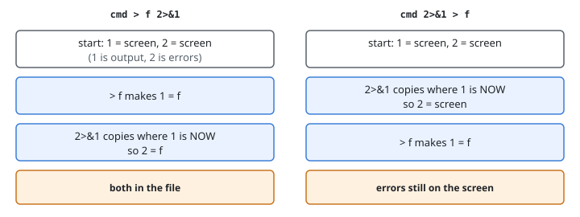

*Draft for owner review.* Most servers run Linux, and you work on them through a **shell**: a program that reads what you type and runs it. The usual one is **bash**. This lesson is the first day on the command line: moving around, handling files **without destroying them**, reading and searching text, understanding permissions, redirecting output, managing processes, and writing and running your first script. It uses only what ships with the system, so it works on a server you have just logged into.

**What was tested, and where.** Everything below was run in **bash 5.3.9** on **Ubuntu 26.04 (WSL2)** (`tests/verification/bash/basics1.sh`; `whichimpl.sh` lists the tool versions). A fact worth knowing before you compare outputs: on this Ubuntu most of the small utilities (`ls`, `cat`, `head`, `tail`, `wc`, `sort`, `stat`, `date`, `mkdir`, `mktemp`...) are the **uutils (Rust) coreutils 0.8.0**, while `cp`, `mv`, `rm` and `df` are **GNU coreutils 9.7**, and `find`, `xargs`, `grep`, `sed` and `gawk` are GNU. Other distributions (AlmaLinux, Debian, Alpine's BusyBox) ship different implementations, so **exact error wording and a few options differ**; where I saw something that depends on the implementation, the text says so. The outputs added under *Who you are*, *Processes and jobs* and *A first look at the system* come from the **Ubuntu 24.04.5** lab VM (`tests/verification/bash/basics2.sh`). Not tested: macOS and BSD (their `ls`, `sed -i` and `date` differ), and the interactive keyboard features (listed at the end, not exercised).

You will practise in a Linux lab VM or WSL. Exercises only touch your home folder or a scratch folder; start a throwaway one with `cd "$(mktemp -d)"`.

## The shell, a command, and getting help

A command is a program name followed by arguments:

```bash
ls -l /etc
echo hello
```

The shell splits the line into **words**, finds the program, runs it, and shows the output. The first word is the command; options usually start with `-` (short: `-l`) or `--` (long: `--help`); the rest are arguments. Three habits save a lot of time:

- **`command --help`** prints a short summary for most programs (`ls --help` began `List directory contents.` here).
- **`man command`** shows the manual page (it is installed on my machine; `q` quits, `/word` searches, `n` finds the next match). `man 5 passwd` asks for section 5, the file format, instead of the command.
- **`type name`** says what a name is. In my run `type cd ls help` answered `cd is a shell builtin`, `ls is /usr/bin/ls`, `help is a shell builtin`. **Builtins have no manual page**; use **`help cd`** (bash's own help, first line `cd: cd [-L|[-P [-e]]] [-@] [dir]`).

`command -v name` also reports what a name is (`cd`, and `type -t` printed `builtin`). For a builtin, `which cd` printed **nothing**: `which` only finds programs on `PATH`. Prefer `command -v` or `type`.

When a name does not exist, bash says `command not found` and the **exit status is 127**.

An editor is something you will need: `nano` (friendly, keys listed at the bottom), `vi` and `vim` were all installed on my machine. Pick one and learn to save and quit.

## Where you are

```bash
pwd             # print the current folder
cd /var/log     # change folder
cd              # no argument: your home folder (for example /home/alice)
cd -            # back to the previous folder
ls              # list the folder
```

Paths that start with `/` are **absolute**; others are **relative** to where you are. `~` is your home folder (`~` and `"$HOME"` were equal), `.` is "here" and `..` is the folder above. After `cd sub`, `cd -` returned to the folder I came from, and `$OLDPWD` holds it.

`cd nowhere` failed with `No such file or directory` and status **1**. **A name with a space needs quotes:** `cd my folder` failed with `too many arguments` (two words), `cd "my folder"` worked. This is the first appearance of the rule that runs through the whole course: **quote variables and names that may contain spaces**.

### Reading `ls -l`

```text
-rw-r--r-- 1 USER alice  0 DATE a.txt
-rw-r----- 1 USER alice  6 DATE data.txt
drwxr-xr-x 2 USER alice 40 DATE dir1
lrwxrwxrwx 1 USER alice  8 DATE link.txt -> data.txt
```

(I replaced my user name and the date.) The columns: **type and permissions** (first character `-` file, `d` directory, `l` symbolic link; then three triples for owner, group and others), **link count**, **owner**, **group**, **size in bytes**, **modification time**, **name** (a link shows `-> target`). Useful options: `-a` (include hidden names, which begin with `.`: `.hidden` appeared only with `-a`), `-h` (human sizes: `3.0K`), `-S` (sort by size), `-t` (newest first), `-R` (recursive), `-d` (the folder itself, not its contents: `ls -ld dir1` showed `drwxr-xr-x`). `ls nosuchfile` failed with status **2**.

`file name` tells you what something is (`ASCII text`, `symbolic link to data.txt`, `directory`, `data`); `stat -c '%n: %s bytes, mode %a, links %h' file` prints chosen facts (`data.txt: 6 bytes, mode 640, links 1`). The `-c` format string is GNU/uutils-style; BSD and macOS `stat` use `-f`.

## Making, copying, moving and removing, and the traps

```bash
mkdir -p p/q/r          # make a folder and any missing parents
touch newfile           # create an empty file (or update a file's time)
cp a b                  # copy file a to b
cp -r dir1 dir2         # copy a folder (needs -r)
mv old new              # rename, or move into a folder
rm file                 # remove a file (no trash: it is gone)
rm -r dir               # remove a folder and everything in it
rmdir dir               # remove an EMPTY folder
```

The shell does exactly what you typed, silently. **Behaviours I saw, all of which have cost someone data:**

- **`cp a b` overwrites `b` without asking.** `cp -i` asks (`cp: overwrite 'f2'?`); `cp -n` refuses to overwrite, but GNU cp 9.7 printed `warning: behavior of -n is non-portable and may change in future; use --update=none instead`.
- **`mv a b` replaces an existing `b` silently** (`mv a1 a2` left `a2` containing `moved`). `mv old dir/` moves into the folder.
- **`mkdir x/y/z` without `-p` fails** (`No such file or directory`); with `-p` it creates the chain. **`cp dir1 dir2` refuses without `-r`** (`-r not specified; omitting directory`).
- **`cp -r dir1 dest` when `dest` already exists copies *into* it** (`dest/dir1`); when it does not exist, `dest` becomes the copy. The same command does two different things depending on what is there: check with `ls` first.
- **`rm dir` fails** (`Is a directory`), **`rmdir` fails on a non-empty folder** (`Directory not empty`), `rm -r` removes it. **`rm -rf` has no confirmation and no undo.** Before a risky `rm -rf PATTERN`, run **`echo rm -rf PATTERN`** (or `ls PATTERN`) and read what the shell expands it to.
- `rm nosuch` fails with status 1; **`rm -f nosuch` succeeds with status 0**: `-f` hides the failure as well as the prompt. `rm -i` asks for each file (`remove regular empty file 'askme'?`).

### Names that bite: spaces and a leading dash

I created `-rf.txt` and `my file.txt` in a folder:

- **`ls *`** expanded `*` to include `-rf.txt` first, so `ls` read it as options and failed (the uutils `ls` said `unexpected argument '-.' found`; other implementations word it differently). GNU `rm *.txt` failed the same way (`invalid option -- '.'`, with the hint `Try 'rm ./-rf.txt'`) and **removed nothing**.
- The fixes: **`rm -- -rf.txt`** (`--` ends the options) or **`rm ./-rf.txt`** (a path that does not start with a dash). **`./*`** instead of `*` protects every glob.
- **Unquoted spaces remove the wrong files.** With a file `my file.txt` and files `my` and `file.txt` present, `rm my file.txt` removed **`my` and `file.txt`** and left `my file.txt`. Quote it (`rm "my file.txt"`) or escape the space (`rm ./my\ file.txt`).

### Links

```bash
ln orig hard        # a hard link: another name for the same file
ln -s orig soft     # a symbolic link: a small file that points at a path
```

The link count of `orig` became **2** after `ln orig hard` (two names, one file); `soft` is a separate file containing the path `orig` (`readlink soft` printed it). **Remove `orig`: `hard` still read `content`, but `soft` failed with `No such file or directory`**: a *broken symlink*, which `find . -xtype l` located. Use symlinks to point at things, hard links rarely.

## Looking inside files

```bash
cat file            # print the whole file
head -3 file        # first 3 lines            tail -3 file   # last 3 lines
head -n -17 file    # everything EXCEPT the last 17 lines
sed -n '5,7p' file  # lines 5 to 7
less file           # page through it (q quits, / searches)
wc -l file          # count lines  (-w words, -c bytes, -m characters)
```

- **`wc -l file` prints the file name; `wc -l < file` prints only the number** (`2 words.txt` against `2`). Use the redirect when you want to capture the number.
- **Bytes versus characters:** `caf\xc3\xa9` (the word *café* in UTF-8) gave `wc -c` = 6 (with the newline) and `wc -m` = 5.
- **`cat -A` shows what you cannot see:** `tab^Ihere^M$` revealed a tab (`^I`) and a Windows carriage return (`^M`), and `line2  $` revealed two trailing spaces. When a script mysteriously fails, `cat -A` it.
- **`tail -f file` follows a growing file** (I appended three lines to a log from the background and it printed them as they arrived); `Ctrl-C` stops it. It is how you watch a log.

## Who you are and what you may do

```bash
id          # uid=1000(alice) gid=1000(alice) groups=...
whoami      # alice
chmod u+x script.sh      # add execute for the owner
chmod 640 file           # rw- for owner, r-- for group, --- for others
```

**Reading `id`** (in the lab VM):

```text
uid=1000(labadmin) gid=1000(labadmin) groups=1000(labadmin),27(sudo)
```

`uid` is your user number and name (**0 is root**), `gid` your **primary** group (new files get it), and `groups` **every** group you belong to. Here `sudo` is the one that matters: on Ubuntu its members may use `sudo`. A group added to your account appears only after you **sign in again**.

A permission has three bits, **r**ead (4), **w**rite (2), e**x**ecute (1), for three classes: **u**ser (owner), **g**roup, **o**thers. Add the digits: `755` is `rwxr-xr-x`, `600` is `rw-------`. I confirmed: `chmod u+x` gave `-rwxr--r--`, then `go-r` gave `-rwx------`, then `755` and `600` gave the expected strings.

Three system files show letters beyond `rwx`:

```text
-rw-r-----  1 root shadow    916 /etc/shadow
drwxrwxrwt 14 root root     4096 /tmp
-rwsr-xr-x  1 root root    64152 /usr/bin/passwd
```

| What you see | Meaning |
|---|---|
| `/etc/shadow`: `rw-r-----`, group `shadow` | Only root may write it and only root and that group read it: it holds password hashes |
| `/tmp` ends in **`t`** (the **sticky bit**) | Anyone may create files, but only a file's owner (or the directory's owner, or root) may remove or rename it |
| `passwd` has **`s`** where the owner's `x` would be (**set-user-ID**) | The program runs **with its owner's rights** (root), so you can change your own password. An unexpected set-user-ID program is a serious security finding |

- **New files start at `644` and new folders at `755`** because of the **umask** (`0022` on my machine). In a subshell with `umask 077`, new files were `600` and folders `700`.
- **A script without the execute bit cannot be run as `./script`:** `Permission denied` (status **126**). `bash script` still ran it, because you are starting bash, which only needs to *read* the file.
- **A folder needs `x` to be entered:** after `chmod 600` on a folder, `cd` said `Permission denied`. A file with mode `000` could not be read even by me (its owner).
- `sudo` runs a command as root. In my non-interactive test it said `interactive authentication is required`: it needs a password (or a rule) and a terminal.

## The environment, `PATH` and aliases

Programs find each other through **environment variables**. The important one is **`PATH`**, a list of folders (separated by `:`) that the shell searches, in order, for a command name. Mine had 29 entries (WSL adds the Windows folders), starting `/usr/local/sbin:/usr/local/bin:/usr/sbin`. `type -a ls` listed every match in order (`/usr/bin/ls` then `/bin/ls`: two entries on `PATH` leading to the same program on my machine).

My experiment with a script `mybin/mytool`:

```text
mytool                        -> command not found   (the folder is not on PATH)
./mybin/mytool                -> my tool ran         (a path with a slash needs no PATH)
PATH="$PATH:$D/mybin" mytool  -> my tool ran         (the assignment applies to this one command)
mytool (afterwards)           -> command not found
export PATH="$PATH:$D/mybin"; mytool   -> my tool ran   (changed for this shell and its children)
```

This is also why you run your own script as `./hello.sh`: the current folder is **not** on `PATH`, and putting `.` on `PATH` is a risk (a program placed in a folder you visit could shadow a real command).

**Exported or not:** a plain `v=plain` was **not** visible to a child process (`bash -c 'echo ${v:-not set}'` printed `not set`); after `export v` it was. `VAR=value command` sets it **for that command only** (`MYVAR=once bash -c 'echo $MYVAR'`; afterwards it was unset). `env` lists exported variables.

**Aliases** are shortcuts for interactive use (`alias ll='ls -l'`). They are **not expanded in scripts** (a non-interactive `bash -c 'alias hi="echo x"; hi'` said `hi: command not found`), and even interactively **an alias defined on a line is not usable on that same line** (bash expands aliases when it *reads* a line), which I reproduced with `bash -ic`. **Do not use aliases in scripts** (use functions, or full command names), a rule that appears again in the PowerShell lessons.

## Redirection and pipes

Every program has three streams: **standard input (0)**, **standard output (1)**, **standard error (2)**. The shell connects them:

```bash
cmd > file          # stdout to a file, REPLACING it
cmd >> file         # append
cmd < file          # read stdin from a file
cmd 2> errors.txt   # ONLY the error stream
cmd > all.txt 2>&1  # both streams to one file (this order!)
cmd &> all.txt      # both, bash shorthand
cmd 2>/dev/null     # throw the errors away
cmd1 | cmd2         # a pipe: stdout of cmd1 becomes stdin of cmd2
cmd1 |& cmd2        # pipe both streams (bash)
cmd | tee file      # print AND save
```



```text
 > f 2>&1 :  1=f first, then 2 copies 1  ->  both in f
 2>&1 > f :  2 copies 1 (the screen) first, then 1=f  ->  errors stay on screen
```

What I saw, including the traps:

- `ls nosuch > out.txt 2> err.txt` left `out.txt` **empty** and the message in `err.txt`.
- **Order matters.** `ls nosuch o.txt > both.txt 2>&1` put both streams in the file. With the order reversed, `2>&1 > file`, the error went to the **screen** and only the normal output reached the file: `2>&1` copies *where stdout points at that moment*.
- **`sort file > file` empties the file** (5 lines became **0**): the shell truncates the target before `sort` reads it. Write to a new file and `mv` it over the old one. `set -C` (noclobber) makes `>` refuse to overwrite (`cannot overwrite existing file`).
- `/dev/null` discards; the command's **status is unchanged** (`ls nosuch 2>/dev/null` still returned 2).
- `sort list.txt | uniq -c | sort -rn` counted duplicates (`3 b`, `1 c`): sort, count adjacent duplicates, order by count. (`uniq` only collapses *adjacent* lines, which is why the first `sort`.)
- `wc -l < file` and `cat file | wc -l` gave the same number; the second starts an extra process (a "useless cat").

### Chaining and exit status

Every command ends with a number, its **exit status**: 0 means success, anything else failure. `$?` holds the last one.

| Written | Meaning |
|---|---|
| `a ; b` | run `a`, then `b`, regardless |
| `a && b` | run `b` only if `a` **succeeded** |
| `a \|\| b` | run `b` only if `a` **failed** |
| `a \| b` | pipe; the **status is `b`'s** (the last command's) |

**`a && b || c` is not "if a then b else c".** `true && false || echo "c ran"` printed `c ran` although the test succeeded, because `b` failed and fell through to `c`. For if/else, write `if`.

**A pipeline reports only the last command's status:** `false | true` left `$?` at `0`; bash keeps every stage in the array `PIPESTATUS` (`1 0`). The `pipefail` option (next lessons) changes that.

## Processes and jobs

A running program is a **process**, with a number (**PID**). `$$` is your shell's PID (mine was 327) and `$PPID` its parent's.

```bash
sleep 30 &          # run in the BACKGROUND; $! holds its PID
jobs                # this shell's jobs
ps -ef              # every process (30 lines on my small WSL)
ps -o pid,ppid,stat,comm -p PID
pgrep -f 'sleep 31' # find PIDs by name
kill PID            # ask nicely (SIGTERM, 15)
kill -KILL PID      # force (SIGKILL, 9); cannot be caught
wait                # wait for background jobs
timeout 1 sleep 5   # run a command with a time limit
```

**Reading `ps -ef`:**

```text
UID    PID  PPID  C STIME TTY      TIME CMD
root     1     0 12 21:45 ?    00:00:02 /sbin/init
root     2     0  0 21:45 ?    00:00:00 [kthreadd]
```

`UID` is who it runs as, `PID` its number, `PPID` its parent's, `STIME` when it started, `TTY` the terminal (`?` means none: usually a service), `TIME` the **processor time used** (not how long it has existed) and `CMD` the command line. Names in `[brackets]` are kernel threads. PID 1 is the first process, from which services descend.

To ask for the columns you want, use `ps -o`:

```text
    PID    PPID USER     STAT     ELAPSED %CPU %MEM   RSS COMMAND
   1167    1154 root     S          00:00  0.0  0.0  1620 sleep 40
```

| Column | Meaning |
|---|---|
| `STAT` | `R` running or ready, **`S` sleeping** (waiting: normal for most), `D` waiting uninterruptibly (often on disk), `T` stopped, `Z` zombie (finished, not yet collected by its parent) |
| `ELAPSED` | How long it has existed |
| `%CPU` | Processor time divided by lifetime: **an average**, not "right now" |
| `RSS` | Memory in RAM, in KiB |

`ps -eo pid,user,%cpu,%mem,rss,comm --sort=-rss | head` lists the biggest memory users ([ps(1)](https://man7.org/linux/man-pages/man1/ps.1.html)); `top` shows the figures live.

Facts from the run:

- `ps` showed the background `sleep` with the shell as its parent (`ppid` = `$$`) and state `S` (sleeping).
- After `kill $pid; wait $pid` the status was **143** (128 + 15, SIGTERM); with `kill -KILL` it was **137** (128 + 9).
- `kill -l` lists signal names (`1) SIGHUP`, `2) SIGINT`, `3) SIGQUIT`...). `Ctrl-C` sends SIGINT to the foreground job; `Ctrl-Z` stops it (then `bg` or `fg`). Those need a real terminal and were not tested here.
- **`wait` with no arguments returns 0 even if a background job failed** (`( exit 3 )` then `wait` gave `0`); `wait PID` returns that job's status.
- `timeout 1 sleep 5` ended with status **124**, the code for "timed out".
- Background jobs are documented to receive a hangup when their terminal closes; **`nohup command &`** (present on my machine) is the usual way to avoid that. I did not test the hangup itself.

## Finding things

```bash
find tree -name '*.txt'            # by name (quote the pattern!)
find tree -iname 'THREE*'          # ignore case
find tree -type f                  # files only (-type d: folders)
find tree -mtime +5                # modified more than 5 days ago
find . -size +2k                   # bigger than 2 KiB
find tree -name '*.txt' -exec wc -l {} +      # run a command on the matches
grep -r needle tree                # search text inside files, recursively
```

`grep` options I used: `-i` ignore case, `-n` line numbers, `-l` only the file names, `-c` count matching lines, `-v` invert, `-w` whole words (`echo 'a needles' | grep -w needle` matched nothing), `-q` quiet (just the status), `-E` extended patterns (`grep -E 'cat|bird'`). **`grep`'s exit status is 0 when it found something, 1 when it did not, and 2 on an error** (I got `0 1 2`). That makes `if grep -q needle file; then` the idiom.

**File names with spaces break `find | xargs`:** `find tree -name 'sp*' | xargs ls` split `tree/a/sp ace.txt` into two broken names; **`find ... -print0 | xargs -0 ls`** handled it (4 files). Use `-print0 | xargs -0` or `find ... -exec ... {} +`. `locate` was **not installed**; `find` always works.

## A first look at the system

| Command | Shows |
|---|---|
| `uname -sr` | kernel name and release |
| `hostname` | the machine's name |
| `date +%F` | today as `YYYY-MM-DD` (`date -d '1 day ago' +%F` for relative dates) |
| `df -h /` | disk space of a filesystem (`Filesystem Size Used Avail Use% Mounted on`) |
| `du -sh folder` | how big a folder is (`12K` for my test tree) |
| `free -h` | memory |
| `uptime` | time up, users, load average |

### Reading the answers

```text
$ df -h / /boot
Filesystem      Size  Used Avail Use% Mounted on
/dev/sda1        19G  1.7G   17G   9% /
/dev/sda16      881M   64M  756M   8% /boot

$ free -h
               total        used        free      shared  buff/cache   available
Mem:           1.9Gi       278Mi       1.6Gi       1.0Mi       185Mi       1.6Gi
Swap:             0B          0B          0B

$ uptime
 21:45:23 up 0 min,  2 users,  load average: 0.13, 0.03, 0.01
$ nproc
2
```

- **`df`** ([manual](https://man7.org/linux/man-pages/man1/df.1.html)): one line per file system. **`Use%` and `Mounted on`** are what to read; a file system near 100 % makes programs fail in confusing ways. `Used` plus `Avail` can be less than `Size`, because some space is reserved.
- **`free`** ([manual](https://man7.org/linux/man-pages/man1/free.1.html)): read **`available`**, not `free`. Linux uses spare memory as a file cache (`buff/cache`) and gives it back when needed. `Swap: 0B` means this machine has no swap.
- **`uptime`** ([manual](https://man7.org/linux/man-pages/man1/uptime.1.html)): how long since the last boot (**an unexpectedly short time means it restarted**), how many sign-ins, and the **load average** over 1, 5 and 15 minutes: roughly the number of processes running or waiting. Compare it with the number of processors (`nproc`, here 2): a load that **stays** well above it means work is queuing. On Linux the figure also counts processes waiting on disk, so high load does not always mean a busy processor. Comparing the three numbers shows whether it is rising or falling.


## Your first script

A script is a text file of commands. Save as `hello.sh`:

```bash
#!/usr/bin/env bash
# greet each argument
if [ "$#" -eq 0 ]; then
    echo "usage: hello.sh NAME..." >&2
    exit 2
fi
for who in "$@"; do
    echo "Hello, $who!"
done
```

```bash
chmod +x hello.sh
./hello.sh Alice Bob      # Hello, Alice!  Hello, Bob!
./hello.sh                # usage message on stderr, status 2
./hello.sh "Mary Ann"     # Hello, Mary Ann!   (one argument, because it was quoted)
```

- **The first line is the shebang.** `#!/usr/bin/env bash` and `#!/bin/bash` are both correct for a script that uses bash features (`env` finds bash on `PATH`, useful where it is not in `/bin`). **A script that uses bash features must name bash, never `sh`** (a `#!/bin/sh` script is a POSIX script and must stay inside POSIX; the next lesson, `shells-and-posix`, shows why `sh` "working" on a machine where it is a link to bash is an accident). My `hello.sh` happens to use only plain syntax, and `sh hello.sh Dee` ran it fine under dash, but that is not a reason to write `sh` in the shebang of a bash script.
- `$1`, `$2`... are the arguments, `$#` is how many, and **`"$@"` is all of them, each kept as one word**. `$0` is the script's name.
- `>&2` sends a message to **standard error**, where messages belong; `exit 2` ends with a failure status other programs can test. Use **0 for success** and non-zero for failure honestly; cron and other scripts depend on it.
- `./` is needed because the current folder is not on `PATH`.

### Run it, check it, trace it

- **`bash -n hello.sh`** checks the syntax **without running** it (`syntax ok`).
- **`bash -x hello.sh Zed`** prints each command as it runs, prefixed with `+`: `+ '[' 1 -eq 0 ']'`, `+ for who in "$@"`, `+ echo 'Hello, Zed!'`. It is the first tool to reach for when a script misbehaves; the `+` lines show the arguments after expansion.
- **A typo in a variable name is silent:** `echo "Hi, $nmae"` printed `Hi, ` and carried on. `set -u` at the top (or `bash -u script`) turns it into an error: `nmae: unbound variable`.
- **`read -r -p "Name? " n`** reads a line from standard input (`echo Pat | bash ask.sh` printed `Hello Pat`).

### Reading the error messages

| You see | It means | Status |
|---|---|---|
| `lss: command not found` | the name is not a program, builtin or function (a typo, or not on `PATH`). **The script keeps going** to the next line | 127 |
| `Permission denied` on `./script` | no execute bit: `chmod +x` | 126 |
| `bad interpreter: No such file or directory` (and `^M`) | wrong shebang path, or Windows line endings (see `cat -A`) | 126 |
| `syntax error: unexpected end of file from 'if' command on line 1` | an unclosed `if`, quote or bracket (`bash -n` finds it) | 2 |
| `unbound variable` | `set -u` caught an unset name | non-zero |

My test script with a missing command printed `lss: command not found` and then **still ran the next line** (`next line still runs`): by default a script continues after a failing command. How to stop on failure safely is the subject of `bash-robust-scripts`.

### `echo` and `printf`

`echo` is fine for simple text. It has traps: `v='-n'; echo "$v"` printed **nothing** (it treated `-n` as an option), and `echo -e 'a\tb'` works in bash but not in every shell. **`printf '%s\n' "$v"`** prints exactly the text (`-n`). Use `printf` for anything that may start with a dash or contain backslashes.

## Interactive keyboard features (not tested here)

These need a real terminal; I list them so you know to look: **Tab** completes names (press twice to list matches); **Ctrl-R** searches your history; **Up/Down** recall commands; **`!!`** repeats the last command (in my `bash -i` test the shell echoed the expanded command, `echo first`, before running it); **Ctrl-C** interrupts, **Ctrl-D** ends input (or logs out), **Ctrl-L** clears the screen, **Ctrl-A / Ctrl-E** jump to the start or end of the line, **Ctrl-U / Ctrl-W** delete the line / the last word.

## Good habits

- **Quote** variables and names with spaces; `"$@"` for arguments.
- **Look before you delete:** `ls` or `echo` the expansion first; use `./*` and `--`.
- **Test on a copy** of real data, never the only copy; keep a backup before editing a config.
- Put messages on stderr and use exit statuses honestly.
- Prefer the simple tool: `grep -c` over a loop that counts by hand.
- Name bash in the shebang if you use bash features; keep a `#!/bin/sh` script strictly POSIX.

## Common mistakes

- An **unquoted** name or variable with spaces (`cd my folder`, `rm $file`).
- `rm *` or `ls *` in a folder with a file whose name starts with `-`.
- Expecting `cp`/`mv`/`>` to ask before overwriting.
- `sort f > f` (the file is emptied before `sort` runs).
- `2>&1 > file` in the wrong order.
- `a && b || c` as if it were if/else.
- Treating `rm -f` or `2>/dev/null` as harmless: they hide failures.
- Forgetting the execute bit or the `./` when running your own script.
- Using aliases in scripts.
- `find | xargs` on names with spaces.
- Writing `#!/bin/sh` on a script that uses bash features.

## Practice

The **labs for this lesson** (open them from the Practice menu) give you a task, starter data in `/home/labadmin/labdata`, and a check that runs your script against **fresh data each time**, so a copied answer fails: start with counting errors in log files and finding the largest files. Then work through these exercises in a scratch folder.

1. In a scratch folder (`cd "$(mktemp -d)"`), create three folders deep with one command, a file in each, and list the tree with `find`.
2. Create files named `-rf.txt` and `my file.txt`. Remove each safely, then show what the dangerous commands would have done (with `echo`, not `rm`).
3. Copy a folder into a name that exists and one that does not; explain the two results.
4. Make a file `data.txt` with ten lines. Print lines 4 to 6, the last two lines, and everything except the last three.
5. Show the difference between `2>&1 > f` and `> f 2>&1` using `ls nosuch .`.
6. Make a script executable only for yourself (`700`), run it, then remove the execute bit and read the error and the status. Run it again with `bash script`.
7. Start `sleep 60 &`, find it with `ps` and `pgrep`, stop it with `kill`, and read the status from `wait`. Do it again with `kill -KILL`.
8. Use `find`, `grep` and `xargs -0` to list the files under a folder that contain the word `error` (any case), where some file names contain spaces.
9. Write `hello.sh`, make it fail three different ways (a typo in a variable, a missing command, a syntax error) and read each message. Then run `bash -n` and `bash -x` and say what each shows.
10. **Read this and say what each line does, and what is wrong with it:**

    ```bash
    #!/bin/sh
    cd /tmp/work
    rm -rf *
    sort list.txt > list.txt
    for f in $(ls); do echo $f; done
    echo -e "done\n"
    ```

    **Answer.** `#!/bin/sh` on a script that uses `echo -e` (a bash/GNU habit): either name bash, or use `printf`. `cd /tmp/work` has no check: if it fails, the script carries on **in whatever folder it was started from**, and `rm -rf *` then deletes *there* (`cd /tmp/work || exit 1`). `rm -rf *` does not protect against a file named `-rf` or similar (`rm -rf ./*`), and `-f` hides errors. `sort list.txt > list.txt` **empties the file** (truncated before `sort` reads it). `for f in $(ls)` splits file names on spaces and treats names beginning with `-` as options (use `for f in ./*` and `"$f"`). `echo $f` is unquoted. The script never checks that `list.txt` exists.

## Check your understanding

1. What is the difference between `'$HOME'`, `"$HOME"` and `$HOME` (unquoted) on a path with a space?
2. A script is run as `./backup.sh v7`. What do `$0`, `$1` and `$#` hold?
3. Why does `rm my file.txt` remove the wrong files, and what are two fixes?
4. Why did `ls *` and `rm *.txt` fail in a folder that has a file called `-rf.txt`?
5. What does `sort f > f` do, and why?
6. What is the difference between `cmd > f 2>&1` and `cmd 2>&1 > f`?
7. What exit status does `grep` give for a match, no match and an error?
8. Why is `true && false || echo c` not an if/else?
9. Why does `./script` fail with Permission denied but `bash script` work?
10. What is the difference between `kill PID` and `kill -KILL PID`, and what statuses show it?

**Expected answers:** (1) `'$HOME'` is the literal text; `"$HOME"` is the value as one word; unquoted, the value is split at spaces (and globbed); (2) `./backup.sh`, `v7` and `1`; (3) unquoted, the shell passes two words (`my` and `file.txt`) and removes those; quote it or escape the space (`rm "my file.txt"`, `rm ./my\ file.txt`); (4) the glob expanded to a name starting with a dash, which the command read as options; use `./*` or `--`; (5) it empties `f`: the shell truncates the file for the redirection before `sort` starts reading it; (6) the first sends both streams to `f`; the second sends the error to where stdout pointed *before* the redirection (the screen) and only stdout to `f`; (7) 0, 1 and 2; (8) `c` runs whenever the *last* command in the chain fails, including `b`, so it runs even when the test succeeded; (9) without the execute bit the kernel will not run the file, but `bash script` only needs to read it; (10) `kill PID` sends SIGTERM (15), which a program can handle and clean up; `kill -KILL` sends SIGKILL (9), which cannot be caught; `wait` gave 143 and 137 (128 + signal number).
