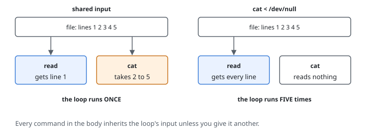

*Draft for owner review.* A script becomes useful when it **decides** and **repeats**: tests a file, branches on a status, loops over data. These are also where most shell bugs live, because the tests are *commands* with quirky syntax and the loops are fed by text that the shell may split or lose. This lesson covers conditions (`if`, `[ ]`, `[[ ]]`, `(( ))`), `case`, every loop form and its traps, reading input line by line, `read` with timeouts, retry loops, and what stays portable to POSIX `sh`.

**What was tested, and where.** All of it was run in **bash 5.3.9** on Ubuntu 26.04 (WSL2), and the portable subset was repeated in **dash 0.5.12** and **busybox 1.35.0 ash** (`tests/verification/bash/cf1.sh`). The small tools (`seq`, `touch`, `ls`...) are the uutils (Rust) coreutils on this Ubuntu, which does not affect shell behaviour. Not tested: other bash versions, zsh, ksh. **Shebang rule for this lesson:** scripts that use bash features (`[[ ]]`, `(( ))`, arrays, `select`) name bash (`#!/bin/bash` or `#!/usr/bin/env bash`); a `#!/bin/sh` script must stay inside the portable subset in the table near the end. The quoting and expansion rules behind every example are in `foundations.bash-variables-and-expansion` (the lesson before this one on the bash path), and the key traps are repeated here where they appear.

## `if` tests a command

`if` does not test a *condition*; it runs a **command** and looks at its **exit status**: 0 means "true" (take the `then` branch), anything else means "false".

```bash
if grep -q root /etc/passwd; then echo "found"; fi        # a program as the test
if ! grep -q zzzzz /etc/passwd; then echo "not found"; fi   # ! negates the status
if grep -q root /etc/passwd && [ -r /etc/passwd ]; then echo "both"; fi
if cd /some/dir 2>/dev/null; then echo "changed"; else echo "cd failed"; fi
```

What I saw: `grep -q` (quiet, status only) drives the `then` branch; `!` flips it; `&&` joins two commands (the second runs only if the first succeeded); a **failed `cd` took the `else` branch** with status 1. Three details:

- **A pipeline's status is its last command's:** `if true | false; then ... else ...` took `else`. (`pipefail`, in a later lesson, changes that.)
- **A `then` branch cannot be empty**: `if true; then` followed directly by `fi` is a syntax error (`syntax error near unexpected token 'fi'`). Write `:` (the do-nothing command, status 0) as a placeholder: `if true; then :; fi`.
- If **no branch is taken**, the status of the whole `if` is **0** (`if false; then echo; fi; echo $?` printed `0`). Do not read `$?` after an `if` expecting the test's status.

Silence a test command you do not want output from with `>/dev/null 2>&1`, or use `grep -q`.

```bash
if   [ "$n" -lt 10 ];  then echo small
elif [ "$n" -lt 100 ]; then echo medium
else                         echo large
fi
```

## `test` and `[ ]`: a command with quirks

`[` is not syntax: it is a **command** named `[` (`type -t '['` said `builtin`, and a real program with the same name exists in `/usr/bin/[` too), and `test` is the same command without the closing `]`. That explains every rule about spaces:

```bash
[ -f /etc/passwd ]       # arguments: -f  /etc/passwd  ]
[-f /etc/passwd]         # one word "[-f": bash said "[-f: command not found"
[ -f /etc/passwd]        # the last word is "/etc/passwd]": "[: missing `]'"
```

**Spaces are required** after `[` and before `]`. The traps, each reproduced:

| Written | Result | Why |
|---|---|---|
| `[ $v = x ]` with `v=""` | `[: =: unary operator expected` | the empty variable vanished, leaving `[ = x ]` |
| `[ $v = x ]` with `v="two words"` | `[: too many arguments` | split into two words |
| `[ -n $v ]` with `v=""` | **true** (!) | becomes `[ -n ]`, a one-argument test |
| `[ "$v" = x ]` | `false`, cleanly | quoted: always exactly one word |
| `[ 10 = 10.0 ]` | false | `=` compares **strings** |
| `[ 10 -eq 10 ]` | true | `-eq`, `-ne`, `-lt`, `-le`, `-gt`, `-ge` compare **integers** |
| `[ abc -eq 1 ]` | `[: abc: integer expected`, status **2** | a non-number is an error, not "false" |
| `[ 9 \> 10 ]` | true | `\>` compares as **strings** (`"9" > "10"`) |
| `[ 9 > 10 ]` | status 0, and a **file named `10` was created** | unescaped `>` is a *redirection* of the command's output |
| `[ 010 -eq 10 ]` | true | `[ ]` reads `010` as decimal 10 (unlike `(( ))`, below) |

**Always quote** the variables inside `[ ]`. Numbers use letters (`-eq`), strings use symbols (`=`); mixing them is the classic bug, and `[ 9 > 10 ]` is the worst, because it succeeds and leaves a stray file. **`-a` and `-o`** (and/or inside `[ ]`) are ambiguous when an argument looks like an operator; write `[ cond1 ] && [ cond2 ]` instead. Even `[ "$x" = "!" ]` and `[ "$x" = "-n" ]` worked as comparisons in my runs when quoted, which is exactly why quoting matters.

`==` inside `[ ]` is a **bashism**: dash rejects it (`[: a: unexpected operator`); `=` is portable.

### File tests

Tested in a folder with a file `f`, a directory `d`, an empty file, a symlink `lnk` to `f`, a broken symlink, a file of mode `000` (`noperm`) and an executable script:

| Test | True when | In my run (names it matched) |
|---|---|---|
| `-e` | the path exists | everything except the broken link and the missing name |
| `-f` | a regular file | `f`, `empty`, `lnk` (links are followed), `noperm`, `x.sh`; **not** `d` |
| `-d` | a directory | `d` |
| `-L` or `-h` | a symbolic link | `lnk` **and** `broken` |
| `-r` `-w` `-x` | readable, writable, executable **by you** | `noperm` (mode 000) failed `-r` and `-w`; `-x` matched `d` (folders need `x` to enter) and `x.sh` |
| `-s` | exists **and is not empty** | `f` (and the folder, whose size is not zero) but not `empty` |
| `-nt`, `-ot`, `-ef` | newer than, older than, **same file** as | `[ new -nt old ]`, `[ old -ot new ]`, and `[ f -ef hard ]` for a hard link |
| `-z`, `-n` | string is empty, non-empty | |

Facts: **`-e` on a broken symlink is false** while `-L` is true (`-e` follows the link to a target that is not there); **`-f` on a directory is false** (use `-e` or `-d`); `-w` on a file I own but made read-only (mode 444) was false. A test followed by a use (`[ -f x ] && cat x`) is a **race**: the file can change in between (called TOCTOU, time of check to time of use), so for anything security-relevant, *attempt* the operation and handle the failure instead of testing first.

**Portable or not:** `-e -f -d -r -w -x -s -z -n -L -h` are fine in `sh`. `-nt`, `-ot` and `-ef` are common but not in older POSIX: in my run dash and busybox `ash` accepted `-ef` but did **not** report `-nt` for two files created back to back (bash did); I did not investigate why (file time resolution is my guess), so do not rely on `-nt` for files created within the same second.

## `[[ ]]`: the safer test (bash)

`[[ ]]` is a bash **keyword** (`type -t '[['` gave `keyword`), parsed by the shell itself, so it sees the original words:

- **No word splitting or globbing of variables.** `[[ $v = x ]]` with `v="two words"` gave a clean `false`; with an **unset** variable also a clean `false`; and `[[ -n $e ]]` for an unset `e` was correctly false (unlike `[ -n $e ]`). You can leave variables unquoted *inside `[[ ]]`* (quote them anyway out of habit).
- **`&&`, `||`, `!` and parentheses** work inside: `[[ -f f && ( -r f || -x f ) ]]`.
- **`==` and `!=` match a pattern on the right.** `[[ $f == *.log ]]` with `f=report.log` was true.
  - **Quote the right side and it is literal:** `[[ $f == "*.log" ]]` was false.
  - **A variable on the right is a pattern unless quoted:** with `pat='*.log'`, `[[ $f == $pat ]]` matched and `[[ $f == "$pat" ]]` did not. A surprise: `a=x; b='*'; [[ $a = $b ]]` was **true**, while `[ "$a" = "$b" ]` was false. If the right side comes from input, quote it.
- **`<` and `>` compare strings** (by the locale's collation): `[[ apple < banana ]]` true, `[[ 9 > 10 ]]` true. For numbers use `(( ))` or `-lt`.
- **`-v name`** tests that a variable is *set* (an empty-but-set variable counts; an unset one does not).

### `=~`: regular expressions

```bash
s="build-1234.tar.gz"
if [[ $s =~ ^build-([0-9]+)\.tar\.gz$ ]]; then
    echo "number=${BASH_REMATCH[1]}"      # 1234
fi
```

On a match, **`BASH_REMATCH[0]`** is the whole match and `[1]`, `[2]`... are the parenthesised groups. My results: `number=1234 whole=build-1234.tar.gz`. Rules I confirmed:

- **Put the regex in a variable** (`re='^([a-z]+)-([0-9]+)'; [[ $s =~ $re ]]`): it avoids quoting problems, and a regex containing a space only worked through a variable.
- **Quoting the regex makes it literal**: `[[ $s =~ "^build" ]]` was false because the `^` was now plain text.
- `BASH_REMATCH` is reset by each match: after a failed match, `[1]` was empty.
- It is an **extended regular expression** (ERE), not the globs of `case`.

### A warning about `-eq` in `[[ ]]`

In `[[ ]]`, `-eq` and friends **evaluate arithmetic expressions**: with `n=2+3`, `[[ $n -eq 5 ]]` was **true** (it computed `2+3`), whereas `[ "$n" -eq 5 ]` said `integer expected`. As the expansion lesson shows, that evaluation can run commands hidden in untrusted text. **For numbers that came from outside, validate first** (`[[ $n =~ ^[0-9]+$ ]]`) or use plain `[ ]`.

## Numbers: `(( ))` and `$(( ))`

```bash
n=7
(( n > 5 )) && echo "bigger"        # no $ needed, spaces are free
(( n % 2 )) && echo "odd"            # non-zero is TRUE
(( n += 3 ))                         # n is 10
echo $(( n > 5 ? 1 : 0 ))            # ternary: 1
```

- **`(( ))`'s status is inverted from the value**: `(( 0 ))` gave status **1** (false) and `(( 5 ))` status **0** (true). So a bare `((count = 0))` or `((i++))` can **fail** and, under `set -e`, end the script. (The next lessons cover it.)
- A **text or unset name counts as 0** (`s=abc; (( s == 0 ))` was true), silently.
- **Integers only**: `(( 3.5 > 2 ))` is an error (`invalid arithmetic operator`).
- **Leading zero means octal in `(( ))`:** `(( 010 == 8 ))` was true, while `[ 010 -eq 10 ]` was also true (decimal). The same text means different numbers in the two tests; strip zeros or force base 10 (`10#$n`).

## `&&`, `||`, grouping and short forms

- **`cmd1 && cmd2`** runs `cmd2` only if `cmd1` succeeded; **`||`** only if it failed. **`a && b || c` is not if/else:** if `b` fails, `c` runs too. Use `if` for real branching.
- **`{ ...; }`** groups commands in the **current shell**; **`( ... )`** runs them in a **subshell**. I showed `x=1; ( x=2 ); echo $x` printing `1` while `{ x=3; }` changed it to `3`, and `( cd / )` left me in the same folder. Use `( )` when you want a change (a `cd`, a variable) to stay local.
- **The "die" idiom:** `cd /somewhere || { echo "cannot cd" >&2; exit 1; }` printed `cannot cd` and exited **1**, without reaching the next line. Always check `cd` before you act in the folder (a failed `cd` followed by `rm -rf *` is how people delete the wrong folder).
- **`set -e` (exit on failure) has exceptions**, which I tested: a failing command in an **`if` condition**, on the left of `&&`, or after `||` does *not* end the script (`survived`), and a function whose body fails, called **inside an `if`**, also keeps running past the failing line (`inside after false` was printed). That is why `set -e` is not a safety net; the robust-scripts lesson covers it.

## `case`

`case` matches **one word against glob patterns**, which is tidier than a chain of `elif`:

```bash
classify() {
  case $1 in
    [0-9]*)        echo "starts with a digit" ;;
    *.log|*.txt)   echo "a log or a text file" ;;
    [[:upper:]]*)  echo "starts upper case" ;;
    "")            echo "empty" ;;
    -h|--help)     echo "help" ;;
    *)             echo "something else" ;;
  esac
}
```

Results: `42abc` (digit), `app.log` and `Notes.txt` (log or text), `Zed` (upper), empty (`""`), `--help`, `hello` and `two words` (something else), and **`a b.log`** matched `*.log`: `case` does not split `$1`, so spaces are fine.

- **Patterns are globs, not regular expressions:** `a+` matched only the literal text `a+` (`case aaa in a+)` fell to `*)`).
- **`|`** means "or"; **`*)`** is the catch-all; **first match wins** (`a*` stopped `abc` before `abc)` could).
- **Quoting matters on the pattern side**, as in `[[ ]]`: `case xyz in $p)` with `p='*'` matched everything, `case xyz in "$p")` only a literal `*`.
- **Fall-through (bash 4+):** `;;` ends a branch. **`;&`** runs the next branch's commands *without testing*, and **`;;&`** keeps testing the later patterns: `case 1 in 1) ;& 2) ;& 3) ;; esac` printed `one two three`, and `case ab in a*) ;;& *b) ;; esac` printed both. These are bash-only (dash: `Syntax error: "&" unexpected`).
- **`shopt -s nocasematch`** makes patterns case-insensitive (`YES` matched `yes`). **`shopt -s extglob`** adds `@(a|b)`, `!(x)`: `*.@(png|jpg)` matched `photo.png`; the `shopt` must be on an **earlier line** than the code that uses it.
- **No match and no `*)`** does nothing and returns status **0**.
- `case $# in 0) ...; 1) ...; *) ...` is a neat way to check the number of arguments; the last branch does not need `;;`.

## Loops

### `for`

```bash
for c in red "dark green" blue; do echo "[$c]"; done      # three words (quotes keep one)
for x; do echo "[$x]"; done                              # no "in": iterates "$@"
for ((i = 0; i < 3; i++)); do echo "$i"; done            # C-style (bash)
for i in {1..3}; do echo "$i"; done                      # brace range (bash)
```

- **`for x` with no `in` loops over `"$@"`**: with `"a b" c` it gave `[a b][c]`. **`for x in $*` splits again** (`[a][b][c]`); `for x in "$@"` keeps them.
- **A glob with no match runs the body once with the pattern text:** `for f in *.nomatch` printed `[*.nomatch]`. **Guard it** (`[ -e "$f" ] || continue`, which printed nothing) or use `shopt -s nullglob` (zero iterations).
- **`for f in $(ls ...)` breaks on spaces:** a file `sp ace` came out as `[sp][ace]`, while `for f in sp*` gave `[sp ace]`. **Loop over a glob, not over `ls` output.**
- **The loop variable survives the loop** (`z=3` afterwards, and `i=3` after the C-style loop).
- The **status of a `for` is the last body command's** (`for q in 1; do false; done` gave 1), and an **empty list** gives 0.
- **Changing the array inside the loop does not change what is iterated:** appending in each of 3 iterations left 6 items, but the loop still ran 3 times, because the list was expanded first.
- `$(seq 1 $n)` and `for ((i=1;i<=n;i++))` both worked; the C-style form needs no extra process and no brace-with-variable problem.

### `while`, `until`, `break` and `continue`

```bash
i=0; while (( i < 3 )); do echo "$i"; ((i++)); done      # repeat while the status is 0
i=0; until (( i >= 3 )); do echo "$i"; ((i++)); done     # repeat until the status is 0
```

- **`break N` and `continue N`** act on the N-th enclosing loop: `continue 2` skipped to the next outer iteration and `break 2` left both loops (`11 21` was printed). `break`/`continue` with a number work in dash and ash too.
- **`while :; do ... ((++n >= 4)) && break; done`** is the infinite-loop-with-exit pattern; always have a `break`, a counter or a timeout.
- A `while` that **never ran** has status 0.
- **A retry loop must have a limit:** `until [ "$attempt" -ge "$max" ] || the_command; do attempt=$((attempt+1)); sleep 1; done` (my test with a command that always failed stopped after 3 attempts; one that succeeded on the second try printed `succeeded on attempt 2`). Without the counter, a command that never succeeds loops forever.

### Reading input line by line

```bash
while IFS= read -r line; do
    echo "got: $line"
done < file
```

`IFS=` keeps leading and trailing spaces; `-r` keeps backslashes. What each missing piece does (file `  lead and trail  ` and ` a\b `):

```text
while read line         -> [lead and trail][ab]       (spaces trimmed, backslash eaten)
while IFS= read -r line -> [  lead and trail  ][ a\b ]  (exact)
```

**Fields:** `while IFS=: read -r user uid shell; do ...` gave `alice(1001,/bin/bash) bob(1002,/bin/sh)`; with more fields than names, **the last name takes the rest** (`read -r a b c <<< "1 2 3 4 5"` gave `c=3 4 5`).

Four traps, all reproduced:

1. **The last line without a newline is dropped.** For `one\ntwo\nthree` (no final newline) the plain loop printed `[one][two]` and **lost `three`**. Fix: `while IFS= read -r line || [ -n "$line" ]; do ...` (printed all three). The same happened in dash and ash; the guard worked in all three.
2. **A command inside the loop that reads standard input steals the rest of the file.** With five lines, `while read -r n; do ...; cat > /dev/null; done < five.txt` printed `got 1;` and **stopped**: `cat` consumed lines 2 to 5. `sed -n 1p` inside the loop did the same. The fix is to give the inner command its own input: `cat < /dev/null`. Any command that reads stdin can do this; running `ssh` inside such a loop is a well-known case (its `-n` option exists for this, from its documentation; I did not test ssh here).



```text
 shared input:      read gets line 1, cat takes lines 2-5  ->  loop runs once
 cat < /dev/null:   read gets every line, cat reads nothing ->  loop runs five times
```

3. **A pipeline runs the loop in a subshell:** `printf 'a\nb\n' | while read -r _; do ((c++)); done` left `c=0`, while `done < <(printf 'a\nb\n')` left `c=2`.
4. **File names with spaces or newlines:** loop with `find ... -print0 | while IFS= read -r -d '' f` (or `< <(find ... -print0)` to keep variables). My test read 3 names including one containing a newline.

Also: a here-string feeds a loop from a variable (`done <<< "$data"` gave `[x][y]`), and **`mapfile -t rows < file`** loads all lines into an array (bash 4+), which is often simpler than a loop.

### `read` with a timeout, a default and a menu

- `read -t 1 ans` waits at most 1 second; the status on timeout was **142** (anything above 128 means "timed out"), `ans` empty. With input it returned 0.
- `read -r -n 1 ch` reads one character (`[x]`). With no variable names, the line is in **`$REPLY`**.
- A default: `read -r ans; ans=${ans:-no}`.
- A prompt with `read -p` is written to stderr and **only when stdin is a terminal**: in a pipeline the prompt did not appear (`[hi]` only).
- **`select`** (bash) prints a numbered menu from `PS3`: input `2` gave `chose [beta] reply=[2]`; an **invalid choice leaves the variable empty** (`s=[] REPLY=[9]`) and `REPLY` holds what was typed. Check for an empty variable.

## What stays portable (dash and busybox ash)

| Construct | bash | dash | ash |
|---|---|---|---|
| `if`, `elif`, `while`, `until`, `for x in`, `for x` (no `in`) | yes | yes | yes |
| `break 2`, `continue 2` | yes | yes | yes |
| `case` with `\|` and `[[:digit:]]` | yes | yes | yes |
| `while read -r x y` and the `\|\| [ -n "$l" ]` guard | yes | yes | yes |
| `[ ... ] && [ ... ]`, `[ $((n % 2)) -eq 1 ]` | yes | yes | yes |
| `[ a == a ]` | yes | **no** | yes |
| `[[ ]]` | yes | **no** (`[[: not found`) | accepted, but **without pattern matching** (see the shells lesson) |
| `(( n > 2 ))` | yes | **no** (`n: not found`) | **no** |
| `for ((i=0;i<2;i++))` | yes | **no** (syntax error) | **no** |
| `select` | yes | **no** | **no** |
| `;&` and `;;&` in `case` | yes | **no** | **no** |
| `-nt` (file newer) | yes | did not report it in my test | same |

For a `#!/bin/sh` script use `[ ]` with `=`, `case`, `$(( ))`, `while read -r`, and nothing from the "no" rows.

## Reading an unknown script (decisions and loops)

- **`for f in $(ls ...)` or `$(cat ...)`:** names with spaces will be split; ask what a file named `a b` or `-rf` would do.
- **A loop with `rm`, `mv` or `chmod` inside:** read the quoting and the `cd` check before it.
- **`[ $x ... ]` with an unquoted variable, `[ $x > 5 ]`, `-a`/`-o`, `==` in a `#!/bin/sh` script:** each is a bug or a portability failure.
- **`while read` without `-r`, without the last-line guard, or with a command inside that reads stdin.**
- **`eval`, `source "$var"` and arithmetic on input** inside loops.
- **A `while true` loop with no counter or timeout**, or a retry with no limit.
- **`set -e` combined with `if`, `&&` or `||`:** the script may not stop where the author assumed.

## Common mistakes

- `[ $v = x ]`, `[ -n $v ]`, `[ $a > $b ]` (unquoted or unescaped).
- `=` for numbers and `-eq` for strings.
- `[ -e broken-link ]` to ask whether a link exists; `-f` on a directory.
- `[[ $x == $pattern ]]` when `$pattern` is input and must be literal.
- Quoting a regex on the right of `=~`.
- `a && b || c` as if/else.
- `case` patterns written as regular expressions.
- `for f in $(ls)`; a glob loop with no guard for "no match".
- `while read line` without `IFS=` and `-r`; losing the last line; a command in the loop eating stdin.
- Variables set inside a pipeline loop, then used after it.
- `(( count = 0 ))` or `((i++))` under `set -e`.
- An unbounded retry loop.
- `cd dir; rm -rf *` instead of `cd dir || exit 1`.

## Practice

The **labs for this lesson** (Practice menu) ask for scripts that classify items with `case`, read a file line by line and split fields, and report on users from a colon-separated file; each is checked against fresh data. The labs on **arguments, exit statuses and backups** belong to the next lesson in the path (`bash-functions-and-scripts`), which teaches them. Then these exercises:

1. Write `check.sh FILE` that prints whether `FILE` is missing, a directory, an empty file, or a non-empty regular file, using `[ ]`, and exits with a different status for each.
2. Reproduce `[ $v = x ]` failing with an empty and with a two-word `v`, then make it robust two ways (quotes; `[[ ]]`). Show `[ 9 > 10 ]` creating a file and fix it.
3. Using only `[[ =~ ]]` and `BASH_REMATCH`, split `backup-2026-11-21.tar.gz` into the year, month and day.
4. Write a `case` that classifies a first argument as `start`, `stop`, `restart`, a `-v|--verbose` flag, an empty string, or anything else (with a usage message to stderr and status 2).
5. Show that `for f in *.log` runs once when there are no logs, then fix it two ways.
6. Create a file called `my notes.txt` and prove which of `for f in $(ls)` and `for f in *` handles it.
7. Read a three-line file whose last line has no newline: show the missing line, then fix it. Then put a `cat` inside the loop and show the stolen input, and fix that.
8. Count lines in a loop fed by a pipe and by `< <( )` and explain the two numbers.
9. Write a retry loop that tries `ping -c1 -W1 host` up to 5 times with a 1-second pause and exits non-zero if it never succeeds.
10. Make a small menu with `select` and handle the invalid-choice case.
11. **Read this and list every problem:**

    ```bash
    #!/bin/sh
    for f in $(ls *.log); do
        if [ $f == "app.log" ]; then
            count=$(grep -c ERROR $f)
            if [ $count > 5 ]; then
                echo "$f has many errors"
            fi
        fi
    done
    while read line; do
        echo $line
    done < list.txt
    ```

    **Answer.** `#!/bin/sh` with a bash-only `==` (dash: `unexpected operator`): use `=`, or name bash. `$(ls *.log)` splits names on spaces and fails when there are no logs: use `for f in ./*.log` with a `[ -e "$f" ] || continue` guard. `[ $f == ... ]` and `grep ... $f` are **unquoted**. **`[ $count > 5 ]` is a redirection:** it writes the output of `[ $count ]` into a file named `5` and is true whenever `count` is non-empty, so *every* log "has many errors"; the correct test is `[ "$count" -gt 5 ]`. `while read line` trims spaces, eats backslashes (use `IFS= read -r line`) and **drops a last line with no newline** (add `|| [ -n "$line" ]`); `echo $line` is unquoted (and `echo` mishandles lines starting with `-`: use `printf '%s\n' "$line"`). There is no check that `list.txt` exists.

## Check your understanding

1. What does `if` test, and what makes a branch "true"?
2. Why is `[ -n $v ]` true when `v` is empty, and what fixes it?
3. What does `[ 9 > 10 ]` actually do?
4. Name three differences between `[ ]` and `[[ ]]`.
5. How do you make the right side of `[[ $a == $b ]]` literal, and how do you make a regex literal by mistake?
6. What does `case` use to match, and what does `;&` do?
7. Why does `for f in *.log` misbehave with no matching files, and what are two fixes?
8. Name two ways a `while read` loop silently loses or steals data, and the fix for each.
9. Why does a variable set inside `cmd | while read ...` disappear?
10. What does `read -t 5` return on a timeout?

**Expected answers:** (1) it runs a command and tests its exit status: 0 is true; (2) the empty variable vanishes and `[ -n ]` is a one-argument test that is true; quote it (`[ -n "$v" ]`) or use `[[ ]]`; (3) it runs `[ 9 ]` and writes its output into a file named `10` (status 0, a stray file): `>` is a redirection; use `-gt` or `\>`-as-string deliberately, or `(( 9 > 10 ))`; (4) any three of: `[[ ]]` does not word-split or glob variables, supports `&&`, `||`, parentheses, `==` pattern matching, `=~` regex with `BASH_REMATCH`, string `<` `>`, and `-v`; it is bash-only and a keyword, while `[ ]` is a portable command; (5) quote it (`"$b"`) for a literal; quoting the regex (`=~ "^x"`) makes it literal by mistake, so put it in a variable; (6) glob patterns (not regular expressions); `;&` runs the next branch's commands without testing its pattern (bash 4+); (7) with no match the pattern text itself is used, so the body runs once with `*.log`; use a `[ -e "$f" ] || continue` guard or `shopt -s nullglob`; (8) the last line with no newline is dropped (add `|| [ -n "$line" ]`), and a command reading stdin inside the loop eats the rest of the file (give it `< /dev/null`); (9) the loop runs in a subshell and its changes are lost; use `done < <(cmd)` or a here-string; (10) a status greater than 128 (142 in my run).
