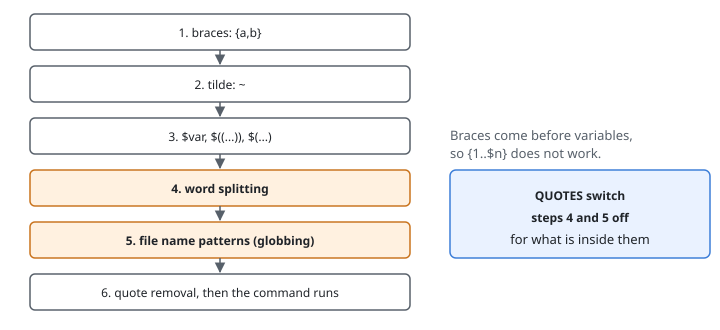

*Draft for owner review.* Most shell-script bugs are not about commands. They are about **what the shell does to your words before the command ever runs**: splitting them on spaces, replacing `*` with file names, stripping newlines, reading `010` as octal. If you understand the order in which the shell rewrites a line, you can predict what a script does and spot what an unknown script will do. This lesson is about that rewriting, which the shell manual calls **expansion**.

**What was tested.** Everything below was run in **bash 5.3.9** on Ubuntu 26.04 (WSL2), using a helper that shows exactly how many words a command received (`tests/verification/bash/expand1.sh`). The portable subset was then checked in **dash 0.5.12** and **busybox 1.35.0 ash** (`expand2.sh`). Where a feature is bash-only the lesson says so, and the full portability story is in `foundations.shells-and-posix` and the later POSIX-sh lesson. Every output here is from a real run; I did not test zsh, ksh or FreeBSD sh. Note that on this Ubuntu the small utilities used to build test data (`touch`, `mkdir`, `wc`, `seq`...) are the **uutils (Rust) coreutils 0.8.0**, not GNU coreutils; the expansion results themselves come from bash, not from those tools.

All scripts here start with `#!/usr/bin/env bash`. The reference is the [Bash Reference Manual](https://tiswww.case.edu/php/chet/bash/bashref.html), sections "Shell Expansions", "Shell Parameter Expansion", "Arrays", "Pattern Matching" and "Shell Arithmetic"; the portable rules are in the [POSIX Shell Command Language](https://pubs.opengroup.org/onlinepubs/9799919799/utilities/V3_chap02.html) (section 2.6, Word Expansions).

## A tool for seeing words

Throughout, I use this function, which prints how many arguments a command received and where each one starts and ends:

```bash
args() { printf '%d args:' "$#"; printf ' [%s]' "$@"; echo; }
```

Use it any time you are unsure what the shell is passing. It is the shell's equivalent of a magnifying glass.

## The order of expansion

For each command line, bash does these steps **in this order** (see "Shell Expansions" in the manual):

1. **Brace expansion**: `{a,b}`, `{1..3}`
2. **Tilde expansion**: `~`, `~user`
3. **Parameter expansion, arithmetic expansion, command substitution** (left to right): `$var`, `${var...}`, `$((...))`, `$(...)`
4. **Word splitting** of the results of step 3 that were *not quoted*
5. **Filename expansion** (globbing): `*`, `?`, `[...]`
6. **Quote removal**

`set -x` shows the result. For `echo {x,y}"$v"~ $((1+1))` with `v="a b"`, the trace printed `+ echo 'xa b~' 'ya b~' 2`: the braces became two words first, the quoted `"$v"` stayed in one piece, the `~` in the middle of a word was **not** a tilde (tilde expansion only applies at the start of a word), and the arithmetic became `2`.

Two consequences you will use constantly:

- **Brace expansion happens before variables.** `n=3; echo {1..$n}` printed `{1..3}` (one word), not `1 2 3`, because when braces were processed `$n` had not been expanded. `eval "args {1..$n}"` produced `1 2 3`, but see the `eval` section for why that is dangerous.
- **Word splitting and globbing only touch the results of unquoted expansions.** Quotes switch them off. That is the whole point of quoting.



```text
 1 braces -> 2 tilde -> 3 $var $(( )) $( ) -> [4 split words -> 5 file patterns] -> 6 remove quotes -> run
                                              ^ quotes switch 4 and 5 off
```

### One line, followed through

In a folder holding `app.log`, `old app.log` and `notes.txt`, with `who='my report'` and `ext='*.log'` (`tests/verification/bash/expand4.sh`):

```bash
args {a,b}.txt ~ "$who" $who $ext "$ext" $((2+3))
```

```text
10 args: [a.txt] [b.txt] [/home/you] [my report] [my] [report] [app.log] [old app.log] [*.log] [5]
```

(The home folder is shown as `/home/you`.) Seven words were typed after `args`; the command received **ten**:

| You typed | It became | Because of |
|---|---|---|
| `{a,b}.txt` | `a.txt`, `b.txt` | Step 1, even though no such files exist |
| `~` | your home folder | Step 2 |
| `"$who"` | **one** word, `my report` | Step 3; quotes stop step 4 |
| `$who` | **two** words, `my`, `report` | Step 4 split the result |
| `$ext` | `app.log`, `old app.log` | Step 5 treated the **value** as a pattern. The name with a space stayed whole: splitting had already happened |
| `"$ext"` | `*.log` | Quoted: no splitting, no globbing |
| `$((2+3))` | `5` | Step 3 |

`set -x` shows the same result before the command runs, adding quotes to show where words begin and end:

```text
+ : a.txt b.txt 'my report' my report app.log 'old app.log' '*.log' 5
```

(There I used `:`, a command that does nothing, so only the trace is printed.) **When a script does something you did not expect, run that line with `set -x` and count the words.**

## Quoting

| Form | Effect | My test |
|---|---|---|
| `'single'` | everything literal | `args '$f *.txt'` gave one word `[$f *.txt]` |
| `"double"` | `$`, `` ` ``, `\` still work; no splitting, no globbing | `args "$f *.txt"` with `f="my notes.txt"` gave one word `[my notes.txt *.txt]` |
| `\x` | the next character is literal | `args a\ b` gave `[a b]` (one word) |
| `$'...'` | backslash escapes like `\t`, `\n`. Not safe in `sh` scripts: added to POSIX only in 2024, and the tested dash lacks it | `args $'a\tb'` gave one word with a tab |
| mixed | quoting pieces of one word | `a"b c"d` gave one word `[ab cd]` |

### The unquoted variable is the bug

Here is what an **unquoted** variable does, with `f="my notes.txt"` and three files `a.txt`, `b.txt` and `c d.txt` in the folder:

```text
args $f              2 args: [my] [notes.txt]
args "$f"            1 args: [my notes.txt]
args $empty          0 args: []                 <- the argument vanishes
args "$empty"        1 args: []                 <- an empty argument stays
args $nosuchvar      0 args: []
star="*.txt"
args $star           3 args: [a.txt] [b.txt] [c d.txt]   <- the glob ran on a variable's value
args "$star"         1 args: [*.txt]
```

That is why `rm $f` removes two files named `my` and `notes.txt` (or nothing), why a variable holding `*` matches every file, and why **`[ -n $v ]` is always true**: with `v=""` it became `[ -n ]`, a one-argument test, and `[ -n $v ] && echo "TRUE (wrong)"` printed `TRUE (wrong)` in bash, dash and busybox ash. `[ -n "$v" ]` printed the right answer in all three.

**The rule:** quote every expansion, `"$var"`, `"$(cmd)"`, `"${arr[@]}"`, unless you specifically want splitting and globbing and can say why. ShellCheck's SC2086 exists for exactly this (see the previous lesson).

### `"$@"` and `$*`

With `set -- "one two" three "four"` (three arguments, the first contains a space):

| Form | Words | Result |
|---|---|---|
| `$*` | 4 | `[one] [two] [three] [four]` (the space split it) |
| `"$*"` | 1 | `[one two three four]` (joined with the first character of `IFS`) |
| `$@` | 4 | `[one] [two] [three] [four]` (same as `$*`) |
| **`"$@"`** | **3** | `[one two] [three] [four]` (**each argument stays intact**) |

`"$*"` with `IFS=,` gave `[one two,three,four]`. And with **no** arguments, `"$@"` expanded to **zero** words while `"$*"` expanded to **one empty word**. **Use `"$@"` to pass arguments along.** The other three are almost always a bug.

### `IFS`: what splitting splits on

`IFS` (the Internal Field Separator) is a set of characters; by default space, tab and newline. In my tests:

- `IFS=:` and `line="a:b::c"` unquoted gave **4** words `[a] [b] [] [c]` (an empty field between the two colons is kept for non-whitespace separators).
- `IFS=` (empty) gave **1** word: splitting off.
- With the default `IFS`, `"  lead and  trail  "` unquoted gave `[lead] [and] [trail]` (runs of whitespace collapse; leading and trailing are dropped).
- `read` also splits on `IFS`: `IFS=: read -r x y z <<< "p:q:r:s"` gave `x=p y=q z=r:s` (the last variable takes the rest). `read -r l <<< "  keep spaces  "` gave `[keep spaces]` but **`IFS= read -r l`** kept the spaces. This is why the safe line-reading loop in the first lesson is `while IFS= read -r line`.

Set `IFS` for **one command** or inside a subshell or function, not globally.

## Variables

```bash
name=value            # no spaces around =
echo "$name"
export name           # make it visible to programs this shell starts
readonly name         # cannot be changed or unset
unset name
declare -p name       # show how it is defined
```

`name = value` (with spaces) runs a command called `name` with the arguments `=` and `value`: the most common syntax error for people coming from other languages.

**Scope:** a variable is global to the script unless declared `local` in a function. A **subshell** (a `( ... )` group, a pipeline stage, `$(...)`) gets a *copy*: changes in it are lost. I showed this with a counter:

```bash
count=0; printf 'a\nb\n' | while read -r _; do ((count++)); done; echo "count=$count"   # count=0
count=0; while read -r _; do ((count++)); done < <(printf 'a\nb\n'); echo "count=$count" # count=2
```

The `while` in a pipeline ran in a subshell, so `count` stayed `0`; reading from process substitution (`< <(...)`) kept the loop in the current shell (`count=2`). The same applies to `cd` and variable assignments inside `( ... )` or `$( ... )`.

### Special parameters

| Name | Meaning | I saw |
|---|---|---|
| `$0` | the script's name (or, with `bash -c`, the first argument after the command) | `bash -c '...' arg0 first second` gave `$0=arg0` |
| `$1`, `$2`, ... `$#` | arguments and how many | `$#=2`, `$1=first` |
| `$?` | exit status of the last command | `1` after `false` |
| `$$` | the shell's process id | a number |
| `$!` | pid of the last background job | a number |
| `$_` | last argument of the previous command | `hi` after `echo hi` |
| `$-` | current shell options | (previous lesson) |

### Set, empty, unset: the default operators

An **unset** variable and an **empty** one are different, and the operators care. I ran each with the variable unset, empty (`v=""`) and set (`v="val"`):

| Expansion | unset | empty | set |
|---|---|---|---|
| `${v-d}` | `d` | *(empty)* | `val` |
| `${v:-d}` | `d` | `d` | `val` |
| `${v=d}` | `d` (and assigns) | *(empty)* | `val` |
| `${v:=d}` | `d` (and assigns) | `d` (and assigns) | `val` |
| `${v+alt}` | *(empty)* | `alt` | `alt` |
| `${v:+alt}` | *(empty)* | *(empty)* | `alt` |

**The colon version treats empty like unset.** Without the colon, only unset triggers. Two more:

- `${v:?message}` **stops the script** with the message when `v` is unset or empty: `v: variable v is required`. This is the cleanest way to demand an argument: `: "${1:?usage: script NAME}"`. (`${v?msg}` without the colon let an **empty** `v` through, printing `[]`.)
- With `set -u` (`nounset`), using an unset variable is an error: `undefined_name: unbound variable`. `${undefined_name-}` is allowed under `set -u` and gave an empty string, which is the way to test a variable that may be unset. In my bash 5.3.9 test, `"${a[@]}"` of an **empty array** under `set -u` did not fail either. I have read that older bash versions failed there; I did not test any bash other than 5.3.9, so if your script must run on an old bash, test it.

## Parameter expansion: working on the value

With `p=/home/user/archive.tar.gz`:

| Expansion | Result | Meaning |
|---|---|---|
| `${#p}` | `25` | length |
| `${p#*/}` | `home/user/archive.tar.gz` | remove the **shortest** match of the pattern from the **front** |
| `${p##*/}` | `archive.tar.gz` | remove the **longest** match from the front (the file name, like `basename`) |
| `${p%.*}` | `/home/user/archive.tar` | remove the shortest match from the **end** |
| `${p%%.*}` | `/home/user/archive` | remove the longest match from the end |
| `${p%/*}` | `/home/user` | the folder, like `dirname` |
| `${p/o/0}`, `${p//o/0}` | `/h0me/user/archive.tar.gz`, same text here | replace the first / **all** matches |
| `${p/%gz/zip}` | `/home/user/archive.tar.zip` | replace only at the end (`/#` only at the start) |
| `${w^^}`, `${W,,}` | `HELLO WORLD`, `hello` | upper / lower case (bash 4+) |
| `${w:6}`, `${w:0:5}` | `world`, `hello` | substring from offset (and length) |
| `${w: -5}` | `world` | **last 5**: note the space before the minus |
| `${w:-5}` | `hello world` | **no space** = the *default* operator, not a substring (the full value, since `w` is set) |
| `${!name}` | `7` | **indirect**: the value of the variable whose name is in `name` |
| `${!prefix_*}` | `prefix_one prefix_two` | the *names* of variables with that prefix |

`#` and `%` are easy to confuse. A memory aid: on a US keyboard `#` is left of `%`, and `#` cuts from the **left**. A second one from my test: **leading zeros**: `n=005` has length 3 and `$((10#$n + 1))` gave `6`; the `10#` forces base 10 (see arithmetic below).

**Portability (tested):** `${#v}`, `${v:-d}`, `${v:=d}`, `${v:?}`, `${v:+x}` and the four trim forms `# ## % %%` worked identically in bash, dash and busybox ash. **bash-only (or partly):** substring `${v:1:3}` (dash: `Bad substitution`; ash works), replace `${v/l/L}` (dash fails; ash works), `${v^^}` (dash and ash fail), `${!n}` (dash and ash fail).

**A trap in the replacement:** `${p/#\/home/~}` is meant to replace a leading `/home` by a literal `~`, but the unquoted `~` was **tilde-expanded**, giving `/home/alice/user/...` (my home folder). Escape or quote it: `${p/#\/home/\~}` printed `~/user/archive.tar.gz`. Expansions nest inside expansions.

## Arrays

Indexed arrays (bash; **not in POSIX sh**, where you use `"$@"` via `set --`):

```bash
arr=(apple "banana split" cherry)
echo "${#arr[@]}"        # 3 (the number of elements)
echo "${arr[0]} ${arr[-1]}"        # apple cherry
arr+=(date)              # append
```

How an array is expanded decides how many words you get. With those three elements:

```text
args "${arr[@]}"   3 args: [apple] [banana split] [cherry]     <- one word per element: use this
args ${arr[@]}     4 args: [apple] [banana] [split] [cherry]    <- split again: the bug
args "${arr[*]}"   1 args: [apple banana split cherry]          <- all joined (with IFS)
```

More that I verified:

- **`"${arr[@]:1:2}"`** is a slice (two elements from index 1); **`"${!arr[@]}"`** lists the **indices**.
- **`${#arr[1]}` is the length of one element** (12 for `banana split`), not the array. The count is `${#arr[@]}`.
- **`unset 'arr[1]'` leaves a hole**: the indices became `0 2 3` and the count `3`. Indices are not renumbered. A sparse array (`sparse[5]=x; sparse[10]=y`) has count `2`, indices `5 10`. Never assume `${#arr[@]}` is the last index plus one.
- **`$x` on an array gives only element 0** (`one` for `x=(one two)`).
- **Filling an array from a command:** `words=($(cmd))` re-splits and globs the output (`a b` and `c` became **3** elements), while `mapfile -t parts < <(cmd)` keeps **one line per element** (`[a b] [c]`). Use `mapfile` (bash 4+).
- `files=(*.txt)` expands the glob into the array: the right way to hold a list of file names. Quote the use: `"${files[@]}"`.

### Associative arrays (dictionaries)

```bash
declare -A color=([apple]=red [banana]=yellow)     # declare -A is REQUIRED
color[cherry]=dark
echo "${#color[@]} ${color[apple]}"        # 3 red
"${!color[@]}"                               # the keys
[[ -v color[apple] ]]                        # is the key present?
```

- Without `declare -A`, `q[apple]=1` makes an **indexed** array and `apple` is evaluated as arithmetic (`apple` = 0), so `q[apple]=1; q[banana]=2` left **one element** with `q[0]=2`. A silent bug.
- The **key order is not the insertion order**: `declare -p` printed `([cherry]="dark" [apple]="red" [banana]="yellow" )`. Sort the keys if you need an order.
- A missing key expands to an empty string (`[${color[nokey]}]` gave `[]`); test with `[[ -v color[key] ]]`.

## Globbing and filename expansion

A glob is a pattern the shell expands into matching file names **only when it is unquoted**:

| Pattern | Matches | Observed (files: `a.txt b.TXT .hidden "x y.txt" -rf.txt file1 file10 file2`) |
|---|---|---|
| `*` | any string (not a leading dot) | 7 names; `.hidden` was **not** among them |
| `*.txt` | names ending `.txt` | `[-rf.txt] [a.txt] [x y.txt]` (case matters: `b.TXT` is absent) |
| `.*` | hidden names | `[.hidden]` (on this bash, `.` and `..` were not included) |
| `?` | one character | `file?` gave `[file1] [file2]` |
| `[0-9]`, `[abc]` | a character class | `file[0-9]*` gave all three `file` names |

Shell options change the rules (`shopt -s name`; `shopt -u name` to undo):

- **No match leaves the pattern as literal text**: `args *.nomatch` gave `[*.nomatch]`, one word, **not an empty list**. A loop like `for f in *.log` then runs once with the text `*.log` when there are no logs. `nullglob` makes it expand to nothing (0 words); `failglob` makes it an **error** (`no match: *.nomatch`). In a script, either use `nullglob` or test `[ -e "$f" ] || continue`.
- `dotglob` includes hidden files (8 words instead of 7); `nocaseglob` matched `b.TXT` too; `globstar` makes `**` recursive: `**/*.log` found `d/1.log` and `d/e/2.log`.
- **`extglob`** adds `!(pattern)`, `+(pattern)`, `@(a|b)`: `!(*.txt)` gave `[b.TXT] [file1] [file10] [file2]`. **It must be enabled on an earlier line:** `bash -c 'shopt -s extglob; echo !(*.txt)'` failed with `syntax error near unexpected token '('` because bash parses the whole line before running it. Put `shopt -s extglob` on its own line, before the code that uses it.

**A file name that starts with `-` is an option to most commands.** With a file called `-rf.txt`, `*` expanded to include it first. Use `./*` (every name became `./-rf.txt`, `./a.txt`...) or end the options with `--` (`rm -- "$f"`). Anything that globs in a folder you do not control should do this.

## Brace expansion

Braces generate words, before everything else, **without looking at files**:

```text
{a,b,c}        a b c            file{1..3}   file1 file2 file3
{01..03}       01 02 03         {1..10..3}   1 4 7 10
{a..e}         a b c d e        {5..1}       5 4 3 2 1
pre{x,y}post   prexpost preypost
cp file{,.bak}                  -> file and file.bak
"{a,b}"        one word {a,b}   (quotes switch braces off)
```

They are **bash-only**: in dash and busybox ash `echo {1..3}` printed `{1..3}`. For a portable counted loop use `i=1; while [ "$i" -le 3 ]; do ...; i=$((i + 1)); done`.

## Command substitution

`$(command)` runs a command and substitutes its **output**, with **all trailing newlines removed** (`printf 'line1\nline2\n\n\n'` came back as `line1` and `line2`). Quote it: unquoted, the output was split into words (`a b\nc` became 3 words). Prefer `$( )` to backticks: `$( )` nests cleanly (`$(echo "outer $(echo inner)")` printed `outer inner`) and is portable.

**The exit status of an assignment is the status of the command:** `x=$(false)` left `$?` at `1`. But **`local v=$(false)` left `$?` at `0`**, because the status that remains is that of `local`, not of the substitution. In a function, declare first and assign after: `local v; v=$(false)` (status 1, as I saw). This matters whenever `set -e` or an `if` depends on the status. A pipeline in `$( )` reports the last stage's status only (`$(true | false; echo $?)` was `1`, but `false | true` would hide the failure without `pipefail`).

A null byte in command output is dropped with a warning (`ignored null byte in input`); bash cannot hold one in a variable.

## Arithmetic

`$(( expression ))` evaluates **integers** and substitutes the result; `(( expression ))` evaluates and returns a status (0 if non-zero); `let` is older and bash-style. Names inside need no `$`.

```text
$((7/2)) = 3      $((-7/2)) = -3     $((7%3)) = 1     $((2**10)) = 1024
$((0x1f)) = 31    $((2#101)) = 5     $((3>2)) = 1     $((a+b)) = 5 (with a=2 b=3)
```

Traps, each from a real run:

- **Division truncates toward zero** (`7/2` is `3`, `-7/2` is `-3`). There is **no floating point**: `$((3.5 + 1))` failed with `arithmetic syntax error: invalid arithmetic operator`. Use `bc` or `awk` for decimals.
- **A leading `0` means octal.** `$((010))` is **8**, and `$((08))` is an error: `value too great for base (error token is "08")`. Zero-padded input (`007`, dates like `08`, `09`) is a classic bug. Force decimal with `10#`: `$((10#08))` is `8`. dash and busybox ash also read `010` as 8.
- **64-bit wraparound with no warning:** `$((9223372036854775807 + 1))` gave `-9223372036854775808`.
- **An unset or non-numeric name is `0`**, silently: `$((undefined_var + 1))` gave `1`, and `v=abc; echo $((v + 1))` gave `1` in bash and busybox ash (dash complained `Illegal number: abc`).
- **`(( ))` as a command returns 1 when the result is 0**: `((0))` had status `1` and `((1))` status `0`. Under `set -e` a statement like `((count = 0))` or `((i++))` when `i` is 0 **ends the script** (in my test, `( set -e; ((z=0)); echo NOT REACHED )` stopped before `echo`, status `1`). Write `count=$((count + 1))` instead, or add `|| true` where you mean it.
- `declare -i num=2+3` stored `5`, and later `num="x"` stored `0`: `-i` makes assignments arithmetic, which hides typos.
- **Portability:** `**`, `++` and the base notation `2#101` worked in bash and busybox ash but **failed in dash** (`expecting primary`). `$((a+b))`, `0x1f`, octal `010` and the ternary `? :` worked in all three.

### Arithmetic on text from outside is code execution

Bash evaluates the text of a variable as an arithmetic *expression* when it is used in `$(( ))` or an array subscript, and an expression can contain a **command substitution**. I ran:

```bash
v='a[$(echo INJECTED >&2)]'
echo $((v))
```

and bash printed `INJECTED`: it **ran the command** hidden in the string (the result was `0`). dash refused (`Illegal number`) and busybox ash gave a syntax error, so this is specific to bash's arithmetic. **Never use `$(( ))`, `(( ))`, `let` or `[[ $x -eq 5 ]]` on text you did not validate.** Check it first: `[[ $v =~ ^-?[0-9]+$ ]] || exit 1`. I tested the comparison forms too: `[[ $v -eq 5 ]]` **ran the command** (`INJECTED-test` appeared), whereas plain `[ "$v" -eq 5 ]` refused it with `integer expected`. So for numeric comparison of untrusted text, `[ ]` is the safer test in bash. The same danger applies to `eval` (next).

## `eval`, and expanding twice

`eval` expands its arguments, joins them and runs the result **as a new command line**, so everything is expanded a *second* time. With `input='; echo INJECTED'`, `eval "echo $input"` ran **two commands** and printed `INJECTED` on a line of its own. Safer: avoid `eval` (use arrays, `${!name}`, `declare -n` or functions instead) or quote with `printf '%q'` (`printf '%q\n' "$input"` printed `\;\ echo\ INJECTED`, which is one safe word; `%q` is bash-specific). In an unknown script `eval`, `$((` on input and `source` of a variable are the lines to read first.

## Process substitution and here-strings (bash)

`<(cmd)` presents a command's output as a file name; `<<<` feeds a string to standard input:

```bash
diff <(printf 'a\nb\n') <(printf 'a\nc\n')     # compare two outputs without temp files
read -r a b <<< "1 2"                           # a=1 b=2
```

Both are bash features (previous lesson: dash fails on them). `< <(cmd)` is how you keep a `while` loop in the current shell.

## Common mistakes

- An **unquoted variable or command substitution** where a path may contain spaces or a glob.
- `[ -n $v ]` / `[ $v = x ]` with a possibly empty `v`.
- `for f in $(ls)`, `for f in $(cat list)`; use a glob or `while IFS= read -r`.
- `"$*"` or `$@` where `"$@"` is meant.
- `local v=$(cmd)` hiding `cmd`'s failure.
- A numeric string with a leading zero in arithmetic.
- `count=$((count + 1))` replaced by `((count++))` under `set -e`.
- `{1..$n}`.
- `arr=($(cmd))` instead of `mapfile`.
- `a[key]=...` without `declare -A`.
- `${v:-5}` when you meant the substring `${v: -5}`.
- `*` or `rm *` in a folder with `-`-named files; use `./*` or `--`.
- Feeding untrusted text to `$(( ))` or `eval`.

## Practice

1. Define `args` and predict, then check, the word count for: `v="a  b"; args $v "$v" '$v' $v$v "$v$v"`.
2. With files `one.txt`, `two words.txt` and `-n.txt`, write a loop that prints each file name once without breaking on spaces or the leading dash, and that works when there are **no** `.txt` files.
3. From `p=/var/log/nginx/error.log.1.gz` produce, with parameter expansion only, the folder, the file name, the name without the last extension, and the last extension.
4. Write `: "${1:?usage: x.sh NAME}"` at the top of a script, run it with and without an argument, and explain the difference between `${1:?}` and `${1?}` for an empty argument.
5. Show the `local v=$(false)` status trap and fix it. Then show it matters with `set -e`.
6. Show why `((i++))` can kill a `set -e` script, and rewrite it.
7. Print the numbers 01 to 12 (zero padded) with brace expansion, then add them up in arithmetic **without** the octal error.
8. Create `declare -A` and indexed arrays holding the same pairs and show the silent difference when you forget `declare -A`.
9. **Read this and find every expansion problem; say what it does with a file called `my file.txt` and with an argument `$(touch PWNED)`:**

   ```bash
   #!/usr/bin/env bash
   for f in $(ls "$1"); do
       size=$(stat -c %s $1/$f)
       if [ $size -gt $2 ]; then
           rm $1/$f
       fi
   done
   total=$(($3 + 1))
   eval "echo $4"
   ```

   **Answer.** `$(ls "$1")` splits file names on spaces, so `my file.txt` becomes `my` and `file.txt` and the script operates on names that do not exist (or on the wrong files). `$1/$f` is unquoted in `stat` and `rm`, so a name with spaces or a glob character is split or expanded, and a name beginning with `-` is read as an option (use `"$1/$f"` and `--`). `[ $size -gt $2 ]` breaks if either is empty or has spaces (quote both, and validate that `$2` is an integer). `$(($3 + 1))` evaluates `$3` as an **expression**: text like `a[$(touch PWNED)]` runs a command (bash). `eval "echo $4"` expands `$4` a second time: with `$(touch PWNED)` it runs the command (and `; cmd` would run `cmd`). The fix is a glob loop (`for f in "$1"/*; do [ -e "$f" ] || continue; ...`), quoted expansions, a checked integer for arithmetic, and no `eval`.

## Check your understanding

1. List the order of expansions, and say which two steps quoting switches off.
2. Why is `[ -n $v ]` always true when `v` is empty?
3. What is the difference between `"$@"`, `"$*"`, `$@` and `$*`?
4. What does `${v:-d}` do differently from `${v-d}`?
5. Why does `${w:-5}` not give the last five characters, and what does?
6. Why does `for f in *.log` run once when there are no logs, and what are two fixes?
7. What is wrong with `local v=$(cmd)`?
8. What does `$((010))` give, and how do you force decimal?
9. Why is `$(( ))` on untrusted text dangerous in bash?
10. Why do brace expansions fail with a variable (`{1..$n}`)?

**Expected answers:** (1) braces, tilde, parameter/arithmetic/command substitution, word splitting, globbing, quote removal; quoting stops **word splitting and globbing** of the unquoted results; (2) it becomes `[ -n ]`, a one-argument test that is true; quote it: `[ -n "$v" ]`; (3) `"$@"` keeps each argument as one word (use this); `"$*"` joins them into one word; `$@` and `$*` re-split on spaces and glob; (4) the colon also treats an **empty** variable like unset; (5) with no space it is the default operator; `${w: -5}` (a space before the minus) is the last five; (6) with no match the pattern stays as literal text; use `shopt -s nullglob`, or `[ -e "$f" ] || continue`; (7) the status of `local` (0) replaces the status of `cmd`; declare first, then assign; (8) `8` (octal); `$((10#010))`; (9) bash evaluates the text as an expression, which can contain a command substitution, so it can run commands; validate with a regex first; (10) braces expand before variables, so `$n` is not yet known; use `seq`, a loop, or (carefully) `eval`.
