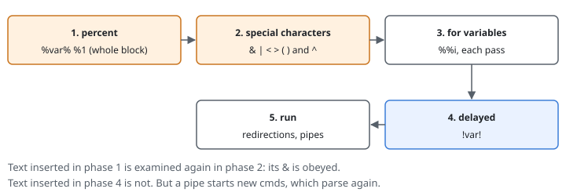

*Draft for owner review.* This is the last cmd lesson, and it is the one that makes you dangerous. It covers how cmd *really* parses a line (the part Microsoft does not document), double expansion, emulated arrays and string functions, recursion, menus, parallel jobs, driving the registry, services and processes from the command line, mixing in PowerShell, and, importantly, how to decide when to stop using cmd. The examples were run on Windows 11 and the output shown is real; the newer results (input validation, array listing, `tasklist`, recursion depth) come from `tests/verification/cmd/adv3.cmd`, `adv4.cmd` and `adv5.ps1`. Windows 10 was not tested.

You should be comfortable with the four earlier cmd lessons (basics, variables, control flow, batch files) first.

## How cmd parses a line

Microsoft documents the commands but not the parser. What follows is the **observed** order of work, enough to predict nearly every surprise. cmd processes a line (or a whole `( ... )` block) in phases:



```text
 1. percent %var% %1  -->  2. special characters & | < > ( ) ^  -->  3. for variables %%i
                                                                          |
              5. redirections, pipes, run  <--  4. delayed !var!  <-------+
```

1. **Percent expansion.** `%var%` and `%1` are replaced with their values (`%%` becomes `%`). This happens for the *whole block* before anything in it runs.
2. **Special characters.** The line is split at unquoted `& | < > ( )` and `^` escapes are processed.
3. **`for` variables.** `%%i` is replaced for each iteration.
4. **Delayed expansion.** `!var!` is replaced (when enabled).
5. **Redirections and pipes** are set up, then the command runs.

Two rules fall out of this:

- A value changed *during* a block is not visible to `%var%` in the same block: phase 1 finished before it ran. Use `!var!`, which is replaced in phase 4, just before the command runs.
- A `^` escape is removed in phase 2, and again after delayed expansion in some contexts, which is why escaping `!` needs different carets depending on context (below).

The practical lesson: when a line does something odd, find the phase that went wrong. Put `echo` in front of it to see what the line looked like after the early phases.

## Double expansion with `call`

`call` runs one more round of percent expansion. That lets you use a variable whose *name* is stored in another variable:

```
set "name=color"
set "color=blue"
call echo %%%name%%%
blue
```

In phase 1, `%%%name%%%` becomes `%color%` (the `%%` pairs become literal `%`, and `%name%` becomes `color`); `call` then expands `%color%` to `blue`. It is slow (it starts another parsing round) and tricky; reach for it only when you need a computed variable name.

## Delayed expansion and the `!` character

With delayed expansion on, `!` is special everywhere. Rules, all from testing:

```
setlocal EnableDelayedExpansion
set "a=Wow^!"
echo a=[!a!]
a=[Wow!]
set "b=Wow^^!"
echo b=[!b!]
b=[Wow^]
set "c=Wow^^^!"
echo c=[!c!]
c=[Wow^!]
```

- With delayed expansion **on**, one caret (`^!`) is the way to put a literal `!` in a value.
- Stacking carets (`^^!`) produces a literal caret and *then* consumes the `!`.
- The robust method is to **set values while delayed expansion is off**, then read them with `!var!`, which never re-parses the value:

```
setlocal DisableDelayedExpansion
set "e=Wow!"
setlocal EnableDelayedExpansion
echo e=[!e!]
e=[Wow!]
echo e-pct=[%e%]
e-pct=[Wow]
endlocal
```

Notice that `%e%` read *while* delayed expansion is on lost the `!`, but `!e!` kept it. When you handle file names or user input that may contain `!`, process them with delayed expansion off and only turn it on for the parts that need it.

## Emulated arrays

cmd has no arrays, but variable names can contain `[` and `]`, and `!` can compute a name:

```
set i=0
for %%f in (apple banana cherry) do (set /a i+=1 & set "arr[!i!]=%%f")
set count=%i%
for /l %%n in (1,1,%count%) do echo arr[%%n]=!arr[%%n]!
arr[1]=apple
arr[2]=banana
arr[3]=cherry
```

(This runs with delayed expansion on.) `set arr` lists **every variable whose name starts with `arr`**, which gives you a free way to dump the whole "array", and `for /f "tokens=1,* delims==" %%a in ('set arr[') do ...` walks them. Walking three elements that way printed `arr[1] holds apple`, `arr[2] holds banana` and `arr[3] holds kiwi fruit`. **The listing is in text order, not number order**: with eleven elements, `set arr[` listed `arr[10]` and `arr[11]` **before** `arr[1]`. Where order matters, count with `for /l` from 1 to the count instead. Variable names can also carry a "key": `set "user.alice=admin"` and `set "user.bob=staff"` make an associative array you can list with `set user.`.

Limits: all values are text; the [documentation for environment variables](https://learn.microsoft.com/windows/win32/procthread/environment-variables) gives 32,767 characters as the maximum for a single user-defined variable and for the whole environment block of a process; and any one `set` line you type or build is also bound by the 8191-character cmd line limit. It is fine for dozens of items and wrong for thousands.

## String functions

Everything is built from substitution, slicing and loops:

**Length** (loop until the slice is empty):

```
set "s=hello world"
set "len=0"
:lenloop
if not "!s:~%len%,1!"=="" (set /a len+=1 & goto lenloop)
echo length=%len%
length=11
```

**Upper case**: substitution is case-insensitive, so replacing each letter with its upper-case form converts the string:

```
set "u=hello"
for %%c in (A B C D E F G H I J K L M N O P Q R S T U V W X Y Z) do set "u=!u:%%c=%%c!"
echo upper=%u%
upper=HELLO
```

**Contains:** remove the search text and see whether the value changed:

```
set "p=C:\Program Files\App"
if not "!p:Program=!"=="!p!" (echo contains-Program)
```

**Trim trailing spaces:** peel one space at a time:

```
set "t=hello   "
for /l %%i in (1,1,5) do if "!t:~-1!"==" " set "t=!t:~0,-1!"
echo [%t%]
[hello]
```

**Numbers with leading zeros:** `08` is invalid octal for `set /a`. Prefix a `1` and subtract: `set /a good=1%mm%-100` turns `08` into `8`.

**Splitting** uses `for /f` with `delims`; **joining** is just concatenation inside a loop. **Sorting** a list is done by writing it to a file (or piping `set arr` output) through `sort`.

## Recursion

A subroutine can call itself. Each level needs its own `setlocal` so the variables do not collide, and the result is returned with `endlocal & set`:

```
call :fact 5 r
echo fact5=%r%
fact5=120
...
:fact
setlocal
set /a n=%1
if %n% leq 1 (endlocal & set "%2=1" & exit /b 0)
set /a m=n-1
call :fact %m% sub
set /a res=n*sub
endlocal & set "%2=%res%"
exit /b 0
```

cmd limits how deeply this can go. A subroutine that calls itself reached a depth of 300 on the test PC, with and without `setlocal`; asked for 1000, **the whole batch file was aborted**:

```text
******  B A T C H   R E C U R S I O N  exceeds STACK limits ******
Recursion Count=312, Stack Usage=90 percent
******       B A T C H   PROCESSING IS   A B O R T E D      ******
```

The number depends on how much each level does, so do not rely on it. Recursion is for small depths (the factorial above worked for 5), and a loop is almost always better.

## Menus and input validation

`choice` is the dependable one-key prompt: `choice /c YNQ /m "Continue"` sets `%errorlevel%` to 1, 2 or 3 for the key pressed. Test the highest number first (`if errorlevel 3` ...). For typed input use a validation loop. This one needs delayed expansion on:

```bat
:ask
set "x="
set /p "x=Enter a number: "
if not defined x goto ask
set "rest=!x!"
for /l %%d in (0,1,9) do if defined rest set "rest=!rest:%%d=!"
if defined rest (echo digits only & goto ask)
```

It deletes every digit from a copy of the input; if **anything is left**, the input was not a number. The input is only ever used as `!x!` and is never sent through a pipe. Fed `abc`, `4a2`, `12 34`, `"7"`, `!x!`, `%TEMP%` and the hostile lines below through standard input, it rejected each one, asked again and accepted `42`, and **no file was created** (`adv5.ps1`). Both `choice` and this loop stop and wait, so keep them out of unattended scripts.

### A "digits only" check that ran the user's commands

An earlier version of this lesson validated with a pipe, a pattern you will find in many scripts:

```bat
echo(!x!| findstr /r "^[0-9][0-9]*$" >nul || (echo digits only & goto ask)
```

It handled `42`, `abc` and `12 34` correctly, so it looked right. Then I tried hostile input:

| Input | What happened |
|---|---|
| `5&echo.> pwned.txt` | **Accepted as digits**, and the command after `&` **ran**: `pwned.txt` was created |
| `5>made.txt` | Rejected, but **`made.txt` had already been created** |
| `5\|echo x> piped.txt` | Rejected, but `piped.txt` had been created |

**Each side of a pipe runs in a new cmd, which reads the text again**, so the protection that `!x!` gives was lost. With a destructive command in place of `echo`, and a script running as administrator, this is how a "number" prompt hands over the machine.

The lessons to keep:

- **Do not pipe untrusted text** through `echo ... |`.
- **A check is not tested until you have tried to break it.** Try `&`, `|`, `>`, `<`, `^`, quotes, `!` and `%`.
- If the input is complicated, validate it in **PowerShell**, where a variable's contents are not re-read as code.

## Waiting, parallel jobs and processes

- **Wait N seconds** without a user: `ping -n N+1 127.0.0.1 >nul` (it works when `timeout` does not, because `timeout` refuses redirected input).
- **Start jobs in parallel:** `start /b cmd /c "job1.cmd"` runs one in the background of the same window. `start` returns at once, so wait for results by polling for a marker file, or use `start /wait` for the last one.
- **List and stop processes:** [`tasklist`](https://learn.microsoft.com/windows-server/administration/windows-commands/tasklist) and [`taskkill`](https://learn.microsoft.com/windows-server/administration/windows-commands/taskkill):

```
tasklist /fi "imagename eq explorer.exe" /fo csv /nh
"explorer.exe","8852","Console","1","281,104 K"
taskkill /im notepad.exe /f
```

`/fo csv /nh` gives output that is easy to parse with `for /f`. `taskkill /f` kills without asking, so check the image name or PID first.

Parsing it with `for /f "tokens=1,2 delims=," %%a in ('tasklist ... /fo csv /nh')` gave `%%b` as `"8976"`, **with quotes**; `%%~b` gave `8976`. **When nothing matches**, `tasklist` prints `INFO: No tasks are running which match the specified criteria.` instead of a CSV row, and the loop **read that message as a result**: its body ran once with the whole sentence in `%%a`. Check the first field (it should start with the image name you asked for) before acting on it, above all before a `taskkill`.

## System administration from cmd

The built-in tools cover a lot, and they give the same effect as the GUI consoles:

**Registry** ([`reg`](https://learn.microsoft.com/windows-server/administration/windows-commands/reg)): everything the Registry Editor does, scriptable.

```
reg add "HKCU\Software\WinLabTest" /v Name /t REG_SZ /d "Demo App" /f
reg add "HKCU\Software\WinLabTest" /v Count /t REG_DWORD /d 5 /f
reg query "HKCU\Software\WinLabTest"

HKEY_CURRENT_USER\Software\WinLabTest
    Name    REG_SZ    Demo App
    Count    REG_DWORD    0x5

for /f "tokens=2,*" %%a in ('reg query "HKCU\Software\WinLabTest" /v Name ^| findstr Name') do echo parsed-name=[%%b]
parsed-name=[Demo App]
reg export "HKCU\Software\WinLabTest" "%TEMP%\test.reg" /y
reg delete "HKCU\Software\WinLabTest" /f
```

**Export a key before you change it** (that is your undo). Writing to `HKLM` needs an elevated prompt. See [`reg query`](https://learn.microsoft.com/windows-server/administration/windows-commands/reg-query) and [`reg add`](https://learn.microsoft.com/windows-server/administration/windows-commands/reg-add).

**Services, tasks, shutdown, system facts:** `sc.exe` and `net start` (services lesson), `schtasks` (scheduled tasks), [`shutdown`](https://learn.microsoft.com/windows-server/administration/windows-commands/shutdown) (`shutdown /r /t 60 /c "Reboot for updates"`), [`systeminfo`](https://learn.microsoft.com/windows-server/administration/windows-commands/systeminfo), `whoami /groups`, `ipconfig`, `netstat`. All are text tools, so parse with `for /f` and `findstr`, and remember that their output depends on the Windows language.

## Mixing in PowerShell

When cmd runs out of road, **call PowerShell for the hard part** and keep cmd for the glue:

```
for /f "delims=" %%a in ('powershell -NoProfile -Command "(Get-Date).Year"') do echo year=%%a
year=2026
```

Patterns:

- **A value back to cmd:** print it in PowerShell, read it with `for /f`.
- **A status back to cmd:** `exit 3` in PowerShell becomes `%errorlevel%` 3.
- **A script file:** `powershell -NoProfile -ExecutionPolicy Bypass -File "%~dp0task.ps1" -Param "%~1"`.
- **Quoting is the hazard:** use `-File` with a real `.ps1` instead of long `-Command` strings; embedded quotes and `%` in a one-liner are painful in both shells.
- **Cost:** starting PowerShell takes a noticeable fraction of a second, so never call it inside a tight loop.

The reverse works too: PowerShell runs cmd built-ins with `cmd /c`, and the call operator `&` runs batch files. The PowerShell lessons cover the details.

## Performance

cmd itself is slow in loops, and external programs are much slower:

- Each `for /f ... in ('command')` **starts a new cmd process**. Run it once and read the result, not once per item.
- Reading a file line by line with `for /f` is fine up to some thousands of lines; beyond that it is slow, and `findstr` or `sort` over the whole file is far faster.
- `set /a` in a loop is fast; `call :sub` per item is not (each `call` reparses).
- Writing to the console is slow. Redirect large output to a file.

If a script takes minutes, count the process launches.

## When to leave cmd

cmd is the right tool for **small glue**: launching things, copying, simple logic, installers, anything that must run where PowerShell is unavailable (recovery environments, very old systems). Move to PowerShell when any of these is true:

| Symptom | Why PowerShell is better |
|---|---|
| you are parsing tool output with `for /f` and `findstr` | PowerShell returns objects |
| you need real arrays, hash tables, sorting or unique | native data structures |
| you handle JSON, XML, CSV or web requests | built-in cmdlets |
| you need proper error handling | `try`/`catch` and typed errors |
| you manage Windows features, services, AD, the registry at scale | purpose-built modules |
| the script is over a few hundred lines | structure, functions, modules, tests |
| you handle non-ASCII text | Unicode throughout |

A good migration method: keep the cmd file as a thin launcher that calls a PowerShell script, then move logic across a function at a time, comparing output to the original as you go.

## Common mistakes

- **Reading a block-changed variable with `%var%`** instead of `!var!`.
- **Leaving delayed expansion on** while handling names with `!`.
- **Using `call` expansion** for something a subroutine argument would do.
- **Building "arrays" bigger than the environment can hold.**
- **Recursing deeply** instead of looping.
- **Validating input by piping it** (`echo !x!| findstr ...`): the new cmd obeys `&`, `|` and `>` inside it.
- **Treating `tasklist`'s INFO message as a process.**
- **Starting a process per loop iteration** and wondering why it takes minutes.
- **Forgetting that `reg add` to `HKLM` needs elevation** and that registry edits have no undo without an export.
- **Parsing localized output** of `systeminfo` or `netstat`.
- **Sticking with cmd past the point of pain.**

## Practice

1. Write a subroutine `:upper` that returns its first argument in capitals, using the substitution trick, and a `:strlen` that returns a string's length. Test with `"Hello World"`.
2. Fill an "array" from the lines of a file, then print them in reverse order.
3. Write `regbackup.cmd KEY` that exports a registry key to a dated file, then changes a value, and a second script that restores it. Test only on a `HKCU\Software\...` key you create.
4. Use `tasklist /fo csv /nh` and `for /f` to print the PID of every `svchost.exe` process, then count them.
5. Take a 30-line cmd script from this course and port it to PowerShell; compare line counts and error handling.
6. Make a menu script using `choice` that offers three actions and loops until the user quits.

## Check your understanding

1. In what order does cmd expand `%var%`, handle special characters and expand `!var!`?
2. What does `call echo %%%name%%%` do?
3. How do you keep a literal `!` in a value when delayed expansion is on? Which method is most robust?
4. How does the "length of a string" loop work?
5. Why does `set arr` list all of an emulated array?
6. Name three signs that a cmd script should be a PowerShell script.
7. How do you wait five seconds in a script that has no console input?
8. What should you always do before changing a registry key from a script?
9. Why did `echo(!x!| findstr ...` run commands typed by the user, although `!x!` is normally safe?
10. Your loop over `tasklist` output acts although no such process is running. Why?

**Expected answers:** (1) `%var%` first, then special characters, then `for` variables, then `!var!`, then redirections; (2) the first phase turns `%%%name%%%` into `%color%` and `call` expands it again, so it prints the value of the variable whose name is stored in `name`; (3) write `^!` in the `set`, or best, set the value with delayed expansion off and read it with `!var!`; (4) it tests whether `!s:~N,1!` is empty and increments N until the slice runs out; (5) `set` with a prefix lists every variable whose name starts with it; (6) parsing tool output with `findstr`, needing arrays/JSON/error handling, and a script over a few hundred lines; (7) `ping -n 6 127.0.0.1 >nul`, because `timeout` fails when its input is redirected; (8) export the key with `reg export` so you have an undo; (9) each side of a pipe runs in a new cmd that reads the text again and obeys its special characters; (10) `tasklist` prints an INFO sentence when nothing matches, and `for /f` reads it like a row.
