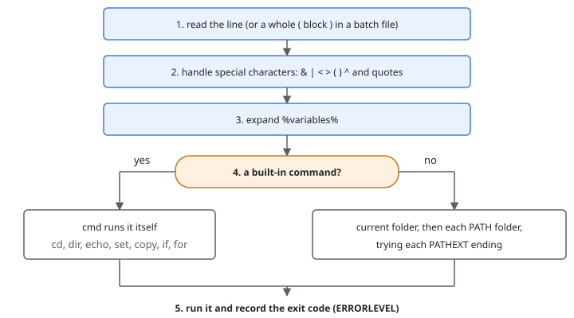
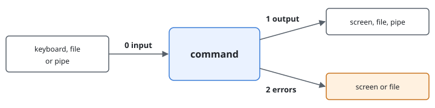

*Draft for owner review.* Command Prompt (`cmd.exe`) is the oldest of Windows' command shells and is still everywhere: in recovery tools, installers, scheduled tasks and batch files that have run for twenty years. Competence here means knowing not only the commands but **how cmd reads a line**, because most batch-file bugs are parsing surprises. This lesson builds that foundation; the lessons after it cover variables, control flow, batch files, text tools and advanced technique.

The commands in this lesson were run on Windows 11 (build 26300) as a standard user; the newer results on reading output, deleting and error codes come from `tests/verification/cmd/basics2.cmd` and `basics3.cmd`. The graphical steps, `setx` and the keyboard features were not exercised by those scripts, and Windows 10 was not tested. Paths are shortened and sample names are used. All exercises are safe: they read information or write inside a scratch folder you create. The graphical way is shown beside each command-line way, because most people use the GUI most of the time and you should be able to do both.

## Opening it and getting oriented

**GUI routes:** press **Win+R**, type `cmd` and press Enter; or search the Start menu for *Command Prompt*; or open **Windows Terminal** and choose the *Command Prompt* profile. In **File Explorer**, click the address bar, type `cmd` and press Enter to open a prompt **in that folder**. Run it as administrator only when a task needs it (right-click, *Run as administrator*); an elevated prompt can change anything.

The prompt shows your **current directory**. Try:

```
cd
dir
ver
```

The prompt itself is information: `C:\Users\student>` says you are on drive `C:`, in the folder `\Users\student`, and that the next thing typed runs **there**. An elevated prompt usually starts in `C:\Windows\System32` and its window title begins with *Administrator*. **Look at the prompt before every command that changes something.**

`cd` with no arguments prints the current directory (`%CD%` holds the same value). `dir` lists its contents, which is what File Explorer's folder view shows. `ver` prints the Windows version:

```
Microsoft Windows [Version 10.0.26300.9974]
```

### Reading `dir`

Here is `dir` in a small test folder:

```text
 Volume in drive C has no label.
 Volume Serial Number is XXXX-XXXX

 Directory of C:\Users\student\AppData\Local\Temp\demo

11/26/2026  02:21 PM    <DIR>          .
11/26/2026  02:21 PM    <DIR>          ..
11/26/2026  02:21 PM                 3 .hidden-by-name.txt
11/26/2026  02:21 PM                 5 a.txt
11/26/2026  02:21 PM                13 b.log
11/26/2026  02:21 PM    <DIR>          My Files
11/26/2026  02:21 PM    <DIR>          sub
               3 File(s)             21 bytes
               4 Dir(s)  635,396,980,736 bytes free
```

| Part | How to read it |
|---|---|
| `Directory of ...` | **Where** the listing is from. Check it first |
| Date and time | When the item was **last written** (changed), in your regional format |
| `<DIR>` | A folder. Files show a **size in bytes** in that column instead |
| `.` and `..` | This folder and the one above it. They are not real items to delete |
| `3 File(s) 21 bytes` | Files listed and their total size. **Not** counting what is inside subfolders |
| `4 Dir(s)` | Includes `.` and `..`, so there are only **two** real subfolders here |
| `bytes free` | Free space on that drive, a quick check when something fails to save |

A name that begins with a dot, such as `.hidden-by-name.txt`, is **not** hidden on Windows: it was listed. The folder also contained `h.txt` with the *hidden* attribute, which is **missing** above. `dir /a` (all attributes) showed it, and the count became `4 File(s) 29 bytes`. **When a file "is not there", try `dir /a`.**

`cd ..` goes up one level and `cd <folder>` goes into one. **To change drive**, type the drive letter alone (`D:`); to change both at once use `cd /d D:\data` (without `/d`, `cd` changes the remembered folder on that drive but stays on the current drive, a classic surprise).

`help` lists the built-in commands; `help dir` or `dir /?` explains one. The official reference is the [Windows commands](https://learn.microsoft.com/windows-server/administration/windows-commands/windows-commands) index, and [`cmd`](https://learn.microsoft.com/windows-server/administration/windows-commands/cmd) documents the interpreter itself.

## How cmd runs what you type

Knowing the order saves hours later.



```text
 1. read the line (or a whole ( block ) in a batch file)
 2. handle special characters:  & | < > ( ) ^ and quotes
 3. expand %variables%
 4. built-in command?  yes --> cmd runs it itself
                       no  --> program: current folder, then each PATH folder,
                               trying each PATHEXT ending
 5. run it, record the exit code (ERRORLEVEL)
```

1. **Read the line.** cmd reads one line (or one parenthesised block in a batch file) as text.
2. **Parse special characters.** `& | < > ( ) ^` and quotes have meaning *before* any command runs (see the table below).
3. **Expand `%variables%`.** In a batch file this happens when the line is read (the next lesson shows why that matters in blocks).
4. **Find what to run.** If the first word is a **built-in** command (`cd`, `dir`, `echo`, `set`, `copy`, `if`, `for`...), cmd runs it itself. Otherwise it looks for a program: first the **current directory**, then each folder in `%PATH%`, trying each extension in `%PATHEXT%`.
5. **Run it and record the exit code.**

```
echo %PATHEXT%
.COM;.EXE;.BAT;.CMD;.VBS;.VBE;.JS;.JSE;.WSF;.WSH;.MSC;.CPL
```

So typing `notepad` finds `notepad.exe` because `.EXE` is in `PATHEXT`, and typing `deploy` runs `deploy.bat` or `deploy.cmd` if one is found first. **Searching the current directory first is a security risk**: a planted `ping.exe` in the folder you are in would run when you type `ping` (built-in commands such as `dir` cannot be overridden this way, programs can). Do not run commands from an untrusted folder, and prefer full paths in scripts. Windows can switch the behaviour off: when the environment variable `NoDefaultCurrentDirectoryInExePath` is defined, cmd stops searching the current directory for programs and a script in the current folder must be started as `.\name.cmd` (see [NeedCurrentDirectoryForExePath](https://learn.microsoft.com/windows/win32/api/processenv/nf-processenv-needcurrentdirectoryforexepathw)). Test your scripts with and without it.

To see **which** program a name resolves to, use [`where`](https://learn.microsoft.com/windows-server/administration/windows-commands/where):

```
where notepad
C:\Windows\System32\notepad.exe
C:\Windows\notepad.exe
C:\Users\student\AppData\Local\Microsoft\WindowsApps\notepad.exe
```

The first line is the one that runs. (`where` lists matches by the search order; built-ins such as `dir` are not programs, so `where dir` finds nothing.)

### Special characters

| Character | Meaning | Escape it with |
|---|---|---|
| `&` | run the next command, always | `^&` |
| `&&` | run the next only if this one succeeded | `^&^&` |
| `\|\|` | run the next only if this one failed | `^\|^\|` |
| `\|` | pipe output into the next command | `^\|` |
| `<` `>` | redirect input, output | `^<` `^>` |
| `( )` | group commands into a block | `^(` `^)` |
| `^` | escape the next character | `^^` |
| `%` | variable expansion | `%%` in a batch file |
| `"` | quote: protects spaces and most specials inside | `""` is not an escape; nest carefully |

```
echo 1 ^& 2
1 & 2
echo a & echo b
a 
b
```

Notice that `echo a & echo b` printed `a ` with a **trailing space**: cmd passes the space before `&` to `echo`. Trailing spaces in output, and in values set with `set X=value & ...`, are a common source of bugs; the next lesson returns to it.

Two more traps in one place:

```
echo done 2>&1
echo 1> file.txt
(echo 1)> file.txt
```

The first line prints `done` and nothing else: `2>&1` is taken as a redirection **of the echo itself**, so it is not printed. The second does not write the character `1`: `1>` is parsed as "redirect stdout", so `echo` runs with no text and writes its status message (`ECHO is off.`) to the file. The third, with the command in parentheses, writes `1`. (A `rem` comment cannot follow a command on the same line, because cmd would treat it as part of the command, so comments here are in the text.)

## Quoting paths with spaces

A space separates arguments, so a path that contains one must be quoted:

```
dir "C:\Program Files\Common Files"
dir C:\Program Files
```

The second command fails (exit code 1): `dir` sees two arguments, `C:\Program` and `Files`. **`cd` is the exception**: `cd C:\Program Files` happens to work, because `cd` treats the rest of the line as one path. That leniency is exactly why the habit of quoting matters: it works with `cd` and then fails with the next command. Quote every path you expand from a variable too: `dir "%USERPROFILE%\Documents"`.

## Working with files and folders

| GUI action in File Explorer | Command |
|---|---|
| open a folder and look | `cd`, `dir` |
| New folder | `mkdir name` (or `md`) |
| copy | `copy src dst`, `xcopy`, `robocopy` |
| cut and paste | `move src dst` |
| rename (F2) | `ren old new` (`rename`) |
| delete | `del file`, `rmdir folder` (`rd`) |
| Properties, hidden or read-only attribute | `attrib` |
| the folder tree | `tree` |
| open a text file | `type file`, `more file` |

The reference pages: [`dir`](https://learn.microsoft.com/windows-server/administration/windows-commands/dir), [`copy`](https://learn.microsoft.com/windows-server/administration/windows-commands/copy), [`move`](https://learn.microsoft.com/windows-server/administration/windows-commands/move), [`rename`](https://learn.microsoft.com/windows-server/administration/windows-commands/rename), [`del`](https://learn.microsoft.com/windows-server/administration/windows-commands/del), [`rmdir`](https://learn.microsoft.com/windows-server/administration/windows-commands/rmdir), [`mkdir`](https://learn.microsoft.com/windows-server/administration/windows-commands/mkdir), [`attrib`](https://learn.microsoft.com/windows-server/administration/windows-commands/attrib), [`tree`](https://learn.microsoft.com/windows-server/administration/windows-commands/tree), [`type`](https://learn.microsoft.com/windows-server/administration/windows-commands/type), [`more`](https://learn.microsoft.com/windows-server/administration/windows-commands/more).

Make a scratch area and practise inside it:

```
mkdir "%TEMP%\wl-cmd-demo"
cd /d "%TEMP%\wl-cmd-demo"
mkdir sub
echo one> a.txt
copy a.txt sub\b.txt
ren a.txt c.txt
move c.txt sub\ >nul
dir /b sub
b.txt
c.txt
```

`dir` has switches worth knowing ([`dir`](https://learn.microsoft.com/windows-server/administration/windows-commands/dir); `help dir` lists them all):

| Command | What it printed in the test folder, and why use it |
|---|---|
| `dir /b` | Bare names, one per line. The form to use in scripts. It still **left out the hidden file** |
| `dir /b /a` | Bare names **including** hidden and system items |
| `dir /b /o:-s /a-d` | Files only (`/a-d` means "not folders"), **largest first** (`/o:s` is smallest first; `-` reverses) |
| `dir /ad /b` | Folders only |
| `dir /b /s *.txt` | Searches subfolders too, and prints **full paths** |

**Wildcards:** `*` matches any run of characters and `?` one character: `dir /b ?.txt` listed only `a.txt`, the one name with a single character before `.txt`. When **nothing** matches, `dir /b *.none` printed no names and set the error code to **1**.

`tree /f /a` prints a folder tree with its files in plain ASCII (`/a` avoids box-drawing characters that some code pages garble):

```text
C:.
|   .hidden-by-name.txt
|   a.txt
|   b.log
|
+---My Files
\---sub
```

`C:.` means "starting at the current folder on `C:`". Lines that begin `+---` or `\---` are folders; `\---` marks the **last** one at that level.

### Overwriting: copy, move and ren

Before you copy or move, know what happens if the destination already exists. **These results were from a batch file**, where I got no questions:

| Command, destination exists | Result |
|---|---|
| `copy a.txt c.txt` | `1 file(s) copied.` The old `c.txt` was **replaced without asking** |
| `move f.txt e.txt` | `1 file(s) moved.` The old `e.txt` was **replaced without asking** |
| `copy /-y a.txt d.txt` | Asked `Overwrite d.txt? (Yes/No/All):`; answering `N` kept the old file |
| `ren g.txt a.txt` | **Refused**, error code 1. `ren` does not overwrite |

[`copy`](https://learn.microsoft.com/windows-server/administration/windows-commands/copy) documents `/y` and `/-y`: the prompt you may see when **typing** a copy is not there to protect a script. In scripts, check with `if exist` first, or use `/-y` only where someone can answer. `ren *.tmp *.bak` renamed both `.tmp` files in one command.

**Deleting is permanent.** `del` and `rd` do **not** use the Recycle Bin. `del /q` suppresses the confirmation, `del /f` removes read-only files, and `rd /s /q folder` deletes a folder and everything in it without asking. Test a delete by running the same pattern with `dir` first, and never run a recursive delete from a variable that might be empty.

Two behaviours that surprise people ([`del`](https://learn.microsoft.com/windows-server/administration/windows-commands/del), [`rmdir`](https://learn.microsoft.com/windows-server/administration/windows-commands/rmdir)):

- **`del h.txt` did not delete the hidden file.** It printed `Could Not Find ...h.txt`, and `dir /a` showed it was still there. `del /a` includes hidden files.
- **`rmdir` without `/s` refuses a folder that is not empty** (`The directory is not empty.`). That refusal is a safety net; `/s` removes it.

How to find out from a script whether a delete worked is covered under exit codes below, and the answer is not what you would expect.

For serious copying use `robocopy`: it retries, preserves attributes and security, and mirrors folders. [`robocopy`](https://learn.microsoft.com/windows-server/administration/windows-commands/robocopy) is covered in the text-and-files lesson; [`xcopy`](https://learn.microsoft.com/windows-server/administration/windows-commands/xcopy) is its older cousin.

## Environment variables

Variables hold values such as paths. Read one by wrapping its name in percent signs:

```
echo %USERNAME%
echo %USERPROFILE%
echo %PATH%
```

`set` with no arguments lists all variables for this window; `set U` lists those that start with `U`. `set NAME=value` changes a variable **only for the current window and the programs it starts**; closing the window discards it. (Permanent changes use `setx` or the **System Properties, Environment Variables** dialog, and affect programs started *afterwards*.) `%PATH%` is the list of folders searched when you type a program name without its location. See [`set`](https://learn.microsoft.com/windows-server/administration/windows-commands/set_1).

## Redirection

Programs have three standard streams: **0** input (stdin), **1** output (stdout) and **2** errors (stderr). Redirection connects them to files or to each other.



```text
                      +-----------+ ---- 1: normal output ----> screen, file or pipe
  0: input  --------> |  command  |
  (keyboard, file,    +-----------+ ---- 2: errors -----------> screen or file
   or pipe)
```

You can see that there are two separate outputs. Asking `dir` for a missing name and sending each stream to its own file:

```text
dir nothere > o.txt 2> e.txt
```

`o.txt` received the heading (`Volume in drive C has no label.` and `Directory of ...`), and `e.txt` received only `File Not Found`. A script that saves only stream 1 **saves no error messages**.

| Syntax | Effect |
|---|---|
| `cmd > file` | send stdout to `file`, **replacing** it |
| `cmd >> file` | append stdout to `file` |
| `cmd < file` | read stdin from `file` |
| `cmd 2> file` | send stderr to `file` |
| `cmd > file 2>&1` | send stdout and stderr to the same file |
| `cmd >nul` | discard stdout |
| `cmd >nul 2>nul` | discard everything |
| `cmd 1>&2` | send stdout to where stderr goes (used to print an error message) |

```
echo hello > "%TEMP%\hello.txt"
echo again >> "%TEMP%\hello.txt"
type "%TEMP%\hello.txt"
dir nothere > out.txt 2>&1
type out.txt
```

To see the order rule: `dir nothere > a.txt 2>&1` put the heading **and** `File Not Found` in `a.txt`. `dir nothere 2>&1 > b.txt` printed `File Not Found` **on the screen**, and `b.txt` held only the heading.

`>` **overwrites an existing file without asking**. **Order matters:** `cmd > file 2>&1` sends both to the file, but `cmd 2>&1 > file` sends errors to the screen, because `2>&1` was evaluated first, when stdout still pointed at the screen. `nul` is the device that discards anything written to it.

## Pipes

A pipe `|` feeds one command's output into another's input:

```
dir C:\Windows | more
set | findstr /i "user"
```

`findstr` filters lines, and `more` shows output one page at a time. In CMD, pipes pass **text**; remember that when you meet PowerShell, which passes objects. Both sides of a pipe run in **separate cmd processes**, so a variable set on one side of a pipe is not visible afterwards.

## Exit codes

When a program finishes it returns a number: `0` normally means success and anything else means failure. Read the last one with `%ERRORLEVEL%`:

```
dir C:\Windows >nul
echo %ERRORLEVEL%
0
dir C:\does-not-exist >nul 2>nul
echo %ERRORLEVEL%
1
cmd /c exit 3
echo %ERRORLEVEL%
3
```

### Which failures ERRORLEVEL shows

**Not every failure sets `ERRORLEVEL`.** Each of these was run right after setting it to 0:

| Command that failed | `%ERRORLEVEL%` afterwards | `command && echo ok \|\| echo failed` |
|---|---|---|
| `copy` of a missing file | **1** | |
| `mkdir` of an existing folder | **1** | |
| a name cmd cannot find | **9009** | |
| `del` of a missing file (`Could Not Find ...`) | **0** | **ok** |
| `rmdir` of a non-empty folder | **0** | failed, and `%ERRORLEVEL%` then read **145** |

(The empty cells were not tested.) So:

- **`del` can report success when it deleted nothing.** If it matters, test the result: `if exist "file" echo still there`.
- **For `rmdir`, `||` saw the failure that `%ERRORLEVEL%` did not show.**
- In general, **check the outcome you care about**, not only the code, and test how each command you rely on behaves.

The file's ending matters too. After a command that exited with 5, I ran `set X=1` and then printed the code:

```text
probe.cmd:   after set: 0
probe.bat:   after set: 5
```

In a **`.cmd`** file the successful `set` replaced the 5 with 0; in a **`.bat`** file the 5 remained. So **save the code at once** if you need it (`set "rc=%ERRORLEVEL%"` on the next line), before running anything else.

`cmd /c <command>` runs one command in a new cmd and exits (`cmd /k` keeps the new prompt open). `exit /b 3` ends a batch file or subroutine with code 3. Scripts and scheduled tasks depend on these codes to decide whether a step worked. The related test `if errorlevel 1` means **1 or greater** (not "equal to 1"), a historical quirk the control-flow lesson covers.

## Combining commands

- `a & b` runs both, always.
- `a && b` runs `b` only if `a` succeeded (exit code 0).
- `a || b` runs `b` only if `a` failed.
- `( a & b )` groups commands, so you can redirect or conditionally run them as one.

```
dir C:\Windows >nul && echo found || echo missing
```

## Housekeeping commands

`cls` clears the screen; `title Name` sets the window title; `color 0A` sets colours (green on black); `doskey /history` lists what you typed (press **F7** for a pop-up list, **Up** to recall); `echo %DATE% %TIME%` shows the date and time in the **regional format**, which differs between machines: never parse it without checking the locale. The commands are [`cls`/`title`/`color`](https://learn.microsoft.com/windows-server/administration/windows-commands/title) and [`doskey`](https://learn.microsoft.com/windows-server/administration/windows-commands/doskey).

To start a graphical program from a prompt and **not** wait for it, use `start`: `start "" notepad`. (The empty quotes are the window title; without them a quoted path is misread as the title.)

## Limits

A single command line in cmd can be at most **8191 characters**; a longer one fails or is truncated, which matters when you build a long command from variables. cmd works in the **OEM or ANSI code page**, not Unicode, so non-English file names and text can appear garbled (the `chcp` command shows and changes the code page). It has no real data types, no arrays and weak error handling, which is why the advanced lesson ends by deciding when to move to PowerShell.

## From commands to batch files

A **batch file** (`.bat` or `.cmd`) is a text file of commands run top to bottom. A minimal one:

```
@echo off
echo Running as %USERNAME%
dir "%USERPROFILE%" > "%TEMP%\listing.txt"
echo Done, exit code %ERRORLEVEL%
```

`@echo off` stops each command from being printed before it runs (the `@` hides the `echo off` line itself). Save it as `hello.cmd` and run it by typing its name from its folder. Use `.cmd` rather than `.bat` for new files: the two behave almost identically, with one old difference in how some commands set the exit code (the `set` example under exit codes). In a batch file, write `%%` where you would type `%` in the prompt for a `for` variable (the control-flow lesson explains this).

## Common mistakes

- **Not quoting a path** that contains a space.
- **Forgetting `/d`** with `cd` when changing drive.
- **Using `>` when you meant `>>`,** and overwriting a file.
- **Putting `2>&1` after `echo`** and having it swallowed.
- **Trusting `echo a & echo b`** to print `a` with no trailing space.
- **Running programs from an untrusted current directory.**
- **Using `del` or `rd /s` from a variable that might be empty.**
- **Trusting `del` because the exit code was 0.**
- **Expecting `copy` or `move` in a script to ask before overwriting.**
- **Running another command before saving `%ERRORLEVEL%`.**
- **Missing a file because it is hidden:** `dir /a`.
- **Parsing `%DATE%`** as if every machine printed the same format.

## Practice

1. In a scratch folder, create `a.txt` containing `one`, copy it to a sub-folder, rename the copy, and show the result with `tree /f /a`.
2. Run `dir C:\does-not-exist > both.txt 2>&1`, then `type both.txt`. Now repeat with `2>&1 > both2.txt` and compare what appears on screen.
3. Using `&&` and `||`, print `found` if `C:\Windows` exists and `missing` otherwise (hint: `dir` sets the exit code).
4. Use `where` to find out which `ping` program runs, then check `echo %PATH%` to explain why.
5. In a scratch folder, make a hidden file with `attrib +h`. List the folder with `dir`, `dir /b` and `dir /a`, and explain the file counts.
6. In a scratch folder, delete a file that does not exist and print `%ERRORLEVEL%`. Then write one line that reliably reports whether a file is gone.
7. Write a three-line batch file that saves your profile listing to `%TEMP%\listing.txt` and prints the exit code. Run it, then break it on purpose (quote a missing folder) and read the code.

## Check your understanding

1. What is the difference between `>` and `>>`?
2. Why does `cd D:\data` appear to do nothing when you are on `C:`, and how do you fix it? Which command does work with an unquoted path containing a space, and why is that no reason to skip quoting?
3. What does an exit code of `0` mean, and why do scripts care?
4. In what order does cmd decide what `ping` means?
5. Why does `echo done 2>&1` not print `2>&1`?
6. What is the difference between `cmd > f 2>&1` and `cmd 2>&1 > f`?
7. A cmd pipe runs `a | b`. Why is a variable set inside `b` gone afterwards?
8. `dir` shows `4 Dir(s)` in a folder in which you made two subfolders. Why?
9. A script runs `del old.log` and then sees `ERRORLEVEL` 0. What has it proved?
10. Your batch file copies onto a file that already exists. What happens?

**Expected answers:** (1) `>` replaces the file and `>>` appends; (2) `cd` without `/d` changes the remembered folder on `D:` but not the current drive, so use `cd /d D:\data` or switch drive first; `cd` accepts an unquoted path with spaces but `dir` and most commands do not, so quote anyway; (3) it normally signals success, and scripts use it to decide what to do next; (4) built-in commands first, then the current directory, then each `%PATH%` folder, trying each `%PATHEXT%` extension; (5) the shell takes `2>&1` as a redirection of `echo` itself; (6) the first sends both streams to the file; the second sends errors to the screen because `2>&1` is evaluated while stdout still points there; (7) each side of a pipe runs in its own cmd process, which ends when the pipe does; (8) the count includes `.` and `..`; (9) nothing about whether the file was deleted: `del` reported 0 for a missing file, so check with `if exist`; (10) in the tests it was replaced without asking.
