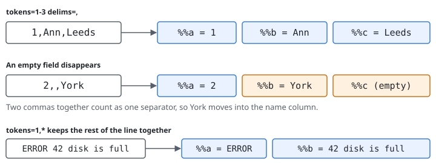
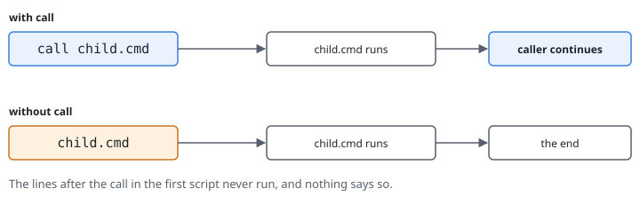

*Draft for owner review.* A batch file is a list of commands, but real scripts need to decide, repeat and recover. cmd has all of that with a syntax that is older and quirkier than a modern language, so this lesson spends its time on the rules and traps that cause most bugs: how `if` compares, every form of `for`, how to structure a script with labels and subroutines, and how to handle failure. Variables and expansion are the previous lesson; read it first, because `!var!` and `setlocal` appear throughout. Everything here is built into Windows. The examples were run on Windows 11; the newer loop, data and robocopy results come from `tests/verification/cmd/flow2.cmd`. Windows 10 was not tested. Paths are shortened.

Save examples as `.cmd` files (for instance `%TEMP%\wl-cmd-demo\test.cmd`) and run them from a Command Prompt. In the lab exercises the VM creates the folders you need.

## Decisions with `if`

The reference is [`if`](https://learn.microsoft.com/windows-server/administration/windows-commands/if). The forms:

```
if "%1"=="" echo no argument given
if /i "%1"=="yes" echo you said yes
if exist C:\Labs\data\report.txt echo the file is there
if defined name echo name has a value
if %n% gtr 3 echo n is bigger than 3
if errorlevel 1 echo the last command failed
if not exist C:\Labs\backup mkdir C:\Labs\backup
```

### Comparing text

`==` compares **text**, character by character. Quote both sides so an empty value does not become a syntax error (`if ==x` is invalid; `if ""=="x"` is fine). `/i` ignores case. When the value comes from an argument that may carry its own quotes, strip them first: `if "%~1"==""`.

### Comparing numbers

`==` is text, so use the word operators for numbers: `equ`, `neq`, `lss`, `leq`, `gtr`, `geq`.

```
if 10 gtr 9 echo numeric: 10 gtr 9 is true
numeric: 10 gtr 9 is true
if "10" lss "9" echo text: "10" lss "9" is also true
text: "10" lss "9" is also true
```

With quotes both sides are compared as **text**, and as text `10` sorts before `9`. Unquoted, cmd compares numbers when both sides look like numbers. These operators work on whole numbers.

### Testing files and variables

`if exist` tests for a file or folder. To test for a *folder only*, add a trailing backslash: `if exist "C:\Labs\data\"`. (The older `if exist folder\nul` form also works for folders; the trailing backslash is clearer.) `if defined name` tests that a variable has a value, and `if not defined name` the reverse.

### Testing an exit code

`if errorlevel N` is true when the last exit code is **N or greater** (not "equal to N"), so a chain of `if errorlevel 2` then `if errorlevel 1` must test the higher number first. Newer scripts use the exact comparison:

```
dir nothere >nul 2>&1
if %errorlevel% equ 1 echo exactly one
if errorlevel 1 echo one or more
```

Inside a parenthesised block, `%errorlevel%` is expanded when the block is read, so use `!errorlevel!` with delayed expansion, or test with `if errorlevel` (which reads the live value).

### `else`, blocks and AND/OR

```
if exist %1 (
    echo found
) else (
    echo missing
)
```

The closing parenthesis and `else` must be on **the same line**; `else` on its own line is a syntax error. A single-line form is `if exist %1 (echo found) else (echo missing)`.

cmd's `if` has **no `and`/`or`**. For AND, nest the tests; for OR, jump with `goto` or use a flag variable:

```
if "%a%"=="1" if "%b%"=="2" echo both true
```

### Comments inside blocks

`rem` is the safe comment. `::` is a label in disguise, and **a `::` line as the last line of a parenthesised block is a syntax error** (`) was unexpected at this time.`), while the same line earlier in the block may appear to work. Do not rely on that. A `rem` comment works anywhere, but never put it on the same line as a command, because the text after the command becomes part of the command line (for example a `set` value).

## Repeating work with `for`

`for` has several forms. In a **batch file** the loop variable is written with two percent signs (`%%f`); at the **prompt** one (`%f`). Names are one letter and **case-sensitive** (`%%a` and `%%A` differ). See [`for`](https://learn.microsoft.com/windows-server/administration/windows-commands/for).

```
for %%f in (C:\Labs\data\*.txt) do echo %%f
```

The plain form loops over a **set** in parentheses: words, wildcards, or both (`(a b "c d" *.log)`).

Here is what two sets actually produced. The test folder `data` held `one.txt`, `two words.txt` and a sub-folder `old` with `three.log` and `four.txt`, plus an empty folder:

```text
for %%a in (alpha "b c" data\*.txt) do echo [%%a]

[alpha]
["b c"]
[data\one.txt]
[data\two words.txt]
```

**Read the second line:** the quotes are **still part of the value**. Use `%%~a` to strip them. The wildcard became one pass for each matching file, **in that folder only**.

Three behaviours that matter in real scripts:

| What I ran | What happened |
|---|---|
| `for %%f in (data\*.none) do ...` (a wildcard matching **nothing**) | The body **never ran**, no message, `ERRORLEVEL` 0 |
| `for %%f in (data\nothere.txt) do ...` (no wildcard, file missing) | The body **ran**, with `data\nothere.txt`: a plain name is only a word |
| `dir /b %%f` where the name had a space | **Failed**; `dir /b "%%f"` worked |

So a loop that did nothing is **not an error** to cmd: if no files is a problem, count them and test the count. And **quote the loop variable** every time it is a file name.

### Counted loops: `for /l`

```
for /l %%i in (3,-1,1) do echo %%i
```

The set is `(start,step,end)`, so this prints 3, 2, 1. It is the only loop with a count; `for /l %%i in (1,1,5)` is 1 to 5.

### Folders and trees: `for /d`, `for /r`

```
for /d %%d in (C:\Labs\*) do echo %%d
for /r C:\Labs %%f in (*.log) do echo %%f
```

`for /d` matches **folders** only (one level); `for /r root` walks everything below `root`, matching files. Together they replace many `dir /s` pipelines.

```text
for /d %%d in (data\*) do echo %%d

data\empty
data\old
```

```text
for /r data %%f in (*.txt) do echo %%~nxf  in  %%~dpf

one.txt  in  C:\...\data\
two words.txt  in  C:\...\data\
four.txt  in  C:\...\data\old\
```

`for /r` gives **full paths** and went down into `old`. `%%~nxf` took the name and extension, `%%~dpf` the drive and folder.

### The lines of a file, and splitting them: `for /f`

`for /f` is the workhorse. It reads a file, a literal string, or a command's output, and splits each line into **tokens**.

```
for /f "skip=1 tokens=1,2 delims=," %%a in (data.csv) do echo id=%%a name=%%b
id=1 name=Ann
id=2 name=Bob
```

The first line (`id,name,city`) was skipped, then every other line was cut at commas: `%%a` is the first token and `%%b` the second (cmd allocates the following letters automatically). The options go in one quoted string:

| Option | Meaning |
|---|---|
| `delims=,` | the delimiter characters (default: space and tab). `delims=` with nothing keeps the whole line |
| `tokens=1,2` | which fields to take. `tokens=1-3`, `tokens=2*` (field 2 in `%%a`, **the rest** in `%%b`), `tokens=*` (the whole line) |
| `skip=N` | skip the first N lines |
| `eol=c` | lines starting with `c` are comments. **The default is `;`**, so lines that start with `;` vanish |
| `usebackq` | quoting changes: `` `command` `` runs a command, `'text'` is a literal string, and `"file name"` is a file with spaces |



```text
 tokens=1-3 delims=,    1,Ann,Leeds  ->  %%a=1   %%b=Ann    %%c=Leeds
 an empty field         2,,York      ->  %%a=2   %%b=York   %%c=(empty)     <- shifted!
 tokens=1,*             ERROR 42 disk is full  ->  %%a=ERROR  %%b=42 disk is full
```

Things `for /f` does that surprise people, all verified:

```
for /f "delims=" %%a in (lines.txt) do echo got:[%%a]
```

with a file of `#comment`, an empty line, `real line` and `;semi` printed only the first and third: **blank lines are skipped**, and `;semi` was dropped by the default `eol=;`. Adding `eol=#` changes which comment character applies. With `tokens=*`, **leading spaces are stripped**. And a `for /f` over a command, written `for /f "delims=" %%a in ('echo hello world') do ...`, runs the command in a **separate cmd** and reads its output.

### What `for /f` gets wrong with real data

I ran `for /f "skip=1 tokens=1-3 delims=,"` over this file:

```text
id,name,city
1,Ann,Leeds
2,,York
3,"Smith, Bo",Hull
```

```text
id=1 name=Ann city=Leeds
id=2 name=York city=
id=3 name="Smith city= Bo"
```

Only the first row is right.

- **Row 2:** the empty name vanished and `York` **moved into the name column**. Delimiters that stand together are treated as one.
- **Row 3:** the comma **inside the quotes** split the field. `for /f` knows nothing about quoting.

No error appeared. **`for /f` is not a CSV parser.** Use it for CSV only when you are sure there are no empty fields and no delimiters inside fields; otherwise use PowerShell's `Import-Csv` (the data lesson). Spaces behave the same way: `   a    b   c` gave `[a][b][c]`, which is what you want for column output.

`tokens=1,*` is the safe way to take "the first word and everything else": from `ERROR 42 disk is full` it gave `first=[ERROR]` and `rest=[42 disk is full ]`. (The trailing space was in the file, written by the `echo` that made it.)

### When `for /f` fails, you may not be told

| Situation | What happened |
|---|---|
| `for /f ... in (nothere.txt)` (missing file) | Printed `The system cannot find the file nothere.txt.`, but `ERRORLEVEL` was **0** |
| `for /f ... in ('cmd /c exit 7')` (the command fails) | The body never ran and `ERRORLEVEL` was **0** |
| `for /f ... in ("My Files\list.txt")` without `usebackq` | **No error**: it processed the **text of the path**, printing `[My Files\list.txt]` |
| the same with `usebackq` | Read the file: `[inside the file]` |

The third is the nastiest: the script runs happily on the wrong thing. **For a file path in quotes, add `usebackq`.** Test with `if not exist` before the loop, and when a command's success matters, run it first (saving its output to a file and checking the code), then read the file.

**A pipe inside the command must be escaped**, or cmd splits your line there: `in ('dir /b data ^| findstr txt')` worked.

### Nested loops and counting

Put one loop directly after another's `do`:

```
set total=0
for %%a in (1 2 3) do for %%b in (10 20) do set /a total+=%%a*%%b
echo total=!total!
total=180
```

(Delayed expansion is on in this script, so `!total!` shows the final value.) `%%~nxf` and the other modifiers of the previous lesson work on loop variables: `%%~nxf` is the name and extension, `%%~zf` the size.

## Structure: labels, `goto`, `call`, subroutines

A label starts with a colon. `goto` jumps to one:

```
@echo off
if "%~1"=="" goto usage
echo working on %~1
goto :eof

:usage
echo usage: myscript.cmd NAME
exit /b 2
```

`goto :eof` jumps to the end of the file, which ends the script (or the current subroutine). Label names are not case-sensitive; use short, distinct names.

### Running other scripts: `call`

**Always `call` another batch file**, or control never comes back:

```
call child.cmd
echo after-call el=%errorlevel%
child.cmd
echo this line is NOT reached
```

Running `child.cmd` without `call` hands control to it, and when it ends the *calling* script ends too. With `call`, the caller continues and `%errorlevel%` holds the child's `exit /b` code (4 in this test). To run a script **in its own cmd**, with its own environment, use `cmd /c child.cmd`.



```text
 with call:     call child.cmd -> child runs -> the caller continues
 without call:  child.cmd      -> child runs -> the end (the caller's other lines never run)
```

### Subroutines

A **subroutine** is a label you reach with `call :label`, passing arguments:

```
@echo off
call :square 4
call :square 7
exit /b 0

:square
set /a result=%1*%1
echo %1 squared is %result%
exit /b 0
```

Inside the subroutine `%1` is the argument given to `call`. Always finish with `exit /b`, or execution **falls through** into the next label. I tested a script that does `call :hello` and then has the `:hello` label straight after it with no `exit /b` between: it printed `hello` **twice**, once for the call and once by running into the label. A `goto` to a label that does not exist printed `The system cannot find the batch label specified - nowhere`, ran nothing after it, and the `cmd` that ran the script returned 1. To return a value without leaking variables, name the output variable as an argument and use the `endlocal & set` trick from the variables lesson:

```
call :max 7 12 big
echo max=%big%
max=12
...
:max
setlocal
set /a r=%1
if %2 gtr %r% set /a r=%2
endlocal & set "%3=%r%"
exit /b 0
```

The subroutine computed in a private `r` and delivered the result into whatever variable name the caller supplied (`big`). That pattern is the closest cmd comes to a function with a return value.

## Success, failure and exit codes

Every program ends with a number: `0` means success, anything else means failure. cmd keeps the last one in `%errorlevel%`. (`robocopy` is unusual: it reports what it did as a **bit mask**, where 0 to 7 all mean success of some kind and 8 or more mean failure; see the [`robocopy`](https://learn.microsoft.com/windows-server/administration/windows-commands/robocopy) page. Always read a tool's documentation.)

```
robocopy C:\Labs\data C:\Labs\backup *.txt
if errorlevel 8 (echo robocopy failed & exit /b 1)
```

Four runs on the test folder:

| Run | `ERRORLEVEL` | Meaning here |
|---|---|---|
| first copy of two files | **1** | files were copied: **success** |
| again, nothing new | **0** | nothing to do: success |
| with an extra file in the destination | **2** | an extra file was noticed: success |
| a source folder that does not exist | **16** | **failure** |

A script that treated "not 0" as failure would report the **first successful copy** as an error. With `/njh /njs /ndl /np` (no header, summary, folder lines or progress) the first run printed one `New File` line for each file copied.

Two operators run a second command depending on the first:

```
mkdir C:\Labs\backup && echo created
dir C:\nowhere || echo that folder does not exist
```

`&&` runs the right side only on success; `||` only on failure. **A chain `a && b || c` is not if/else**: `c` also runs when `b` fails.

```
dir . >nul && (echo first-ok & dir nothere >nul 2>&1) || echo c-runs-after-failed-b
first-ok 
c-runs-after-failed-b
```

The standard robust patterns:

```
copy report.txt backup\ >nul || exit /b 1
if errorlevel 1 (echo the copy failed & exit /b 1)
```

Finish your own scripts with `exit /b 0` or `exit /b 1` (or another code) so scheduled tasks and other scripts can tell how it went. **Use `exit /b`, not `exit`**: plain `exit` closes the whole cmd window, and `cmd /c "exit /b 9"` shows the difference between the code of a command and the window's. In a scheduled task or any non-interactive context, `pause` and `timeout` can hang or fail (`timeout` reports "Input redirection is not supported" when its input is redirected), so avoid them there.

### Asking the user: `choice`

`choice /c YN /m "Continue"` waits for one key and sets `%errorlevel%` to the **position** of the key chosen (`1` for Y, `2` for N). Test with `if errorlevel 2` first, then `if errorlevel 1`. It is more reliable than `set /p` for yes/no.

With the answer fed in through a pipe, `N` printed `Continue [Y,N]?N` and gave `ERRORLEVEL` 2, and `Y` gave 1. Feeding it like this is also a way to test such a script without typing.

## Handling errors well

A pattern for a script that must not continue after a failure:

```
@echo off
setlocal
set "src=%~1"
if not defined src (echo usage: backup.cmd SOURCE & exit /b 2)
if not exist "%src%\" (echo not a folder: %src% & exit /b 3)
robocopy "%src%" "%TEMP%\backup" /e >nul
if errorlevel 8 (echo copy failed & exit /b 1)
echo done
exit /b 0
```

It checks its input, uses distinct exit codes for distinct problems, and treats robocopy's success codes properly. Log with `>> "%LOG%" echo message` rather than relying on the screen, because a scheduled run has none.

## Good habits and limits

- Start with `@echo off` and `setlocal`. Test on a copy of real data.
- Quote paths that may contain spaces, and quote the loop variable: `"%%f"`.
- Do not parse real CSV with `for /f`: empty fields shift columns and quoted commas split.
- Add `usebackq` to read a quoted file path, and check the file exists first.
- `call` other scripts; `exit /b`, never `exit`.
- Use one distinct exit code per kind of failure, and document them.
- Keep batch files short. When you need arrays, error objects, JSON or real functions, switch to PowerShell; the next lessons cover its control flow.

## Practice

The labs for this lesson ask for batch files that add numbers from arguments, total file sizes in a loop, report with exit codes, back up files, number the lines of a file, and call a subroutine. Each is checked against fresh data, so a script that prints a memorised answer fails. Before you run a lab, also write by hand:

1. A script that prints each line of a CSV with its second field, skipping the header and any line starting with `#`.
2. A subroutine `:larger` that takes two numbers and returns the bigger in a variable the caller names.
3. A script that exits with 0, 2 or 3 depending on whether its argument is missing, not a folder, or a folder, and test each code with `echo %errorlevel%`.
4. The three-stage `a && b || c` chain, changed so `c` runs only when `a` fails.

## Check your understanding

1. Why does `echo %n%` inside a `for` block not show the updated value, and what two changes fix it?
2. What is the difference between `if "%a%"=="10"` and `if %a% equ 10`?
3. Why must `) else (` be written on one line?
4. After `dir C:\nowhere`, what is `%errorlevel%`, and how would you print "missing" only when the command fails?
5. What does `if errorlevel 2` test, and in what order must you test `2` and `1`?
6. What happens if you run `child.cmd` from a script without `call`?
7. A `for /f` over a file with a blank line and a line starting with `;` returned fewer lines than the file has. Why?
8. Why is `a && b || c` not the same as if/else?
9. `for /f` reads a CSV and one row's city appears in the name column. Why?
10. A script reads `"C:\My Data\list.txt"` with `for /f` and prints the path itself. What is missing?
11. `robocopy` returns 1 and your script reports a failure. What is wrong?

**Expected answers:** (1) `%n%` is replaced before the block runs; add `setlocal enabledelayedexpansion` and write `!n!`; (2) the first compares text, the second compares numbers; (3) cmd reads the closing parenthesis and the `else` as one statement; anything between them breaks it; (4) non-zero (typically 1); `dir C:\nowhere >nul 2>&1 || echo missing`; (5) the last exit code is 2 **or greater**, so test the higher number first; (6) control passes to the child and does not come back, so the calling script ends when the child does; (7) `for /f` skips blank lines, and the default `eol=;` drops lines starting with `;`; (8) `c` also runs if `b` fails, because `||` reacts to the most recent command; (9) an empty field: two delimiters together count as one, so later fields shift left; (10) `usebackq`, which makes a quoted item a file name; (11) 1 means files were copied; only 8 or more is failure.
