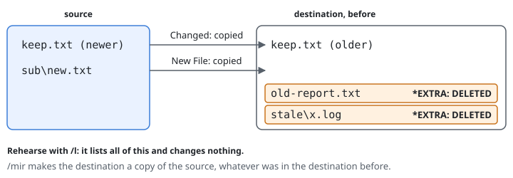

*Draft for owner review.* Most administration scripting is two jobs: finding things in text (logs, command output, configuration) and moving files around safely. cmd's tools for both are older and smaller than their Linux or PowerShell counterparts, but you will meet them in every legacy script, and knowing what they *cannot* do is as useful as knowing what they can. This lesson covers `type`, `more`, `find`, `findstr`, `sort`, `fc`, `copy`, `xcopy`, `robocopy`, `forfiles`, `attrib`, `mklink` and the `for /f` combinations that tie them together. It finishes with a comparison table showing the PowerShell and bash equivalents.

The examples were run on Windows 11 and the outputs are real; the newer results (comparing files, line endings and encodings, mirroring, ages) come from `tests/verification/cmd/text2.cmd`. Windows 10 and non-English Windows were not tested. Most examples use a small set of sample files (a log, two word lists):

```
logs\app.log                      data\names.txt     data\nums.txt
2026-11-20 10:01 INFO start       zoe                10
2026-11-20 10:02 ERROR disk full  adam               9
2026-11-20 10:03 WARN slow        Bob                100
2026-11-21 09:00 ERROR timeout    adam               1
2026-11-21 09:05 INFO done        carl
```

## Looking at text

| Tool | Use |
|---|---|
| `type file` | print a whole file ([`type`](https://learn.microsoft.com/windows-server/administration/windows-commands/type)) |
| `more file`, `type file \| more` | one screen at a time; `more +2 file` starts at line 2 ([`more`](https://learn.microsoft.com/windows-server/administration/windows-commands/more)) |
| `type nul > empty.txt` | create an empty file (or empty an existing one) |
| `find`, `findstr` | search for text |
| `sort` | sort lines |
| `fc`, `comp` | compare two files |

There is **no `head` or `tail`** in cmd. To skip lines use `more +N`, or `for /f "skip=N"`; to take the first lines use a loop that stops. (PowerShell's `Get-Content -TotalCount` and `-Tail` are the clean answer; see the comparison table at the end.)

**Counting lines.** `find /c /v ""` counts the lines of its input (it counts lines that do **not** match an empty string, which is all of them):

```
type data\names.txt | find /c /v ""
5
```

## `find`: the simple search

[`find`](https://learn.microsoft.com/windows-server/administration/windows-commands/find) searches for a literal string:

```
find /c "ERROR" logs\app.log

---------- LOGS\APP.LOG: 2

find /i "error" logs\app.log

---------- LOGS\APP.LOG
2026-11-20 10:02 ERROR disk full
2026-11-21 09:00 ERROR timeout
```

`/c` counts matching lines, `/i` ignores case, `/v` shows the lines that do **not** match, `/n` numbers lines. Notice that `find` prints a **header line** (and upper-cases the file name) unless it reads from a pipe. For scripts, `findstr` is usually the better tool.

## `findstr`: the workhorse

[`findstr`](https://learn.microsoft.com/windows-server/administration/windows-commands/findstr) matches lines. It also **sets the exit code** (`0` found, `1` not found), so it doubles as a test.

| Switch | Meaning |
|---|---|
| `/i` | ignore case |
| `/n` | prefix line numbers |
| `/v` | show lines that do **not** match |
| `/c:"two words"` | search for the literal phrase (without it, **spaces separate alternatives**) |
| `/r` | treat the pattern as a regular expression (also the default when the pattern has regex characters) |
| `/b` `/e` | match only at the beginning, or the end, of a line |
| `/s` | search subfolders (with a file pattern such as `*.log`) |
| `/m` | print only the **names** of files that contain a match |
| `/l` | literal search, no regular expressions |
| `/x` | the line must match the whole pattern |
| `/f:file` `/g:file` | read file names (`/f`) or search strings (`/g`) from a file |

```
findstr /n /i "error" logs\app.log
2:2026-11-20 10:02 ERROR disk full
4:2026-11-21 09:00 ERROR timeout

findstr /b /c:"2026-11-20" logs\app.log
2026-11-20 10:01 INFO start
2026-11-20 10:02 ERROR disk full
2026-11-20 10:03 WARN slow

findstr /i /c:"ERROR disk" /c:"timeout" logs\app.log
2026-11-20 10:02 ERROR disk full
2026-11-21 09:00 ERROR timeout

findstr /v /i "info" logs\app.log
2026-11-20 10:02 ERROR disk full
2026-11-20 10:03 WARN slow
2026-11-21 09:00 ERROR timeout

findstr /s /i "adam" data\*.txt
data\names.txt:adam
data\names.txt:adam

findstr /m "ERROR" logs\*.log
logs\app.log
```

In order: the lines matching either of two literal phrases; everything except the `INFO` lines; a search through a tree (each match is prefixed with its file name); and only the **names** of files that mention the pattern.

### The regular expressions `findstr` understands

`findstr` has its own small regex dialect, **not** the one in PowerShell, grep or most other tools:

| Syntax | Meaning |
|---|---|
| `.` | any one character |
| `*` | zero or more of the previous character |
| `^` `$` | start, end of line |
| `[abc]` `[^abc]` `[a-z]` | a character class, a negated class, a range |
| `\<` `\>` | start, end of a **word** |
| `\x` | the literal character `x` |

```
findstr /r "^[a-b]" data\names.txt        names that begin with a or b
adam
adam

findstr /r "\<adam\>" data\names.txt       the whole word
adam
adam
```

The first prints the names that begin with `a` or `b`; the second matches `adam` as a whole word.

**It does not support** `+`, `?`, `|` (alternation) or `{n,m}` counts. A search such as `findstr /r /c:"a\{2\}"` silently matched nothing (exit code 1) in my test; there is no error, so a pattern that "does nothing" usually means you used a feature it lacks. For alternation use several `/c:` strings or run `findstr` twice; for richer patterns move to PowerShell's `Select-String`.

**Quirks to remember:** `findstr` treats a space in the pattern as "or" unless you use `/c:`; a very long line or a binary file can confuse it; and its matching of non-English text depends on the code page. Be careful with `findstr` in `for /f`: the pipe inside the command must be escaped, as the next section shows.

### When `findstr` finds nothing, check the file

A search that finds nothing may mean **the text is not there**, or that `findstr` **cannot read this file the way you think**. Two common cases:

**1. Linux-style line endings.** Many logs end each line with LF only (anything from a Linux system, and some programs). A three-line LF file had two lines ending in `ERROR`:

| Command | LF file | the same text with CR+LF |
|---|---|---|
| `findstr /n "ERROR" file` | found lines 1 and 3 | found |
| `findstr /n /e "ERROR" file` (at line end) | **nothing**, exit 1 | found lines 1 and 3 |
| `findstr /n "ERROR$" file` | **nothing**, exit 1 | |

`/e` and `$` need the Windows line ending. **Search without the anchor**, or convert the file first, when it came from elsewhere. (`find /c /v ""` still counted 3 lines.)

**2. UTF-16 files.** In **Windows PowerShell 5.1**, `'disk ERROR here' > u16.log` creates a UTF-16 file. On it:

| Command | Result |
|---|---|
| `type u16.log` | showed the text correctly |
| `findstr "ERROR" u16.log` | `FINDSTR: Warning - input file u16.log is in Unicode format.` and **no match**, exit 1 |
| `find "ERROR" u16.log` | **found it**, exit 0 |
| `type u16.log \| findstr "ERROR"` | **found it**, exit 0 |

`type` converted the text on the way through the pipe. So for a log made by a PowerShell script, use `type file | findstr`, or have the script write UTF-8.

**Exit code 1 is also what a missing file gives** (`FINDSTR: Cannot open nothere.txt`). A script that treats 1 as "no errors in the log" will report all is well when the log **does not exist**. Check `if exist` first.

## Combining tools: `for /f` over a command

`for /f` can read a command's output. If the command contains a pipe or other special character, escape it with `^` **inside the for**:

```
for /f "tokens=2 delims=:" %%a in ('echo key:value:more ^| findstr key') do echo token2=%%a
token2=value
```

This is the standard way to pick one value out of a tool's output, for example one line of `ipconfig`, `net` or `systeminfo`. The patterns are always the same: run the tool, filter with `findstr`, split with `tokens` and `delims`. The wider rule: output formats of old tools are **not a stable interface**, and a different Windows language or version can change them, so keep such parsing in one place and test it.

## `sort`

[`sort`](https://learn.microsoft.com/windows-server/administration/windows-commands/sort) orders lines **as text**:

```
sort data\names.txt        adam adam Bob carl zoe       (not case-sensitive)
sort /r data\names.txt     zoe carl Bob adam adam       (reverse)
sort data\nums.txt         1 10 100 9                   (text order, not numeric)
```

Numbers sort as text, so `9` comes after `100`. To sort numbers, pad them with leading zeros, or use PowerShell (`Sort-Object { [int]$_ }`). `/+n` sorts from character column `n`. `sort` has no "unique" switch, so removing duplicates is awkward in cmd: another sign it is time for PowerShell (`Sort-Object -Unique`).

## Comparing files

```
fc data\names.txt data\copy.txt
Comparing files DATA\names.txt and DATA\COPY.TXT
FC: no differences encountered
```

[`fc`](https://learn.microsoft.com/windows-server/administration/windows-commands/fc) compares text files and sets the exit code (`0` identical, `1` different), so it works as a test: `fc a b >nul && echo same`. [`comp`](https://learn.microsoft.com/windows-server/administration/windows-commands/comp) compares files byte by byte, which is what you want for binaries.

### Reading the differences

`a.txt` holds `alpha`, `beta`, `gamma`; `b.txt` holds `alpha`, `BETA changed`, `gamma`, `delta`:

```text
***** a.txt
alpha
beta
gamma
***** B.TXT
alpha
BETA changed
gamma
*****

***** a.txt
***** B.TXT
delta
*****
```

Each **block** between rows of stars is one difference, shown **twice**: first as it is in the first file, then as it is in the second. The matching lines around it are there to show **where** you are. In the first block, `beta` became `BETA changed`. In the second, the first file's part is **empty**: `delta` exists only in the second file. `fc /n` adds line numbers. `fc /b` compares bytes and prints `offset: byte byte`, for example `00000001: 62 63`.

**Exit codes: 0 identical, 1 different, 2 a file could not be opened.** A script testing only for "not 0" would call a missing file a difference.

## Copying, moving, and keeping in sync

| Tool | Use it for |
|---|---|
| `copy` | single files, concatenation (`copy a+b c`), simple cases |
| `xcopy` | trees (`/e` include empty folders, `/i` assume destination is a folder, `/y` no prompts, `/d` only newer) |
| `robocopy` | **everything serious**: retries, logging, mirroring, attributes, security, long paths |
| `move` | move or rename |

[`xcopy`](https://learn.microsoft.com/windows-server/administration/windows-commands/xcopy) is the older tree copier; its exit code is 0 for success, and it prints `3 File(s) copied`. Prefer `robocopy`.

### `robocopy`

[`robocopy`](https://learn.microsoft.com/windows-server/administration/windows-commands/robocopy) ("robust copy") is built into Windows and is the tool to learn. The shape is `robocopy source destination [files] [options]`:

| Option | Meaning |
|---|---|
| `/e` | copy subfolders including empty ones |
| `/mir` | **mirror**: make the destination identical to the source, **deleting** extras at the destination |
| `/purge` | delete destination files that no longer exist in the source |
| `/l` | **list only**: show what would happen and copy nothing (a dry run) |
| `/r:n` `/w:s` | retry `n` times, wait `s` seconds (the default is a million retries, 30 seconds apart, which can hang a script for a very long time) |
| `/xf` `/xd` | exclude files, exclude folders |
| `/log:file` `/tee` | write a log; `/tee` also shows it |
| `/np` `/njh` `/njs` `/ndl` `/nc` `/ns` | trim the output: no progress, no job header, no job summary, no directory list, no class, no size |
| `/z` | restartable mode, useful over unreliable links |
| `/mt:n` | multi-threaded copy with `n` threads |
| `/copyall` | copy data, attributes, timestamps, security, owner and auditing |

**Always rehearse with `/l` first**, especially with `/mir`:

```
robocopy data C:\dest /mir /l
```

`/mir` deletes whatever is in the destination and not in the source. Pointing it at the wrong folder is a classic way to lose data; running it only after a dry run is the right habit. The picture and the real output below show it. With a source folder holding three files, the first real run reported exit code **1** (files copied), an immediate second run **0** (nothing to do), and after adding an extra file to the destination a `/l` dry run reported **2** (extra file present). The destination copy that `/mir` would remove showed in the dry run's list.



```text
 source                          destination before
 keep.txt (newer)  --Changed-->  keep.txt (older)
 sub\new.txt       --New File->
                                 old-report.txt     *EXTRA: DELETED
                                 stale\x.log        *EXTRA: DELETED
```

I ran exactly this. The destination held a file called `old-report.txt` whose only content was `do not lose me`. The **dry run** `robocopy src dst /mir /l /njh /njs /np /ndl` printed:

```text
	*EXTRA Dir        -1	...\dst\stale\
	  *EXTRA File 		       3	...\dst\stale\x.log
	  *EXTRA File 		      16	...\dst\old-report.txt
	    Changed   		       6	...\src\keep.txt
	    New File  		       5	...\src\sub\new.txt
```

and returned **3** (1: would copy, plus 2: extras), with the destination still unchanged. **Read every `*EXTRA` line: with `/mir`, those are the things that will be deleted.** The real run then removed `old-report.txt` and the `stale` folder. There is no Recycle Bin and no undo.

Without `/njs` the job ends with a summary table:

```text
               Total    Copied   Skipped  Mismatch    FAILED    Extras
    Dirs :         2         1         1         0         0         1
   Files :         2         2         0         0         0         2
```

Check **FAILED** (should be 0) and **Extras** before trusting a mirror.

### `robocopy` exit codes

The exit code is a **bit mask**; add the values that apply:

| Value | Meaning |
|---|---|
| 0 | nothing needed copying; the folders already match |
| 1 | one or more files were copied |
| 2 | extra files or folders exist in the destination |
| 4 | mismatches were found |
| 8 | some files or folders could not be copied (a **failure**) |
| 16 | a serious error: nothing was copied |

So **0 to 7 are success** and 8 or more are failures: `if errorlevel 8 (echo failed & exit /b 1)` is the correct test.

## `forfiles`: select by age and run something

[`forfiles`](https://learn.microsoft.com/windows-server/administration/windows-commands/forfiles) runs a command on files, with variables for their properties:

```
forfiles /p logs /m *.log /c "cmd /c echo @file @fsize bytes"
"app.log" 151 bytes
```

`/p` is the path, `/m` the mask, `/s` recurses, `/d -30` selects files **older than 30 days** (`/d +` for newer), and `@file`, `@fname`, `@fext`, `@fsize`, `@fdate`, `@path` are the variables. A typical clean-up (always rehearsed with `echo` first):

```
forfiles /p "D:\logs" /s /m *.log /d -30 /c "cmd /c echo del @path"
```

When no file matches, `forfiles` prints an error (`ERROR: No files found with the specified search criteria.`) and sets exit code `1`, which a script must not mistake for a failure.

To test the age filter, I made `stale.log` and set its date 40 days back. `forfiles /m *.log /d -30 /c "cmd /c echo older than 30 days: @file @fdate"` printed only `older than 30 days: "stale.log" 10/17/2026` (the date in this PC's format). `@file` arrived **with quotes**, which protects names with spaces. With a mask that matched nothing, the message was `ERROR: Files of type "*.none" not found.` and the exit code was 1: **the wording differs with the reason**, so do not test for the text.

## Attributes, links and listing

- [`attrib`](https://learn.microsoft.com/windows-server/administration/windows-commands/attrib): `attrib +h file` hides, `-h` unhides, `+r` read-only; `dir /a:h` lists hidden files, `dir /a:-d` lists files only. The Properties dialog sets the same attributes.
- **`dir` sorting and filters:** `dir /b /o:-s` biggest first, `/o:d` by date, `/t:w` write time, `/s /b` full paths of everything below.
- **[`mklink`](https://learn.microsoft.com/windows-server/administration/windows-commands/mklink)** creates links: `mklink link target` (file symbolic link), `mklink /d link target` (folder symbolic link), `mklink /j link target` (junction), `mklink /h link target` (hard link). Creating symbolic links needs a privilege: administrator, or Developer Mode turned on. In my (non-elevated) test it worked because the privilege was available.
- **Empty file size:** `for %%f in (empty.txt) do echo %%~zf` prints `0`; the `%~z` modifier is the quick way to get a size.

## Dealing with dates, safely

`%DATE%` and `%TIME%` depend on regional settings, and `dir` output is localized. For anything beyond simple age checks (`forfiles /d`), ask PowerShell (`Get-Date`, `Get-ChildItem | Where-Object LastWriteTime -lt ...`) or compare files with `robocopy /l /maxage:n`.

## The same job in three shells

| Task | cmd | PowerShell | bash (GNU) |
|---|---|---|---|
| print a file | `type f` | `Get-Content f` | `cat f` |
| first 3 lines | loop with `for /f` | `Get-Content f -TotalCount 3` | `head -n 3 f` |
| last 3 lines | no simple way | `Get-Content f -Tail 3` | `tail -n 3 f` |
| count lines | `type f | find /c /v ""` | `(Get-Content f).Count` | `wc -l < f` |
| lines containing text | `findstr text f` | `Select-String text f` | `grep text f` |
| lines not containing | `findstr /v text f` | `Select-String text f -NotMatch` | `grep -v text f` |
| sort lines | `sort f` | `Get-Content f \| Sort-Object` | `sort f` |
| sort numerically | not directly | `Sort-Object { [int]$_ }` | `sort -n f` |
| unique lines | no direct tool | `Sort-Object -Unique` | `sort -u f` |
| compare files | `fc a b` | `Compare-Object (gc a) (gc b)` | `diff a b` |
| recursive search | `findstr /s text *.log` | `Get-ChildItem -Recurse \| Select-String text` | `grep -r text .` |
| copy a tree | `robocopy a b /e` | `Copy-Item a b -Recurse` | `cp -r a b` |
| list by size | `dir /o:-s` | `Get-ChildItem \| Sort-Object Length -Descending` | `ls -lS` |

## Common mistakes

- **Forgetting that `findstr` treats spaces as "or"** and using `/c:` when you want a phrase.
- **Expecting `findstr` to support `+`, `?`, `|` or `{n}`** and getting no error, only no match.
- **Sorting numbers with `sort`** and being surprised by `1 10 100 9`.
- **Running `robocopy /mir` without a `/l` dry run.**
- **Using the default `robocopy` retry settings** in a script (`/r:1 /w:1` is saner).
- **Testing `if errorlevel 1` after `robocopy`**; 1 and 2 are success.
- **Treating `forfiles` exit code 1** (no files found) as a failure.
- **Trusting "not found" from `findstr`** on an LF-only or UTF-16 file, or a file that does not exist.
- **Using `$` or `/e` on logs from other systems.**
- **Not reading the `*EXTRA` lines** of a `/mir` dry run.
- **Piping inside `for /f` without escaping the pipe** (`^|`).
- **Parsing localized tool output** and finding it breaks on another language of Windows.

## Practice

1. Write a command that prints the line number and text of every `ERROR` line in `logs\app.log`, and another that counts them.
2. Print only the lines of `app.log` **not** containing `INFO`, and count them with `find /c /v ""`.
3. Use `for /f` and `findstr` to extract the IPv4 address from `ipconfig` output (the pipe must be escaped).
4. Mirror a source folder to a destination with `robocopy`, first as a `/l` dry run, then for real. Add an extra file to the destination and show that `/mir` removes it.
5. Write a clean-up script that lists the files older than 30 days with `forfiles` and an `echo` before it deletes anything.
6. Show why `sort` ranks `9` after `100`, then make it sort numerically by padding with zeros.

## Check your understanding

1. How do you count the lines of a file in cmd?
2. What does `findstr "two words"` search for, and what does `findstr /c:"two words"` search for?
3. Name three regex features `findstr` does not support.
4. What does `robocopy` exit code 3 mean, and is it a failure?
5. What is the danger of `robocopy /mir`, and how do you rehearse it?
6. Why must the pipe in `for /f ... in ('a ^| b')` be escaped?
7. How do you list the names of files that contain a pattern, without the matching lines?
8. Which cmd tool has no PowerShell-free way to sort numbers or remove duplicates, and what do you use instead?
9. `findstr /e "ERROR"` finds nothing in a log copied from a Linux server, although lines clearly end in ERROR. Why?
10. Your script checks a PowerShell-made log with `findstr` and never finds anything. What might be wrong, and what worked in the lesson's test?
11. In a `/mir` dry run, what do the `*EXTRA` lines mean?

**Expected answers:** (1) `find /c /v "" < file` or `type file | find /c /v ""`; (2) either word; the exact phrase; (3) `+`, `?`, `|` (alternation) and `{n,m}` counts; (4) 1 + 2: files were copied and extra files exist at the destination; it is not a failure (only 8 or more are); (5) it deletes anything in the destination that is not in the source; run it with `/l` first; (6) the parser would otherwise apply the pipe to the whole `for` command instead of to the command inside the parentheses; (7) `findstr /m pattern files`; (8) `sort`; use PowerShell's `Sort-Object { [int]$_ }` and `Sort-Object -Unique`; (9) the file has LF line endings, and `/e` needs CR+LF; (10) the file is UTF-16; `type file | findstr` or `find` found the text; (11) files and folders only in the destination, which the real run will delete.
