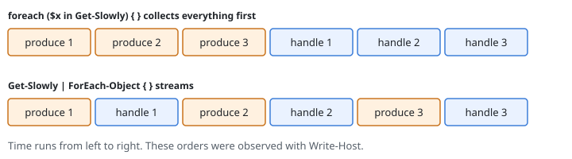

*Draft for owner review.* Control flow is how a script decides and repeats: `if`, `switch`, and the loop statements. PowerShell has all of them, plus a pipeline-based way to loop (`ForEach-Object`) that behaves differently from the statement forms in ways that matter. This lesson covers each construct, the traps in each, which one to choose, and how to read someone else's control flow quickly. Functions are the next lesson and errors the one after, both because they deserve more room than they got here. Every example was run on **Windows PowerShell 5.1** and **PowerShell 7**, and where they differ the text says so. The results on `break`, the order of work, `switch -File` and the loop traps come from `tests/verification/powershell/cflow2.ps1`; they were the same in 5.1.26100 and 7.6.10.

## Decisions with `if`

```powershell
if ($size -gt 1GB) {
    'large'
} elseif ($size -gt 1MB) {
    'medium'
} else {
    'small'
}
```

The condition is any expression, converted to true or false by the truthiness rules of the previous lesson (`$null`, `0`, `''` and `@()` are false). `-and` and `-or` **short-circuit**, so the right side runs only if needed: `if ($path -and (Test-Path $path))` never calls `Test-Path` on an empty `$path`. A command can be the condition: `if (Test-Path $file) { ... }`, `if (Get-Process notepad -ErrorAction SilentlyContinue) { ... }`.

### The assignment trap

```powershell
$x = 0
if ($x = 5) { "assigned, now x=$x (condition was truthy)" }
assigned, now x=5 (condition was truthy)
```

A single `=` **assigns**, and the value assigned (5) is true. This is legal, silent and almost always a bug: comparison is `-eq`. When you read a script, a lone `=` inside an `if (...)` is the first thing to check.

### `else` placement

Write `} elseif (...) {` and `} else {` on the same line as the closing brace, as in the example. A newline before `else` also works inside a saved script (I tested both editions), but it fails when you type the statement line by line at the prompt, so the one-line form is the habit that works everywhere.

## Many cases with `switch`

`switch` tests one value against several cases:

```powershell
switch ($status) {
    'Running' { 'all good' }
    'Stopped' { 'needs attention' }
    default   { 'unknown state' }
}
```

`switch` has behaviours that surprise people coming from other languages:

**It does not stop at the first match.** Every case that matches runs:

```powershell
switch (5) {
    { $_ -gt 1 } { 'gt1' }
    { $_ -gt 3 } { 'gt3' }
    5            { 'is5' }
    default      { 'default' }
}
gt1
gt3
is5
```

All three matched, and `default` ran only because it is the fallback when **none** match. Add `break` to stop after the first match (`{ 'gt1'; break }` printed only `gt1`), or `continue` to move to the next input value.

**A case can be a script block** (`{ $_ -gt 1 }`), a value (`5`), or a pattern with the options below. Inside the block, `$_` is the value being tested.

**It loops over an array** testing each element:

```powershell
switch (1,2,3) { 1 {'one'} 2 {'two'} default {"other $_"} }
one
two
other 3
```

**`break` in a `switch` over a collection ends the whole `switch`, not just that item.** This is the opposite of what many people expect:

| `switch (1,2,3,4)` with a case for 2 that says | Output |
|---|---|
| `{ 'two: break'; break }` | `saw 1`, `two: break` (**3 and 4 were never tested**) |
| `{ 'two: continue'; continue }` | `saw 1`, `two: continue`, `saw 3`, `saw 4` |

When `switch` works through several values, **`continue`** means "done with this value, take the next", and **`break`** means "stop altogether". Use `break` there only if you really mean to stop.

Two edge cases: `switch ($null)` **does** run its `default` case (once, for `$null`), but `switch (@())`, an empty array, runs **nothing at all**.

### Options

| Option | Meaning |
|---|---|
| `-Wildcard` | cases are `-like` patterns (`'*.log'`) |
| `-Regex` | cases are regular expressions, and `$Matches` is set |
| `-CaseSensitive` | match case (the default is **case-insensitive**, including for wildcard and regex) |
| `-Exact` | no pattern matching (the default) |
| `-File path` | test each line of a file |

```powershell
switch -Regex ('error 404 not found') {
    '^error (\d+)' { "code $($Matches[1])" }
    'found'        { 'found-text' }
}
code 404
found-text
```

Two cases matched, so both ran. With `-Wildcard`, `'Report.LOG'` matched `'*.log'`; with `-CaseSensitive` it did not. Use `switch` when you have **one value and several outcomes**; use `if`/`elseif` when the conditions are unrelated.

`-File` reads a file line by line, which makes `switch` a compact log classifier. For a file of `INFO start`, `ERROR disk full`, `WARN slow`, `ERROR timeout`:

```powershell
$errors = 0
switch -Regex -File x.log {
    '^ERROR (.+)' { $errors++; "error: $($Matches[1])" }
    '^WARN'       { 'warning' }
}
"errors: $errors"
```

```text
error: disk full
warning
error: timeout
errors: 2
```

A line that matches no case, such as `INFO start`, produces nothing (there is no `default` here).

## Loops

PowerShell has four loop statements (`foreach`, `for`, `while`, `do`) and one pipeline cmdlet (`ForEach-Object`). Know which you are using, because they differ.

### The `foreach` statement

```powershell
foreach ($file in Get-ChildItem C:\Labs -File) {
    "$($file.Name): $($file.Length) bytes"
}
```

It first **collects** everything on the right, then loops. That is fast, but it holds the whole collection in memory. The loop variable **persists after the loop**: after `foreach ($i in 1..3) { }`, `$i` is `3`. `break` leaves the loop and `continue` skips to the next item. Looping over `$null` does not run the body at all (I confirmed this in both editions).

### `ForEach-Object`

```powershell
Get-ChildItem C:\Labs -File | ForEach-Object { "$($_.Name): $($_.Length) bytes" }
```

It **streams**: each object goes through the pipeline as it is produced, which uses little memory and starts output immediately. You can watch the difference. `Get-Slowly` is a function that announces each item as it makes it:



```text
 foreach ($x in Get-Slowly):   produce 1, produce 2, produce 3, handle 1, handle 2, handle 3
 Get-Slowly | ForEach-Object:  produce 1, handle 1, produce 2, handle 2, produce 3, handle 3
```

And `Get-Slowly | Select-Object -First 1` produced **only item 1**: the producer was stopped. With a slow or enormous source, that difference is minutes.

 It has three blocks:

```powershell
1..3 | ForEach-Object -Begin { $sum = 0 } -Process { $sum += $_ } -End { "sum=$sum" }
sum=6
```

`-Begin` runs once before, `-Process` once per object, `-End` once after. The aliases are `%` and `foreach` (the second is the cmdlet alias when used after a pipe, not the statement, which is confusing; in scripts write `ForEach-Object`).

**Differences you must know** between the statement and the cmdlet:

| | `foreach` statement | `ForEach-Object` |
|---|---|---|
| memory | collects first | streams |
| speed | faster: summing 200,000 numbers took about 0.3 s | about 1.2 s for the same work (3 to 4 times slower) |
| current item | the variable you name | `$_` |
| `break` | leaves the loop | **do not use**: it ends an enclosing loop, or the whole script (below) |
| `return` | leaves the function | acts like `continue` for that item |

```powershell
1..4 | ForEach-Object { if ($_ -eq 2) { return }; $_ }
1
3
4
```

Here `return` skipped only item 2. To stop a pipeline early use `Select-Object -First n`, which cleanly cuts the upstream, or switch to the `foreach` statement.

#### What `break` really does here

`ForEach-Object` is not a loop, so `break` looks **outward** for one. I ran two small scripts, each in its own PowerShell:

```powershell
"before"
1..4 | ForEach-Object { if ($_ -eq 2) { break }; "item $_" }
"AFTER the pipeline"
```

```text
before
item 1
```

**`AFTER the pipeline` never printed.** With no loop around it, `break` **ended the script**, silently. In the second, the pipeline was inside `foreach ($round in 1..3)`:

```text
round 1
  item 1
after the loop
```

It ended the **outer `foreach`**: rounds 2 and 3 never happened, and not even the line `end of round 1` ran. **No error is reported in either case.** A script that just "stops early" is worth searching for `break` inside `ForEach-Object` or `Where-Object` blocks.

**Choose:** `foreach` for in-memory data and speed; `ForEach-Object` for streaming large or slow sources and for putting a loop in the middle of a pipeline.

### The `.ForEach()` and `.Where()` methods

Collections have methods (PowerShell 4+) that are faster and more compact than pipelines for in-memory arrays:

```powershell
(1..6).Where({ $_ % 2 -eq 0 }) -join ','        # 2,4,6
(1..3).ForEach({ $_ * 10 }) -join ','           # 10,20,30
```

### `for`

```powershell
for ($i = 0; $i -lt 5; $i++) { $i }
```

Initial statement, condition, step. It takes **one** initialiser (a comma-separated pair of assignments is a syntax error). Use it when you need the index or an unusual step. The `++` operator updates silently: `$i++` outputs nothing, but `($i++)` in parentheses outputs the old value, which is why a stray `($i++)` prints a number.

### `while` and `do`

```powershell
while ($tries -lt 3) { $tries++ }                 # tests first: may run zero times
do { $n++ } while ($n -lt 3)                      # tests after: always runs once
do { $m++ } until ($done)                         # until: repeat until the condition is TRUE
```

`do ... while` and `do ... until` run the body **at least once**; plain `while` can run zero times (confirmed: `$k = 10; while ($k -lt 3) {...}` never ran). `until` is `while` with the condition inverted.

A loop that waits for something, with a time limit, is a staple of admin scripts:

```powershell
$deadline = (Get-Date).AddSeconds(30)
while ((Get-Date) -lt $deadline) {
    if (Test-Path $ready) { break }
    Start-Sleep -Seconds 2
}
if (-not (Test-Path $ready)) { throw "timed out waiting for $ready" }
```

### `break`, `continue` and labels

`break` leaves the innermost loop (or `switch`); `continue` skips to the next iteration. To leave an **outer** loop, give it a label:

```powershell
:outer foreach ($a in 1..3) {
    foreach ($b in 1..3) {
        if ($a * $b -ge 4) { "stop at $a x $b"; break outer }
    }
}
stop at 2 x 2
```

### Changing a collection while you loop over it

The two common collections behave differently:

```powershell
$list = [System.Collections.Generic.List[int]]@(1,2,3)
foreach ($e in $list) { if ($e -eq 2) { $list.Add(9) } }
InvalidOperationException: Collection was modified; enumeration operation may not execute.

$arr = @(1,2,3)
foreach ($e in $arr) { if ($e -eq 2) { $arr += 9 } }
$arr -join ','
1,2,3,9
```

The list throws. The array did not, but only because `+=` made a **new** array, so the loop kept walking the old one and never saw `9`. Build a second collection of changes and apply it after the loop.

### Parallel loops (PowerShell 7 only)

```powershell
1..4 | ForEach-Object -Parallel { $_ * 2 } -ThrottleLimit 2 | Sort-Object
2
4
6
8
```

`-Parallel` runs the script block on several threads (here two at a time). Results arrive in **any order**, the block runs in its own scope (it cannot see your variables unless you pass them with `$using:name`), and it only pays off for slow work such as network calls, not for fast arithmetic. It does not exist in 5.1.

### Two loop traps that raise no error

| What I ran | What happened |
|---|---|
| `for ($i = 0; $i -le $arr.Count; $i++)` on three items | A **fourth** pass with `i=3` and an **empty** value. Past the end of an array is `$null`, not an error. The condition must be `-lt`, not `-le` |
| `foreach ($x in $hashtable)` | **One** pass, with the whole hashtable as `$x`. Loop over `$hashtable.Keys` (or `$hashtable.GetEnumerator()`) |

(`foreach ($c in 'abc')` also runs once, with the whole string: a string is not split into characters.)

## Reading a loop: patterns to recognise

Many scripts are one of a handful of shapes:

| Shape | What it does |
|---|---|
| `foreach ($f in Get-ChildItem ...) { ... }` | process each file |
| `Import-Csv x.csv \| ForEach-Object { ... }` | process each row of a CSV |
| `foreach ($line in Get-Content x.log) { if ($line -match 'ERROR') { ... } }` | scan a log |
| `while ($true) { ...; if (...) { break }; Start-Sleep ... }` | poll until a condition |
| `for ($i = 1; $i -le $retries; $i++) { try {...; break} catch {...; Start-Sleep ...} }` | retry |
| `switch -Regex -File x.log { ... }` | classify lines by pattern |

**For large files**, `Get-Content` loads line by line into the pipeline, but `foreach ($line in Get-Content big.log)` first collects *every line*. Use `Get-Content big.log | ForEach-Object { ... }` or `switch -File` to stream, or `Select-String` for searching.

## Exiting early

- `continue` and `break` act on loops and `switch`.
- `return` leaves a function; at the top of a script it ends the script.
- `exit n` ends the process (and the script) with exit code `n`. Do not `exit` inside a function you intend to reuse in a console: it closes the host. Scripts and scheduled tasks use `exit` for the code their caller reads; the functions and errors lessons show the pattern.

## Common mistakes

- **`if ($x = 5)`** assigning instead of comparing.
- **`switch` falling through** because there is no `break`.
- **`break` inside `ForEach-Object`**, ending more than intended.
- **`break` in a `switch` over many values**, skipping all the rest.
- **`-le $arr.Count` in a `for` loop,** and expecting an error.
- **`foreach` over a hashtable** instead of its keys.
- **`return` inside `ForEach-Object`** thinking it exits the function.
- **`foreach` over a huge command output** and running out of memory.
- **A modified collection** inside `foreach`.
- **`for ($i=0, $j=10; ...)`** two initialisers.
- **Assuming `-Parallel` exists** in 5.1, or that it preserves order.
- **A waiting loop with no deadline.**
- **Using `Where-Object` to filter** when the cmdlet's own `-Filter` would remove the objects earlier.

## Read this script

Without running it, say what it prints, which lines run for a file named `report.LOG` that is 5 MB, and what would be different in `-CaseSensitive` mode. Then say what is wrong with the last `foreach`.

```powershell
$files = @(
    [pscustomobject]@{ Name = 'report.LOG'; Size = 5MB },
    [pscustomobject]@{ Name = 'notes.txt';  Size = 2KB }
)
foreach ($f in $files) {
    switch -Wildcard ($f.Name) {
        '*.log' { "log: $($f.Name)" }
        '*.txt' { "text: $($f.Name)" }
    }
    if ($f.Size = 5MB) { "big" }
}
```

**Answer.** `report.LOG` matches `'*.log'` because `-Wildcard` is case-insensitive, so it prints `log: report.LOG`; `notes.txt` prints `text: notes.txt`. With `-CaseSensitive`, `report.LOG` would match neither case and print nothing from the `switch`. The last `if ($f.Size = 5MB)` is the **assignment trap**: it *sets* the size to 5MB and is always true, so both files print `big`, and it also corrupts the data. It should be `-eq` (or `-ge`).

## Practice

1. Write a `switch -Regex` that classifies the strings `'ERROR disk'`, `'WARN slow'`, `'INFO ok'` and anything else, and print the severity and message.
2. Rewrite `Get-ChildItem | ForEach-Object { $_.Length }` with the `foreach` statement and measure both with `Measure-Command` on `C:\Windows\System32`.
3. Write a waiting loop that polls for a file for up to 20 seconds, and exits with code 1 and a message if it never appears.
4. Show, with a counter, that `switch` runs every matching case, then fix it with `break`.
5. Demonstrate the collection-modified error with a `List`, and the safe version that collects changes first.
6. In PowerShell 7, run the same slow task (`Start-Sleep -Milliseconds 500`) for 8 items sequentially and with `-Parallel -ThrottleLimit 4`, and compare the times.
7. Find the bug: `$total = 0; foreach ($n in 1..5) { $total = $n }; $total`.

The labs for this lesson ask for scripts that read a CSV and JSON file, take parameters and set exit codes, survive missing files, rename files in bulk, and classify numbers with `switch`. The check runs your script against fresh data and also looks at the exit code and the files left behind.

## Check your understanding

1. Why does `if ($x = 5)` always run its block?
2. What does `switch (5) { {$_ -gt 1} {'a'} {$_ -gt 3} {'b'} }` print?
3. How do you stop a `switch` after the first match?
4. What is the difference between `foreach` and `ForEach-Object` regarding memory and `break`?
5. What does `return` do inside a `ForEach-Object` script block?
6. How do you leave an outer loop from an inner one?
7. Why does modifying an array in a `foreach` not throw, while a `List` does?
8. When is `ForEach-Object -Parallel` a good idea, and what must you remember about it?
9. `switch (1,2,3)` has `break` in the case for 2. Is 3 tested?
10. A script stops partway with no error. It has `break` inside `ForEach-Object`. What happened?
11. Why does `for ($i=0; $i -le $a.Count; $i++)` not raise an error on the last pass?

**Expected answers:** (1) a single `=` assigns, and the assigned value is true; (2) `a` and `b`: both cases match; (3) `break` inside the case block; (4) `foreach` collects everything first (fast, more memory) and `break` leaves the loop; `ForEach-Object` streams (low memory) and `break` should be avoided there; (5) it acts like `continue`, skipping only that item; (6) give the outer loop a label and `break label`; (7) `+=` builds a new array, so the loop is still walking the old one; a `List` is modified in place, which the enumerator forbids; (8) for slow work such as network calls on PowerShell 7; results come in any order and variables need `$using:`; (9) no: `break` ends the whole `switch`; (10) `break` ended the surrounding loop, or the whole script, because `ForEach-Object` is not a loop; (11) reading past the end of an array gives `$null` without an error.
