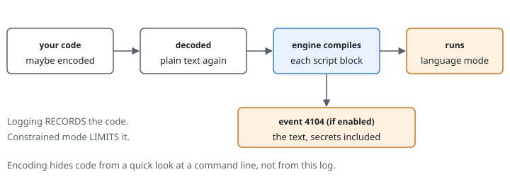

*Draft for owner review.* This is the last lesson of the PowerShell series. It covers the parts that make a script a *program* (**classes and enums**, direct use of **.NET**), the parts that make it *fast enough* (**performance**), and the parts that matter when somebody is *watching or restricting* PowerShell (**script block logging** and **constrained language mode**), plus a clear map of **Windows PowerShell 5.1 versus PowerShell 7**.

**What was tested, and where.** The portable battery (`tests\verification\powershell\adv1.ps1`) ran unchanged in **Windows PowerShell 5.1.26100**, **PowerShell 7.6.10 on Windows** and **PowerShell 7.6.10 on Linux** (WSL Ubuntu). Script block logging ran in the **Windows Server 2022 lab VM** (5.1, elevated; the VM was restored afterwards). Timings are from one machine on one afternoon: the *ratios* matter, not the milliseconds. Not tested: macOS, App Control for Business or AppLocker enforcing constrained language mode system-wide, module logging, and transcription by policy.

## Classes

PowerShell 5 added `class`. Use one when you need an object with a **fixed shape, typed properties and behaviour** that several functions share; for a bag of data a `[pscustomobject]` is still lighter. See [about_Classes](https://learn.microsoft.com/powershell/module/microsoft.powershell.core/about/about_classes).

```powershell
class Point {
    [int]$X
    [int]$Y
    hidden [string]$Secret = 'h'
    static [int]$Count = 0
    Point([int]$x, [int]$y) { $this.X = $x; $this.Y = $y; [Point]::Count++ }
    Point() { $this.X = 0; $this.Y = 0; [Point]::Count++ }
    [double] Length() { return [math]::Sqrt($this.X * $this.X + $this.Y * $this.Y) }
    [string] ToString() { return "($($this.X), $($this.Y))" }
    static [Point] Origin() { return [Point]::new() }
}
$p = [Point]::new(3, 4)
$p.Length()          # 5
"$p"                 # (3, 4)
[Point]::Count       # 1
```

All of that gave the same result in 5.1, 7 on Windows and 7 on Linux. What to notice:

- **Constructors** have the class name and no return type; you call them with `[Point]::new(...)`. **Static** members belong to the class (`[Point]::Count`), and `$this` is the instance.
- **`hidden`** keeps `Secret` out of `Get-Member` and tab completion. It is **not** security: the member is still readable.
- **Properties are typed and enforced.** `$p.X = 'abc'` failed with `Exception setting "X": "Cannot convert value "abc" to type "System.Int32"...`, while `$p.X = '7'` was converted and `$p.X.GetType().Name` was `Int32`.
- **A method that declares a return type must return on every path.** `class Bad { [int] Get() { 5 } }` is rejected at **parse time**: `ParseException ... Not all code path returns value within method.` In a *function* the bare `5` would be output; in a *method* only `return` produces output.
- **Methods do not leak stray output.** My `Run()` called `$list.Add(1)` (which returns an index in a function and pollutes the pipeline) and the call still returned only `5`. That is a real advantage over functions, where an unsuppressed `.Add()` is a classic bug.
- **Inheritance:** `class Dog : Animal` with an overriding `Speak()` returned `Woof`. A cast `([Animal]$dog).Speak()` returned `...` in all three of my runs, the *base* method; do not assume C#-style virtual dispatch through a cast without testing it.
- **You cannot redefine a class in a live session.** Defining `class Point` again through `Invoke-Expression` printed no error, but the existing type kept being used (`[Point]::new(1,2)` still produced an object with `X` and `Y`). To change a class during development, **start a new session** (the PowerShell extension for VS Code can restart it). A *parse-time* duplicate in one file is an error.

### Enums

```powershell
enum Level { Low = 1; Mid; High }
[Level]::Mid          # Mid
[int][Level]::High    # 3
[Level]'High'         # High
[Level]'Nope'         # error listing the valid names: Low, Mid, High
```

An enum gives names to a fixed set of values, rejects anything else with a clear message, and can be used directly as a parameter type so the **tab completion and validation come for free** ([about_Enum](https://learn.microsoft.com/powershell/module/microsoft.powershell.core/about/about_enum)).

**When not to use a class:** a script that only passes a few values around; anything that must work in PowerShell 3 or 4; or code that will be dot-sourced repeatedly in one session (see the redefinition trap). According to the documentation (I did not test this), classes defined in a **module** are only visible to callers through `using module`, which is why many module authors still use `[pscustomobject]` plus functions.

## Using .NET directly

Every PowerShell value is a .NET object, and any .NET type is reachable with square brackets: `[Type]::StaticMember` for static members, `$object.Member` for instance members.

```powershell
[math]::Round(2.5)                                          # 2
[math]::Round(2.5, [MidpointRounding]::AwayFromZero)         # 3
[System.IO.Path]::Combine('a', 'b', 'c.txt')                 # a\b\c.txt  (on Windows)
[System.IO.Path]::GetExtension('x.tar.gz')                   # .gz
[guid]::NewGuid().ToString().Length                          # 36
[System.Text.Encoding]::UTF8.GetBytes('é').Count             # 2
```

Things I verified:

- **`[math]::Round(2.5)` is 2** (banker's rounding, to the even neighbour); the overload with `[MidpointRounding]::AwayFromZero` gives 3. This is the same rule that made `[int](2.5)` equal 2 in an earlier lesson. Never hand-roll rounding; read the .NET documentation for the overload you want.
- **`::` versus `.`:** `[math].Round(2.5)` raised a `RuntimeException` (it asks the `Type` object, not the class, for a `Round` method).
- **Generic collections:** `[System.Collections.Generic.List[string]]::new()` is the right growing list. `$l.Add(5)` on a `List[string]` did not fail; the `5` was converted and `$l[1].GetType().Name` was `String`. PowerShell converts arguments to the declared type for you, so a type that "enforces" something may be silently coercing.
- **Dictionaries are case-sensitive** where a PowerShell hashtable is not: `ContainsKey('a')` was `True` and `ContainsKey('A')` was `False` on `Dictionary[string,int]`.
- **`StringBuilder`:** `[void]$sb.Append('a').Append('b')`. The `[void]` discards the returned builder so it does not print. Without it, every `Append` would write an object to the pipeline.

### Adding your own C#: `Add-Type`

```powershell
Add-Type -TypeDefinition 'public static class WlMath { public static int Twice(int n) { return n * 2; } }'
[WlMath]::Twice(21)          # 42
```

Running the *same* definition again raised no error; running a **different** definition with the same type name failed with `Cannot add type. The type name 'W2' already exists.` Types cannot be unloaded from a session, which is the same reason as for classes. `Add-Type` **compiles code at run time**, which is a reason to read any script that uses it very carefully (see the audit table below). See [Add-Type](https://learn.microsoft.com/powershell/module/microsoft.powershell.utility/add-type).

### The null-conditional trap (PowerShell 7)

PowerShell 7 added `??` (null-coalescing), `? :` (ternary), `&&` and `||` (pipeline chains) and `?.` (null-conditional member access) ([about_Operators](https://learn.microsoft.com/powershell/module/microsoft.powershell.core/about/about_operators), [about_Pipeline_Chain_Operators](https://learn.microsoft.com/powershell/module/microsoft.powershell.core/about/about_pipeline_chain_operators)). One of them has a trap that I fell into while testing:

```powershell
$u = $null
$u?.Length       # printed 0 (!), not nothing
${u}?.Length     # printed nothing, as intended
```

`?` is a **legal character in a variable name**, so `$u?.Length` is read as "the variable named `u?`, then `.Length`", and `$null.Length` is `0`. For `?.` and `?[]` the variable name must be wrapped in braces: `${u}?.Length`. I saw this on both Windows and Linux. The error is silent, which is why it matters.

## Performance

The rule: **measure, do not guess** (`Measure-Command`, or `[System.Diagnostics.Stopwatch]`). Microsoft's [script authoring considerations](https://learn.microsoft.com/powershell/scripting/dev-cross-plat/performance/script-authoring-considerations) list the same habits I measured:

### Measuring, and reading the result

```powershell
Measure-Command { Start-Sleep -Milliseconds 250 } | Format-List Seconds, Milliseconds, TotalSeconds, TotalMilliseconds
```

```text
Seconds           : 0
Milliseconds      : 264
TotalSeconds      : 0.2642436
TotalMilliseconds : 264.2436
```

[`Measure-Command`](https://learn.microsoft.com/powershell/module/microsoft.powershell.utility/measure-command) returns a `TimeSpan`. **Read the `Total...` properties.** `Seconds` and `Milliseconds` are only the *parts* of the time: for 2,350 ms, `Milliseconds` is **350** and `TotalMilliseconds` is 2350.

Three more behaviours, all checked in 5.1 and 7.6 (`tests/verification/powershell/adv3.ps1`):

- **The block's output is swallowed.** You get only the time. To see output too, send it to `Out-Default` inside the block, and remember that printing is then part of what you time.
- **The block runs in your current scope.** `$n = 1; Measure-Command { $n = 99 }` left `$n` at **99**. Do not time code that changes or deletes things without meaning it to happen.
- **One run proves little.** Five runs of one loop took 221, 186, 138, 183 and 208 ms in 5.1: the slowest was about 60 % longer than the fastest. In 7.6 they were 253, 214, 201, 219 and 206 ms.

So run it several times, compare the typical value, use input of **realistic size**, and **check that both versions give the same result** before preferring the faster one. A difference of 20 % is noise here; a difference of ten times is worth acting on.


| Task (20,000 or 100,000 items) | 5.1 (Windows) | 7 (Windows) | 7 (Linux) |
|---|---|---|---|
| `$a += $i` on an array, 20,000 times | **11,365 ms** | 1,210 ms | 785 ms |
| `List[int].Add`, 20,000 times | 43 ms | 222 ms | 40 ms |
| `$r = foreach (...) { $i }` collecting output | 29 ms | 8 ms | 18 ms |
| `1..100000 \| ForEach-Object { $_ * 2 }` | 717 ms | 851 ms | 1,143 ms |
| `foreach ($i in 1..100000) { $i * 2 }` statement | 79 ms | 24 ms | 86 ms |
| `$nums \| Where-Object { ... }`, 200,000 items | 1,612 ms | 780 ms | 989 ms |
| `$nums.Where({ ... })`, same items | 640 ms | 221 ms | 242 ms |
| `1..1000000 \| Select-Object -First 1` | 13 ms | 2 ms | 1 ms |

How to read it (one machine, one run each; the 7 on Windows `List.Add` figure, 222 ms, is out of line with the other two columns and I did not repeat it to find out why):

1. **`$array += x` copies the whole array every time.** It is quadratic: it was by far the slowest and was **about ten times worse in 5.1**. Collect with `$result = foreach (...) { ... }` or a `List[T]`. This is the single most common performance bug in real scripts.
2. **The `foreach` statement beats `ForEach-Object`** by a large factor, because the pipeline pays per-object overhead. The pipeline wins on *memory* and on *streaming* (it can start producing before the input ends and `Select-Object -First 1` stops it early: 1 to 13 ms for a million-item range). Choose by need: small and in memory, use the statement; large or streaming, use the pipeline.
3. **The `.Where()` method is faster than `Where-Object`** on an in-memory collection, but it needs the whole collection first.
4. **`string +=` is fine at small sizes.** For 5,000 appends I measured 9 to 21 ms for `+=` against 6 to 17 ms for `StringBuilder`: no real difference. The advice to use a builder starts to matter with tens of thousands of appends; I did not measure that size, so do not take the rule as universal. See [StringBuilder](https://learn.microsoft.com/dotnet/api/system.text.stringbuilder).
5. **Filter left.** The event-log lesson showed 32 ms against 1,130 ms for filtering in the query rather than in the pipeline; asking the source for less is the largest win of all.

### Parallel work in PowerShell 7

`ForEach-Object -Parallel` runs the script block in separate runspaces ([ForEach-Object](https://learn.microsoft.com/powershell/module/microsoft.powershell.core/foreach-object)):

```powershell
$outer = 10
1..4 | ForEach-Object -Parallel { $_ * $using:outer } -ThrottleLimit 2 | Sort-Object
# 10 20 30 40
1..2 | ForEach-Object -Parallel { "[$outer]" }
# [] and []   <- no $using:, so the variable is empty in the new runspace
```

It is the same rule as for jobs: **the block cannot see your variables; use `$using:`**. The results arrive in completion order, so sort if order matters. Parallelism helps for waiting (network calls, remote machines) far more than for short computations: a start-up cost per runspace can be larger than the work. **Windows PowerShell 5.1 does not have `-Parallel`.**

## Seeing and restricting PowerShell: security features

PowerShell is a normal administration tool *and* a favourite of attackers, so Windows has features that record what it runs and limit what it can do. You need to know them as an administrator, as a script author (your script may run under them) and as someone reading unknown code.



```text
 your code (maybe encoded) --> decoded --> engine compiles each block --> runs (limited by the language mode)
                                                     |
                                                     +--> event 4104, if enabled: the text, secrets included
```

### Script block logging

When enabled, PowerShell writes the **text of every script block it compiles** to the `Microsoft-Windows-PowerShell/Operational` log as event **4104** ([about_Logging_Windows](https://learn.microsoft.com/powershell/module/microsoft.powershell.core/about/about_logging_windows)). It is enabled by policy: **Group Policy, Administrative Templates, Windows Components, Windows PowerShell, Turn on PowerShell Script Block Logging**, which writes this registry value:

```
HKLM\SOFTWARE\Policies\Microsoft\Windows\PowerShell\ScriptBlockLogging
    EnableScriptBlockLogging = 1  (DWord)
```

What I did in the lab VM (5.1, elevated): the operational log was enabled, the policy key did not exist, I created it with the value 1, and ran a **new** `powershell.exe` (the policy is read at start-up) with a marker string. Result:

```
Id: 4104   LevelDisplayName: Verbose
Creating Scriptblock text (1 of 1):
$x = 'WLMARK1452262516'; $secret = 'p@ss-' + $x; Write-Output done

ScriptBlock ID: 34894412-3ca9-4291-b647-b707ac05816d
```

Four lessons from one event:

1. **The code was logged exactly as typed**, including the literal `'p@ss-'`. **Anything you put in a script, a command line or a variable assignment can end up in this log**, so a plain-text password in a script is now also in an event log that others may read. This is a reason for the credential rules in the modules lesson.
2. **An `-EncodedCommand` was logged decoded.** I ran a Base64 command; the log held `$m = 'WLMARK1452262516-ENC'; Write-Output $m` in plain text. Encoding hides code from a human glancing at a process list, not from this log. This is why defenders turn it on.
3. **Setting the value to 0 stopped it:** a command run afterwards produced no 4104 event with its marker.
4. The event level is **Verbose** here, and the log has a size limit. Logging is only useful if someone **keeps and reads it** (forward it to a collector). Note also that on a machine you administer, the log tells you what *other* people (and malware) ran; reading it is a skill from the event-log lesson (`-FilterHashtable @{ LogName = ...; Id = 4104 }`).

I did not test **module logging** (event 4103) or **transcription by policy**. Plain `Start-Transcript` worked and wrote a header with user, machine, host application and `PSVersion` to a text file; as a *policy* it is a separate setting.

### Constrained language mode (CLM)

**Language modes** limit what the language itself may do ([about_Language_Modes](https://learn.microsoft.com/powershell/module/microsoft.powershell.core/about/about_language_modes)). `$ExecutionContext.SessionState.LanguageMode` shows the current mode; normally `FullLanguage`. In `ConstrainedLanguage` the engine blocks the things that let a script reach into .NET and Windows. Real systems get CLM from **application control** (App Control for Business or AppLocker: [script enforcement](https://learn.microsoft.com/windows/security/application-security/application-control/app-control-for-business/design/script-enforcement)), not from the user.

To *see* the effect without a policy, I switched my own session down (you can lower the mode in-session, **not raise it again**) and tried things. The same results appeared in 5.1, 7 on Windows and 7 on Linux:

```
ConstrainedLanguage
[Math]::Sqrt(4)             -> Cannot invoke method. Method invocation is supported only on core types in this language mode.
[System.IO.File]::Exists()  -> Cannot invoke method. Method invocation is supported only on core types in this language mode.
Add-Type -TypeDefinition    -> Cannot add type. Definition of new types is not supported in this language mode.
New-Object -ComObject       -> Cannot create type. Only core types are supported in this language mode.   (Windows)
[Point]::new(1,2)           -> Cannot create type. Only core types are supported in this language mode.
$ExecutionContext.SessionState.LanguageMode = 'FullLanguage'
                            -> Cannot set property. Property setting is supported only on core types in this language mode.
```

Findings: ordinary cmdlets (`Get-Date`) kept working; method calls on most .NET types, `Add-Type`, COM and **your own classes** were blocked; and the session could not raise itself back to `FullLanguage`. `Invoke-Expression '1+1'` still returned `2` in my in-session test, so `Invoke-Expression` is not "blocked", it simply runs under the same constrained rules. (In the Linux session `New-Object -ComObject` failed for a different reason: the parameter does not exist there.)

**Consequences for a script author:** scripts that rely on `Add-Type`, classes, COM or .NET static methods **will fail on a locked-down machine**. If your script must run there, use cmdlets, say so in its documentation, and test with CLM. **Consequences for an attacker's code:** much of it stops working, which is the point. CLM is a layer, not a wall: Microsoft documents it together with application control precisely because an unenforced mode can be bypassed; I did not test enforcement.

## Windows PowerShell 5.1 versus PowerShell 7

| | Windows PowerShell 5.1 | PowerShell 7 |
|---|---|---|
| Program | `powershell.exe` | `pwsh.exe` (`pwsh` on Linux and macOS) |
| `$PSVersionTable.PSEdition` | `Desktop` (.NET Framework) | `Core` (.NET) |
| Ships with | Windows (not updated except for fixes) | Install separately (winget, MSI, zip, package manager); runs **side by side** |
| Platforms | Windows only | Windows, Linux, macOS |
| `??`, `? :`, `&&`, `?.`, `ForEach-Object -Parallel` | not available | available |
| Classes, enums | yes (5.0 and later) | yes |
| Default `>` encoding | UTF-16 (my 5.1 redirected output file was UTF-16) | UTF-8 without BOM |
| Windows-only modules (CIM, ScheduledTasks, ...) | native | most load directly in my tests; others via `Import-Module -UseWindowsPowerShell` |

The full list of differences is in [Differences between Windows PowerShell 5.1 and PowerShell 7.x](https://learn.microsoft.com/powershell/scripting/whats-new/differences-from-windows-powershell). Practical rules:

- **State the version you wrote for**, at the top of the script: `#Requires -Version 5.1` (or `7.0`) and, if needed, `#Requires -PSEdition Core`. The script then fails with a clear message instead of in the middle.
- **A 7-only operator in a script run by 5.1 is a parse error** for the **whole file**, even in a branch that never runs. I hit this writing my battery and moved those lines into strings run with `Invoke-Expression`; in real scripts, either write for one version or keep the new syntax out of the shared file.
- On a Windows machine **test in both** when the script will run on servers that only have 5.1.
- 7 can reach Windows-only modules in 5.1 with the compatibility layer, and both can talk to each other: the SSH remoting test in the previous lesson ran 7 to 7, and WinRM remoting from 7 to a 5.1 endpoint is also normal.

## Reading unknown PowerShell: the advanced checklist

| You see | It means | Question to ask |
|---|---|---|
| `Add-Type -TypeDefinition` / `-MemberDefinition` | compiles and loads C# at run time | what does the C# do? (P/Invoke to `kernel32`/`user32` is a common sign of low-level tricks) |
| `[System.Reflection.Assembly]::Load`, `[Convert]::FromBase64String` then `Invoke-Expression` | loads code that is not visible in the file | where does the data come from; can I decode it **without** running it? |
| `-EncodedCommand`, `-w hidden`, `-NoProfile -ExecutionPolicy Bypass` together | hides and unrestricts | why must it be hidden? (execution policy is a safety belt, not a security boundary) |
| `New-Object -ComObject WScript.Shell`, `[Net.WebClient]`, `Invoke-WebRequest ... \| Invoke-Expression` | runs a program or downloads and runs code | what is fetched, from where, over what protocol? |
| `$ExecutionContext.SessionState.LanguageMode`, `[Ref].Assembly.GetType(...)` | the script is inspecting or modifying PowerShell's own security state | almost never legitimate in an ordinary admin script |
| Very long one-liner, tick-mangled names (`` I`nv`oke-Ex`pression ``), string concatenation of cmdlet names | obfuscation | script block logging records the *de-obfuscated* text; run it **only** in a throwaway VM, and read the log |

**Safe way to read a Base64 blob:** decode it, do not execute it:

```powershell
[System.Text.Encoding]::Unicode.GetString([Convert]::FromBase64String($blob))
```

(`-EncodedCommand` uses UTF-16, so decode with `Unicode`, as I did when I built my test command.) Read the text. Do not paste it into `Invoke-Expression` to "see what happens".

## Common mistakes

- `$array += $x` in a loop over a big collection.
- Using `ForEach-Object` where a `foreach` statement would do, then calling the script "slow".
- `$u?.Length` without braces.
- Trusting a type to "enforce" a value when it is quietly converting it.
- Defining classes in a file you dot-source repeatedly in one session, then wondering why edits do nothing.
- A `[void]` forgotten on `.Add()` or `.Append()` in a function, so objects pollute the output.
- Mixing PowerShell 7 syntax into a script that must also run on 5.1.
- Assuming CLM is a security boundary on its own, or writing scripts that silently depend on `Add-Type` or COM.
- Logging a secret: remembering that script block logging captures what you type.

## Practice

1. Write a `Stack` class (typed `List[object]` property, `Push`, `Pop` that throws on empty, `Peek`, `Count` as a method) and test it. What happens when you change the class and run it again in the same session?
2. Create an `enum Severity { Info; Warning; Error }` and a function whose parameter is `[Severity]`. Show the tab completion and the error for a wrong value.
3. Time `$a += $i` and `List[int].Add` for 1,000, 10,000 and 50,000 items and plot or tabulate the growth. Does the rule "use a List" matter at 1,000?
4. Rewrite a pipeline of `Get-ChildItem | Where-Object | ForEach-Object` three ways and time them on a real folder tree. Which version is easiest to read? Is it the fastest?
5. Use `ForEach-Object -Parallel` to ping ten names with `-ThrottleLimit 3`; show what happens with and without `$using:`.
6. In a **lab VM**, enable script block logging, run a script that sets a variable to a fake secret, find the event, then disable logging and remove the policy key. Record what the log did and did not contain.
7. Switch a session to `ConstrainedLanguage`, then list which of *your own* earlier scripts still run.
8. **Read this script and say what it does, what you would check first, and how you would examine it safely:**

   ```powershell
   $d = 'JABjAD0ATgBlAHcALQBPAGIAagBlAGMAdAAgAE4AZQB0AC4AVwBlAGIAQwBsAGkAZQBuAHQA'
   powershell.exe -w hidden -nop -ep bypass -enc $d
   ```

   (Decode it with the one-liner above; do **not** run it. It is the beginning of a download cradle: it creates a `Net.WebClient`.)

## Check your understanding

1. Why does `class Bad { [int] Get() { 5 } }` fail, and when?
2. What is `hidden` for, and what is it not?
3. Why is `$array += $x` slow, and what are two better ways?
4. When is the pipeline better than the `foreach` statement?
5. Why does `$u?.Length` print `0`, and how do you fix it?
6. What does script block logging record, and why is a Base64-encoded command not hidden from it?
7. What does constrained language mode block, and how does it differ from execution policy?
8. Name four differences between Windows PowerShell 5.1 and PowerShell 7.
9. A timing shows `Milliseconds : 350`. Why may the code have taken over two seconds?

**Expected answers:** (1) a method with a return type must return on every path; it is a parse-time error (`Not all code path returns value within method`), whereas a function would just output `5`; (2) it hides the member from `Get-Member` and completion; it is not access control or security; (3) it copies the whole array on each add; use `$r = foreach (...) { ... }` or a `List[T]`; (4) for large or streaming data and when you want early stop (`Select-Object -First`) or lower memory use; (5) `?` is valid in a variable name, so it read `$u?` (empty) and `.Length` of null is 0; write `${u}?.Length`; (6) the text of each script block as compiled (event 4104), including secrets typed into it and decoded encoded commands; (7) .NET method calls on non-core types, `Add-Type`, COM and your own classes; execution policy only affects running script *files* and is not a security boundary, while CLM limits the language itself and is enforced by application control; (8) any four of: `powershell.exe` vs `pwsh.exe`, Desktop vs Core, Windows-only vs cross-platform, 7 has `??`/ternary/`&&`/`?.`/`-Parallel`, `>` encoding, installed side by side; (9) `Milliseconds` is only the part below a second; read `TotalMilliseconds`.
