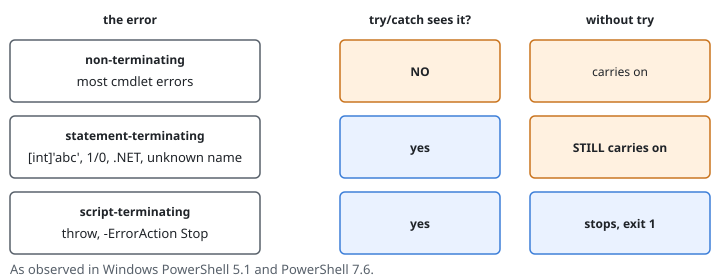

*Draft for owner review.* A script that works on your machine, today, with good input, is a demo. A script you can trust *reports* what went wrong, *stops* when it should, *keeps going* when it should, and leaves enough evidence to find the cause. PowerShell's error system is richer than cmd's exit codes and more confusing than most languages', because it has two kinds of error, several output streams and a pile of preference variables. This lesson explains how it actually works, with real output from **Windows PowerShell 5.1** and **PowerShell 7** (the section on reading errors and on which errors let a script continue comes from `tests/verification/powershell/err3.ps1`, run in 5.1.26100 and 7.6.10), and then covers debugging, logging, static analysis and testing, so that you can both write careful code and diagnose someone else's.

## Reading an error message

Do not skim the red text: it says **what** failed, **where**, and **what kind** of failure it was. The same two-line script (`$name = 'C:\nope'` then `Get-Item $name`) prints in **Windows PowerShell 5.1**:

```text
Get-Item : Cannot find path 'C:\nope' because it does not exist.
At C:\...\show.ps1:2 char:1
+ Get-Item $name
+ ~~~~~~~~~~~~~~
    + CategoryInfo          : ObjectNotFound: (C:\nope:String) [Get-Item], ItemNotFoundException
    + FullyQualifiedErrorId : PathNotFound,Microsoft.PowerShell.Commands.GetItemCommand
```

and in **PowerShell 7**:

```text
Get-Item: C:\...\show.ps1:2
Line |
   2 |  Get-Item $name
     |  ~~~~~~~~~~~~~~
     | Cannot find path 'C:\nope' because it does not exist.
```

| Part | How to use it |
|---|---|
| `Get-Item` at the start | **Which command** reported the error (in 7, an error from your own code may start with an exception type such as `RuntimeException`) |
| the sentence | **What** went wrong. Note the actual value: `C:\nope`, not `$name`. If it is empty or odd, your variable is the problem |
| `show.ps1:2 char:1` / `2 |` | **File and line.** Start reading there |
| the `~~~~` underline | The part of the line that failed |
| `CategoryInfo` (5.1) | A class of failure (`ObjectNotFound`) and the .NET exception, `ItemNotFoundException`: the name to put in a `catch` |
| `FullyQualifiedErrorId` (5.1) | A stable identifier: search the web for this rather than the sentence, which differs by Windows language |

PowerShell 7's short view hides the category and identifier. `$Error[0] | Format-List * -Force` (or `Get-Error` in 7) shows everything.

## Two kinds of error

PowerShell's documentation separates **terminating** from **non-terminating** errors, and the first thing to know is which of them `try`/`catch` sees:

| | Non-terminating | Terminating |
|---|---|---|
| what happens | the error is reported and the command **carries on** with the next item | the **statement** that failed is abandoned (see below: the script may still go on) |
| typical source | a cmdlet that fails on one of several inputs | `throw`, a .NET exception, `-ErrorAction Stop`, a parse error |
| `try`/`catch` | **does not catch it** | catches it |

Most cmdlet errors are non-terminating. Given a list, `Get-Item` reports the bad path and still returns the good one:

```powershell
Get-Item 'C:\nope1','C:\Windows'
Get-Item: Cannot find path 'C:\nope1' because it does not exist.

    Directory: C:\

Mode  LastWriteTime  Length Name
d---- ...                   Windows
```

**This is why `try { Get-Item 'C:\nope' } catch { ... }` does not catch anything**: the error is non-terminating, so `catch` never fires and the script carries on:

```powershell
try { Get-Item 'C:\nope' } catch { 'caught A' }; 'after A (not caught, continued)'
Get-Item: Cannot find path 'C:\nope' because it does not exist.
after A (not caught, continued)
```

To make an error catchable, turn it into a terminating one with `-ErrorAction Stop`:

```powershell
try { Get-Item 'C:\nope' -ErrorAction Stop } catch { 'caught B: ' + $_.Exception.GetType().Name }
caught B: ItemNotFoundException
```

### "Terminating" does not always stop the script

This is where many scripts go wrong. I ran each line in a `.ps1`, followed by a line that prints `next line ran`:

| The failing line | Did the next line run? | Exit code of the script |
|---|---|---|
| `Get-Item C:\nope` (non-terminating) | yes | 0 |
| `[int]'abc'` (a failed conversion) | **yes** | **0** |
| `1/0` | **yes** | **0** |
| `[IO.File]::ReadAllText('C:\nope.txt')` (a .NET method) | **yes** | **0** |
| `nosuchcommand` | **yes** | **0** |
| `throw 'stop here'` | no | 1 |
| `Get-Item C:\nope -ErrorAction Stop` | no | 1 |
| `[int]'abc'` after `$ErrorActionPreference = 'Stop'` | no | 1 |

Both editions behaved this way. The middle four are often called **statement-terminating**: `catch` sees them, but **without** `try` only that statement is abandoned and the script **goes on**.



```text
 error kind              caught by try?   without try
 non-terminating         NO               carries on
 statement-terminating   yes              STILL carries on     ([int]'abc', 1/0, .NET, unknown command)
 script-terminating      yes              stops, exit 1        (throw, -ErrorAction Stop)
```

What that means in practice:

```powershell
$total = [int]'abc'
"total is [$total]"
```

printed the error, then `total is []`, and the script ended with **exit code 0**. A scheduler would record **success**, and anything that used `$total` would act on an empty value. **`$ErrorActionPreference = 'Stop'` at the top of a script** makes all of these stop it.

### `-ErrorAction` and `$ErrorActionPreference`

| Value | Effect |
|---|---|
| `Continue` | report the error and carry on (the default) |
| `Stop` | make it terminating |
| `SilentlyContinue` | do not show it, carry on; **the error is still recorded in `$Error`** |
| `Ignore` | do not show it and **do not record it** |
| `Inquire` | ask what to do |

`-ErrorAction` applies to one command. `$ErrorActionPreference` applies to everything in the scope: set it to `Stop` at the top of a script when any failure should stop it, and **every** error then becomes catchable:

```powershell
$ErrorActionPreference = 'Stop'
try { Get-Item 'C:\nope'; 'not reached' } catch { 'global Stop caught' }
global Stop caught
```

`SilentlyContinue` and `Ignore` differ in one way that matters when debugging: after `Get-Item 'C:\nope' -ErrorAction SilentlyContinue`, `$Error.Count` was 1; after `-ErrorAction Ignore` it was 0. See [about_Preference_Variables](https://learn.microsoft.com/powershell/module/microsoft.powershell.core/about/about_preference_variables). **Hiding errors with `SilentlyContinue` is how silent failures are made**: use it only where a failure is expected and you handle the outcome.

## `try`, `catch`, `finally`

```powershell
try {
    $content = Get-Content -Path $path -ErrorAction Stop
}
catch [System.Management.Automation.ItemNotFoundException] {
    Write-Warning "no such file: $path"
    $content = @()
}
catch {
    throw        # anything else: rethrow the original error
}
finally {
    # always runs, error or not: close files, remove temp data
}
```

- **Order matters:** the first matching `catch` runs. List the specific exception types first and a general `catch` last. In a test, `[int]'x'` matched `[System.Management.Automation.RuntimeException]`, `Get-Content` of a missing file with `-ErrorAction Stop` matched `ItemNotFoundException`, and `1/0` matched `[System.DivideByZeroException]`.
- **`finally` always runs**, even after `return`:

```powershell
function T { try { 'in try'; return 'ret' } finally { 'finally ran' } }
T
in try
ret
finally ran
```

- **A bare `throw` inside `catch`** rethrows the current error with its original details; `throw $_` also works.

See [about_Try_Catch_Finally](https://learn.microsoft.com/powershell/module/microsoft.powershell.core/about/about_try_catch_finally) and [about_Throw](https://learn.microsoft.com/powershell/module/microsoft.powershell.core/about/about_throw).

### What is in `$_` inside `catch`

`$_` is an **ErrorRecord**. These properties answer "what, where and why":

```powershell
try { Get-Item 'C:\nope' -ErrorAction Stop } catch {
  'message : ' + $_.Exception.Message
  'category: ' + $_.CategoryInfo.Category
  'target  : ' + $_.TargetObject
  'fqid    : ' + $_.FullyQualifiedErrorId
  'line    : ' + $_.InvocationInfo.ScriptLineNumber
}
message : Cannot find path 'C:\nope' because it does not exist.
category: ObjectNotFound
target  : C:\nope
fqid    : PathNotFound,Microsoft.PowerShell.Commands.GetItemCommand
line    : 7
```

`$_.Exception` is the .NET exception (its type tells you which `catch` to write), `CategoryInfo` classifies the error, `TargetObject` is what the command was working on, `FullyQualifiedErrorId` is a stable identifier to search for, and `InvocationInfo` gives the script, line and the command text. `$_.ScriptStackTrace` shows the call chain. The `$Error` automatic variable holds the recent errors, newest first (`$Error[0]`); `$Error.Clear()` empties it.

### Collecting errors without stopping: `-ErrorVariable`

```powershell
Get-Item 'C:\nope' -ErrorAction SilentlyContinue -ErrorVariable ev
$ev.Count
1
$ev[0].Exception.Message
Cannot find path 'C:\nope' because it does not exist.
```

Run the whole job, collect the errors, then report them together: the right pattern for "process 500 servers, tell me which failed".

## Raising errors yourself: `throw` and `Write-Error`

| | `throw 'text'` | `Write-Error 'text'` |
|---|---|---|
| kind | **terminating** | **non-terminating** by default |
| after it | the function or script stops | execution continues |
| use for | "I cannot continue" | "this item failed, but others may succeed" |

```powershell
function ThrowIt { throw 'boom' }
try { ThrowIt } catch { 'caught throw: ' + $_.Exception.Message }
caught throw: boom

function WriteErr { [CmdletBinding()] param() Write-Error 'soft error'; 'continued after Write-Error' }
WriteErr
soft error
continued after Write-Error
try { WriteErr -ErrorAction Stop } catch { 'caught with Stop: ' + $_.Exception.Message }
caught with Stop: soft error
```

`Write-Error` in an advanced function respects the **caller's** `-ErrorAction`, which makes your function behave like a cmdlet. For error records with a proper category and target, use `$PSCmdlet.WriteError()` or `$PSCmdlet.ThrowTerminatingError()`; the [exceptions deep-dive](https://learn.microsoft.com/powershell/scripting/learn/deep-dives/everything-about-exceptions) covers them. Throw meaningful text (what failed and with what input), not just `'error'`.

## Errors from programs: `$?` and `$LASTEXITCODE`

A **native program** (not a cmdlet) reports failure through its exit code, which PowerShell stores in `$LASTEXITCODE`, and sets `$?` to `False` for a non-zero code:

```powershell
cmd /c exit 5
'$LASTEXITCODE=' + $LASTEXITCODE + '  $?=' + $?
$LASTEXITCODE=5  $?=False
cmd /c exit 0
$LASTEXITCODE=0  $?=True
```

**A native command failing does not raise an exception by default.** `try`/`catch` does not see it; you must test the code yourself, or in **PowerShell 7.3 and later** ask PowerShell to treat a non-zero code as an error:

```powershell
$PSNativeCommandUseErrorActionPreference = $true
$ErrorActionPreference = 'Stop'
try { cmd /c exit 3 } catch { 'caught: ' + $_.Exception.Message }
caught: Program "cmd.exe" ended with non-zero exit code: 3 (0x00000003).
```

On 5.1, and in any script that must run there, check explicitly:

```powershell
robocopy $src $dst /e
if ($LASTEXITCODE -ge 8) { throw "robocopy failed with code $LASTEXITCODE" }    # robocopy: 0-7 are success
```

`$?` reflects only the **last** command and a cmdlet's `-ErrorAction SilentlyContinue` still sets it to `False`, so test it **immediately** after the command and nothing else. A program's **stderr** is text, not an error: merged with `2>&1`, each line arrives as an `ErrorRecord` object (`cmd /c "echo to-stderr 1>&2" 2>&1` gives `ErrorRecord: to-stderr`), which surprises people who then see red text for a program that succeeded.

## Output streams

PowerShell has several output streams, each with a cmdlet and a preference variable:

| Number | Stream | Cmdlet | Shown by default |
|---|---|---|---|
| 1 | Success (output) | `Write-Output` or any value | yes |
| 2 | Error | `Write-Error` | yes |
| 3 | Warning | `Write-Warning` | yes |
| 4 | Verbose | `Write-Verbose` | **no** (`-Verbose`) |
| 5 | Debug | `Write-Debug` | **no** (`-Debug`) |
| 6 | Information | `Write-Information` | **no** (`-InformationAction Continue`) |

Redirect a stream with its number (`3>&1` sends warnings into the output; `*>` redirects them all; `2>$null` discards errors), as in `Streams 3>&1 4>&1 6>&1`, which delivered `String: out`, `WarningRecord: warn`, `VerboseRecord: verb` and `InformationRecord: info`. See [about_Output_Streams](https://learn.microsoft.com/powershell/module/microsoft.powershell.core/about/about_output_streams) and [about_Redirection](https://learn.microsoft.com/powershell/module/microsoft.powershell.core/about/about_redirection).

Use them for different audiences: **objects on the success stream for data**, **warnings for things the user should know**, **verbose for detail an operator can switch on**, **debug for the developer**, **errors for failures**. A function that puts progress chatter on the success stream corrupts its own result.

## Exit codes from scripts

The process exit code is how a scheduler, a batch file or a CI job learns the outcome:

```powershell
pwsh -NoProfile -File thr.ps1        # the script does:  throw "script failed"
$LASTEXITCODE
1
# a script that catches, reports, and chooses its own code:
try { Get-Item C:\nope -ErrorAction Stop } catch { Write-Error $_; exit 4 }
$LASTEXITCODE
4
```

An **uncaught terminating error** ends a `-File` script with exit code 1; use `exit n` with distinct codes when callers need to tell failures apart, as in the cmd lessons. Put `exit` in the script's top level, not in a function other code calls.

## Defensive scripting

- Set `$ErrorActionPreference = 'Stop'` near the top, unless you deliberately handle non-terminating errors.
- **`Set-StrictMode -Version Latest`** turns uninitialised variables and bad property names into errors instead of silent `$null`s:

```powershell
Set-StrictMode -Version Latest
$undefined + 1
The variable '$undefined' cannot be retrieved because it has not been set.
```

- **Validate inputs** at the edge (parameter validation from the previous lesson).
- **Test with `-WhatIf`** and in a scratch folder before the real run.
- **Clean up in `finally`** (temporary files, connections, a changed working directory).
- **Be idempotent**: running a script twice should not break anything (`if (-not (Test-Path $dir)) { New-Item ... }`).
- **Do not swallow errors**: an empty `catch { }` hides the one fact you needed.

## Debugging

**Print what is happening.** `Write-Verbose` and `Write-Debug` in your functions, switched on with `-Verbose` or `-Debug`, cost nothing when off. `$VerbosePreference = 'Continue'` turns them on for the session.

**Trace lines.** `Set-PSDebug -Trace 1` prints every line before it runs, and `Set-PSDebug -Off` stops it:

```
DEBUG:    1+ Set-PSDebug -Trace 1;  >>>> $a = 1 + 2; Set-PSDebug -Off
```

**Breakpoints.** [`Set-PSBreakpoint`](https://learn.microsoft.com/powershell/module/microsoft.powershell.utility/set-psbreakpoint) pauses on a line, a command or a variable change (`Set-PSBreakpoint -Variable total -Mode Write`), and in the debugger `s` steps, `v` steps over, `o` steps out, `c` continues, `l` lists the code and `q` quits. **Visual Studio Code** gives you the same with a graphical debugger (click the margin, press F5), and is the easiest way to learn it. See [about_Debuggers](https://learn.microsoft.com/powershell/module/microsoft.powershell.core/about/about_debuggers).

**Look at the error, not just its text.** `$Error[0] | Format-List * -Force` shows every property, including `InvocationInfo` and `ScriptStackTrace`, which usually name the line.

**Record a session.** `Start-Transcript -Path run.log` records everything shown, which is useful for a scheduled run you cannot watch.

**Time it.** `Measure-Command { ... }` returns a duration for a block, which finds the slow step.

## Logging

For a script that runs unattended, write a log with timestamps and levels to a file:

```powershell
function Write-Log {
    param([Parameter(Mandatory)][string]$Message, [ValidateSet('INFO','WARN','ERROR')][string]$Level = 'INFO')
    $line = '{0:yyyy-MM-dd HH:mm:ss} [{1}] {2}' -f (Get-Date), $Level, $Message
    Add-Content -Path $script:LogPath -Value $line
    if ($Level -eq 'ERROR') { Write-Error $Message } elseif ($Level -eq 'WARN') { Write-Warning $Message }
}
```

Log the **start, each significant step, every failure with its details (`$_.Exception.Message` and `$_.ScriptStackTrace`) and the end with a result**. Never log passwords or secrets. Rotate or limit the file.

## Checking code you did not run

Two kinds of tool find problems before you run a script, which is exactly how you read someone else's script safely:

- **PSScriptAnalyzer** is a static checker for PowerShell: it flags aliases in scripts, unused variables, missing help, risky constructs and more. It is not installed by default (my test showed it absent); install it from the PowerShell Gallery with `Install-Module PSScriptAnalyzer` (needs network access) and run `Invoke-ScriptAnalyzer -Path .\script.ps1`. It is the PowerShell counterpart of **ShellCheck** for bash. See the [PSScriptAnalyzer overview](https://learn.microsoft.com/powershell/utility-modules/psscriptanalyzer/overview).
- **`-WhatIf`, a transcript and a scratch folder**: run an unknown script with `-WhatIf` where it supports it, in a throwaway VM or folder, with `Start-Transcript`, reading it first for downloads (`Invoke-WebRequest`, `Invoke-Expression`, `iex`), encoded commands (`-EncodedCommand`, `FromBase64String`), registry writes, and anything that disables security features.

## Testing with Pester

**Pester** is PowerShell's test framework: a test states what a function should do and fails when it does not.

```powershell
Describe 'Add-Two' {
    It 'adds two numbers' {
        Add-Two 1 2 | Should -Be 3
    }
    It 'rejects text' {
        { Add-Two 'a' 2 } | Should -Throw
    }
}
```

Run with `Invoke-Pester`. Be aware of the version: **Windows PowerShell 5.1 ships Pester 3.4.0**, whose assertion syntax is older (`Should Be 3`, without the dash), while current Pester (5 and later) uses `Should -Be`. In my test, PowerShell 7 saw Pester 6.2.0 (installed from the Gallery) and 5.1 saw 3.4.0. Install a current version with `Install-Module Pester` when you can. A test per function, run before every change, turns "I think it still works" into evidence. See the [Pester quick start](https://pester.dev/docs/quick-start).

## Common mistakes

- **Expecting `catch` to catch a non-terminating error** (no `-ErrorAction Stop`).
- **Setting `$ErrorActionPreference = 'SilentlyContinue'`** globally and losing the failure.
- **An empty `catch`** that swallows errors.
- **Not checking `$LASTEXITCODE`** after a native program.
- **Testing `$?` after another command ran.**
- **`throw` where `Write-Error` was meant** (stops everything when one item fails), and the reverse.
- **Putting the general `catch` before the specific ones.**
- **Assuming `finally` is skipped by `return`.**
- **Treating stderr text from a program as a PowerShell error.**
- **Using `Write-Host` for diagnostics** that should be on the verbose or log stream.
- **Exiting from a function** and killing the host.
- **Assuming a failed conversion or .NET call stops the script.** Without `Stop`, it carries on and may exit 0.

## Read this script

Without running it: what happens for a missing file `a.txt`, what is the script's exit code, and what is wrong with the error handling?

```powershell
$files = 'a.txt', 'b.txt'
foreach ($f in $files) {
    try {
        $text = Get-Content $f
        "read $f"
    } catch {
        "failed $f"
    }
}
```

**Answer.** `Get-Content` on a missing file is a **non-terminating** error, so the `catch` never runs. PowerShell prints the error and the loop continues, then prints `read a.txt` (with `$text` empty). The exit code is 0, because nothing terminated the script. Fix with `-ErrorAction Stop` on `Get-Content` (or `$ErrorActionPreference = 'Stop'`), so the `catch` prints `failed a.txt`, and set `exit 1` if any file failed.

## Practice

1. Prove that `try { Get-Item C:\nope } catch { 'x' }` does not catch, then make it catch in two different ways.
2. Write a script that processes a list of paths, collects the failures with `-ErrorVariable`, and ends with a summary and a non-zero exit code if any failed.
3. Show the difference between `SilentlyContinue` and `Ignore` using `$Error.Count`.
4. Call a native program that fails and check `$LASTEXITCODE`, then (in 7) use `$PSNativeCommandUseErrorActionPreference` to catch it.
5. Write `Write-Log`, and use it so that a failing step logs the exception message and stack trace.
6. Use `Set-StrictMode -Version Latest` to find a typo'd variable in a script of yours.
7. Write two Pester tests for one of your functions: one for good input and one that expects an error.
8. Use `Set-PSDebug -Trace 1` and a variable breakpoint on one of your scripts and write down what each showed you.

The lab for this lesson asks for a script that handles missing files without crashing; the check runs it with missing, empty and normal inputs and looks at the exit code and the output.

## Check your understanding

1. Why does `catch` not run for `try { Get-Item C:\nope } catch { }`?
2. What is the difference between `SilentlyContinue` and `Ignore`?
3. What is the difference between `throw` and `Write-Error`?
4. Does a failing native program raise an exception in 5.1? How do you detect the failure?
5. When does `finally` run?
6. Which stream does `Write-Verbose` write to, and is it shown by default?
7. What does `Set-StrictMode -Version Latest` change?
8. Why is `PSScriptAnalyzer` useful when reading someone else's script?
9. A script converts text with `[int]`, the conversion fails, and the scheduler reports success. Why?
10. In a 5.1 error, which part would you search for on the web, and why not the sentence?

**Expected answers:** (1) the error is non-terminating; add `-ErrorAction Stop` (or set `$ErrorActionPreference = 'Stop'`); (2) both hide the error, but `SilentlyContinue` still records it in `$Error` and `Ignore` does not; (3) `throw` is terminating and stops the function; `Write-Error` is non-terminating by default and execution continues; (4) no; check `$LASTEXITCODE` (and `$?`) immediately after the command; (5) always, after the `try` and any `catch`, even after a `return`; (6) the verbose stream (4), not shown unless `-Verbose` or `$VerbosePreference` says so; (7) uninitialised variables, nonexistent properties and similar mistakes become errors instead of silent `$null`s; (8) it flags risky and sloppy constructs statically, so you can review the script without running it; (9) the failed statement is abandoned but the script goes on and exits 0; set `$ErrorActionPreference = 'Stop'` or use `try`; (10) the `FullyQualifiedErrorId`, because the sentence can differ by language.
