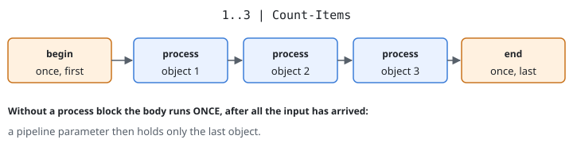

*Draft for owner review.* A function packages a piece of logic under a name; a script is a function that lives in a file. The step from "a few commands" to "a tool others can rely on" is writing functions and scripts that take **parameters**, **validate them**, work in a **pipeline**, support **`-WhatIf`**, and carry their own **help**. That step is also where most hidden bugs appear: output that sneaks into the result, aliases that shadow your function, a comma that turns two arguments into one array. This lesson covers all of it with real output from **Windows PowerShell 5.1** and **PowerShell 7**. The results on how arguments are bound come from `tests/verification/powershell/fn4.ps1`; they were the same in 5.1.26100 and 7.6.10.

## A first function

```powershell
function Add-Two {
    param([int]$A, [int]$B)
    $A + $B
}
Add-Two 1 2
3
Add-Two -A 3 -B 4
7
```

`param(...)` declares the parameters, and **whatever the function outputs is its result**; there is no need for `return`. Name functions `Verb-Noun` with an approved verb (`Get-Verb`), and call them like cmdlets.

### The call-syntax trap

PowerShell functions are called **without parentheses and without commas between arguments**:

```powershell
Add-Two 1, 2
Cannot process argument transformation on parameter 'A'. Cannot convert the "System.Object[]" value of type "System.Object[]" to type "System.Int32".
```

`1, 2` is one **array** argument, which went to `$A`. Writing `Add-Two(1, 2)` makes the same mistake. This is the number one trap for people coming from other languages: pass arguments separated by spaces, by name when there is any doubt.

### Do not shadow aliases

PowerShell resolves a name in this order: **alias, function, cmdlet, external program** ([about_Command_Precedence](https://learn.microsoft.com/powershell/module/microsoft.powershell.core/about/about_command_precedence)). So an alias beats a function of the same name. I named test functions `R` and `Ps`, and PowerShell ran `Invoke-History` and `Get-Process` instead:

```powershell
function ls { 'my function ls' }
ls                                   # runs the ALIAS: a directory listing
Get-Command ls | Select-Object -ExpandProperty CommandType
Alias
```

Check a new name with `Get-Command name` before you use it. Two sibling rules matter just as much. When a script runs an **external program**, write its extension (`where.exe`, `sort.exe`, `curl.exe`) and keep its folder on `PATH`, so no alias or function can intercept it (the basics lesson shows `where` becoming `Where-Object`). And **do not use aliases in your own scripts and functions** (write `Get-ChildItem`, not `ls` or `gci`). Aliases differ by platform (Linux has no `ls` or `rm` alias at all), can be redefined, and hide what the code does; PSScriptAnalyzer flags them. See the basics lesson.

## Parameters

### Types, defaults and switches

```powershell
function Nums { param([int[]]$N = 1..3) ($N | Measure-Object -Sum).Sum }
Nums
6
Nums -N 10,20
30
```

A **type** converts and checks the argument (`[int[]]` accepts a list of integers). A **default** (`= 1..3`) applies when the caller omits it. A `[switch]` parameter is a flag with no value. **Positional** arguments are matched in order (`[Parameter(Position = 0)]`).

### The unnamed-argument style (avoid)

Old-style functions read `$args`:

```powershell
function Old { "args: " + ($args -join ',') + " count=" + $args.Count }
Old a b c
args: a,b,c count=3
```

It works, but you lose validation, names, help and tab completion. Prefer `param()`.

### `[CmdletBinding()]`: an advanced function

Adding `[CmdletBinding()]` turns a function into an **advanced function** that behaves like a compiled cmdlet: it gets the common parameters (`-Verbose`, `-ErrorAction`, `-WhatIf` when you ask for it), strict parameter checking, and access to `$PSCmdlet`. Use it for everything you write that is more than a throwaway. See [about_Functions_CmdletBindingAttribute](https://learn.microsoft.com/powershell/module/microsoft.powershell.core/about/about_functions_cmdletbindingattribute) and [about_Functions_Advanced](https://learn.microsoft.com/powershell/module/microsoft.powershell.core/about/about_functions_advanced).

### Mandatory parameters, validation and pipeline input

```powershell
function Get-Size {
    [CmdletBinding()]
    param(
        [Parameter(Mandatory, ValueFromPipeline, Position = 0)]
        [ValidateNotNullOrEmpty()]
        [string[]]$Path,

        [ValidateSet('B','KB','MB')]
        [string]$Unit = 'KB',

        [ValidateRange(0,3)]
        [int]$Digits = 1,

        [switch]$Quiet
    )
    begin   { $div = @{ B=1; KB=1KB; MB=1MB }[$Unit]; Write-Verbose "unit $Unit" }
    process {
        foreach ($p in $Path) {
            $len = (Get-Item -LiteralPath $p).Length
            [pscustomobject]@{ Path = (Split-Path -Leaf $p); Size = [math]::Round($len / $div, $Digits); Unit = $Unit }
        }
    }
    end { if (-not $Quiet) { Write-Verbose 'done' } }
}
```

What each piece does:

| Attribute | Effect |
|---|---|
| `Mandatory` | the caller must supply it; PowerShell prompts if running interactively, and **fails** in a non-interactive run (`Cannot process command because of one or more missing mandatory parameters: Name.`) |
| `ValueFromPipeline` | the parameter takes objects arriving from the pipeline |
| `Position = 0` | the first unnamed argument goes here |
| `ValidateNotNullOrEmpty` | rejects `$null` or `''` |
| `ValidateSet('B','KB','MB')` | only those values (and tab completion offers them) |
| `ValidateRange(0,3)` | a number in the range |
| `ValidatePattern('^\d+$')`, `ValidateScript({...})`, `ValidateCount`, `ValidateLength` | regex, your own test, list size, text length |

Bad input is rejected **before your code runs**, with a clear message:

```powershell
Get-Size .\f1.txt -Unit GB
Cannot validate argument on parameter 'Unit'. The argument "GB" does not belong to the set "B,KB,MB" specified by the ValidateSet attribute. Supply an argument that is in the set and then try the command again.
Get-Size .\f1.txt -Digits 9
Cannot validate argument on parameter 'Digits'. The 9 argument is greater than the maximum allowed range of 3. ...
```

That is the point of validation: the function body can assume good input. See [about_Functions_Advanced_Parameters](https://learn.microsoft.com/powershell/module/microsoft.powershell.core/about/about_functions_advanced_parameters).

### `begin`, `process`, `end`

A function that accepts pipeline input runs `begin` once, `process` **once per input object**, and `end` once:



```text
 1..3 | Count-Items :  begin -> process(1) -> process(2) -> process(3) -> end
 without a process block: the body runs ONCE, after all input; the parameter holds only the LAST object
```

```powershell
function Count-Items { [CmdletBinding()] param([Parameter(ValueFromPipeline)]$Item) begin { $n = 0 } process { $n++ } end { "saw $n" } }
1..5 | Count-Items
saw 5
```

Without a `process` block, a function runs **once, after all the input has arrived**: a parameter marked `ValueFromPipeline` holds only the **last** object (`1..3 | Get-Last2` printed `got 3` in a test), and a parameter without `ValueFromPipeline` is simply empty. The whole stream is available in `$input`. A function whose whole body is a `process` block is a **filter**:

```powershell
function Double-It { process { $_ * 2 } }
1..3 | Double-It
2
4
6
```

### By value and by property name

A parameter can take a pipeline object in two ways: **by value** (`ValueFromPipeline`: the whole object becomes the parameter) or **by property name** (`ValueFromPipelineByPropertyName`: a property **with the same name** is taken). This is how cmdlets connect without any code from you.

```powershell
function Show-Target {
    [CmdletBinding()]
    param(
        [Parameter(ValueFromPipelineByPropertyName)][string]$Name,
        [Parameter(ValueFromPipelineByPropertyName)][Alias('Id')][int]$Number
    )
    process { "Name=$Name Number=$Number" }
}
[pscustomobject]@{ Name='web01'; Id=7 }, [pscustomobject]@{ Name='db01'; Number=9 } | Show-Target
```

```text
Name=web01 Number=7
Name=db01 Number=9
```

`[Alias('Id')]` let a property called `Id` fill `-Number`. An object with **neither** name, `@{ComputerName='x'; Port=1}`, was rejected: `The input object cannot be bound to any parameters for the command...`. When you see that message, compare the **property names** of the objects (`Get-Member`) with the parameter names and aliases; renaming with `Select-Object @{n='Name';e={$_.ComputerName}}` is the usual fix.

A trap: a parameter that accepts **both** ways. Given `[pscustomobject]@{ Other = 'x' }`, with no `Name` property, it was bound **by value** and printed `[@{Other=no Name property}]`: the whole object turned into text. No error, and a script would carry on with that nonsense. Give a parameter both only when a plain value is really meaningful.

### Parameter sets

When two ways of calling a command are mutually exclusive, declare **parameter sets**:

```powershell
function Find-Thing {
    [CmdletBinding(DefaultParameterSetName = 'ByName')]
    param(
        [Parameter(ParameterSetName = 'ByName')][string]$Name,
        [Parameter(ParameterSetName = 'ById')][int]$Id
    )
    $PSCmdlet.ParameterSetName
}
Find-Thing -Name a      # ByName
Find-Thing -Id 5        # ById
Find-Thing -Name a -Id 5
Parameter set cannot be resolved using the specified named parameters. One or more parameters issued cannot be used together ...
```

### Splatting

A hashtable of parameter values can be passed with `@` instead of `$`, which keeps long calls readable and lets you build arguments conditionally:

```powershell
$args1 = @{ Path = '.\f1.txt'; Unit = 'B'; Digits = 0 }
(Get-Size @args1).Size
2048
```

See [about_Splatting](https://learn.microsoft.com/powershell/module/microsoft.powershell.core/about/about_splatting). `$PSBoundParameters` holds the parameters the caller **actually supplied** (not defaults), which is how you tell "left blank" from "set to the default":

```powershell
function Show { [CmdletBinding()] param($X = 'dflt', $Y) "bound: " + (($PSBoundParameters.Keys | Sort-Object) -join ',') + "; X=$X" }
Show -Y 1
bound: Y; X=dflt
```

### Surprises when arguments are bound

| What I ran | What happened |
|---|---|
| a **simple** function (no `[CmdletBinding()]`) with a misspelled `-Nmae bob` | **No error.** `$Name` stayed empty; `-Nmae` and `bob` went into `$args` |
| the same on an **advanced** function | `A parameter cannot be found that matches parameter name 'Nmae'.` |
| extra unnamed arguments `a b c` on a simple one-parameter function | `b`, `c` silently in `$args`; the advanced one refused them |
| `[string]$Value` given `@('a','b','c')` | **`a b c`**: the array was joined into one string |
| `[int]$N` given `2.5`, `3.5` | `2`, `4` (rounds to even) |
| `[bool]$Enabled` given the **text** `'False'` | Rejected. For on/off, use a `[switch]`; `-Force:$false` turns one off |
| `[ValidateRange(1,10)][int]$Count = 0`, not passed | **`Count=0`**: **validation is not applied to a default value** |
| the same parameter assigned `99` later inside the function | failed: validation does apply to later assignments |
| a script that **calls a function before it is defined** | `The term 'Say-It' is not recognized...`, then the script **carried on** to the later, working call |

The first two rows are the best argument for **always using `[CmdletBinding()]`**: it turns silent mistakes into clear errors. Define functions **above** the code that calls them.

## What a function returns

**A function returns everything it outputs, not just what follows `return`.** Any expression whose value is not captured, assigned or piped to `Out-Null` goes into the result:

```powershell
function Bad {
    $al = [System.Collections.ArrayList]::new()
    $al.Add('x')
    $al.Add('y')
    'result'
}
(Bad) -join ','
0,1,result
```

`ArrayList.Add` returns the index it used, so `0` and `1` leaked into the output and a caller expecting `'result'` got an array of three. This is the single most common function bug. Fixes: assign to `$null` (`$null = $al.Add('x')`), cast `[void]`, or pipe to `Out-Null`:

```powershell
function Good { $al = [System.Collections.ArrayList]::new(); $null = $al.Add('x'); [void]$al.Add('y'); 'result' }
(Good) -join ','
result
```

`return` outputs a value and **exits** the function (`'first'; return 'second'; 'never'` produces `first|second`); it is for early exit, not required for output. Two output rules to hold on to:

- **`Write-Output`** (or just naming a value) writes to the pipeline and becomes the result. **`Write-Host`** writes straight to the screen and is **not** captured: `$x = Out1` captured `to pipeline` and still showed `to host only`. Use `Write-Host` for messages meant only for a person, `Write-Verbose` for optional detail, and objects for data.
- A function that returns an **array** hands the caller the items, unrolled, which is usually what you want; `,$array` (a leading comma) returns it as one object.

Declare what you return with `[OutputType([pscustomobject])]` (documentation for tools and tab completion, not enforcement). The best output is an **object** (`[pscustomobject]`), never formatted text, so the caller can sort, filter and export it.

## Scope

A function's variables are local: assigning `$counter++` inside a function changes a **local copy**, not the caller's (the caller's stayed `0`). To change a variable outside, qualify it (`$script:counter++`). Prefer passing data in with parameters and out as return values, so functions stay predictable and testable.

## `-WhatIf` and `-Confirm` for your own commands

A function that changes things should support rehearsal. Add `SupportsShouldProcess` and wrap each change:

```powershell
function Remove-Demo {
    [CmdletBinding(SupportsShouldProcess, ConfirmImpact = 'Medium')]
    param([string]$Name)
    if ($PSCmdlet.ShouldProcess($Name, 'Remove')) { "removed $Name" }
}
Remove-Demo A -WhatIf
What if: Performing the operation "Remove" on target "A".
Remove-Demo B
removed B
```

`ShouldProcess` returns `False` under `-WhatIf` (and prints the message), and prompts under `-Confirm`. Every destructive function you write should do this; callers then get the same rehearsal habit cmdlets give them.

## Help for your functions

Comment-based help makes your function behave like a documented cmdlet:

```powershell
function Get-Greeting {
    <#
    .SYNOPSIS
    Builds a greeting.
    .PARAMETER Name
    Who to greet.
    .EXAMPLE
    Get-Greeting -Name Ada
    #>
    [CmdletBinding()] param([Parameter(Mandatory)][string]$Name) "Hello, $Name"
}
(Get-Help Get-Greeting).Synopsis
Builds a greeting.
```

Write at least a synopsis, each parameter and one example. See [about_Comment_Based_Help](https://learn.microsoft.com/powershell/module/microsoft.powershell.core/about/about_comment_based_help).

## Scripts

A `.ps1` file is a function body with a file name. Put a `param()` block at the top, optional `#Requires` lines before it, and exit with a code:

```powershell
#Requires -Version 5.1
[CmdletBinding()]
param([Parameter(Mandatory)][string]$Name, [int]$Count = 2)
"Hello $Name x$Count from $(Split-Path -Leaf $PSCommandPath)"
exit 3
```

```
pwsh -NoProfile -File tool.ps1 -Name Ada
Hello Ada x2 from tool.ps1
echo $LASTEXITCODE
3
```

- **`#Requires`** refuses to run on the wrong version (or without a needed module or administrator rights: `#Requires -RunAsAdministrator`). See [about_Requires](https://learn.microsoft.com/powershell/module/microsoft.powershell.core/about/about_requires).
- **`exit n`** sets the process exit code; the caller (cmd's `%errorlevel%`, Task Scheduler, a CI job) reads it. `exit 0` is success.
- **`$PSScriptRoot`** and `$PSCommandPath` give the script's folder and path, so refer to files beside the script as `Join-Path $PSScriptRoot 'config.json'`, never by assuming the current directory.
- **A missing mandatory parameter in a non-interactive run fails** (`tool.ps1: Cannot process command because of one or more missing mandatory parameters: Name.`) rather than hanging for input, which is what you want in a scheduled task.
- Run it with `-File` from other shells: `powershell -NoProfile -ExecutionPolicy Bypass -File .\tool.ps1 -Name Ada`.

### Running a script versus dot-sourcing it

Running a script puts its functions and variables in a **child scope that disappears** when it ends. **Dot-sourcing** runs it in the current scope, which is how you load a library of functions:

```powershell
& .\lib.ps1
(Get-Command Hello -ErrorAction SilentlyContinue) -ne $null       # False
. .\lib.ps1
Hello
hello from lib
```

A dot-sourced file should only define functions and constants, not do work. For anything you will reuse across scripts, the next step is a **module** (the modules lesson).

## Designing a good function

- **One job, a clear name, an approved verb.**
- **Parameters, not globals.** The function should not read variables from outside.
- **Validate at the edge** with attributes, then trust the values inside.
- **Output objects**, not strings; let the caller format.
- **Support `-WhatIf`** if it changes anything, and `-Verbose` for detail.
- **Errors are errors**: use `throw`/`Write-Error` (next lesson), not a message on the screen.
- **Help**: synopsis, parameters, an example.
- **Test it**: at least call it with good input, bad input, empty input and pipeline input.

## Common mistakes

- **Calling with commas or parentheses** (`f(1,2)`, `f 1, 2`).
- **Naming a function like an alias** (`ls`, `ps`, `r`, `sort`) and having the alias win.
- **Letting method return values leak** into the output (`$list.Add()`, `New-Item` without `| Out-Null`).
- **Using `return` as if it were required,** or expecting it to be the only output.
- **`Write-Host` for data,** which cannot be captured.
- **Reading and writing global variables** from inside functions.
- **No `process` block** in a function meant for the pipeline.
- **Assuming the current directory** instead of `$PSScriptRoot`.
- **Forgetting `exit` codes** in scripts used by schedulers.
- **No validation,** so errors surface deep in the body.
- **Leaving out `[CmdletBinding()]`**, so a misspelled parameter is silently ignored.
- **Trusting validation to check your own default values.**
- **Calling a function above its definition** in a script.

## Read this function

What does this return for `Get-Total 1,2,3`? What is wrong with it, and how do you fix it?

```powershell
function Get-Total {
    param($Numbers)
    $list = [System.Collections.ArrayList]::new()
    foreach ($n in $Numbers) { $list.Add($n * 2) }
    $sum = 0
    foreach ($v in $list) { $sum += $v }
    Write-Host "Total: $sum"
    return $sum
}
$t = Get-Total 1,2,3
```

**Answer.** `$list.Add(...)` returns the index each time, so `0, 1, 2` leak into the output, and `$t` ends up as an array `0,1,2,12` instead of `12`. The `Write-Host` line is not captured, so it prints but is not part of the result. Fix: `$null = $list.Add($n * 2)` (or use a typed `[int[]]` result and `ForEach-Object`), keep `Write-Host` out of data-returning functions, and add `[CmdletBinding()]` with a typed, validated `[int[]]$Numbers`.

## Practice

1. Write `Convert-Size` with a mandatory `-Bytes` (pipeline input), a `-Unit` validated with `ValidateSet`, and output as a `[pscustomobject]`. Test it with good, bad and piped input.
2. Take any function of yours that changes things and add `SupportsShouldProcess` with `-WhatIf`.
3. Write a script with a `param()` block that takes a folder, validates that it exists with `ValidateScript`, and exits 2 if it holds no files.
4. Reproduce the output-pollution bug and fix it three ways.
5. Add comment-based help and check it with `Get-Help name -Full`.
6. Dot-source a file of two functions, call them, then run the same file with `&` and show the difference.
7. Find a built-in alias and write a function with the same name; show which one wins and why.

The labs for this lesson ask for a script that takes parameters with defaults and sets exit codes; the check runs it with several argument combinations and inspects the exit code.

## Check your understanding

1. Why does `Add-Two 1, 2` fail?
2. Which wins, an alias or a function of the same name?
3. What goes into a function's result besides what follows `return`?
4. What are `begin`, `process` and `end` for?
5. What does `ValidateSet` give you, and when does it run?
6. What does `-WhatIf` need from your function?
7. What is the difference between `&` and `.` for running a script?
8. Why use `$PSScriptRoot`?
9. A call has a misspelled parameter name and nothing complains. What is missing from the function?
10. What does `ValueFromPipelineByPropertyName` match on?
11. Does `ValidateRange` check a parameter's default value?

**Expected answers:** (1) `1, 2` is a single array argument, so it goes to `-A` and cannot convert to an integer; separate arguments with spaces; (2) the alias; (3) everything the function outputs: any uncaptured expression; (4) setup once, once per pipeline object, and cleanup once; (5) it limits a parameter to listed values, offers tab completion, and rejects bad values before the function body runs; (6) `SupportsShouldProcess` in `[CmdletBinding()]` and a call to `$PSCmdlet.ShouldProcess(...)` around each change; (7) `&` runs the script in a child scope (its functions vanish); `.` runs it in the current scope so its functions stay defined; (8) it is the script's own folder, so file paths do not depend on the current directory; (9) `[CmdletBinding()]`, which makes unknown parameters an error; (10) a property of the incoming object whose name equals the parameter's name or one of its aliases; (11) no, only values that are passed or assigned.
