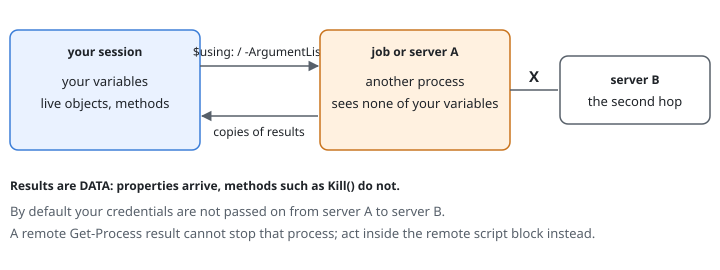

*Draft for owner review.* A script is one file; real automation is **reusable modules**, code that **runs on other machines**, work done **in the background or in parallel**, and **secrets handled without leaking them**. This lesson covers modules (writing, loading, versioning, the PowerShell Gallery and why installing from it is a trust decision), script signing, credentials, jobs, and remoting over WinRM and SSH. It also says plainly what I could and could not test: modules, jobs, signatures and credentials were run on Windows PowerShell 5.1, PowerShell 7 and PowerShell 7 on Linux; WinRM remoting was then run for real against a **Windows Server 2022 lab VM** (as `Administrator`), and the lesson shows both the error from a non-elevated prompt and the working results. Remoting **over SSH** failed on the first attempt, and the lesson shows the cause I found and the working run afterwards (Windows target only; a Linux target was not tested).

## Modules

A **module** is a package of functions, variables and commands loaded as a unit. Everything you use that is not built into the engine comes from one: `Microsoft.PowerShell.Utility`, `NetTCPIP`, `ActiveDirectory` and so on. See [about_Modules](https://learn.microsoft.com/powershell/module/microsoft.powershell.core/about/about_modules).

### Where modules are found: `PSModulePath`

PowerShell searches the folders in `$env:PSModulePath` (separated by `;` on Windows and `:` on Linux), in order:

| Edition | Folders (Windows, from my test) |
|---|---|
| Windows PowerShell 5.1 | `Documents\WindowsPowerShell\Modules`, `C:\Program Files\WindowsPowerShell\Modules`, `C:\WINDOWS\system32\WindowsPowerShell\v1.0\Modules` |
| PowerShell 7 | `Documents\PowerShell\Modules`, `C:\Program Files\PowerShell\Modules`, `C:\Program Files\PowerShell\7\Modules`, **and the three Windows PowerShell folders above** |

So 7 can see modules installed for 5.1, though many Windows-only modules are not compatible and 7 can load them through a compatibility layer (`Import-Module -UseWindowsPowerShell`, which runs the module in a hidden 5.1 process and gives you proxy commands). The `CurrentUser` locations need no administrator rights and the `Program Files` ones do. See [about_PSModulePath](https://learn.microsoft.com/powershell/module/microsoft.powershell.core/about/about_psmodulepath).

### Discovery and auto-loading

```powershell
Get-Module -ListAvailable                      # everything installed
Get-Module                                     # what is loaded in this session
Get-Command -Module Microsoft.PowerShell.Utility
Import-Module Pester
Remove-Module Pester
```

Since PowerShell 3, **calling a command from an installed module loads the module automatically**, which I saw in my test: merely running `Get-Command Get-Greeting` loaded the module, and after `Remove-Module`, calling the command loaded it again. Explicit `Import-Module` is still the clearest thing to write in a script, because it fails early with a clear message if the module is missing.

**Reading `Get-Module -ListAvailable`.** Narrowed to one built-in module and a few columns, the two editions showed:

| Edition | ModuleType | Version | Exported commands |
|---|---|---|---|
| 5.1 | `Manifest` | 3.1.0.0 | 94 |
| 7.6 | `Manifest` | 7.0.0.0 | 66 |

`ModuleType` says how the module is built (`Manifest` means it is described by a `.psd1`); `Version` matters when several are installed; and the **same module name can offer different commands** in each edition, which is one reason a script that works in one fails in the other.

### Writing a module

A minimal module is a folder with a `.psm1` file and a manifest, in a version folder on `PSModulePath`:

```
WlTools\
    1.0.0\
        WlTools.psm1
        WlTools.psd1
```

```powershell
# WlTools.psm1
$script:Greeting = 'Hello'                   # module-private state
function Get-Hidden { 'private helper' }     # not exported
function Get-Greeting {
    [CmdletBinding()] param([Parameter(Mandatory)][string]$Name)
    "$script:Greeting, $Name (helper says: $(Get-Hidden))"
}
function Set-Greeting { param([string]$Text) $script:Greeting = $Text }
Export-ModuleMember -Function Get-Greeting, Set-Greeting
```

```powershell
New-ModuleManifest -Path .\WlTools.psd1 -RootModule WlTools.psm1 -ModuleVersion 1.0.0 `
    -FunctionsToExport Get-Greeting, Set-Greeting -Author 'student' -Description 'demo'
```

What I verified when I built and used it:

- **Only exported commands are visible:** `Get-Greeting` and `Set-Greeting` were; the helper `Get-Hidden` was **not** (`Get-Command Get-Hidden` found nothing outside the module).
- **Module state is private:** `Set-Greeting 'Hi'` changed `$script:Greeting` inside the module, and the next `Get-Greeting` said `Hi, Bob`.
- **Versions live side by side:** with `1.0.0` and `2.0.0` folders, `Get-Module -ListAvailable` showed both, the newest loads by default, and `Import-Module WlTools -RequiredVersion 1.0.0` loaded the old one.

Use `$PSScriptRoot` in a module to find files beside it. Always list `FunctionsToExport` explicitly in the manifest (not `*`), because the manifest lets PowerShell find your commands for auto-loading **without** loading the module, which is fast. Keep a **test** (Pester) per exported function. See [`New-ModuleManifest`](https://learn.microsoft.com/powershell/module/microsoft.powershell.core/new-modulemanifest), [`Export-ModuleMember`](https://learn.microsoft.com/powershell/module/microsoft.powershell.core/export-modulemember) and [`Import-Module`](https://learn.microsoft.com/powershell/module/microsoft.powershell.core/import-module).

### The PowerShell Gallery: a trust decision

The [PowerShell Gallery](https://learn.microsoft.com/powershell/gallery/overview) is the public repository of modules and scripts. Installing is one line:

```powershell
Find-Module Pester
Install-Module Pester -Scope CurrentUser
Get-InstalledModule
Update-Module Pester
```

Both `PowerShellGet` (`Install-Module`, in 5.1 and 7) and the newer **PSResourceGet** (`Install-PSResource`, present in 7.6 in my test) work; each needs **network access**, which is why I did not run installs here. See [`Install-Module`](https://learn.microsoft.com/powershell/module/powershellget/install-module) and [`Install-PSResource`](https://learn.microsoft.com/powershell/module/microsoft.powershell.psresourceget/install-psresource).

**How big is it?** The Gallery is a website and a catalogue, not a package you download; you fetch only the modules you ask for, and most are small. These download sizes are the `PackageSize` the Gallery itself reports, read on 2026-11-21 without downloading anything:

| Module | Version | Download |
|---|---|---|
| ThreadJob | 2.1.0 | 0.03 MB |
| Microsoft.PowerShell.SecretManagement | 1.1.2 | 0.08 MB |
| PSReadLine | 2.4.5 | 0.22 MB |
| Pester | 6.2.0 | 0.44 MB |
| Microsoft.PowerShell.PSResourceGet | 1.3.1 | 4.09 MB |
| PSScriptAnalyzer | 1.25.0 | 13.98 MB |

PSScriptAnalyzer is the large one because it bundles its rules and dependencies. On a metered connection that makes the whole useful set (Pester, PSScriptAnalyzer, SecretManagement, ThreadJob) about 15 MB, once. In Windows PowerShell 5.1 the first `Install-Module` also offers to install the small **NuGet provider** it needs; accept it, once. You can ask the Gallery for a size yourself: `Invoke-WebRequest "https://www.powershellgallery.com/api/v2/Packages()?`$filter=Id eq 'Pester' and IsLatestVersion&`$select=Id,Version,PackageSize"`.

**Installing a module runs someone else's code with your rights** (and an elevated install runs it with administrator rights). Treat it like any download:

- Prefer **`-Scope CurrentUser`**; do not install as administrator unless you must.
- Check the **publisher, download count, version history and source link**, and look for a project repository. Names can be squatted with look-alikes.
- **Read it before use**: `Save-Module Name -Path .\inspect` downloads the files without installing them, so you can read the `.psm1` (look for downloads, `Invoke-Expression`, encoded commands, registry writes).
- **Pin versions** in production (`-RequiredVersion`), and mirror approved modules to an internal repository.
- The Gallery marks itself *Untrusted* by default and asks you to confirm; do not blindly answer yes.

## Signing and trust

A script or module can carry an **Authenticode signature**, which proves who published it and that it has not changed. Verify one with [`Get-AuthenticodeSignature`](https://learn.microsoft.com/powershell/module/microsoft.powershell.security/get-authenticodesignature):

```powershell
Get-AuthenticodeSignature (Get-Module Microsoft.PowerShell.Utility -ListAvailable).Path |
    Select-Object Status, @{n='Signer';e={$_.SignerCertificate.Subject}}
Status Signer
------ ------
Valid  CN=Microsoft Corporation
```

`Valid` means the signature checks out and the certificate chains to a trusted root; `NotSigned`, `HashMismatch` (the file changed after signing) and `UnknownError` are the other results you will see. With the execution policy `AllSigned`, only signed scripts run. To sign your own scripts you need a code-signing certificate from your organisation (or a self-signed one for testing, trusted only on your machine) and `Set-AuthenticodeSignature -FilePath .\tool.ps1 -Certificate $cert`. See [about_Signing](https://learn.microsoft.com/powershell/module/microsoft.powershell.core/about/about_signing). Signing is a way to **distribute** scripts safely inside an organisation; it does not make a script *correct* or *safe*, only attributable.

## Credentials and secrets

A password in a script is a password in every backup, log and repository that script touches. PowerShell has types for handling secrets, and they have clear limits.

```powershell
$ss   = ConvertTo-SecureString 'p@ss' -AsPlainText -Force
$cred = [pscredential]::new('user', $ss)
$cred.UserName          # user
$cred.Password          # System.Security.SecureString   (never shows the text)
```

- A **`SecureString`** keeps text out of casual display and memory dumps on Windows, but **`GetNetworkCredential().Password` returns it in plain text** (I confirmed it), so it protects a value from being printed, not from a program that is allowed to use it. On Linux and macOS a `SecureString` is **not encrypted at rest**.
- **`Get-Credential`** asks the user for a name and password at run time ([`Get-Credential`](https://learn.microsoft.com/powershell/module/microsoft.powershell.security/get-credential)); this is the best option for interactive scripts.
- **Never put `-AsPlainText -Force` passwords in a script** except in a throwaway demo like this one: it exists for tests, and a script containing it contains the password.
- To store a credential for an unattended job on Windows, `$cred | Export-Clixml .\cred.xml` protects the password with **DPAPI**, so only the **same user on the same machine** can `Import-Clixml` it. That is convenient and limited: it does not work for another account or computer, and anyone running as that user can read it.
- For shared or production secrets use a **secret store**: the **SecretManagement** module ([overview](https://learn.microsoft.com/powershell/utility-modules/secretmanagement/overview)) gives one interface over vaults such as Windows Credential Manager and Azure Key Vault. Scheduled tasks can run as a managed account instead of holding a password.
- Never write secrets to logs, transcripts or error messages, and rotate any that leaked.

## Jobs: background work

`Start-Job` runs a script block in a **separate PowerShell process**, so your prompt stays free ([about_Jobs](https://learn.microsoft.com/powershell/module/microsoft.powershell.core/about/about_jobs)):

```powershell
$job = Start-Job { Get-ChildItem C:\Windows -Recurse -ErrorAction SilentlyContinue | Measure-Object Length -Sum }
Get-Job
$job | Wait-Job
$result = $job | Receive-Job
$job | Remove-Job
```

`Receive-Job` returns the output (and by default **removes** it from the job; add `-Keep` to read again), `Wait-Job` blocks until it finishes, and `Get-Job` shows the state (`Running`, `Completed`, `Failed`).

**Reading `Get-Job`.** Three jobs, one finished, one failed and one still running (5.1; the columns were the same in 7):

```text
Id     Name      PSJobTypeName   State         HasMoreData     Location       Command
--     ----      -------------   -----         -----------     --------       -------
1      works     BackgroundJob   Completed     True            localhost      Start-Sleep 1; '...
3      fails     BackgroundJob   Failed        False           localhost      Get-Item C:\nope...
5      busy      BackgroundJob   Running       True            localhost      Start-Sleep 60
```

| Column | What to look at |
|---|---|
| `State` | `Running`, `Completed`, `Failed` or `Stopped`. **Check it before trusting the output** |
| `HasMoreData` | `True` while there is output to receive. After one `Receive-Job` on `works` it became `False`, and a second receive returned **nothing** (use `-Keep` to read twice) |
| `Command` | Cut off; `Format-List *` shows it whole |

For the failed job, `Receive-Job -ErrorAction Stop` raised `Cannot find path 'C:\nope-nope' because it does not exist.`, and the same text was in `$job.ChildJobs[0].JobStateInfo.Reason.Message`. `Stop-Job` moved the running job to `Stopped`, and `Remove-Job` cleared them all. The numbers in `Id` jump by two because each job has a child job of its own.



```text
 your session  --- $using: / -ArgumentList --->  job or server A  ---X--->  server B (second hop)
 live objects  <--------- copies of results ----  another process; sees none of your variables
```

### Four things that surprise people

1. **The job cannot see your variables.** It is another process:

```powershell
$limit = 3
Start-Job { "limit inside job = [$limit]" } | Wait-Job | Receive-Job
limit inside job = []
Start-Job { "limit inside job = [$using:limit]" } | Wait-Job | Receive-Job
limit inside job = [3]
```

Pass values with **`$using:name`** or `-ArgumentList` (`Start-Job -ScriptBlock { param($a,$b) "args: $a $b" } -ArgumentList 'x', 7` printed `args: x 7`).

2. **Results are copies, without behaviour.** Objects cross the process boundary as **serialized data**: you get back the properties, but the methods are gone. A process object returned from a job was a plain `PSObject` and had **no `Kill()` method**, and every result carries an extra `PSComputerName` property. The same is true of remoting.

3. **Errors and warnings are held, not shown.** A job that throws ends in state `Failed`, and the error is re-raised when you `Receive-Job`. In my test the job's output `out` and warning `warn` arrived with the receive, and the failure message was `Cannot find path 'C:\nope-nope' because it does not exist.` Use `Receive-Job -ErrorVariable` and `-WarningVariable` to capture them, and always look at `State`.

4. **A job is a whole extra process** (about the memory and start-up cost of a new PowerShell), so many tiny jobs are slow. For lightweight concurrency use a **thread job**: `Start-ThreadJob` runs on a thread in the **same** process. It is built in to PowerShell 7 and a module you install for 5.1 (in my test `Start-ThreadJob` existed in 7 and not in 5.1). The PIDs showed it: the caller's PID was 6680 and so was the thread job's, while a normal `Start-Job` ran in a different process (12724). Thread jobs share the process, so they start faster but also share its fate. See [about_Thread_Jobs](https://learn.microsoft.com/powershell/module/microsoft.powershell.core/about/about_thread_jobs). `ForEach-Object -Parallel` (control-flow lesson) is the pipeline version of the same idea.

## Remoting

**PowerShell remoting** runs commands on another computer and brings the results back. The pieces ([about_Remote](https://learn.microsoft.com/powershell/module/microsoft.powershell.core/about/about_remote)):

| Cmdlet | Use |
|---|---|
| [`Invoke-Command`](https://learn.microsoft.com/powershell/module/microsoft.powershell.core/invoke-command) | run a script block on one or many computers |
| [`Enter-PSSession`](https://learn.microsoft.com/powershell/module/microsoft.powershell.core/enter-pssession) | an interactive remote prompt |
| [`New-PSSession`](https://learn.microsoft.com/powershell/module/microsoft.powershell.core/new-pssession) | a **persistent** session you reuse (state is kept between commands) |
| `Copy-Item -ToSession` | copy files over the session |

```powershell
Invoke-Command -ComputerName server01, server02 -ScriptBlock { Get-Service Spooler } -Credential $cred
$s = New-PSSession -ComputerName server01
Invoke-Command -Session $s -ScriptBlock { $x = 42 }
Invoke-Command -Session $s -ScriptBlock { $x }          # 42: the session kept its state
Remove-PSSession $s
```

### Two transports

- **WinRM** (WS-Management) is the Windows transport, HTTP on port **5985** and HTTPS on **5986**. It is the default for `-ComputerName`, authenticates with **Kerberos** inside a domain (and NTLM otherwise), and encrypts the payload.
- **SSH** is the cross-platform transport, available in PowerShell 7: `New-PSSession -HostName server01 -UserName admin` (and `-SSHTransport`). It needs an SSH server with a PowerShell subsystem on the target (a `Subsystem powershell` line placed **above** any `Match` block, see my verified run below) and works to Linux and macOS as well as Windows. See [PowerShell remoting over SSH](https://learn.microsoft.com/powershell/scripting/security/remoting/ssh-remoting-in-powershell).

Windows PowerShell 5.1 uses WinRM only.

### What I saw on this machine

The WinRM service was **Running / Automatic**, and `Test-WSMan localhost` answered. But the first real attempt, from a normal (non-elevated) prompt, failed in both editions:

```
Invoke-Command -ComputerName localhost -ScriptBlock { ... }
Connecting to remote server localhost failed with the following error message : Access is denied. For more information, see the about_Remote_Troubleshooting Help topic.
Get-PSSessionConfiguration
Access is denied. To run this cmdlet, start PowerShell with the "Run as administrator" option.
```

That is the **default behaviour**: by default only administrators (and, on servers, members of the Remote Management Users group) may connect to the standard endpoint, and listing or changing endpoint configurations needs an elevated session.

### What I saw on a Windows Server 2022 VM

I repeated the test on a lab VM running Windows Server 2022 (Windows PowerShell 5.1.20348), logged in as `Administrator` through the VM's SSH control channel. There the session **was elevated**, `Get-PSSessionConfiguration` listed the endpoints (`microsoft.powershell` and others), and WinRM listened on HTTP port 5985 with Negotiate and Kerberos enabled. Yet `Invoke-Command -ComputerName localhost` **still failed with "Access is denied"**. The reason is the login: an SSH session is a *network logon* whose credentials cannot be reused to open a second connection, so connecting from inside it to WinRM is a **second hop** in miniature (see below). With an **explicit credential** it worked:

```powershell
$cred = [pscredential]::new("$env:COMPUTERNAME\Administrator", $securePassword)
Invoke-Command -ComputerName localhost -Credential $cred -ScriptBlock { 'ran on ' + $env:COMPUTERNAME + ' as ' + [Environment]::UserName }
ran on WINLAB-LAB-C as Administrator
```

With that credential I verified, in this order:

- **`$using:` and `-ArgumentList`** passed local values into the remote block (`using=[3]`, `arg=[x]`).
- **Results are serialized copies:** the returned process object was a plain `PSObject`, `Kill()` was **absent**, and it carried the extra properties `PSComputerName` (`localhost`) and `RunspaceId`.
- **A persistent session keeps state:** `$x = 42` in one `Invoke-Command -Session $s` was visible (`42`) in the next. The remote working directory was `C:\Users\Administrator\Documents`, not my local one.
- **`Copy-Item -ToSession`** copied a file to the target and a remote command read it back (`payload`).
- **Output order is completion order:** with `-ComputerName 'localhost', $env:COMPUTERNAME` the replies came back as `WINLAB-LAB-C`, then `localhost`, not in the order I listed them; each result had its `PSComputerName`.
- **Remote errors:** with `-ErrorAction Stop`, a failing remote `Get-Item` arrived as a **`RemoteException`** with the original message; a remote `Write-Error` was collected by `-ErrorVariable` and its `OriginInfo` named the computer (`localhost`) while the script block carried on.
- **`-AsJob`** returned a `PSRemotingJob` (state `Running` at once) that `Receive-Job` completed.
- **By IP address:** `Invoke-Command -ComputerName 127.0.0.1` also worked, because that is the loopback address; for another machine's IP address, NTLM needs HTTPS or an entry in `TrustedHosts` (from the documentation; not tested).

**Remoting over SSH (verified on a Windows Server 2022 VM, PowerShell 7.6.10 on both ends).** On the VM I unpacked the PowerShell 7 zip into `C:\pwsh7` (a 109 MB download) and added a `Subsystem powershell C:/pwsh7/pwsh.exe -sshs -NoLogo -NoProfile` line to `C:\ProgramData\ssh\sshd_config`. **The first attempt failed** with `subsystem request failed on channel 0` / `The SSH transport process has abruptly terminated`, because I had added the line at the **end of the file, after a `Match Group administrators` block**. In `sshd_config`, everything after a `Match` line belongs to that block, so the subsystem was not a global setting: `sshd -T` (which prints the effective configuration) listed only `subsystem sftp sftp-server.exe`. Moving the line to sit **right after the `sftp` Subsystem line, above the `Match` block**, made `sshd -t` (syntax check) return 0 and `sshd -T` list both subsystems. After `Restart-Service sshd` this worked from the host:

```powershell
$s = New-PSSession -HostName 127.0.0.1 -Port 44024 -UserName Administrator -KeyFilePath $key
Invoke-Command -Session $s -ScriptBlock { "$env:COMPUTERNAME as $([Environment]::UserName) PS $($PSVersionTable.PSVersion)" }
```

```
Transport=SSH State=Opened
WINLAB-LAB-C as Administrator PS 7.6.10 (Core)
```

What else I observed over SSH: `$using:limit` worked; state persisted in the session; results were deserialized (`System.Management.Automation.PSObject`, no `Stop()` method) just as with WinRM; an error in the script block arrived as a `RemoteException`; `Copy-Item -ToSession` copied a file; the session was elevated because the account is an administrator. The **diagnostic habit** is the lesson: when a remote service will not do what its config says, ask the service for its *effective* configuration (`sshd -T`) instead of re-reading the file you edited. Key-based login and the host-key prompt are the same ones you use for ordinary `ssh`; use a key, not a password, and do not disable `StrictHostKeyChecking` outside a throwaway lab (I did, in a VM that is restored after each use).

See [about_Remote_Requirements](https://learn.microsoft.com/powershell/module/microsoft.powershell.core/about/about_remote_requirements) and [about_Remote_Troubleshooting](https://learn.microsoft.com/powershell/module/microsoft.powershell.core/about/about_remote_troubleshooting).

### Enabling it, safely

On a machine you manage, from an **elevated** prompt, `Enable-PSRemoting` ([doc](https://learn.microsoft.com/powershell/module/microsoft.powershell.core/enable-psremoting)) starts WinRM, creates the listener and opens the firewall for the **Domain and Private** networks (it refuses on a Public network unless you add `-SkipNetworkProfileCheck`). Consider what that means: you have opened a remote administration channel.

- **Limit who may connect**: restrict the Remote Management Users and Administrators groups, and scope the firewall rule to your management network.
- **Prefer Kerberos in a domain.** For machines outside a domain you need **HTTPS** (a certificate) or the client-side **TrustedHosts** setting, which turns off mutual authentication for the listed hosts. `TrustedHosts` was empty on my machine; do not set it to `*`.
- **Do not enable remoting on workstations you do not need to reach**, and turn it off again (`Disable-PSRemoting`) when a lab ends.
- Use a **Just Enough Administration** (JEA) endpoint when a person needs to run only a few commands: a constrained session configuration that exposes a short list of commands and nothing else.

### Variables, serialization and the second hop

- A remote script block has **no access to your local variables**: use `$using:` (`Invoke-Command -ScriptBlock { "$using:limit" }`) or `-ArgumentList` (see [about_Remote_Variables](https://learn.microsoft.com/powershell/module/microsoft.powershell.core/about/about_remote_variables)). Results come back **serialized** (properties without methods) with a `PSComputerName` property, exactly as with jobs.
- Output from many computers returns **in completion order**, not the order you listed them; sort or group by `PSComputerName`. `-ThrottleLimit` caps how many run at once (the default is 32).
- The **second hop**: from your PC you remote to server A, and from server A you try to reach server B (a file share, another server) with your credentials. By default that fails, because your credentials were **not delegated** to A. The fixes (Kerberos constrained delegation, resource-based delegation, `CredSSP` which is risky, or passing credentials explicitly inside the block) are covered in [the second-hop guide](https://learn.microsoft.com/powershell/scripting/security/remoting/ps-remoting-second-hop); choose one deliberately and prefer the least privilege.
- Run a long remote job without staying connected with `Invoke-Command -AsJob`, and collect it later with `Receive-Job`.

## Putting it together: a script that behaves

A pattern for a reusable, safe tool:

1. **Parameters** with validation (`[CmdletBinding(SupportsShouldProcess)]`).
2. **`#Requires -Version 5.1`** and `#Requires -Modules` for what it needs.
3. **Modules imported explicitly** with `-ErrorAction Stop`.
4. **No secrets in the text**; credentials come from `Get-Credential` or a secret store.
5. **One target at a time inside a function**, then `foreach` or `-Parallel` / `Invoke-Command` across targets, collecting failures with `-ErrorVariable`.
6. **Logs and exit codes** (errors lesson).
7. **Signed**, where your organisation requires it.

## Common mistakes

- **Installing Gallery modules as administrator** without reading them.
- **Assuming `PSModulePath` is the same** in 5.1 and 7.
- **Using `*` in `FunctionsToExport`** and slowing module discovery.
- **Expecting a job to see local variables** (use `$using:`).
- **Expecting methods on job or remoting results** (they are deserialized copies).
- **Not checking a job's `State`,** so a `Failed` job looks like an empty result.
- **Putting passwords in scripts**, or believing `SecureString` hides them from the code that uses them.
- **Setting `TrustedHosts` to `*`.**
- **Enabling remoting everywhere** and leaving it on.
- **Forgetting the second hop** and blaming the network.
- **Treating a valid signature as proof that a script is safe.**

## Read this script

What are the problems?

```powershell
Install-Module SomeHelperTools -Force -Scope AllUsers
$pw = ConvertTo-SecureString 'Winter2026!' -AsPlainText -Force
$cred = New-Object pscredential('admin', $pw)
$threshold = 80
Invoke-Command -ComputerName (Get-Content servers.txt) -Credential $cred -ScriptBlock {
    Get-CimInstance Win32_LogicalDisk | Where-Object { ($_.Size - $_.FreeSpace) / $_.Size * 100 -gt $threshold }
}
Set-Item WSMan:\localhost\Client\TrustedHosts -Value '*' -Force
```

**Answer.** (1) `Install-Module ... -Scope AllUsers -Force` installs unreviewed code as administrator with no prompt; use `-Scope CurrentUser`, inspect with `Save-Module`, pin a version. (2) A **plaintext password** in the script; use `Get-Credential` or a secret store. (3) `$threshold` is **not visible** in the remote script block (there the filter compares each percentage with `$null`, so it matches every disk); use `$using:threshold` or `-ArgumentList`. (4) `Get-Content servers.txt` yields unvalidated names, and a failure on one server is not collected; add `-ErrorVariable` and report. (5) `TrustedHosts '*'` disables mutual authentication for every host: it is the setting that makes credentials interceptable. (6) The results are deserialized objects, so sort them by `PSComputerName` and do not call methods on them.

## Practice

1. Write the `WlTools` module above (psm1 and manifest) in your `CurrentUser` module folder, show that the helper is hidden, then add version `2.0.0` and load `1.0.0` with `-RequiredVersion`.
2. Show that merely calling an exported command loads the module (`Get-Module` before and after).
3. Start a job that fails, and read its `State`, error and warning without losing them.
4. Prove that a job cannot see `$limit`, and fix it two ways. Then show that a returned process object has lost its `Kill()` method.
5. Compare `Start-Job` and `Start-ThreadJob` PIDs in PowerShell 7.
6. Check the signature of three files from the Windows folder and explain each status.
7. In a lab VM, run `Enable-PSRemoting` from an elevated prompt, run `Invoke-Command` against it, keep a `New-PSSession` and show that state persists, then disable remoting again. Record what you changed so you can undo it.
8. Use `Save-Module` (with network access) to download a Gallery module into a folder and read its `.psm1` for risky constructs before installing.

## Check your understanding

1. Where does PowerShell look for modules, and how do 5.1 and 7 differ?
2. What does `FunctionsToExport` in the manifest do?
3. Why is `Install-Module` a trust decision, and how do you inspect a module first?
4. What does a valid Authenticode signature prove, and what does it not prove?
5. Why can a job not see your local variables, and how do you pass them?
6. Why do objects returned from a job or a remote session lack methods?
7. Why did `Invoke-Command -ComputerName localhost` fail with "Access is denied" in my test?
8. What is the second-hop problem?

**Expected answers:** (1) the folders in `$env:PSModulePath`; 5.1 uses the `WindowsPowerShell` folders and 7 uses the `PowerShell` folders **plus** the Windows PowerShell ones; (2) it lists the commands the module exposes, so PowerShell can find them for auto-loading without loading the module, and anything not listed stays private; (3) installing runs someone else's code with your rights (more if elevated); prefer `-Scope CurrentUser`, check the publisher and history, download with `Save-Module` and read it, and pin the version; (4) who published it and that it has not changed since signing; not that it is correct or safe; (5) it runs in a separate process; use `$using:name` or `-ArgumentList`; (6) results are serialized across the process or network boundary, so only data properties arrive, as deserialized copies; (7) by default only administrators may connect to the standard endpoint, and my session was not elevated; (8) a remote session on server A cannot reach server B with your credentials, because they were not delegated to A.
