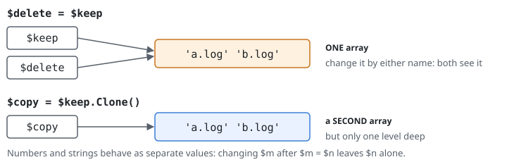

*Draft for owner review.* This lesson is the grammar of PowerShell: variables, types, strings, arrays, hashtables and the operators that combine them. It is where PowerShell stops looking like cmd with nicer commands and starts being a programming language. It is also where the sharpest traps live (a string that does not interpolate, a comparison that quietly filters an array, an `&&` that does not mean what you think). Every example below was run on **Windows PowerShell 5.1** and **PowerShell 7**; the output shown is real, and 7-only features are marked. The traps added on references, unset variables, regular-expression characters and `$Matches` come from `tests/verification/powershell/vars3.ps1`; they behaved the same in 5.1.26100 and 7.6.10.

## Variables

A variable starts with `$`. There is no declaration:

```powershell
$name = 'Ada'
$count = 3
"Hello $name, you have $count items"
Hello Ada, you have 3 items
```

Names are not case-sensitive and may contain letters, digits and underscores. For an odd name, wrap it in braces: `${my var} = 1`. Useful cmdlets: `Get-Variable`, `Set-Variable`, `Remove-Variable`, and `Clear-Variable`. See [about_Variables](https://learn.microsoft.com/powershell/module/microsoft.powershell.core/about/about_variables).

### Typed variables

A variable normally holds whatever you give it, but a **type constraint** locks it:

```powershell
[int]$t = 5
$t = 'abc'
Cannot convert value "abc" to type "System.Int32". Error: "The input string 'abc' was not in a correct format."
$t = '7'
$t.GetType().Name
Int32
```

Assigning `'7'` worked because PowerShell converted the text to the constrained type. Constrain variables that must hold numbers, dates or paths; it catches mistakes at the assignment instead of far from it.

### Read-only and constants

`Set-Variable ro -Value 1 -Option ReadOnly` makes a variable that cannot be changed (assigning raises `SessionStateUnauthorizedAccessException`); `-Option Constant` also forbids removal. Use them for values a script must never alter.

### Automatic and preference variables

PowerShell maintains variables you read but should not assign. The ones you need constantly ([about_Automatic_Variables](https://learn.microsoft.com/powershell/module/microsoft.powershell.core/about/about_automatic_variables)):

| Variable | Holds |
|---|---|
| `$_` or `$PSItem` | the current object in a pipeline script block |
| `$?` | `True` if the last command succeeded |
| `$LASTEXITCODE` | the exit code of the last native program |
| `$Error` | the list of recent errors, newest first |
| `$true`, `$false`, `$null` | the constants |
| `$args` | unnamed arguments of a function or script |
| `$PSScriptRoot` | the folder of the running script (empty at the prompt) |
| `$PSVersionTable` | the PowerShell version information |
| `$HOME`, `$PWD`, `$PID` | home folder, current location, this process ID |
| `$IsWindows`, `$IsLinux`, `$IsMacOS` | the platform, in PowerShell 7 (these variables do not exist in Windows PowerShell 5.1, which only runs on Windows) |
| `$env:NAME` | environment variable `NAME` |

**Preference variables** change how PowerShell behaves ([about_Preference_Variables](https://learn.microsoft.com/powershell/module/microsoft.powershell.core/about/about_preference_variables)): `$ErrorActionPreference` (what to do on an error; `Stop` turns every error into a terminating one), `$WarningPreference`, `$VerbosePreference`, `$ProgressPreference` and `$ConfirmPreference`. The errors lesson uses them heavily.

### Scope

A variable is visible in the **scope** where it was created and in child scopes (functions, script blocks), but an assignment in a child creates a **new** variable there:

```powershell
$x = 1
function f { $x = 2; "inner $x" }
f
inner 2
"outer $x"
outer 1
```

To change the outer one deliberately, qualify it: `$script:x = 3`, `$global:x = 3`. Modules, scripts and functions each get their own scope; the functions lesson returns to this. See [about_Scopes](https://learn.microsoft.com/powershell/module/microsoft.powershell.core/about/about_scopes).

### A variable that was never set

A misspelled variable is **not an error**. It is `$null`:

```powershell
$total = 10
"typo gives: [$totla]"      # typo gives: []
"typo + 1 = $($totla + 1)"  # typo + 1 = 1
$null -gt 0                 # False
$null -lt 1                 # True
```

So a typo can quietly turn a size check, a count or a path into nothing. **`Set-StrictMode -Version Latest`** at the top of a script turns this into an error:

```text
The variable '$totla' cannot be retrieved because it has not been set.
```

## Types

Everything in PowerShell is a .NET object with a type. Ask with `.GetType()` and test with `-is`:

| Literal or cast | Type | Notes |
|---|---|---|
| `42` | `Int32` | 32-bit integer |
| `3000000000` | `Int64` | too big for `Int32`, so it is promoted |
| `1.5`, `1/3` | `Double` | floating point |
| `1.5d` | `Decimal` | exact decimal, for money |
| `'text'`, `"text"` | `String` | |
| `[char]'a'` | `Char` | one character |
| `$true`, `$false` | `Boolean` | |
| `[datetime]'2026-11-21'` | `DateTime` | a date and time |
| `[timespan]` | `TimeSpan` | a duration |
| `[version]'5.1.26100'` | `Version` | compares correctly |
| `[ipaddress]'192.168.1.20'` | `IPAddress` | |
| `@(1,2,3)` | `Object[]` | an array |
| `@{a=1}` | `Hashtable` | |
| `[pscustomobject]@{a=1}` | `PSCustomObject` | a plain object |

**Casting** converts: `[int]'42'`, `[datetime]'2026-11-21 14:30'`, `[string]42`. A failed cast raises an error. The bracketed names are **type accelerators** ([about_Type_Accelerators](https://learn.microsoft.com/powershell/module/microsoft.powershell.core/about/about_type_accelerators)).

### Numbers

- **Literals:** `0x1F` is 31, `1e3` is 1000, and the size suffixes `KB`, `MB`, `GB`, `TB` multiply by powers of 1024 (`2MB` is 2097152). See [about_Numeric_Literals](https://learn.microsoft.com/powershell/module/microsoft.powershell.core/about/about_numeric_literals).
- **Division returns a double**: `5/2` is `2.5`, not 2. For whole-number division use `[math]::Truncate(5/2)` (2) or `[math]::Floor`.
- **Overflow promotes**: `2147483647 + 1` is not an error; it becomes a `Double` (2147483648), unlike `set /a` in cmd.
- **Casting to `[int]` rounds, to the nearest even number**: `[int](7/2)` is **4**, `[int](2.5)` is **2** and `[int](3.5)` is **4**, because 3.5 and 2.5 round to even. `[math]::Round(2.5)` is also 2. Use `[math]::Floor` or `[math]::Truncate` when you mean "drop the fraction", and `[math]::Round(2.567, 2)` (2.57) for decimal places.
- **Use `[decimal]` for money**, not `[double]`: binary floating point cannot represent 0.1 exactly.

## Strings

### Quoting rules

| | Single `'...'` | Double `"..."` |
|---|---|---|
| variables expand | **no** | yes: `"Hello $name"` |
| `$( )` expressions | no | yes: `"Sum: $(1+2)"` |
| escape character | none (double the quote: `'it''s'`) | the **backtick**: `` `n `` newline, `` `t `` tab, `` `" `` quote, `` `$ `` literal dollar |

Prefer single quotes for literal text (paths, regular expressions) and double quotes when you need interpolation. See [about_Quoting_Rules](https://learn.microsoft.com/powershell/module/microsoft.powershell.core/about/about_quoting_rules) and [about_Special_Characters](https://learn.microsoft.com/powershell/module/microsoft.powershell.core/about/about_special_characters).

### Two interpolation traps

**1. Only a plain variable expands, not a property.** This prints the object, not the name:

```powershell
$p = [pscustomobject]@{ Name = 'Bob' }
"Name: $p.Name"
Name: @{Name=Bob}.Name
"Name: $($p.Name)"
Name: Bob
```

Wrap any property, method call or expression in `$( )` (a **subexpression**).

**2. A colon after a name looks like a drive.** `"$n: done"` is an error, because `$n:` is read as the variable `n` on a provider drive. Write `"${n}: done"` (or `"$($n): done"`).

### Here-strings

A **here-string** holds many lines and quotes without escaping. `@"..."@` expands variables; `@'...'@` does not. The opening marker must end its line and the closing marker must start its line:

```powershell
$h = @"
line one $n
line two
"@
```

### Formatting with `-f`

The `-f` operator formats values into a template (the .NET [composite format](https://learn.microsoft.com/dotnet/standard/base-types/composite-formatting)), with alignment and format strings:

```powershell
"{0:N2} and {1,5}|{2,-5}|" -f 3.14159, 'x', 'y'
3.14 and     x|y    |
```

`{0:N2}` is the first value as a number with two decimals; `{1,5}` right-aligns to width 5; `{2,-5}` left-aligns. Dates use the [standard](https://learn.microsoft.com/dotnet/standard/base-types/standard-date-and-time-format-strings) and [custom](https://learn.microsoft.com/dotnet/standard/base-types/custom-date-and-time-format-strings) format strings: `Get-Date -Format 'yyyyMMdd-HHmmss'`, `"{0:yyyy-MM-dd}" -f $d`.

### Splitting, joining and searching

```powershell
'a,b,c' -split ','                   # a, b, c
'a','b','c' -join '-'                # a-b-c
'a1b22c333' -split '\d+'             # a, b, c and a trailing empty string
'Hello' -replace 'l+','L'            # HeLo     (regular expression)
'John Smith' -replace '(\w+) (\w+)','$2, $1'     # Smith, John   (capture groups)
'ver 5.1.26' -match '(\d+)\.(\d+)'   # True; $Matches[1] is 5 and $Matches[2] is 1
'abc' -like 'a*'                     # True      (wildcards, not regex)
```

`-split`, `-replace` and `-match` use **regular expressions** ([about_Regular_Expressions](https://learn.microsoft.com/powershell/module/microsoft.powershell.core/about/about_regular_expressions)); `-like` uses wildcards (`*` and `?`). Reference: [about_Split](https://learn.microsoft.com/powershell/module/microsoft.powershell.core/about/about_split) and [about_Join](https://learn.microsoft.com/powershell/module/microsoft.powershell.core/about/about_join). A string also has methods: `.Trim()`, `.Replace('a','b')` (literal, not regex), `.Substring(2,3)`, `.ToUpper()`, `.Contains('x')`, `.StartsWith('x')`, `.IndexOf('x')`, `.PadLeft(8)`, `.Split(',')`.

### When one result is not an array

A command that can return several things returns **one object, not an array, when there is only one**:

```powershell
function Get-Some($n) { 1..$n }
(Get-Some 1).GetType().Name    # Int32
(Get-Some 2).GetType().Name    # Object[]
$files = 'report.txt'          # what a search that found one file gives you
$files[0]                      # r        <- the first CHARACTER
```

Indexing a string gives a **character**, so a script that works when a search finds two files can silently process the letter `r` when it finds one. Wrap results in `@( )`: with `$wrapped = @($files)`, `$wrapped[0]` is `report.txt` and `$wrapped.Count` is 1.

### Special characters in `-replace`, `-split` and `-match`

These three use **regular expressions**, so some characters have meanings. **No error appears** when you forget:

| What I ran | Result |
|---|---|
| `'1.2.3' -replace '.', '-'` | `-----`: `.` means **any character** |
| `'1.2.3' -replace [regex]::Escape('.'), '-'` | `1-2-3` |
| `'1.2.3'.Replace('.', '-')` | `1-2-3`: the **method** is plain text |
| `'a.b.c' -split '.'` | **6** empty pieces |
| `'a.b.c' -split '\.'` | `a`, `b`, `c` |
| `'C:\temp\new' -match 'C:\temp'` | **`False`**: in a regular expression `\t` means a tab |
| `'C:\temp\new' -match [regex]::Escape('C:\temp')` | `True` |

When the text you search **for** comes from a variable or contains `\ . * + ? ( ) [ ] { } ^ $ |`, wrap it in `[regex]::Escape(...)`, or use the string methods.

**`-contains` is not "contains text".** It asks whether a **collection** has an item. `'abc' -contains 'a'` is `False`. For text use `-like '*a*'` or `-match`, which **ignore case**, or the method `.Contains('a')`, which is **case-sensitive**: `'abc'.Contains('A')` is `False` while `'abc' -match 'A'` is `True`.

**`$Matches` is left over.** It is set only when `-match` **succeeds** on a single value:

```powershell
'port=80' -match 'port=(\d+)'      # True ; $Matches[1] is 80
'host=web01' -match 'port=(\d+)'   # False; $Matches[1] is STILL 80
```

So read `$Matches` **only inside the `if` whose `-match` succeeded**. With a **collection** on the left, `-match` returns the matching items and does not set `$Matches`.

## Operators

### Arithmetic and string operators

`+ - * / %` do what you expect for numbers. The `+` operator **depends on the left operand's type**:

```powershell
'1' + 1        # 11   (string + number: concatenation)
1 + '1'        # 2    (number + string: addition)
'a' * 3        # aaa
(1,2) + (3,4)  # 1,2,3,4
```

If a value might be text, cast it: `[int]$x + 1`.

### Comparison

Comparison operators start with a dash, and are **case-insensitive by default** (`c` prefix for case-sensitive: `-ceq`; `i` for explicit insensitive: `-ieq`):

| Operator | Meaning |
|---|---|
| `-eq` `-ne` | equal, not equal |
| `-gt` `-ge` `-lt` `-le` | greater, greater or equal, less, less or equal |
| `-like` `-notlike` | wildcard match |
| `-match` `-notmatch` | regular-expression match (sets `$Matches`) |
| `-contains` `-notcontains` | collection contains a value |
| `-in` `-notin` | value is in a collection |
| `-is` `-isnot` | type test |
| `-and` `-or` `-xor` `-not` (`!`) | logical |
| `-band` `-bor` `-bxor` `-shl` `-shr` | bitwise |

```powershell
'abc' -eq 'ABC'         # True
'abc' -ceq 'ABC'        # False
1,2,3 -contains 2       # True
2 -in 1,2,3             # True
```

Reference: [about_Comparison_Operators](https://learn.microsoft.com/powershell/module/microsoft.powershell.core/about/about_comparison_operators), [about_Logical_Operators](https://learn.microsoft.com/powershell/module/microsoft.powershell.core/about/about_logical_operators) and the overview [about_Operators](https://learn.microsoft.com/powershell/module/microsoft.powershell.core/about/about_operators).

**Comparison with an array on the left filters it.** This is the biggest surprise in the language:

```powershell
1,2,3,2 -eq 2          # 2, 2        (returns the matching elements, not True)
$list -eq 'x'          # an array of matches; if it is empty, an `if` treats it as false
```

Put the scalar on the left when you want a boolean, and use `-contains` to ask "is it in the list".

**Strings compare as text, not as versions or numbers:**

```powershell
'5.1.26100' -gt '5.1.9'                          # False (text order)
[version]'5.1.26100' -gt [version]'5.1.9'        # True
```

When both sides must be compared as numbers, cast at least one.

### Truthiness and `$null`

`if ($x)` treats these as **false**: `$false`, `$null`, `0`, the empty string `''`, and an empty array `@()`. Everything else is true. Two traps:

- The **string `'False'` is true** (it is not empty).
- A **one-element array** takes the truthiness of its element (`@(0)` is false), but `@(0,0)` is true.

For null checks, put `$null` on the **left**: `if ($null -eq $x)`. With an array on the left, `-eq` filters and `@() -eq $null` returns nothing, which does not mean what it looks like. Use `[string]::IsNullOrEmpty($s)` for strings, and `if ($arr.Count -eq 0)` for collections.

### Assignment, range and others

`=`, `+=`, `-=`, `*=`, `++` and `--` assign and update. `1..5` is the range of integers (`'a'..'e'` works in 7). `&` calls a command, `.` dot-sources, `::` reaches a static member (`[math]::Round(2.5)`), and `,` builds an array (`1,2,3`).

### Operators only in PowerShell 7

| Operator | Meaning | In 5.1 |
|---|---|---|
| `$x ?? 'default'` | use `'default'` when `$x` is `$null` | parse error |
| `$x ??= 'default'` | assign only when `$null` | parse error |
| `$cond ? 'yes' : 'no'` | ternary | parse error |
| `a && b`, `a \|\| b` | run `b` if `a` **succeeded** (or failed) | parse error |
| `$obj?.Name` | null-conditional member access | parse error |

I ran `$x ?? "default"` and `(5 -gt 3) ? "yes" : "no"` in both editions: 7 printed `default` and `yes`, and 5.1 reported a parse error. The `&&`/`||` operators test whether the **command succeeded**, not whether it returned a true value: `Test-Path C:\nope && 'yes'` prints `False` and then `yes`, because `Test-Path` ran successfully (it just returned `False`). See [about_Pipeline_Chain_Operators](https://learn.microsoft.com/powershell/module/microsoft.powershell.core/about/about_pipeline_chain_operators). A script that must run on 5.1 cannot use them.

## Arrays

```powershell
$a = 1..5
$a[0]          # 1
$a[-1]         # 5       (negative counts from the end)
$a[1..3]       # 2, 3, 4 (a slice)
$a.Count       # 5
```

- **Force an array** with `@( )`: `$b = @('x')` has `.Count` 1 and `$c = 'x'` also reports 1 (PowerShell wraps a scalar), but `@()` gives an empty array with `.Count` 0. Use `@(Get-Something)` when a command may return one object, none or many, so the result is always indexable.
- **An array is fixed-size.** `$a += 3` does not extend it; it builds a **new** array and copies. That is fine for tens of items and slow for thousands. Use a list for growing collections:

```powershell
$l = [System.Collections.Generic.List[string]]::new()
$l.Add('a'); $l.Add('b')
$l.Count        # 2
```

- **Member enumeration:** `$processes.Name` returns the `Name` of **every** element, which is handy and surprising.
- Arrays nest (`@(@(1,2), @(3,4))`), but a function that returns an array **unrolls** it; wrap with a leading comma (`,$a`) to return it intact.

See [about_Arrays](https://learn.microsoft.com/powershell/module/microsoft.powershell.core/about/about_arrays).

### Two names for one array

Assigning an array or a hashtable to another variable **does not copy it**. Both names refer to the same thing:



```text
 $keep   --\
            >-- ONE array ['a.log','b.log']     a change by either name is seen by both
 $delete --/

 $copy  ---- a SECOND array (from $keep.Clone()), one level deep
```

| What I ran | Result |
|---|---|
| `$delete = $keep; $delete[0] = 'CHANGED'` | **`$keep` shows `CHANGED`** too |
| then `$delete += 'c.log'; $delete[1] = 'x'` | `$keep` kept its two items: `+=` had given `$delete` a **new** array |
| `$copy = $keep.Clone(); $copy[0] = '...'` | `$keep` unchanged |
| `$other = $base; $other.Port = 8080` (a hashtable) | **`$base.Port` is 8080** |
| `$c = $nested.Clone(); $c.Tags[0] = 'changed'` | **the original's `Tags` changed**: a clone is **shallow** |
| `$m = $n; $m = 6` (a number) | `$n` unchanged |

The dangerous case is a list that was meant to be filtered: `$toDelete = $allFiles` followed by changes changes `$allFiles` too. Use `.Clone()`, or build a new collection with a pipeline (`$toDelete = @($allFiles | Where-Object { ... })`), and remember that nested collections need their own copies. (An array's `+=` creating a new array is what made the second row behave differently: do not rely on that.)

## Hashtables and objects

A **hashtable** maps keys to values; it is the everyday record and lookup table:

```powershell
$ht = @{ Name = 'Ann'; Age = 30 }
$ht['Name']            # Ann
$ht.Age                # 30
$ht.ContainsKey('Age') # True
$ht.Keys.Count         # 2
$ht['City'] = 'Oslo'   # add; assigning an existing key updates it
$ht.Remove('Age')
```

Keys are case-insensitive, and a plain hashtable does **not** keep order. `[ordered]@{ z = 1; a = 2 }` does (`z,a`). To walk one: `foreach ($k in $ht.Keys) { "$k = $($ht[$k])" }` or `$ht.GetEnumerator()`.

When you want a **record that behaves like the objects cmdlets return** (so `Format-Table`, `Export-Csv`, `Sort-Object` work on it), convert it:

```powershell
$p = [pscustomobject]@{ Name = 'Bob'; Age = 40 }
$p.Name            # Bob
$p | Format-Table
```

`[pscustomobject]` is the standard way to emit structured results from a script. A hashtable is also how you pass parameters by **splatting** (`@params`), covered in the functions lesson. See [about_Hash_Tables](https://learn.microsoft.com/powershell/module/microsoft.powershell.core/about/about_hash_tables).

## Dates and durations

```powershell
$d = [datetime]'2026-11-21 14:30'
$d.DayOfWeek                                  # Saturday
$d.AddDays(-30).ToString('yyyy-MM-dd')        # 2026-10-22
($d - [datetime]'2026-11-01').Days            # 20      (subtracting dates gives a TimeSpan)
$d.ToString('dddd d MMMM yyyy HH:mm')         # Saturday 21 November 2026 14:30
(New-TimeSpan -Hours 90).ToString()           # 3.18:00:00
```

[`Get-Date`](https://learn.microsoft.com/powershell/module/microsoft.powershell.utility/get-date) returns the current date and time (and `-Format` gives text), and [`New-TimeSpan`](https://learn.microsoft.com/powershell/module/microsoft.powershell.utility/new-timespan) builds a duration. These replace every `%DATE%`/`%TIME%` workaround from the cmd lessons: dates here are objects, not regional text. For anything that is stored or compared, keep a `[datetime]` (or an ISO `yyyy-MM-dd` string), and format only for display.

## Common mistakes

- **`"$obj.Property"`** without `$( )` and getting the whole object printed.
- **`"$name: text"`** and the drive-qualifier error.
- **Expecting `-eq` on an array to return `True`.** It returns the matches.
- **Comparing version strings or numbers as text.**
- **`'1' + 1`** when you meant addition.
- **`$a += $x` in a big loop,** instead of a `List`.
- **`[int]` casts of halves** rounding to even.
- **`[double]` for money.**
- **Treating the string `'False'` as false.**
- **Using `??`, `?:` or `&&` in a script that must run on 5.1.**
- **Forgetting that `@()` may be needed** to make a one-or-many result an array.
- **Believing a second variable is a copy** of an array or hashtable.
- **Using `.` or a Windows path as a pattern** without `[regex]::Escape`.
- **Using `-contains` to search inside text.**
- **Reading `$Matches` after a match that failed.**

## Practice

1. Show with a one-line `.GetType().Name` check what type each of these is: `42`, `3000000000`, `1.5`, `1.5d`, `'x'`, `$true`, `(Get-Date)`, `1..3`, `@{a=1}`.
2. Print `[int](2.5)`, `[int](3.5)`, `[math]::Round(2.5)` and `[math]::Floor(2.5)`, and explain each result.
3. Make a here-string with a variable in it, and the same with the opposite quoting, and show the difference.
4. Build a table of `Name`/`Size` from the five largest files in a folder using `[pscustomobject]`, then format the sizes with `-f` as `{0:N0} KB`.
5. Write `$list -eq 'b'` on an array of strings, and explain why the result is not a boolean; then write the boolean version.
6. Compare `'5.1.26100' -gt '5.1.9'` with the `[version]` version.
7. Use `$x ?? 'default'` in PowerShell 7 and show the error in 5.1; rewrite it so it works in both.
8. Show why `@(0)` and `@(0,0)` differ in an `if`.

## Check your understanding

1. What is the difference between single and double quotes?
2. Why does `"Name: $p.Name"` print the object, and how do you fix it?
3. What does `1,2,3,2 -eq 2` return?
4. Why is `[int](2.5)` equal to 2?
5. What does `'1' + 1` return, and `1 + '1'`?
6. How do you compare two version numbers correctly?
7. What does `a && b` test in PowerShell 7?
8. When should you use a `List` rather than an array?
9. After `$b = $a`, you change `$b[0]`. What happens to `$a`?
10. Why does `'C:\temp\new' -match 'C:\temp'` return `False`?
11. A search found one file and `$result[0]` is a single letter. Why?

**Expected answers:** (1) single quotes are literal; double quotes expand variables and `$( )` and use backtick escapes; (2) only a plain variable name expands, so wrap the property in `$( )`: `"Name: $($p.Name)"`; (3) `2, 2`: the matching elements, not a boolean; (4) casting rounds to the nearest even integer, and 2.5 rounds to 2; (5) `11` (text) and `2` (number); the left operand decides; (6) cast both to `[version]` and compare; (7) whether command `a` **succeeded**, not whether its output is true; (8) when you add many items, because `+=` on an array copies the whole array each time; (9) it changes too, because both names are the same array; (10) the pattern is a regular expression, where `\t` is a tab; escape it with `[regex]::Escape`; (11) one result is not an array, so indexing a string gives a character; wrap with `@( )`.
