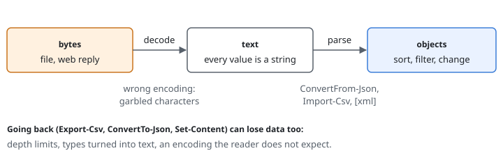

*Draft for owner review.* Most real scripts are glue between data formats: read a log, parse a CSV export, call a JSON API, write a report, edit a config file. PowerShell makes each of these short, and each has a trap that silently corrupts data: a file written in the wrong encoding, numbers that are really strings, JSON cut off at depth 2, a path with brackets treated as a wildcard. This lesson covers files and paths, text, regular expressions, CSV, JSON, XML, comparing data and the web cmdlets, with the traps shown from real output on **Windows PowerShell 5.1**, **PowerShell 7 on Windows** and **PowerShell 7 on Linux**. The newer traps (rewriting a file onto itself, `Compare-Object`, and badly formed CSV) come from `tests/verification/powershell/data3.ps1`, run on Windows in 5.1.26100 and 7.6.10.



```text
 bytes --decode--> text --parse--> objects  (sort, filter, change)  --convert back--> text --encode--> bytes
   ^ wrong encoding garbles          ^ every parsed CSV value is text        ^ depth limits and types are lost
```

When data comes out wrong, **find the step where it went wrong**: look at the raw bytes, then the text, then the objects (`Get-Member`).

Reminder from the earlier lessons: scripts use full cmdlet names (no aliases), and an external program is written with its extension (`curl.exe`, not `curl`).

## Paths and files

Build paths with `Join-Path` and take them apart with `Split-Path`; they use the right separator on every platform and handle trailing slashes ([`Join-Path`](https://learn.microsoft.com/powershell/module/microsoft.powershell.management/join-path), [`Test-Path`](https://learn.microsoft.com/powershell/module/microsoft.powershell.management/test-path)):

```powershell
$dir  = Join-Path $env:TEMP 'reports'
$file = Join-Path $dir 'summary.csv'
Test-Path $file                      # does it exist?
Split-Path $file -Parent             # the folder
Split-Path $file -Leaf               # summary.csv
[IO.Path]::GetExtension($file)       # .csv
```

### `-Path` versus `-LiteralPath`

`-Path` treats `*`, `?` and **`[ ]`** as wildcards ([about_Wildcards](https://learn.microsoft.com/powershell/module/microsoft.powershell.core/about/about_wildcards)). A file really named `data[1].txt` therefore cannot be addressed with `-Path`:

```powershell
Set-Content "data[1].txt" 'x'
Set-Content: An object at the specified path ...\data[1].txt does not exist, or has been filtered by the -Include or -Exclude parameter.
Set-Content -LiteralPath "data[1].txt" 'x'       # works
Get-Content -Path "data[1].txt"                  # nothing found
Get-Content -LiteralPath "data[1].txt"           # x
```

(This happened to my own test, in both editions and on Linux.) **Use `-LiteralPath` whenever the name comes from data** (a directory listing, user input, a CSV), because real file names contain brackets, and use `-Path` only when you want wildcards.

## Reading text

```powershell
Get-Content .\five.txt                   # an ARRAY of lines (string[])
Get-Content .\five.txt -Raw              # ONE string with the line breaks
Get-Content .\five.txt -TotalCount 2     # first 2 lines
Get-Content .\five.txt -Tail 2           # last 2 lines
Get-Content .\one-line.txt               # a single line comes back as a STRING, not an array
```

Seen in a test: a five-line file gave `Object[]` with `Count` 5; with `-Raw` it was one `String` of length 40; a **one-line** file was a plain `String`. That last case is a classic bug. For a file containing `hello`, `(Get-Content f).Count` is 1 (PowerShell lets any single object report a count of 1), but `(Get-Content f)[0]` is **`h`**, the first *character*, and `.Length` is 5, the string length. For a two-line file `[0]` is `hello`, the first line. A script that indexes the result works on every test file with two or more lines and breaks on a one-line file. Wrap with `@(Get-Content f)` when you need an array of lines (`@(Get-Content f)[0]` gave `hello`).

**Large files.** `foreach ($l in Get-Content big.log)` first loads every line. Stream instead: `Get-Content big.log | ForEach-Object { ... }`, or `Get-Content -ReadCount 1000` for batches, or `Select-String` for searching ([`Get-Content`](https://learn.microsoft.com/powershell/module/microsoft.powershell.management/get-content)). Use `-Raw` when you need to run a multi-line regular expression over the whole text, or hand the text to `ConvertFrom-Json`.

## Writing text, and the encoding trap

This is where scripts quietly damage data. I wrote the text `hi` with each writer and read the first bytes:

| Writer | Windows PowerShell 5.1 | PowerShell 7 (Windows) | PowerShell 7 (Linux) |
|---|---|---|---|
| `Out-File`, `>` | **UTF-16 LE with a BOM** (`FF FE 68 00 ...`, 10 bytes) | UTF-8, no BOM (`68 69 0D 0A`) | UTF-8, no BOM, **LF** line endings (3 bytes) |
| `Set-Content`, `Add-Content` | **ANSI** (the system code page), no BOM (`68 69 0D 0A`) | UTF-8, no BOM | UTF-8, no BOM, LF |
| `-Encoding UTF8` | UTF-8 **with a BOM** (`EF BB BF`) | UTF-8, no BOM (`utf8NoBOM`; `utf8BOM` for a BOM) | the same |
| `-Encoding ASCII` | ASCII, no BOM | ASCII | ASCII |

Consequences:

- In **5.1**, `>` and `Out-File` produce **UTF-16**, which many tools (Linux, `grep`, parsers, other scripts) read as garbage. `Set-Content` writes ANSI, which **loses any character outside the code page**. For portable files use `-Encoding UTF8` (it adds a BOM in 5.1, which some tools dislike) or `[IO.File]::WriteAllText($path, $text, [Text.UTF8Encoding]::new($false))` for UTF-8 with no BOM in both editions.
- In **7**, everything defaults to UTF-8 without a BOM, which is what you want. Do not assume a script written for 7 produces the same bytes under 5.1.
- **Always set `-Encoding` explicitly** when a file will be read by another program or another machine, and `-Encoding` when *reading* too (`Get-Content -Encoding UTF8`), because a BOM-less UTF-8 file is read as ANSI by 5.1.

See [about_Character_Encoding](https://learn.microsoft.com/powershell/module/microsoft.powershell.core/about/about_character_encoding) and the VS Code [file encoding guide](https://learn.microsoft.com/powershell/scripting/dev-cross-plat/vscode/understanding-file-encoding).

Other writing notes:

- `Out-File` formats objects **as the screen shows them** (a table, truncated to the console width unless you pass `-Width`); `Set-Content` converts each object to a **string**. Use `Set-Content` or `Export-Csv`/`ConvertTo-Json` for data and `Out-File` only for display text.
- `Set-Content` replaces a file, `Add-Content` appends, and `-NoNewline` omits the trailing line break (useful for a one-line token file).
- On Windows the line ending is CR+LF and on Linux LF. A file you generate for another platform needs the other ending, which `-replace "`r`n","`n"` and `-NoNewline` can produce.
- To write safely, write to a **temporary file in the same folder and rename** it over the target, so a crash cannot leave a half-written file.

### Never rewrite a file while you are reading it

A pipeline **streams**, so the writer can start before the reader has finished. Editing a file in place this way is dangerous:

| What I ran | What happened (5.1 and 7.6) |
|---|---|
| `Get-Content same.txt \| Set-Content same.txt` | Failed: `The process cannot access the file ... because it is being used by another process.` The contents **survived** |
| `Get-Content clob.txt \| Out-File clob.txt` | **The file ended up empty.** No error reached my `catch` |
| `(Get-Content same.txt) \| Set-Content same.txt` | Worked: the parentheses read the **whole** file first |

**Do not rely on being saved by an error.** Read into a variable (or use parentheses), then write; better, write a new file and rename it over the old one (above), after keeping a copy.

## Searching text with `Select-String`

[`Select-String`](https://learn.microsoft.com/powershell/module/microsoft.powershell.utility/select-string) is PowerShell's `grep`/`findstr`, and it returns **objects** with the line, the line number, the file and the regex match groups:

```powershell
$m = Select-String -Path log.txt -Pattern 'ERROR (\w+ \w+|\w+) code=(\d+)'
$m.Count                               # 2 matching lines
$m[0].LineNumber                       # 2
$m[0].Matches[0].Groups[1].Value       # disk full
$m[1].Matches[0].Groups[2].Value       # 408
```

| Parameter | Effect |
|---|---|
| `-Pattern` | regular expression (use `-SimpleMatch` for literal text) |
| `-CaseSensitive` | match case (the default is insensitive) |
| `-NotMatch` | lines that do **not** match |
| `-Context 0,1` | show 0 lines before and 1 after (`$_.Context.PostContext`) |
| `-AllMatches` | every match on a line, not just the first |
| `-List` | only the first match per file |
| `-Recurse` via `Get-ChildItem -Recurse \| Select-String` | search a tree |

Because the output is objects, the pipeline carries on: `Select-String -Pattern 'ERROR' | Group-Object { $_.Line.Substring(0,10) }` counts errors per date. The regular expressions are .NET regexes ([about_Regular_Expressions](https://learn.microsoft.com/powershell/module/microsoft.powershell.core/about/about_regular_expressions)), unlike `findstr`'s small dialect.

## CSV

[`Import-Csv`](https://learn.microsoft.com/powershell/module/microsoft.powershell.utility/import-csv) turns each row into an object with one property per header ([RFC 4180](https://www.rfc-editor.org/rfc/rfc4180) is the closest thing to a CSV standard):

```powershell
$emp = Import-Csv .\emp.csv        # Name,Dept,Salary,Start
$emp[0].Name                        # Ann
```

### Everything is a string

```powershell
$emp[0].Salary.GetType().Name                  # String
$emp[0].Salary + $emp[2].Salary                # 50006100   (concatenation!)
[int]$emp[0].Salary + [int]$emp[2].Salary      # 11100
```

`Import-Csv` has no types, so `5000 + 6100` became `50006100`, and sorting `Salary` sorts as **text** (`9` after `100`). Convert on the way in:

```powershell
$emp | Select-Object Name, Dept,
    @{ Name = 'Salary'; Expression = { [int]$_.Salary } },
    @{ Name = 'Start';  Expression = { [datetime]$_.Start } }
```

That `@{ Name = ...; Expression = ... }` is a **calculated property**: a property you define from a script block (`n`/`e` are accepted abbreviations).

### A badly formed CSV is read without complaint

I imported this file:

```text
Name,Dept,Salary
Ann,IT,5000
Bo,HR
Cy,IT,4000,extra
```

All three rows were accepted: Bo's `Salary` was **empty** and Cy's fourth value, `extra`, **vanished**. Nothing was reported. A **misspelled column** is just as quiet: `$row.Salery` is empty. `Measure-Object Salery -Sum` gave an empty sum; Windows PowerShell 5.1 also raised an error (`...the value of argument "Property" is not valid`), but **PowerShell 7.6 reported nothing**. Only a **repeated header** was refused (`The member "Name" is already present.`).

So **check the data you import** before you use it:

```powershell
$rows = Import-Csv .\emp.csv
$columns = $rows[0].PSObject.Properties.Name
foreach ($needed in 'Name', 'Dept', 'Salary') {
    if ($needed -notin $columns) { throw "column '$needed' is missing" }
}
$bad = @($rows | Where-Object { $_.Salary -notmatch '^\d+$' })
if ($bad.Count) { throw "$($bad.Count) row(s) have no usable salary" }
```


### Summaries

```powershell
$emp | Group-Object Dept | ForEach-Object {
    '{0}: n={1} total={2}' -f $_.Name, $_.Count, ($_.Group | Measure-Object Salary -Sum).Sum
}
HR: n=1 total=4200
IT: n=2 total=11100
```

(`Measure-Object -Sum` converted the numeric-looking text to numbers in my test, in both editions, giving 9200 for `'5000'` and `'4200'`; do not depend on that, and cast the property first so the intent is explicit.)

### Writing CSV

```powershell
$emp | Export-Csv .\out.csv -NoTypeInformation
```

[`Export-Csv`](https://learn.microsoft.com/powershell/module/microsoft.powershell.utility/export-csv) behaves differently by edition:

| | 5.1 | 7 |
|---|---|---|
| default first line | `#TYPE System.Management.Automation.PSCustomObject` (you must add `-NoTypeInformation` to avoid it) | the header row (no type line) |
| default encoding | ASCII (characters outside it are lost, so use `-Encoding UTF8`) | UTF-8, no BOM |

Every value is written quoted, so `Export-Csv` then `Import-Csv` round-trips; remember the types are lost again. Other forms you will use: `-Delimiter ';'` (many European exports), `-Header 'First','Second'` for a file with no header row, and `ConvertFrom-Csv`/`ConvertTo-Csv` for text in memory (`'a;b','1;2' | ConvertFrom-Csv -Delimiter ';'`). Excel opens a UTF-8 file correctly when it has a BOM, so a CSV for Excel often needs `-Encoding UTF8` in 5.1 and `utf8BOM` in 7.

### Joining two data sets

Do not loop over one table for every row of the other (quadratic). Build a **hashtable lookup** once:

```powershell
$byId = @{}
foreach ($d in $departments) { $byId[$d.Id] = $d }
foreach ($e in $employees) { $e | Add-Member DeptName $byId[$e.DeptId].Name -PassThru }
```

## JSON

JSON ([RFC 8259](https://www.rfc-editor.org/rfc/rfc8259)) is the format of configuration files and web APIs. [`ConvertFrom-Json`](https://learn.microsoft.com/powershell/module/microsoft.powershell.utility/convertfrom-json) gives objects and [`ConvertTo-Json`](https://learn.microsoft.com/powershell/module/microsoft.powershell.utility/convertto-json) gives text:

```powershell
$j = '{"a":1,"items":[{"n":"x"},{"n":"y"}],"single":[7],"when":"2026-11-21T10:30:00Z"}' | ConvertFrom-Json
$j.items.n -join ','        # x,y        (member enumeration)
$j.single.GetType().Name    # Object[]
$j.when.GetType().Name      # DateTime in 7, String in 5.1
```

A file: `Get-Content .\settings.json -Raw | ConvertFrom-Json` (`-Raw` so the parser gets the whole text). In 7, `-AsHashtable` returns hashtables, which preserves key case and handles keys that are not valid property names.

### The depth trap

`ConvertTo-Json` stops expanding objects at **depth 2** by default and replaces anything deeper with its string form, **without failing**:

```powershell
$obj = [pscustomobject]@{ name = 'x'; nested = [pscustomobject]@{ a = [pscustomobject]@{ b = [pscustomobject]@{ c = 1 } } } }
$obj | ConvertTo-Json -Compress
{"name":"x","nested":{"a":{"b":"@{c=1}"}}}
$obj | ConvertTo-Json -Compress -Depth 5
{"name":"x","nested":{"a":{"b":{"c":1}}}}
```

The deepest object became the text `"@{c=1}"`, so data was lost in a valid-looking file (7 prints a warning that the JSON is truncated; do not rely on noticing). **Always pass `-Depth`** (a generous number such as 10) when you serialize nested data.

### The one-element array trap

```powershell
ConvertTo-Json @(7) -Compress          # [7]
@(7) | ConvertTo-Json -Compress        # 7
```

Piping **unrolls** the array, so a one-item array becomes a bare value. Pass the array as an **argument** (`ConvertTo-Json -InputObject @(7)`) when it must stay an array, as an API may expect. (A property holding a one-item array, `[pscustomobject]@{ x = @(7) }`, did serialize as `{"x":[7]}`.)

Other notes: `-Compress` removes whitespace for transmission; dates are strings in JSON, so parse them deliberately (`[datetime]`), and be careful that `ConvertFrom-Json` converts date-like strings to `DateTime` in 7 but leaves them as strings in 5.1; very large numbers lose precision as doubles; JSON has no comments, so a "JSON with comments" file needs stripping first.

## XML

```powershell
$x = [xml]'<cfg><server name="a" port="80"/><server name="b" port="8080"/><opt>on</opt></cfg>'
$x.cfg.server.Count               # 2
$x.cfg.server[1].port             # 8080
$x.cfg.opt                        # on
(Select-Xml -Xml $x -XPath '//server[@port="8080"]').Node.name       # b
$x.cfg.opt = 'off'; $x.OuterXml
<cfg><server name="a" port="80" /><server name="b" port="8080" /><opt>off</opt></cfg>
```

The `[xml]` accelerator parses text into a document you navigate with dots (elements are properties, attributes too), change by assigning, and save with `$x.Save($path)`. [`Select-Xml`](https://learn.microsoft.com/powershell/module/microsoft.powershell.utility/select-xml) runs XPath queries. Load a file with `[xml](Get-Content -Raw -LiteralPath $path)`; a single child element appears as an object and several as an array, so use `@($x.cfg.server)` when you iterate.

**`Export-Clixml` / `Import-Clixml`** save and restore **PowerShell objects** exactly (including types), which is ideal for caching a result between runs (`Get-Process -Id $PID | Select-Object Id, ProcessName | Export-Clixml p.xml`, then `Import-Clixml p.xml`). It is not an interchange format for other languages. See [`Export-Clixml`](https://learn.microsoft.com/powershell/module/microsoft.powershell.utility/export-clixml).

## Comparing and checking data

```powershell
Compare-Object (Get-Content a1.txt) (Get-Content a2.txt)
InputObject SideIndicator
----------- -------------
x           =>
b           <=
```

[`Compare-Object`](https://learn.microsoft.com/powershell/module/microsoft.powershell.utility/compare-object) reports differences: `<=` only in the reference (first) set, `=>` only in the difference (second) set; `-IncludeEqual` shows what matches, and `-Property` compares chosen properties of objects. **Know what it ignores**, because "no differences" can be wrong for your purpose:

| Comparison | Differences reported |
|---|---|
| `'one','two','three'` with `'three','one','two'` (same lines, **other order**) | **0** |
| the same with `-SyncWindow 0` (compare position by position) | 6 lines of differences |
| `'ABC'` with `'abc'` | **0**; with `-CaseSensitive`, 2 |
| two objects with the same `Name` but `Size` 1 and 2, **no `-Property`** | **0** |
| the same with `-Property Name,Size` | 2 |

To compare objects, **always name the properties** that matter. To check two files are identical, compare hashes (`Get-FileHash`), which notice order, case and every byte. [`Get-FileHash`](https://learn.microsoft.com/powershell/module/microsoft.powershell.utility/get-filehash) returns a checksum (`-Algorithm SHA256`, which is 64 hex characters) to verify a download or detect a changed file. `ConvertFrom-StringData` turns `key=value` lines into a hashtable (`(ConvertFrom-StringData "a=1`nb=two").b` gives `two`).

## The web: `Invoke-RestMethod` and `Invoke-WebRequest`

The two cmdlets differ in what they give you:

| | returns | use it for |
|---|---|---|
| [`Invoke-RestMethod`](https://learn.microsoft.com/powershell/module/microsoft.powershell.utility/invoke-restmethod) | the **parsed body**: JSON becomes objects, XML an XML object, text a string | APIs |
| [`Invoke-WebRequest`](https://learn.microsoft.com/powershell/module/microsoft.powershell.utility/invoke-webrequest) | a **response object**: `StatusCode`, `Headers`, `Content`, `RawContentLength` | when you need the status, headers or the raw body; downloads with `-OutFile` |

I tested both against a throwaway local server (no internet needed):

```powershell
$r = Invoke-RestMethod http://localhost:8766/json
$r.name                                 # demo
$r.items -join ','                      # 1,2,3
$w = Invoke-WebRequest http://localhost:8766/json -UseBasicParsing
$w.StatusCode                           # 200
$w.Headers['Content-Type']              # application/json
```

**Sending data and headers:**

```powershell
$body = @{ id = 7; tags = @('a','b') } | ConvertTo-Json -Compress
Invoke-RestMethod http://localhost:8766/echo -Method Post -Body $body -ContentType 'application/json' -Headers @{ 'X-Token' = $token }
```

The server saw method `POST`, the `X-Token` header and the JSON body, and the reply came back as objects (`$e.body.tags -join ','` gave `a,b`). **Do not hard-code a token** in the script: read it from a secret store or a protected file or environment variable, and never write it to a log.

**Downloading a file:** `Invoke-WebRequest $url -OutFile $path` (`-UseBasicParsing` in 5.1; it is accepted and ignored in 7).

### HTTP errors

A 404 or 500 raises an **exception**, which differs by edition, so catch the general type:

| | exception | status code |
|---|---|---|
| 5.1 | `System.Net.WebException` | `[int]$_.Exception.Response.StatusCode` gave 404 |
| 7 | `Microsoft.PowerShell.Commands.HttpResponseException` | `[int]$_.Exception.Response.StatusCode` gave 404 |

```powershell
try { Invoke-WebRequest "$b/missing" -UseBasicParsing -ErrorAction Stop }
catch { 'status ' + [int]$_.Exception.Response.StatusCode }
```

PowerShell 7 adds **`-SkipHttpErrorCheck`**, which returns the response object even for an error status (it returned `404` without an exception); 5.1 has no equivalent. For flaky services write a **retry loop** (control-flow lesson) with a deadline and a pause.

### Platform notes

- **`curl` is not the curl program in 5.1**: it is an alias of `Invoke-WebRequest` (see the basics lesson). Use `Invoke-RestMethod` for APIs, or `curl.exe` when you need the program.
- **`-UseBasicParsing`** is needed in 5.1 to avoid the Internet Explorer engine, and unnecessary in 7.
- **TLS:** on this 5.1 build the default protocol setting was `SystemDefault`. On older Windows PowerShell installations you may need `[Net.ServicePointManager]::SecurityProtocol = [Net.SecurityProtocolType]::Tls12` before calling an HTTPS API that rejects older protocols.
- Behind a proxy, add `-Proxy` and `-ProxyUseDefaultCredentials`.
- Treat everything from the network as **untrusted input**: validate it before you write it to disk, parse it into something typed, and never pass it to `Invoke-Expression`.

## Idioms that make data code short

- **`Select-Object -ExpandProperty Name`** returns the *values* of a property instead of objects that hold it.
- **`Group-Object -AsHashTable -Property Dept`** makes a lookup table keyed by a property.
- **`Sort-Object -Unique`** removes duplicates (and sorts).
- **`ForEach-Object -Begin/-Process/-End`** keeps a running total across the pipeline.
- **`Tee-Object -FilePath out.txt`** saves the pipeline to a file *and* passes it on.
- **`Out-String -Width 200`** turns formatted output into text without truncation.
- **Build strings in a loop with `-join` or a `[System.Text.StringBuilder]`**, not `+=` (each `+=` copies the whole string).

## Common mistakes

- **Using `-Path` with names from data** (brackets are wildcards): use `-LiteralPath`.
- **Not setting `-Encoding`**, and meeting UTF-16 files from `>` in 5.1, or lost characters from `Set-Content`.
- **Treating `Import-Csv` values as numbers or dates.**
- **`Export-Csv` without `-NoTypeInformation` in 5.1** and a stray `#TYPE` line.
- **`ConvertTo-Json` without `-Depth`**, losing nested data silently.
- **Piping a one-item array to `ConvertTo-Json`** and getting a bare value.
- **Indexing `Get-Content` output of a one-line file** (`[0]` is the first character, not the line): wrap it in `@()`.
- **Loading a huge file with `foreach ($l in Get-Content ...)`.**
- **Hard-coding secrets** in URLs, headers or scripts.
- **Catching only one exception type** for HTTP errors across 5.1 and 7.
- **Assuming 5.1 and 7 write the same bytes or return the same types.**
- **`Get-Content x | Out-File x`** (or any rewrite of a file you are still reading).
- **Trusting `Compare-Object`'s silence** about order, case or properties you did not name.
- **Using imported CSV columns without checking that they exist and are filled.**

## Read this script

What is wrong with this script, and what will the output file contain on Windows PowerShell 5.1?

```powershell
$rows = Import-Csv .\sales.csv                 # Region,Amount
$total = 0
foreach ($r in $rows) { $total += $r.Amount }
$report = [pscustomobject]@{ Total = $total; Regions = ($rows | Select-Object Region -Unique); Detail = $rows }
$report | ConvertTo-Json | Out-File .\report.json
```

**Answer.** Four problems. (1) `$r.Amount` is a **string**. The loop happens to work because `$total` starts as a number on the **left** (`0 += '5000'` gave `5000`, an `Int32`, and then `9200`), but write it the other way round (`'5000' + 0`) and you get the text `50000`, and `'12.5'` becomes a `Double`, which is wrong for money: cast with `[decimal]$r.Amount` so the intent and the type are explicit. (2) `ConvertTo-Json` without `-Depth` cuts nested objects (`Detail` is an array of objects within an object) at depth 2 and writes the rest as text. (3) On **5.1**, `Out-File` writes **UTF-16 with a BOM**, so other tools will misread `report.json`; use `Set-Content -Encoding UTF8` or write bytes explicitly, and always set the encoding. (4) `Select-Object Region -Unique` returns objects with a `Region` property, not strings; use `Select-Object -ExpandProperty Region -Unique` if the JSON should hold a list of names.

## Practice

1. Write the same five-line text with `Out-File`, `Set-Content`, `Add-Content` and `>`, and print the first four bytes of each file. Do it under 5.1 and 7 and explain every difference.
2. Create a file named `data[1].txt` and show that `-Path` fails and `-LiteralPath` works.
3. From a CSV of employees, produce department totals as objects, sorted descending, exported to CSV and to JSON (with enough `-Depth`).
4. Search a log with `Select-String` for errors with their codes, count them per day, and show the line before each.
5. Round-trip a nested object through `ConvertTo-Json` with the default depth and with `-Depth 10` and compare with `Compare-Object`.
6. Show the one-element-array difference between piping and `-InputObject`.
7. Parse a small XML config, change a value, add an element, and save it.
8. Start a local listener, call it with `Invoke-RestMethod` (GET, then POST with a header), then call a missing URL and handle the error on both 5.1 and 7.

The lab for this lesson asks for a script that reads a JSON settings file and uses its values; the check runs it against fresh settings and inspects the output.

## Check your understanding

1. Why use `-LiteralPath` for names that come from data?
2. What bytes does `'hi' > file.txt` write in 5.1, and in 7?
3. Why does `$emp[0].Salary + $emp[2].Salary` give `50006100`?
4. What does `ConvertTo-Json` do to objects nested deeper than 2 levels by default?
5. What is the difference between `ConvertTo-Json @(7)` and `@(7) | ConvertTo-Json`?
6. What is the difference between `Invoke-RestMethod` and `Invoke-WebRequest`?
7. How do you get the HTTP status when a request fails, in 5.1 and in 7?
8. Why is `curl` unsafe to use in a script?
9. Two lists hold the same lines in a different order. What does `Compare-Object` report, and how do you compare positions?
10. Why did `Get-Content file | Out-File file` leave the file empty?

**Expected answers:** (1) `-Path` treats `[ ]`, `*` and `?` as wildcards, so a literal name with brackets is not found; (2) UTF-16 LE with a BOM (`FF FE 68 00 ...`) in 5.1, and UTF-8 without a BOM (`68 69 0D 0A`) in 7; (3) `Import-Csv` values are strings, so `+` concatenates; (4) it replaces them with their string form (`"@{c=1}"`) without failing; (5) the first gives `[7]` and the second `7`, because piping unrolls the array; (6) `Invoke-RestMethod` returns the parsed body (objects), `Invoke-WebRequest` returns a response object with status, headers and content; (7) catch the exception and read `[int]$_.Exception.Response.StatusCode` (a `WebException` in 5.1, an `HttpResponseException` in 7), or in 7 use `-SkipHttpErrorCheck`; (8) in 5.1 it is an alias of `Invoke-WebRequest` and in 7 it runs `curl.exe`, so the same line means different things; write `curl.exe` or the PowerShell cmdlet; (9) no differences; `-SyncWindow 0` compares position by position; (10) the writer opened (and emptied) the file while the pipeline was still reading it; read it all first.
