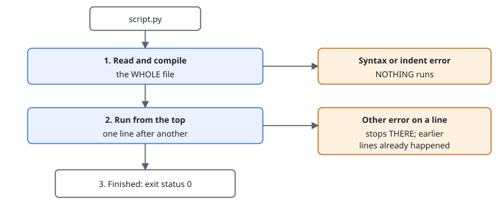

*Draft for owner review.* **Python** is a general programming language that many administrators use for scripts that outgrow a shell: reading and reshaping data, talking to several kinds of system, and running the **same script on Windows and Linux**. This is the first lesson of the *Python for administrators* track. It teaches only as much language as you need to run a script safely, read its errors and **audit what someone else wrote**. Later lessons are about administration work.

**What was tested, and where.** Everything shown was run with **Python 3.15.2 on Windows 11** and **Python 3.14.4 on Ubuntu 26.04 (WSL2)**; where the two differ, the text says so. The scripts are in `tests/verification/python/` (`pyb1.py`, `pyb2.ps1`, `pyb3.sh`). **Not tested:** Python 3.9 and 3.12 (versions you will meet on servers, including the course's AlmaLinux and Ubuntu lab VMs), the interactive prompt, macOS and Windows 10. Paths in the output are shortened to `<work>`, the temporary folder each test ran in.

## When to reach for Python

You already have shells. Choose by the job:

| The job | Usually the better choice |
|---|---|
| Run a few commands and join them up | The system's shell (PowerShell or bash) |
| Manage Windows settings, services, users | **PowerShell**: it has cmdlets for them and passes objects |
| A small task on a bare Linux server | **sh or bash**: always there |
| Parse awkward files, reshape CSV or JSON, do real calculations | **Python** |
| One tool that must behave the same on Windows and Linux | **Python** |

Python is **not part of every system**. Linux distributions often include it (the course's Ubuntu and AlmaLinux lab VMs do); Windows usually does not until someone installs it ([Using Python on Windows](https://docs.python.org/3/using/windows.html)). Before you write a Python tool for a machine, check that Python is there and which version it is. Installing it is a change to that machine: follow its rules.

## Which Python am I running?

This is the first question to answer, because one machine can have several Pythons, and the command name differs between systems.

On the test Windows PC, installed with Python's install manager, **three names worked**:

```text
python --version     Python 3.15.2
python3 --version    Python 3.15.2
py --version         Python 3.15.2
```

`py list` shows what the launcher manages:

```text
Tag           Name           Managed By  Version  Alias
3.15[-64]  *  Python 3.15.2  PythonCore  3.15.2   python3[-64].exe, python3.15[-64].exe
```

On that PC `Get-Command python` pointed into `...\Microsoft\WindowsApps\`, which is **not** where Python itself lives. To find the real program, **ask Python**:

```powershell
python -c 'import sys; print(sys.executable)'
```

```text
C:\Users\student\AppData\Local\Python\pythoncore-3.15-64\python.exe
```

(The user name here is a sample; yours will be in your path.) On Ubuntu the story was different:

```text
command -v python     -> not found
command -v python3    -> /usr/bin/python3
ls -l /usr/bin/python3 -> /usr/bin/python3 -> python3.14
python --version      -> python: command not found      (exit status 127)
```

**On Linux, write `python3`.** A script or note that says `python` may fail on a machine where only `python3` exists, as here.

A script can check for itself. [`sys`](https://docs.python.org/3/library/sys.html) knows the running interpreter and its version:

```python
import sys, platform

print(sys.executable)               # the program that is running this script
print(sys.version_info[:3])         # for example (3, 15, 2)
print(sys.version_info >= (3, 9))   # True when it is new enough
print(platform.system())            # Windows or Linux
```

Compare **`sys.version_info`** with a tuple, as above. Do not compare version **text**: as strings, `"3.9"` sorts after `"3.14"`.

## Running Python

Four ways, all of which you will meet ([command line](https://docs.python.org/3/using/cmdline.html)):

| You type | What it does |
|---|---|
| `python script.py a b` | Runs a file; `a` and `b` are its arguments |
| `python -c "print(6 * 7)"` | Runs the text you give. Printed `42` |
| `python -m name` | Runs an installed module as a program, for example `python -m py_compile file.py` |
| `python` | Starts the **interactive prompt** (`>>>`); leave it with `exit()` ([the interpreter](https://docs.python.org/3/tutorial/interpreter.html)). Not exercised by the test scripts |

Python also reads a program from standard input when you give `-`.

### Quoting `-c` differs between shells

The quotes are read by **your shell before Python sees anything**. This line works in PowerShell 7:

```powershell
python -c 'print("hi there")'
```

In **PowerShell 7** it printed `hi there`. The **same line in Windows PowerShell 5.1** failed, because 5.1 lost the inner double quotes on the way to the program:

```text
    print(hi there)
          ^^^^^^^^
SyntaxError: invalid syntax. Perhaps you forgot a comma?
```

In Command Prompt, swap the quotes: `python -c "print('hi there')"` worked. In bash, `python3 -c 'print("hi there")'` worked. **When a one-liner behaves strangely, put it in a file** and the shell stops being part of the problem.

### Scripts on Linux: the shebang

On Linux a script can start with a **shebang** line naming its interpreter, so you can run it as `./hello.py` ([using Python on Unix](https://docs.python.org/3/using/unix.html)):

```python
#!/usr/bin/env python3
import sys
print("args:", sys.argv[1:])
sys.exit(3)
```

| What I did | Result |
|---|---|
| `./hello.py` before `chmod +x` | `Permission denied`, status 126 |
| `python3 hello.py a 'b c'` | `args: ['a', 'b c']`, status 3 (no execute bit needed) |
| `chmod +x hello.py`, then `./hello.py a 'b c'` | the same output and status |
| a file with **Windows line endings**, run as `./crlf.py` | `env: $'python3\r': No such file or directory`, status 127 |
| the same file run as `python3 crlf.py` | worked |

The `\r` in that message is the extra carriage return from a Windows editor: the system looked for a program literally called `python3` plus that character.

**Leaving the shebang out is worse than an error.** Without it, bash ran a file containing `import sys` **as a shell script**. `import` was then looked up as a command, and on that machine it is **ImageMagick's screen-capture program**. With a desktop available it waits for a mouse click (my first test run hung until I stopped it). With no display it reported:

```text
import: unable to open X server `' @ error/import.c/ImportImageCommand/348.
./bare.py: 2: Syntax error: word unexpected (expecting ")")
```

On a machine without ImageMagick you would see a different message. **If a "Python script" behaves bizarrely, check its first line.**

### Scripts on Windows

**Run `python script.py arguments`.** Its exit status arrives in `$LASTEXITCODE` (PowerShell) or `%errorlevel%` (Command Prompt). Typing just `.\hello.py` relies on the file association, which is a property of that PC: in my test it returned the script's exit status 3 but **showed none of its output**. A bare `hello.py`, without `.\`, was not found by PowerShell.

## How Python runs your file



```text
  script.py
      |
      v
  1. read and compile the WHOLE file  --- syntax or indentation error? ---> nothing runs
      |
      v
  2. run it from the top, line by line --- other error on a line? ---> stops THERE
      |                                    (earlier lines have already happened)
      v
  3. finished: exit status 0
```

This matters on a real system. A **syntax error** anywhere means the script does **nothing**:

```python
print("step 1")
if True
    print(2)
```

```text
  File "<work>/s.py", line 2
    if True
           ^
SyntaxError: expected ':'
```

`step 1` never appeared. But a mistake such as a misspelled name is found **only when that line runs**:

```python
print("step 1 ran")
print(undefined_name)
```

```text
step 1 ran
Traceback (most recent call last):
  File "<work>/s.py", line 2, in <module>
    print(undefined_name)
          ^^^^^^^^^^^^^^
NameError: name 'undefined_name' is not defined
```

So a script can **delete half the files and then crash**. You cannot assume that an error means nothing changed, and a mistake in a rarely used branch can hide for months. This is why administration scripts are tested on copies first.

You can check the syntax **without running** the file ([`py_compile`](https://docs.python.org/3/library/py_compile.html)):

```powershell
python -m py_compile late.py
```

A bad file printed the `SyntaxError` and exited 1. A good file printed nothing, exited 0, and **did not run** (its test line, which would have created a file, had no effect). It finds only syntax problems: **passing it does not mean the script is correct or safe.**

## Indentation is the structure

Where other languages use braces, Python uses **indentation** to say which lines belong to an `if`, a loop or a function ([control flow](https://docs.python.org/3/tutorial/controlflow.html)). The usual style is four spaces per level.

```python
total = 0
for n in [1, 2, 3]:
    total += n
    print("inside", total)    # runs three times
print("after", total)         # runs once
```

```text
inside 1
inside 3
inside 6
after 6
```

**Moving a line left or right changes what the program does**, with no error at all. Two other cases do raise errors, before anything runs:

| Mistake | Error |
|---|---|
| A line indented to a level that matches nothing | `IndentationError: unindent does not match any outer indentation level` |
| Tabs and spaces mixed | `TabError: inconsistent use of tabs and spaces in indentation` |

Set your editor to insert spaces. Be careful when you **paste** code from a web page or chat: check the indentation before you run it.

## Values and their types

Every value has a **type** ([built-in types](https://docs.python.org/3/library/stdtypes.html)):

| Value | Type | Meaning |
|---|---|---|
| `42` | `int` | A whole number |
| `3.5` | `float` | A number with a fraction |
| `"42"` | `str` | Text |
| `True`, `False` | `bool` | Yes or no |
| `None` | `NoneType` | "No value" |
| `[1, 2]` | `list` | An ordered collection you can change |
| `{"a": 1}` | `dict` | Names (keys) that lead to values |

`type(x).__name__` tells you what you have, and `repr(x)` shows it unambiguously: `repr("42")` is `'42'`, with quotes.

```python
print(7 / 2, 7 // 2, 7 % 2, 2 ** 10)    # 3.5 3 1 1024
print(0.1 + 0.2, 0.1 + 0.2 == 0.3)      # 0.30000000000000004 False
print(int("42") + 1, str(42) + "1")     # 43 421
```

`/` always gives a fraction, `//` divides and rounds down, `%` is the remainder. Fractions are stored in binary, so **do not test floats for exact equality** ([floating point](https://docs.python.org/3/tutorial/floatingpoint.html)).

### Text is not a number

Everything read from a file, a command line or a prompt **arrives as text**. Python does not convert for you:

```python
count = "5"
print(count + 1)
```

```text
TypeError: can only concatenate str (not "int") to str
```

Multiplying text does not fail, which is worse: with `n = "5"`, `n * 3` is `'555'`, while `int(n) * 3` is `15`. Convert deliberately with `int()` or `float()`, and expect bad input:

```text
int("12 GB")   ->   ValueError: invalid literal for int() with base 10: '12 GB'
```

## Strings you will use every day

An **f-string** puts values inside text; write `f` before the quote ([formatting output](https://docs.python.org/3/tutorial/inputoutput.html)):

```python
name = "web01"
free = 12.3456
print(f"{name}: {free:.1f} GB free")     # web01: 12.3 GB free
print(f"[{name:<8}][{free:>8.2f}]")      # [web01   ][   12.35]
print(f"{name=} {free=}")                # name='web01' free=12.3456
print(f"{1536000:,} bytes")              # 1,536,000 bytes
```

`:.1f` means one decimal place; `<8` and `>8` pad to eight characters, left or right; `{name=}` is a quick debugging print; `,` adds thousands separators.

Splitting and cleaning text is most of the work with system files:

```python
line = "  alice:x:1001:1001::/home/alice:/bin/bash  \n"
clean = line.strip()                  # remove blanks and the newline at both ends
parts = clean.split(":")              # cut at every colon
print(len(parts), parts[0], parts[-1])   # 7 alice /bin/bash
print(clean.startswith("alice"), "bash" in clean)   # True True
print(":".join(parts[:3]))            # alice:x:1001
print("Report.TXT".lower().endswith(".txt"))        # True
```

There are **seven** parts although two colons stand together: the empty field between them counts.

### Windows paths and the backslash

Inside ordinary quotes, a backslash starts an **escape**: `\n` is a new line, `\t` a tab ([string literals](https://docs.python.org/3/reference/lexical_analysis.html)). A Windows path walks straight into this:

```python
p = "C:\new\table.txt"
print(p)
```

```text
C:
ew	able.txt
```

No error: just a wrong path. Another one will not even start:

```python
p = "C:\Users\alice"
```

```text
SyntaxError: (unicode error) 'unicodeescape' codec can't decode bytes in position 2-3: truncated \UXXXXXXXX escape
```

(`\U` begins a special character code.) Use a **raw string**, `r"C:\new\table.txt"`, or forward slashes. Better still, build paths with [`pathlib`](https://docs.python.org/3/library/pathlib.html), which knows each system's rules:

```python
from pathlib import Path, PureWindowsPath, PurePosixPath

print(PureWindowsPath("C:/Logs") / "app" / "x.log")    # C:\Logs\app\x.log
print(PurePosixPath("/var/log") / "app" / "x.log")     # /var/log/app/x.log
p = Path("logs") / "app.log"
print(p.name, p.stem, p.suffix, p.parent)              # app.log app .log logs
print(p.exists())                                      # False
```

Use `Path` in your scripts; the two `Pure...` classes are here to show both styles on one machine. Building a path does **not** create or check the file; `exists()` asks.

### Text, bytes and encodings

A file holds **bytes**; text is bytes **decoded** with an encoding. `"café".encode("utf-8")` is `b'caf\xc3\xa9'`: **5 bytes for 4 characters**. Decoding those bytes with the wrong encoding, `cp1252`, produced `café`, the damage you have probably seen in a badly opened file.

When no encoding is given, the default **depends on the Python version and system**. On Windows, 3.15.2 reported UTF-8 mode **on** (`sys.flags.utf8_mode` was 1; [PEP 686](https://peps.python.org/pep-0686/) made it the default from 3.15). On Ubuntu, 3.14.4 reported it **off** and used UTF-8 because of the system's language settings. An older Python on Windows may use a different default (not tested here). **Say what you mean**: `open(path, encoding="utf-8")`.

## Lists and dictionaries

```python
servers = ["web01", "db01"]
servers.append("web02")
print(servers[0], servers[-1], servers[0:2])   # web01 web02 ['web01', 'db01']
print(sorted(servers), servers)                # sorted() returns a NEW list
ports = {"ssh": 22, "https": 443}
ports["rdp"] = 3389
for name, port in ports.items():
    print(f"{name} {port}")
print(ports.get("smtp"), ports.get("smtp", 25), "ssh" in ports)   # None 25 True
```

Positions start at **0**; `-1` is the last; `[0:2]` takes positions 0 and 1 ([data structures](https://docs.python.org/3/tutorial/datastructures.html)). Asking for something that is not there is an error: `servers[1]` on a one-item list raised `IndexError: list index out of range`, and `ports["smtp"]` raised `KeyError: 'smtp'`. Use `.get()` when a missing key is normal, and give the default that really makes sense.

### Two names, one list

```python
keep = ["a.log", "b.log"]
delete = keep             # NOT a copy: a second name for the same list
delete.append("c.log")
print(keep)               # ['a.log', 'b.log', 'c.log']
```

`keep` changed too. To get a separate list, use `keep.copy()`. In a script that builds a list of things to delete, this mistake is dangerous.

Two relatives of it:

```python
def add(item, seen=[]):    # the default list is made ONCE and then reused
    seen.append(item)
    return seen
print(add("a"))            # ['a']
print(add("b"))            # ['a', 'b']
```

```python
names = ["a.tmp", "b.tmp", "c.txt"]
for n in names:
    if n.endswith(".tmp"):
        names.remove(n)    # changing the list you are looping over
print(names)               # ['b.tmp', 'c.txt']   <- one .tmp survived
```

Write `def add(item, seen=None):` and create the list inside ([why](https://docs.python.org/3/faq/programming.html)); loop over a copy (`for n in names.copy():`) or build a new list.

## Decisions, loops and truth

```python
sizes = [10, 95, 99]
for number, pct in enumerate(sizes, start=1):
    if pct >= 98:
        level = "critical"
    elif pct >= 90:
        level = "warning"
    else:
        level = "ok"
    print(number, pct, level)
```

```text
1 10 ok
2 95 warning
3 99 critical
```

**Order matters:** test the strictest case first, or `critical` is never reached. `range(3)` gives 0, 1, 2; `range(1, 4)` gives 1, 2, 3: the end is **not** included.

In an `if`, any value counts as true or false:

| False | True |
|---|---|
| `0`, `""`, `[]`, `None` | `1`, `"0"`, `"False"`, `[0]` |

**The text `"False"` is true**, because it is not empty. A setting read from a file must be compared: `value.lower() == "true"`.

`==` asks whether two values are **equal**; `is` asks whether they are **the same object**. With `a = [1, 2]` and `b = [1, 2]`, `a == b` was `True` and `a is b` was `False`. Use `is` only for `None`: `if x is None:`.

## Functions

```python
def percent_used(used, total):
    """Return used/total as a percentage."""
    if total <= 0:
        raise ValueError("total must be positive")
    return used / total * 100

print(f"{percent_used(45, 60):.1f}")     # 75.0
```

The string under `def` is the **docstring**; `help()` shows it. `raise` refuses bad input loudly instead of returning a wrong number. **A function with no `return` gives `None`**: a function whose body is just `x * 2` returned `None`.

## Reading a traceback

When Python stops on an error it prints a **traceback** ([errors](https://docs.python.org/3/tutorial/errors.html)). Read it **from the bottom**:

```text
Traceback (most recent call last):
  File "<work>/s.py", line 7, in <module>
    main()
    ~~~~^^
  File "<work>/s.py", line 5, in main
    print(load("ten"))
          ~~~~^^^^^^^
  File "<work>/s.py", line 2, in load
    return int(count_text)
ValueError: invalid literal for int() with base 10: 'ten'
```

1. **Last line:** the error type and message: `ValueError`, and the bad value `'ten'`.
2. **The frame just above:** the line where it happened: line 2, inside `load`.
3. **Further up:** how the program got there: line 7 called `main`, and line 5 called `load`. The cause is often **here**: someone passed in `"ten"`.

| Error type | Usual meaning |
|---|---|
| `SyntaxError`, `IndentationError` | The file cannot be compiled; nothing ran |
| `NameError` | A misspelled or never-assigned name |
| `TypeError` | The wrong kind of value, such as text where a number belongs |
| `ValueError` | The right kind, unusable content |
| `KeyError`, `IndexError` | No such key or position |

(There are many more: [built-in exceptions](https://docs.python.org/3/library/exceptions.html).) Python often helps: for a misspelled name it printed `NameError: name 'server_cuont' is not defined. Did you mean: 'server_count'?`

**But a typo in an assignment is silent.** `verbose = False`, then `verbsoe = True`, then `print(verbose)` printed `False`, with no error: the misspelling quietly made a new variable.

## Arguments and exit status

An administration script is often run by another program: a scheduler, a monitoring tool or another script. It receives **arguments** in `sys.argv` and reports back with an **exit status**: 0 for success, anything else for failure.

```python
"""Greet each name given on the command line."""
import sys


def main(argv):
    if len(argv) < 2:
        print("usage: hello.py NAME...", file=sys.stderr)
        return 2
    for name in argv[1:]:
        print(f"Hello, {name}!")
    return 0


if __name__ == "__main__":
    sys.exit(main(sys.argv))
```

| Run | Output | Status |
|---|---|---|
| `python hello.py Alice Bob` | `Hello, Alice!` and `Hello, Bob!` | 0 |
| `python hello.py` | the usage line, on **standard error** | 2 |
| `python hello.py "Mary Ann"` | `Hello, Mary Ann!` (one argument) | 0 |

- `sys.argv[0]` is the script's name; your arguments start at `[1]`. **All are text**: running with `5 "a b" --force` gave `['5', 'a b', '--force']`.
- **`if __name__ == "__main__":`** means "only when this file is run, not when it is imported" ([`__main__`](https://docs.python.org/3/library/__main__.html)). Importing `hello` ran no greeting.
- **Printing "FAILED" does not make a script fail.** A script whose only line was `print("FAILED: disk full")` exited **0**, so anything that checks the status would call it a success. Return a non-zero status.
- `sys.exit("config file not found")` printed the message to standard error and exited **1**.
- **`sys.exit(True)` exits 1**, which means failure. Pass numbers: `return 0`.

Real scripts should use the `argparse` module for options; a later lesson covers it.

## Before you run someone else's script

Python scripts are easy to find and copy. **A script runs with all of your rights**, as with any shell script. Read it first.

**1. Importing runs code.** `import helper` is not just loading definitions: any statement at the top level of `helper.py` runs right then. My `helper.py` printed a line merely by being imported ([modules](https://docs.python.org/3/tutorial/modules.html)). Reading only the "main" script is not enough: read the local files it imports.

**2. A file next to the script can replace a standard module.** Python looks for imports in **the script's own folder first**. I put a file called `json.py` beside a script that does `import json`:

```text
!!! this is ./json.py, not the standard library
<work>/shadow/json.py
False
```

The script's innocent `import json` ran **the file in the folder**. In a downloads folder or an unpacked archive, someone else chooses those files. The same trap happens by accident if you name your own file `random.py`:

```text
AttributeError: module 'random' has no attribute 'choice' (consider renaming '<work>/shadow2/random.py' since it has the same name as the standard library module named 'random' and prevents importing that standard library module)
```

(That helpful hint came from both tested versions.) The defence for running a script you do not control is **isolated mode, `-I`** ([command line](https://docs.python.org/3/using/cmdline.html)). With `python -I report.py`, the same script loaded the **real** library:

```text
C:\Users\student\AppData\Local\Python\pythoncore-3.15-64\Lib\json\__init__.py
True
```

`-I` also ignores `PYTHON...` environment variables and your personal package folder. Because it leaves the script's folder out of the search, a script that legitimately imports its own neighbouring files will **not** find them with `-I`. **`-I` is not a sandbox:** the script can still do anything you can.

**3. What to look for when reading:**

| Look for | Why |
|---|---|
| `import` lines | What can it do? `subprocess`, `os`, `shutil`, `socket`, `urllib` reach programs, files and the network |
| `subprocess`, `os.system` | It runs other programs. Which, and is any part built from input? |
| `os.remove`, `shutil.rmtree`, `Path.unlink`, `open(..., "w")` | It deletes or overwrites files |
| `eval`, `exec`, long encoded text, `base64` | It may build code at run time that you cannot see by reading |
| Code at the top level, outside functions | It runs as soon as the file is run **or imported** |

These are reasons to **read closely**, not proof of harm: honest scripts use all of them. If you cannot tell what it does, do not run it on a machine that matters.

## Getting help

`help(str.split)` at the prompt shows documentation, and `python -h` lists the interpreter's own options. The official [tutorial](https://docs.python.org/3/tutorial/index.html) and library reference are free, and the documentation site lets you choose **your Python version**: use the one you are running.

## Common mistakes

- Typing `python` on a Linux machine that has only `python3`.
- Leaving out the shebang, or saving a Linux script with Windows line endings.
- Writing a Windows path in ordinary quotes.
- Treating text from a file or argument as a number.
- Assuming an error means nothing was changed: earlier lines already ran.
- `copy = original` for a list, then changing one.
- Removing items from a list while looping over it.
- Testing the text `"False"` as if it were false.
- Printing an error but exiting with status 0.
- Naming your file after a standard module.
- Running a downloaded script from its own folder without reading it **and the files beside it**.

## Practice

Work in a new, empty folder. These only touch files you create there.

1. Find which `python` names exist on your machine, and use `sys.executable` to find the real interpreter. On Linux and Windows, if you have both, compare.
2. Write a script that prints its version and refuses to continue below 3.9, with exit status 2.
3. Write `"C:\new\table.txt"` three ways: broken, as a raw string, and with `pathlib`. Print each with `print` and `repr`.
4. Given `line = "db01,95,online"`, print `db01 is online (95% full)`. Then make the number part invalid and read the traceback.
5. Reproduce the two-names-one-list mistake, then fix it.
6. Write `check_disks.py` that takes percentages as arguments, prints `ok`, `warning` or `critical` for each, and exits 0 if all are ok, 1 if any is not, and 2 for no or bad arguments. Test each exit status from your shell.
7. Make a syntax error in the last line of a script that prints something first. Predict what you will see, then run it. Then check it with `python -m py_compile`.
8. In an empty folder, create a harmless `csv.py` that prints a message, plus a script that does `import csv`. Run it with and without `-I`.
9. **Read this and say what is wrong with it. Do not run it.**

    ```python
    import os, sys

    target = sys.argv[1]
    old = os.listdir(target)
    keep = old
    keep.remove("current.log")
    for f in old:
        os.remove(f)
    print("done")
    ```

    **Answer.** No check that an argument was given. `keep = old` is the **same list**, so removing `current.log` from `keep` also removes it from `old`; the intent was probably to delete everything except that file, which only works **by accident**, and the script raises `ValueError` if the file is absent. `os.listdir` returns bare **names**, so `os.remove(f)` deletes those names in the **current folder**, not in `target`: run from the wrong place, it deletes the wrong files. It would stop partway if an entry were a folder, after deleting others. There is no preview or confirmation, and no meaningful exit status.

## Check your understanding

1. Why should a Linux script or instruction say `python3` and not `python`?
2. A script has a syntax error on its last line. What has it done by the time you see the error? What if the last line has a misspelled name instead?
3. What does `python -m py_compile script.py` prove, and what does it not?
4. Why does `"C:\new\table.txt"` print on two lines?
5. `n = "5"`. What are `n * 3` and `int(n) * 3`?
6. After `b = a` and `b.append(1)`, what happened to `a` (a list)?
7. In a traceback, which line do you read first, and where is the cause often found?
8. A script prints `ERROR` and ends. A scheduler reports success. Why?
9. What can a file named `json.py` next to a script do, and what does `-I` change?
10. Is a script safe because it ran with `-I`?

**Expected answers:** (1) some Linux systems have `python3` but no `python` command; (2) with a syntax error, nothing at all, because the whole file is compiled first; with a misspelled name, everything before that line has already happened; (3) that the file compiles, with no syntax error; not that it is correct or safe; (4) `\n` is a new line and `\t` a tab inside ordinary quotes; (5) `'555'` and `15`; (6) `a` also has the new item, because both names are the same list; (7) the last line, with the error type and message; the cause is often further up, where the bad value was passed in; (8) printing does not set the exit status, which was 0; it must exit non-zero; (9) it is imported instead of the standard module and its code runs; `-I` keeps the script's folder out of the import search; (10) no: `-I` only changes how Python starts and where it looks for imports; the script still has all your rights.
