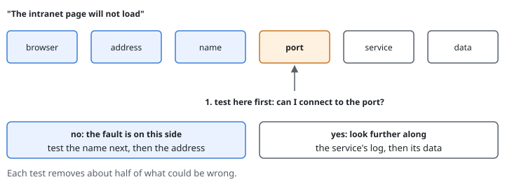

*Draft for owner review.* Guessing and changing settings until something works is slow, and it can leave a system worse than you found it. A repeatable method is faster over time and leaves a record. This lesson teaches the method this course uses, shows which built-in tools serve each step on Windows and Linux, and gives you worked examples to practise on. Every later lesson and lab assumes you work this way.

## The eight steps

1. **Reproduce.** Make the problem happen on demand, or learn exactly when it happens. If you cannot reproduce it, say so; that is itself a finding.
2. **Scope.** Decide how far it reaches. One user or all? One machine or several? Since when? What changed just before it began?
3. **Observe.** Collect evidence without changing anything: error text, event logs, the state of services and processes, recent changes. Copy messages exactly.
4. **Hypothesize.** Write down the most likely causes that fit the evidence, ranked. A hypothesis must be something a test could prove wrong.
5. **Test.** Design the smallest check that separates your hypotheses. Prefer read-only checks. Change one thing at a time.
6. **Repair.** Apply the fix for the cause you confirmed. Before changing anything, know how you would undo it, and take a backup or restore point when the change is hard to reverse.
7. **Verify.** Repeat the reproduction from step 1. Confirm the problem is gone and that nothing nearby broke.
8. **Document.** Record the symptom, cause, fix and how you verified it, so you or someone else can solve it faster next time.

These steps cover the same ground as the troubleshooting processes taught in industry courses and certifications (identify the problem, form a theory, test it, plan and implement the fix, verify, document); the course's own list simply splits "identify" into reproduce, scope and observe, because those are the steps people skip.

## Why each step matters

- Skipping **reproduce** means you cannot know whether your fix worked.
- Skipping **scope** sends you to fix one machine when the cause is a shared one.
- Skipping **observe** turns troubleshooting into guessing.
- Changing several things at once in **test** or **repair** means you cannot tell which change mattered, and you cannot cleanly undo them.
- Skipping **verify** is how a problem returns the next morning.
- Skipping **document** means the next person, who is often you in six months, starts from zero.

## Step 1 and 2: reproduce and scope

Ask questions that narrow the problem. These work for nearly every report:

| Question | What it tells you |
|---|---|
| What exactly did you do, and what did you expect? | the real symptom, not the user's guess at the cause |
| What did you see? (the exact error text, or a screenshot) | evidence you can search for |
| When did it last work? | the time window to examine |
| What changed since then? (updates, installs, new hardware, password change, moved office) | the first suspect |
| Does it happen for others, on other machines, in other places? | the scope |
| Does it happen every time? | whether it is reproducible |

Scope is a decision tree, and each answer removes whole branches:

| Finding | Points towards |
|---|---|
| one user, every machine they use | the account: permissions, profile, group membership |
| every user, one machine | the machine: a service, a driver, a disk, the local network |
| every user, every machine | something shared: a server, the network, a certificate, an expired password policy |
| only one application | that application's configuration or its dependencies |
| began at a specific time | what changed at that time |

## Step 3: observe, with built-in tools

Observation must not change the system. These are read-only and ship with the operating system.

| Evidence | Windows | Linux |
|---|---|---|
| Recent errors | `Get-WinEvent` | `journalctl -p err -b` |
| A service's state | `Get-Service` | `systemctl status <name>` |
| What is running | `Get-Process` | `ps aux`, `top` |
| Kernel and hardware messages | Event Viewer (System log) | `dmesg` |
| Recent updates | `Get-HotFix` | the package manager's history (`dnf history`, `apt` logs) |
| Basic facts about the machine | `systeminfo` | `uname -a`, `cat /etc/os-release` |
| Disk space | `Get-PSDrive` or `Get-Volume` | `df -h` |

### Windows event logs

The [event logs](https://learn.microsoft.com/powershell/module/microsoft.powershell.diagnostics/get-winevent) record what happened and when. To list recent errors and warnings from the System log:

```
Get-WinEvent -FilterHashtable @{LogName='System'; Level=2,3} -MaxEvents 3 |
    Format-Table TimeCreated,Id,LevelDisplayName,ProviderName -AutoSize

TimeCreated              Id LevelDisplayName ProviderName
-----------              -- ---------------- ------------
11/21/2026 7:20:45 AM 10016 Warning          Microsoft-Windows-DistributedCOM
11/21/2026 7:20:44 AM  7023 Error            Service Control Manager
11/21/2026 7:19:58 AM 10016 Warning          Microsoft-Windows-DistributedCOM
```

`Level` 1 is critical, 2 error, 3 warning, 4 information. The **Id** and **ProviderName** together identify an event, which is what you search for. Always **read the message** of an event that fits your time window (`| Select-Object -First 1 -ExpandProperty Message`), and treat noisy repeats (the DistributedCOM warning 10016 above is common and usually harmless) with care: an event that happens every day is not the cause of a problem that began on Monday. From Command Prompt, [`wevtutil qe System /c:3 /rd:true /f:text`](https://learn.microsoft.com/windows-server/administration/windows-commands/wevtutil) shows the newest events as text.

### Is it new, or has it always been there?

A healthy machine logs errors and warnings. Before you chase one, ask **how often it happens and when it started**. Group the log by source and ID:

```powershell
$all = Get-WinEvent -FilterHashtable @{ LogName = 'System'; Level = 1, 2, 3 }
$all | Group-Object ProviderName, Id | Sort-Object Count -Descending |
    Select-Object Count, Name,
        @{ n = 'First'; e = { ($_.Group.TimeCreated | Measure-Object -Minimum).Minimum } },
        @{ n = 'Last';  e = { ($_.Group.TimeCreated | Measure-Object -Maximum).Maximum } }
```

On a freshly started Windows Server 2022 lab VM (`tests/verification/powershell/method1.ps1`):

```text
Count Name                                    First                 Last
    5 Microsoft-Windows-WinRM, 10149          11/8/2026 3:10:45 AM  11/26/2026 6:01:40 PM
    5 Microsoft-Windows-DistributedCOM, 10016 11/8/2026 3:17:25 AM  11/26/2026 9:12:26 PM
    2 Microsoft-Windows-Time-Service, 134     11/8/2026 11:10:08 AM 11/8/2026 11:10:10 AM
    2 Service Control Manager, 7034           11/8/2026 3:39:08 AM  11/26/2026 6:01:40 PM
```

| Pattern | What it suggests |
|---|---|
| Many times, **first seen long before** the problem | Background: unlikely to be the cause |
| **First seen just before** the problem began | A strong lead |
| A burst at the time of the failure, then nothing | Part of that incident: read each message |
| Old, but **suddenly much more frequent** | Something changed: look at when the rate rose |

To list only the kinds **never seen before** a given moment, keep the groups whose first time is later than it. Two cautions: the log only goes back as far as it has room for, so "first seen" means **first still kept**; and if the machine's clock changed, times can mislead.

### Services and processes

```
Get-Service Spooler,W32Time | Format-Table Status,Name,DisplayName

 Status Name    DisplayName
 ------ ----    -----------
Running Spooler Print Spooler
Stopped W32Time Windows Time
```

See [`Get-Service`](https://learn.microsoft.com/powershell/module/microsoft.powershell.management/get-service) and [`Get-Process`](https://learn.microsoft.com/powershell/module/microsoft.powershell.management/get-process). A stopped service is not necessarily a fault: some are set to start only when needed. Check the **startup type** before deciding.

### Recent changes

```
Get-HotFix | Sort-Object InstalledOn -Descending | Select-Object -First 3 Description,HotFixID,InstalledOn

Description HotFixID  InstalledOn
----------- --------  -----------
Update      KB5127694 10/24/2026 12:00:00 AM
Update      KB5054156 10/18/2026 12:00:00 AM
```

[`Get-HotFix`](https://learn.microsoft.com/powershell/module/microsoft.powershell.management/get-hotfix) lists installed updates. A problem that began the day after one was installed is a lead, not proof. It does **not** list every change: drivers, applications, settings and some updates are missing (see the updates and policy lesson).

### Linux

```
journalctl -p err -b          # errors since this boot
systemctl status sshd         # state, last log lines, and why it failed
dmesg | tail                  # recent kernel messages
```

See [journalctl(1)](https://man7.org/linux/man-pages/man1/journalctl.1.html), [systemctl(1)](https://man7.org/linux/man-pages/man1/systemctl.1.html) and [dmesg(1)](https://man7.org/linux/man-pages/man1/dmesg.1.html). `systemctl status` is often all you need: it shows whether the unit is active, its exit code, and the last few log lines.

### Keep notes as you go

Write each command you ran and what it showed, with the time. You will need it for the record in step 8, and the evidence also stops you repeating a check you already did.

## Step 4: hypothesize

List causes that fit **all** the evidence, most likely first. Weigh each by:

- how well it explains **every** symptom (a cause that explains only half is probably not it),
- how likely it is in general (the simple, common cause is usually right),
- how cheap and safe it is to test.

Write each hypothesis so a test could disprove it: "the user is no longer in the Printing group" is testable; "something is wrong with permissions" is not.

## Step 5: test

The best test is read-only and separates two hypotheses: its result must differ depending on which one is true. If hypothesis A says the account lacks a permission and B says the printer is down, "print from a second account" separates them.

When a test *must* change something, change **one** thing, note it, and be ready to put it back.

### Halve the problem

When many things could be broken, test **near the middle** of the chain. The result removes about half of them.



```text
 browser - address - name - [PORT] - service - data
                              ^ test here first
 cannot connect: look left (name, then address, firewall)     connects: look right (service log, data)
```

Why start at the port? One command (`Test-NetConnection server -Port 443` on Windows) says whether you can reach it, and either answer narrows the search a great deal. A failure there still needs reading: **refused** and **timed out** point to different causes, and  does not say which it was (the addressing and names lesson shows how to find out). The same idea works elsewhere: for a script that fails, check the values **halfway** through; for "it stopped working last week", test a version or configuration from **halfway** back.

**Compare with something that works** whenever you can: another user, another machine, the same machine yesterday. Then reduce the differences one at a time.

## Step 6: repair, and keep a way back

Know how you would undo the change before you make it. Choose the safety net by the size of the change:

| Change | Safety net |
|---|---|
| A setting you can note down and restore | write the old value in your notes |
| A registry key | export it first (`reg export`) |
| A driver, update or system-wide setting | a System Restore point; see below |
| Anything on a virtual machine | a snapshot (the labs do this for you) |
| A configuration file | copy it with a dated name before editing |

On Windows, [`Checkpoint-Computer`](https://learn.microsoft.com/powershell/module/microsoft.powershell.management/checkpoint-computer) creates a restore point and [`Get-ComputerRestorePoint`](https://learn.microsoft.com/powershell/module/microsoft.powershell.management/get-computerrestorepoint) lists them. System Restore must be enabled for the drive, so check with `Get-ComputerRestorePoint` that the point was actually created.

```
Checkpoint-Computer -Description "Before driver change" -RestorePointType MODIFY_SETTINGS
Get-ComputerRestorePoint
```

A restore point protects system files and settings, not your documents. It is a safety net for the change, not a backup.

## Step 7: verify

Go back to the reproduction from step 1 and run exactly it again. Then check one nearby thing that your change could have affected. A fix that cures the symptom but breaks something else is not finished. If the problem is intermittent, "it worked once" is not verification: say how long you watched it.

## Step 8: document

A useful record is short and specific. Compare:

| Weak | Strong |
|---|---|
| "Fixed printer." | "Symptom: user could not print, access denied. Cause: removed from group PrintUsers on 11/20. Fix: re-added via the change process. Verified: test page printed, 11/21 09:40." |

Put the **symptom as the user described it** in the record: the next person will search for those words, not for your diagnosis.

## Worked examples

### 1. Access denied on a shared printer

*Report:* "The shared printer stopped working for me today."

- **Reproduce:** printing a test page fails with an error.
- **Scope:** a colleague prints fine; it fails for this user on both of their devices. The printer and network are probably fine and something specific to this account is involved.
- **Observe:** the error is an access-denied message. Nothing changed on the user's PC, but their group membership was edited yesterday.
- **Hypothesize:** (a) the user was removed from the group that may print; (b) the printer's permissions changed. (a) fits the scope better.
- **Test:** read-only. Compare the user's groups with the printer's permission list.
- **Repair:** restore the membership through the normal change process.
- **Verify:** the user prints a test page.
- **Document:** record the symptom, the group cause and the fix.

### 2. A service that will not start

*Report:* "The website on our server is down."

- **Reproduce:** the page does not load; a port test to 443 is refused (the networking lessons explain why *refused* points at the service).
- **Scope:** every user is affected, so it is the server, not the clients.
- **Observe:** `Get-Service` shows the web service **Stopped**; the System log has an Error 7023 or 7000 series event from Service Control Manager at 07:20, with the service's name.
- **Hypothesize:** (a) the service crashed after a dependency failed; (b) a recent update changed its configuration; (c) the account it runs as has an expired password. The event text names the cause far more often than guessing does, so read it first.
- **Test:** read the event's full message; try `Start-Service` only after you understand why it stopped (starting it hides the cause).
- **Repair:** fix the cause (the dependency, the configuration or the account), then start it.
- **Verify:** the port test succeeds and the page loads; then watch the log for a repeat.
- **Document:** note the cause so the next failure is a lookup.

### 3. Slow sign-in for one user

*Report:* "My laptop takes several minutes to reach the desktop since Monday."

- **Scope:** only this user, on this machine. Another user signing in to the same laptop is fast, so the machine is fine and the profile or the user's startup items are suspects.
- **Observe:** Task Manager's Startup tab (or `Get-CimInstance Win32_StartupCommand`) lists what runs at sign-in; the user installed a program on Monday.
- **Hypothesize:** (a) a new startup item blocks the desktop; (b) a mapped drive to an unreachable server delays sign-in.
- **Test:** disable one startup item and sign in again; or sign in with the network cable unplugged.
- **Verify and document** as above.

## Common mistakes

- **Fixing the first thing you see.** The loudest event is rarely the cause; compare its time with the problem's.
- **Changing several things at once**, then not knowing what worked or how to undo it.
- **Skipping the scope question.** "It's broken" for one user is usually not a server problem.
- **Treating a restart as a diagnosis.** A restart can hide a fault and destroy the evidence; note what you saw first.
- **Not writing anything down.** Memory fails by the next day.
- **Declaring victory without repeating the reproduction.**
- **Starting a stopped service without asking why it stopped.**
- **Assuming the user's explanation of the cause is the cause.** Take the symptom from them and find the cause yourself.
- **Chasing an old, harmless event** because it says "Error".

## Check your understanding

1. Which two steps would have prevented "I reinstalled the application and now I do not know what fixed it"?
2. Why is a read-only test preferred?
3. A problem affects every user on one machine only. Where do you look first?
4. An event fires every ten minutes and has done for months. The problem began on Monday. How much weight does that event get?
5. You are about to update a storage driver. Which safety net do you choose on a physical Windows PC, and which on a VM?
6. Rewrite "Fixed Wi-Fi" as a useful record.

**Answers.** (1) Test and repair, which change one thing at a time, together with document. (2) It cannot damage the system or destroy the evidence you are still examining. (3) The machine: a service, a driver, the disk, or the machine's local network, not the account. (4) Little. It is background noise that predates the problem, so look for what changed on Monday. (5) A System Restore point on the PC (checking it was created); a snapshot on the VM. (6) Include the symptom in the user's words, the cause, the fix, how you verified it and when: for example "Symptom: laptop saw networks but would not connect. Cause: adapter power-saving turned the radio off. Fix: disabled power saving in the adapter's settings. Verified: connected for an hour, 11/21."

## Practice

1. Write a problem record, five to ten lines, for this scenario: *a laptop takes several minutes to reach the desktop after sign-in since Monday, but only for one user.* Use the eight steps as headings. For steps you cannot complete from the description, write the first check you would perform, naming the command or tool.
2. Open any lab in WinLab. Before you press Start, write down your scope questions. After you reach a fix, write the record from step 8 as if you were handing it to a colleague.
