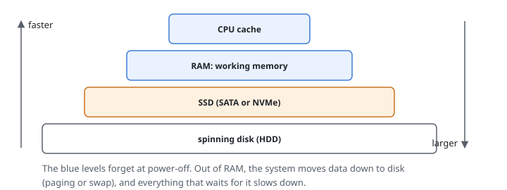

*Draft for owner review.* A virtual machine cannot teach you to seat a memory module, but it can teach you to **read what a machine reports about its hardware**, and to know **when not to believe it**. This lesson covers the parts, how they fail, how to ask Windows and Linux about them, and how to tell a hardware fault from a software one.

**What was tested.** All output is from the **Windows Server 2022** and **AlmaLinux 9.8** lab VMs (`tests/verification/powershell/hw1.ps1`, `tests/verification/bash/hw1.sh`). Their hardware is **virtual**. **Not tested:** physical hardware, failing parts, RAID, SMART tools, beep codes, and macOS.

## The parts and what they do

| Part | Job | Possible symptoms when it fails |
|---|---|---|
| CPU | Runs instructions; cores and threads run work in parallel | Overheating and throttling, crashes under load |
| RAM | Fast, temporary working space | Random crashes and corrupted data (faulty); slowness, paging, out-of-memory kills (**not enough**) |
| Storage (SSD, HDD, NVMe) | Permanent data | Slow or failing reads, file system errors, SMART warnings, clicking (HDD) |
| Motherboard and firmware (UEFI or BIOS) | Connects the parts and starts the machine | No start-up self test, wrong clock, settings lost (often the clock battery) |
| Power supply | Converts mains power for the parts | Random shutdowns, no power |
| GPU | Graphics and parallel computing | Screen artefacts, driver crashes |
| NIC | Network connection | No link, drops, slow transfers |

A symptom **suggests** a part; it does not prove it. High CPU use, for example, is usually software doing a lot of work, not a bad processor.



```text
 faster  ^   CPU cache
         |   RAM                       <- forgets at power-off
         |   SSD (SATA or NVMe)
         v   spinning disk (HDD)       larger
```

When RAM runs out, the system pushes data to disk (**paging** on Windows, **swap** on Linux), and programs wait for the disk. That is why, on a machine that is **short of memory**, adding RAM helps far more than a faster CPU. Measure first: if memory is plentiful, more of it changes nothing.

## Storage types and RAID

- **HDDs** have spinning platters and moving heads, and are sensitive to shock.
- **SSDs** have no moving parts, are much faster, and their cells wear with writing.
- **NVMe** is a way of connecting an SSD over **PCIe**, faster than the older SATA connection.

**RAID** combines disks. With four disks of 4 TB (RAID 1 shown with two):

| Level | How | Usable | Survives |
|---|---|---|---|
| RAID 0 | Stripes | 16 TB | **No** failure: one lost disk loses everything |
| RAID 1 (2 disks) | Mirror | 4 TB | 1 disk |
| RAID 5 | Stripes with one disk's worth of parity | 12 TB | any 1 disk |
| RAID 6 | Stripes with two disks' worth of parity | 8 TB | any 2 disks |
| RAID 10 | Stripes of mirrored pairs | 8 TB | 1 per pair; losing both disks of one pair loses all |

After a failure the array runs **degraded**: **replace the disk promptly**, because a rebuild takes time and reads the remaining disks heavily. Something must **tell you** a disk failed, or the first you hear of it is the second failure. On Linux software RAID, [`/proc/mdstat`](https://man7.org/linux/man-pages/man4/md.4.html) shows the state (the lab has no arrays, so it listed none).

**RAID is availability, not backup:** a deleted file, or one encrypted by ransomware, changes on every disk at once.

## Reading the hardware with built-in tools

### Windows

```powershell
Get-CimInstance Win32_ComputerSystem | Format-List Manufacturer, Model, NumberOfLogicalProcessors, TotalPhysicalMemory, HypervisorPresent
Get-CimInstance Win32_Processor      | Format-List Name, NumberOfCores, NumberOfLogicalProcessors, LoadPercentage
Get-CimInstance Win32_PhysicalMemory | Format-Table DeviceLocator, Capacity, Speed, Manufacturer
Get-PhysicalDisk | Format-Table FriendlyName, MediaType, BusType, HealthStatus, Size
Get-Volume
```

(`systeminfo` prints a general summary.) From the lab, trimmed:

```text
Manufacturer : QEMU          Model : Standard PC (Q35 + ICH9, 2009)
Name         : QEMU Virtual CPU version 2.5+     NumberOfCores : 2     LoadPercentage : 100

DeviceLocator GB Speed Manufacturer
DIMM 0         4       QEMU

FriendlyName  MediaType   BusType HealthStatus
QEMU HARDDISK Unspecified SATA    Healthy
```

| Look at | How to read it |
|---|---|
| `Manufacturer`, `Model` | Here they say plainly that this is a **virtual** machine. On a real one, they identify it for drivers and warranty |
| [`NumberOfCores`, `NumberOfLogicalProcessors`](https://learn.microsoft.com/windows/win32/cimwin32prov/win32-processor) | Physical cores, and the processors the OS schedules on (higher when each core runs two threads) |
| `LoadPercentage : 100` | **One instant**, taken just after start-up while services were busy. Sample several times, or watch Task Manager, before concluding anything |
| [`Win32_PhysicalMemory`](https://learn.microsoft.com/windows/win32/cimwin32prov/win32-physicalmemory) | One row per module on real hardware: size, speed, slot. An empty `Speed` means **not reported** |
| [`Get-PhysicalDisk`](https://learn.microsoft.com/powershell/module/storage/get-physicaldisk) `MediaType` | `SSD`, `HDD` or, as here, `Unspecified`: Windows does not know |
| `HealthStatus : Healthy` | What the storage system currently reports, **not a guarantee** that the disk will keep working |

Memory in use, and the largest consumers:

```powershell
Get-CimInstance Win32_OperatingSystem | Select-Object TotalVisibleMemorySize, FreePhysicalMemory   # in KB
Get-Process | Sort-Object WorkingSet64 -Descending | Select-Object -First 5 Name, WorkingSet64
```

The lab had 2.73 GB of 4 free; the largest process was `MsMpEng` (Defender) at 179 MB.

**Devices with problems** (what Device Manager marks with a warning sign):

```powershell
Get-CimInstance Win32_PnPEntity | Where-Object ConfigManagerErrorCode -ne 0 | Select-Object Name, ConfigManagerErrorCode
```

The lab had one, with code **28**, which is [`CM_PROB_FAILED_INSTALL`](https://learn.microsoft.com/windows-hardware/drivers/install/cm-prob-failed-install): no working driver is installed. That is a **driver** problem, not broken hardware. Look up other numbers in the [list of Device Manager errors](https://learn.microsoft.com/windows-hardware/drivers/install/device-manager-error-messages). The name was empty here because Windows had not identified the device.

### Linux

```bash
lscpu                     # processor, cores, threads, virtualization
free -h                   # memory and swap
lsblk -d -o NAME,ROTA,SIZE,MODEL,TRAN
lspci                     # devices on the PCI bus
sudo dmidecode -t system  # what the firmware says the machine is
sudo dmidecode -t memory  # memory slots and modules
systemd-detect-virt       # am I in a virtual machine?
```

[`lscpu`](https://man7.org/linux/man-pages/man1/lscpu.1.html): the lab reported `CPU(s): 2` with `Core(s) per socket: 2`, `Thread(s) per core: 1`, `Socket(s): 1`, so 1 × 2 × 1 = 2. Its `Model name` was the **host's real processor**, passed through to the guest.

[`free -h`](https://man7.org/linux/man-pages/man1/free.1.html):

```text
               total        used        free      shared  buff/cache   available
Mem:           1.9Gi       342Mi       1.6Gi        14Mi       142Mi       1.6Gi
Swap:             0B          0B          0B
```

- **Read `available`, not `free`.** Linux uses spare memory to cache files (`buff/cache`) and gives it back when programs need it. On a machine that has run for a while, `free` is often small and that is **normal**. `available` estimates what programs can still get ([`MemAvailable`](https://man7.org/linux/man-pages/man5/proc_meminfo.5.html)). (Here the machine had just started, so the two are close.)
- `total` is 1.9 GiB for a machine given 2 GiB: some memory is reserved before the OS counts it.
- `Swap: 0B`: this VM has **no swap**. When memory runs out, Linux must kill a process.
- The largest processes: `ps -eo pid,rss,comm --sort=-rss | head`.

### When the report is wrong

A virtual machine shows what its hypervisor **presents**, and each tool reports what it can see:

| What I asked | Answer in the lab | Why not to trust it blindly |
|---|---|---|
| Linux `lsblk` `ROTA`, `/sys/block/sda/queue/rotational` | `1` (spinning) | It is the virtual disk's description, **not** evidence about the real drive |
| Windows `MediaType` | `Unspecified` | Windows cannot tell |
| Linux `systemd-detect-virt` | `microsoft` | The VM is **QEMU**, running on a Windows hypervisor, which is what the tool detects ([manual](https://man7.org/linux/man-pages/man1/systemd-detect-virt.1.html)) |
| Linux `lscpu` `Hypervisor vendor` | `Microsoft` | The same reason |
| `dmidecode -t system` | `Manufacturer: QEMU` | This one names the virtual machine's maker |

Two tools gave different names for "what am I running on", and both were reporting something true. Behind a RAID controller or a USB adapter, physical machines can mislead in the same way. **Cross-check** with a second source, such as the vendor's specification or the label on the part.

## Troubleshooting hardware

Use the same method as for software, and change **one thing at a time**: a known-good cable, port, module or power supply. If the fault **moves with the part**, you have found it.

### Evidence the machine keeps

Windows: the **System log** and **Reliability Monitor** (`perfmon /rel`). Starting points:

```powershell
Get-WinEvent -FilterHashtable @{ LogName = 'System'; ProviderName = 'disk' } -MaxEvents 20
Get-WinEvent -FilterHashtable @{ LogName = 'System'; Id = 41, 6008 } -MaxEvents 20     # unexpected restarts and shutdowns
```

Both found nothing in the healthy lab. (When nothing matches, `Get-WinEvent` raises an error; see the system administration lesson.) Events **41** and **6008** say that Windows did **not shut down cleanly**, not **why**: power loss, a crash, or someone holding the power button.

Linux:

```bash
journalctl -k -p err            # kernel messages at "error" and worse
dmesg -T --level=err,warn       # the kernel's buffer with times (dmesg(1))
```

**A healthy machine has messages too.** The lab showed `Warning: Unmaintained driver is detected: e1000_init_module` among errors, and processor power-management warnings in [`dmesg`](https://man7.org/linux/man-pages/man1/dmesg.1.html). Neither was a fault. What matters is a message that is **new**, **repeating**, **names a device** (especially I/O errors on a disk) and **matches the time of the symptom**.

For disks, **SMART** tools (such as `smartctl` from [smartmontools](https://www.smartmontools.org/), or the vendor's utility) read the drive's own health counters. They were not installed in the lab. A rising count of reallocated or pending sectors is a reason to **back up now** and replace the drive. A "passed" result does not prove the drive is good.

| Observation | Think of | Check next |
|---|---|---|
| Passes at idle, crashes under load | Heat or power | Temperatures, fans, dust, power supply |
| Random crashes in different programs | RAM | A memory test (`mdsched.exe` on Windows), one module at a time |
| Slow, CPU idle, disk constantly busy | Disk, or paging from low memory | Memory use first, then disk health |
| No picture and no sound at power-on | Power, memory, motherboard | Vendor's beep or light codes |

The **power-on self test (POST)** runs before any operating system; its beeps, lights or messages mean what **your vendor** says they mean.

## Virtualization and cloud, briefly

A **hypervisor** shares physical hardware among virtual machines. **Type 1** runs directly on the hardware (Hyper-V, ESXi, and KVM is usually grouped here); **type 2** runs as a program on an operating system. This course uses **QEMU**, a program on Windows, accelerated by the Windows hypervisor platform. Virtual hardware can be resized, copied and snapshotted, which is why the labs use it.

[NIST's definition of cloud computing](https://csrc.nist.gov/pubs/sp/800/145/final) names three service models:

| Model | You manage | The provider manages |
|---|---|---|
| **IaaS** | OS, software, data | Hardware and virtualization |
| **PaaS** | Your application and data | Also the OS and platform |
| **SaaS** | Your data and users | Also the application |

## Common mistakes

- **Replacing parts on one symptom** without isolating.
- **Reading Linux `free` as "memory left".**
- **Believing a virtual machine's hardware report** describes the real hardware.
- **Treating `Healthy` or a SMART pass** as a promise.
- **Counting every log error as a fault.**
- **Calling RAID a backup**, or not noticing a degraded array.

## Check yourself

1. A machine is slow, the CPU is idle, and the disk light is solid. What do you suspect first?
2. Why is RAID 1 not a backup?
3. Name two commands that show how much RAM a machine has, one per operating system family.
4. Linux shows `free` 200 MB and `available` 5 GB. Is it short of memory?
5. `lsblk` shows `ROTA 1` inside a VM. What does that tell you about the physical disk?
6. Device Manager shows code 28. Is the device broken?

**Expected answers:** (1) memory shortage causing paging, or a slow or failing disk: check memory use first, then disk health and logs; (2) a deletion or corruption is mirrored to both disks; (3) for example `Get-CimInstance Win32_PhysicalMemory` (or `Win32_ComputerSystem`) and `free -h`; (4) no: the rest is mostly cache that can be reclaimed; (5) nothing reliable: it describes the virtual disk; (6) not shown by that code: no working driver is installed.
