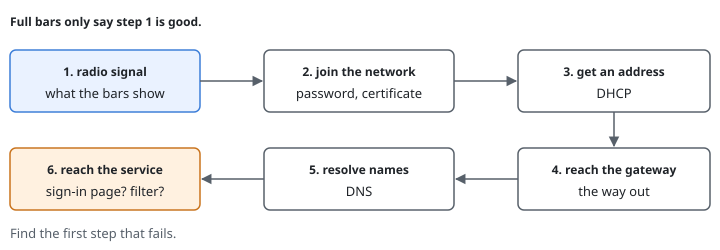

*Draft for owner review.* Phones, tablets and laptops are the machines most users carry. They are the most likely to be lost, to run on a battery, and to connect over wireless links. This lesson covers how they differ, how to diagnose them in order, how organisations manage them, and **how to avoid destroying a user's data** while fixing them.

**What was tested: nothing.** WinLab cannot give you a physical phone, and I tested no mobile device for this lesson. It is concepts and procedure, with links to vendors' and standards documents. **Menu names differ between makers and versions: check the guide for the device in your hand.** You can practise the network steps (address, gateway, name, port) on the lab VMs.

## Device types and their parts

| Device | What distinguishes it | Repair reality |
|---|---|---|
| Laptop | Desktop OS, battery, built-in screen, keyboard, touchpad | Some memory and storage are replaceable, many are soldered: **check the model** |
| Tablet | Touch screen, usually a mobile OS | Usually little a technician can replace |
| Smartphone | Cellular radio, SIM or eSIM, many sensors | Repair through the maker or an authorised service |
| Wearable | Very small battery, usually pairs with a phone | Often replaced, not repaired |

### Laptop display faults

| What you see | Think of | A test |
|---|---|---|
| Picture on an external screen is fine, the built-in one is blank | Built-in panel, its cable or backlight, or display settings | The external screen shows the computer and graphics output work |
| Very dim; a torch held close shows a faint picture | Backlight (or its power) | The picture is being made but not lit |
| Flickers or changes when the lid moves | Display cable through the hinge, or a connection | Move the lid slowly and watch |
| Cracked, blotched, lines in fixed places | The panel | Compare with an external screen |
| Same artefacts on **both** screens | Graphics driver or graphics hardware | Try safe mode; check driver history |

Each is a **suggestion** to test, not a diagnosis. Check the simple things first: brightness, the screen-output setting, and the charger.

### Batteries

Battery wear shows as shorter running time. Operating systems and makers' tools report **health** or **cycle count** (for example, on [Mac laptops](https://support.apple.com/en-us/102888)). On a Windows laptop, `powercfg /batteryreport` writes a report comparing the battery's design capacity with its current full-charge capacity.

A **swollen, hot, smoking or damaged** battery is a **safety problem**, not a performance problem: a lithium battery can catch fire. **Stop using and charging it**, do not press it flat, puncture it or force a case shut over it, move away from it if it is hot or smoking, and follow your workplace's and the maker's emergency and **hazardous-waste** instructions. A raised touchpad or a lifting screen can be the first sign.

## Connectivity

| Technology | Use | First checks |
|---|---|---|
| Wi-Fi (IEEE 802.11) | Local network access; 2.4, 5 and 6 GHz bands, depending on the device and country | Airplane mode off? Right network and password? Signal? |
| Bluetooth | Short-range accessories | Paired, powered, charged, near, not connected to another device |
| Cellular (4G, 5G) | Wide-area data and calls | SIM or eSIM active, plan, signal, mobile data on, APN |
| NFC | Centimetres: payments and tags | Enabled, correct card or app chosen, a thick case |
| VPN | An encrypted tunnel to another network | Credentials, date and time, whether it works without the VPN |
| Hotspot | Shares a phone's mobile data | Enabled, allowed by the plan, data limit |

2.4 GHz generally **reaches further** and passes walls better, but has few channels and many neighbours; 5 and 6 GHz generally offer **more speed over shorter distances**. An **APN** (access point name) is the setting that tells the phone how to reach the carrier's data network.

### Full bars, no internet



```text
 1 signal -> 2 joined -> 3 address -> 4 gateway -> 5 DNS -> 6 service
 (bars show only step 1)
```

| Step | Check | A clue |
|---|---|---|
| 2 Join | Does it say connected, or keep asking for the password? | Wrong password, expired certificate, blocked device |
| 3 Address | Open the network's details and read the IP address | An address starting **169.254.** is [**link-local**](https://www.rfc-editor.org/rfc/rfc3927): the device gave it to itself, usually because DHCP did not answer |
| 4 Gateway | Is there a gateway (router) address? Can another device on the same Wi-Fi get online? | If nobody can, look at the router or the provider |
| 5 Names | Do some apps work while web names fail? | DNS settings, a filtering or "private DNS" setting |
| 6 Service | A guest network? Open a browser | A **captive portal** (sign-in or terms page) blocks traffic until accepted |

Also check the **date and time**: a badly wrong clock makes secure connections fail. Compare with **another device on the same network** and the **same device on another network**. These two tests separate device faults from network faults.

Be careful with "forget this network" and "reset network settings": the second usually **erases all saved Wi-Fi networks** and related settings. Say so before you do it.

## Management and security

Organisations **enrol** devices in **mobile device management** (MDM) to require a passcode and encryption, deliver settings and apps, check compliance, and act on lost devices ([enrollment guide](https://learn.microsoft.com/intune/intune-service/fundamentals/deployment-guide-enrollment); [NIST SP 800-124](https://csrc.nist.gov/pubs/sp/800/124/r2/final) covers managing mobile security).

| Ownership | Typical arrangement | What it means for the user |
|---|---|---|
| Corporate-owned | The organisation manages the whole device | It may control, restrict or erase it |
| Bring your own (BYOD) | A separate **work profile** or **managed apps** ([app protection](https://learn.microsoft.com/intune/intune-service/apps/app-protection-policy)) | The organisation manages the work part |

What management can see and do depends on the platform and the type of enrollment: **read your organisation's policy** and tell users the truth about it.

### Lost or stolen

1. **Report it quickly**, with the time and place.
2. **Lock** or locate it with the management service or the owner's account.
3. **Protect accounts:** sign out sessions, change exposed passwords, and handle the second factor that was on that device.
4. **Contact the carrier** about the SIM, to stop misuse of the number.
5. **Erase** if policy says so. Know **which** action you are choosing: a **full wipe** erases the device, while selective actions remove only work data. Names differ ([Intune's wipe action](https://learn.microsoft.com/intune/intune-service/remote-actions/devices-wipe)). Choosing the wrong one on a personal phone destroys the owner's photographs.

A remote command works only if the device is **enrolled** (or signed in to a find-my-device service) **before** it is lost, and it takes effect when the device **receives** it: one that is off or offline has not been erased yet. **Encryption and a screen lock** protect the data meanwhile.

### Everyday protection

Keep the system and apps **updated**; require a **screen lock** and encryption; install apps from the **official store** or the organisation's catalogue, and question permissions an app has no reason to need; be wary of unexpected sign-in prompts and links; keep **backups**.

## Troubleshooting routine

Start with what cannot lose data.

1. **Ask and reproduce:** what happens, when it started, what changed (update, new app, drop, water).
2. **Restart.** It clears many software faults.
3. **Check settings:** airplane mode, Wi-Fi, Bluetooth, battery saver, free storage, date and time.
4. **Check updates** and recently installed apps.
5. **Isolate, one change at a time:** another network, another charger and cable, safe mode (it starts without most added apps, if the device offers it).
6. **Back up and check the backup** before anything that can erase data.
7. **Reset** only when needed, with the user's agreement.

For physical or liquid damage, **stop and escalate**: do not charge a wet device or heat it to dry it.

### Before you reset anything

A factory reset **erases the user's data** ([Android](https://support.google.com/android/answer/6088915), [iPhone](https://support.apple.com/guide/iphone/erase-iphone-iph7a2a9399b/ios)). Confirm **all** of these first:

| Check | Why |
|---|---|
| The backup is **recent**, and you have seen that it **contains** what matters | Not every app's data is included |
| The user **knows the account and password** used on the device | Theft protection may demand them after a reset ([Android](https://support.google.com/android/answer/9459346), [Apple's Activation Lock](https://support.apple.com/en-us/108794)). Without them the device can be unusable |
| The **second factor** will still work | An authenticator app may need to be moved first, or the user is locked out of accounts |
| What happens to the **eSIM** | If it is erased, the carrier may have to reactivate service |
| The device's management **enrollment** | It may need to be re-enrolled |
| The user **agrees**, knowing what will be lost | It is their data |

## Common mistakes

- **Resetting before backing up**, or trusting a backup nobody checked.
- **Resetting without the account password.**
- **Forgetting the authenticator app.**
- **Reading full signal bars as "the network is fine".**
- **Choosing a full wipe** where only work data should go.
- **Assuming a wipe command has already happened.**
- **Charging a swollen or wet device.**

## Check yourself

1. A phone shows full Wi-Fi bars but cannot browse. Which layers do you check?
2. Why is a swollen battery an emergency?
3. What does a remote wipe do, and why must the device be enrolled first?
4. A phone's address is 169.254.x.x. What does that suggest?
5. Name three things to confirm before a factory reset.
6. A built-in laptop screen is blank, but an external monitor works. What does that rule in and out?

**Expected answers:** (1) above the radio link: joining the network, the IP address, the gateway, name resolution, then the service (including a captive portal); (2) it can catch fire: stop using and charging it and follow disposal and emergency procedure; (3) it tells the device to erase data; the management connection must already exist to deliver it, and the device must receive it; (4) it assigned itself a link-local address, usually because no DHCP server answered; (5) any three: a checked backup, the account and password, the second factor, the eSIM, re-enrollment, the user's agreement; (6) the computer and graphics output work; look at the built-in panel, backlight, cable or display settings.
