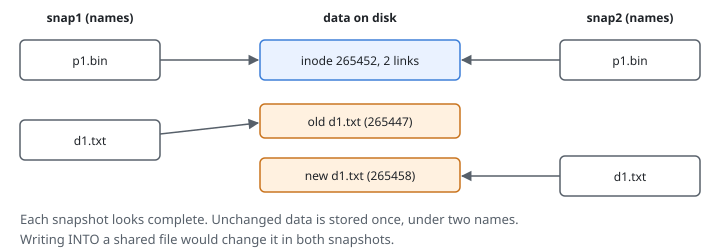

*Draft for owner review.* A backup you have never restored is a hope, not a backup. This lesson makes backups three ways on the lab VMs, **rsync snapshots** that share unchanged files, **tar incrementals** and **restic** (encrypted, deduplicated), and for each one does the part people skip: **restore it and compare**. It also breaks a backup on purpose to see which check notices. Everything runs on local disk in the lab VMs.

**What was tested, and where.** As root on **Ubuntu 24.04.5** (rsync **3.2.7**, GNU tar **1.35**, restic **0.16.4**) and **AlmaLinux 9.8** (rsync **3.2.7**, GNU tar **1.34**, restic **0.19.1**, installed with `dnf install epel-release` and then `dnf install restic`; I did not record which repository supplied it), with a 5.8 MB test data set (three 2 MB random files and five tiny text files) (`tests/verification/homelab/hl3.sh` and small follow-ups; output is real). **Not tested:** remote destinations (SSH, SFTP, S3, a rest-server), **restic's other back ends**, backups of **databases or running virtual machines** (a copy of files that are changing can be inconsistent), Windows backup tools (`wbadmin`, File History, volume shadow copies), bare-metal restore, backups to removable media, large data sets and speed, and ransomware behaviour. Timings and sizes are from a toy data set.

## First, the rule and the question

The US government's [CISA, Data Backup Options](https://www.cisa.gov/sites/default/files/publications/data_backup_options.pdf) (I read the opening page) states the **3-2-1 rule**: "Keep 3 copies of any important file: 1 primary and 2 backups. Keep the files on 2 different media types to protect against different types of hazards. Store 1 copy offsite (e.g., outside your home or business facility)."

For a home lab, that might be: the live data; a restic repository on a **second disk** in the same machine (different media from the first copy); and a copy on an **external drive kept elsewhere** or in a cloud store. The point of each copy is a different failure: a deleted file, a dead disk, a fire or theft, and **ransomware that encrypts every drive it can reach** (a backup that is always mounted and writable is not safe from that; an offline or append-only copy is).

Two questions decide the design before you pick a tool:

- **How much can I afford to lose?** (the age of the newest backup: hourly, nightly)
- **How long can I afford to be down?** (how fast can I restore: minutes from a local copy, hours from a cloud store)

## rsync snapshots with hard links

[`rsync`](https://manpages.debian.org/stable/rsync/rsync.1.en.html) copies only what changed. With `--link-dest=DIR` ("hardlink to files in DIR when unchanged", in the manual's own words) each new snapshot **looks like a full copy** but unchanged files are **hard links** to the previous snapshot's files, so they cost no extra space. (A *hard link* is a second name for the same data on disk; the data exists once while any name remains.)

```text
$ rsync -a data/ dest/snap1/
$ echo "changed" >> data/docs/d1.txt
$ rsync -a --delete --link-dest=$PWD/dest/snap1 data/ dest/snap2/
$ stat -c '%i %h links  %n' dest/snap1/photos/p1.bin dest/snap2/photos/p1.bin
265452 2 links  dest/snap1/photos/p1.bin          (same inode number: the same data)
265452 2 links  dest/snap2/photos/p1.bin
$ stat -c '%i %h links  %n' dest/snap1/docs/d1.txt dest/snap2/docs/d1.txt
265447 1 links  dest/snap1/docs/d1.txt           (the changed file: two separate copies)
265458 1 links  dest/snap2/docs/d1.txt
```

The photo, unchanged, has **two names and one inode**; the changed text file has two inodes. (`--link-dest` wants an absolute path or one relative to the destination; I used absolute paths.) The archive option `-a` keeps permissions, times and ownership. `--delete` makes the new snapshot an exact image of the source, removing files that are gone.



```text
 snap1/p1.bin ---> [data, inode 265452, 2 links] <--- snap2/p1.bin     unchanged: stored once
 snap1/d1.txt ---> [old copy]          [new copy] <--- snap2/d1.txt     changed: two copies
```

**Measuring size is a trap.** `du` counts each hard-linked file **once per run**:

```text
$ du -sh dest/snap1 dest/snap2           (one run, two arguments)
2.0M  dest/snap1
8.0K  dest/snap2                         (it looks nearly empty: its big file was already counted under snap1)
$ du -shl dest/snap1 dest/snap2          (-l: count every link)
2.0M  dest/snap1
2.0M  dest/snap2
$ du -sh dest/snap2                      (alone)
2.0M  dest/snap2
```

(Numbers from a later small data set; the main run printed `5.8M` for the first snapshot and `19` bytes for the second, with `5.8M` for both directories together.) All three are correct, and each answers a different question: "how much does this snapshot **add**?" versus "how big would this snapshot be **on its own**?" The disk holds the data once.

Deleting a file from the live data does not remove it from older snapshots, which is the whole point:

```text
$ rm data/docs/d5.txt
$ rsync -a --delete --link-dest=$PWD/dest/snap2 data/ dest/snap3/
$ ls dest/snap2/docs | wc -l; ls dest/snap3/docs | wc -l
5
4
```

A **dry run** (`-n`) with `-i` (itemise) shows what *would* change, without changing it:

```text
$ echo new > data/docs/d6.txt
$ rsync -a -n --delete -i data/ dest/snap3/
>f+++++++++ docs/d6.txt            (a new file would be sent)
```

(AlmaLinux also printed `.d..t...... docs/`, the directory's time changing.) Then the part that matters, **restore and compare**:

```text
$ rsync -a dest/snap1/ restore1/
$ diff -r restore1 dest/snap1 && echo "restore identical to snap1"
restore identical to snap1
$ diff -rq restore1 data
Files restore1/docs/d1.txt and data/docs/d1.txt differ
Only in restore1/docs: d5.txt
Only in data/docs: d6.txt
```

The restored first snapshot matches that snapshot exactly and, correctly, **differs from today's data** in the three ways the story above predicts.

**A warning:** hard-link snapshots protect against deleting or overwriting a file *by mistake*. If someone with write access edits an old file **in place** (not by replacing it), every snapshot that shares the inode changes at once. They are not tamper-proof history.

## tar incrementals

GNU tar can do **incremental** backups with a snapshot file that records what it has seen ([tar(1)](https://manpages.debian.org/stable/tar/tar.1.en.html), option `--listed-incremental`):

```text
$ tar --listed-incremental=tar.snar -czf level0.tgz data        (the first run is a full backup, "level 0")
$ echo "new file" > data/docs/d7.txt; echo more >> data/docs/d2.txt
$ tar --listed-incremental=tar.snar -czf level1.tgz data        (the second holds only the changes)
$ ls -l level0.tgz level1.tgz | awk '{print $5, $9}'
6001821 level0.tgz
297 level1.tgz
$ tar -tzf level1.tgz | grep -v '/$'
data/docs/d2.txt
data/docs/d7.txt
```

The full backup is 6 MB and the incremental **297 bytes**. To restore, extract the **full backup first and then each incremental in order**, each with `--listed-incremental=/dev/null` (this tells tar to apply the recorded deletions and changes rather than start a new run):

```text
$ mkdir r2; tar -xzf level0.tgz -C r2 --listed-incremental=/dev/null
$ tar -xzf level1.tgz -C r2 --listed-incremental=/dev/null
$ diff -r r2/data data && echo "restore identical to live data"
restore identical to live data
```

The trade-off against rsync snapshots: tar incrementals are small **archives** you can move around, but a restore needs the **whole chain**, and a missing or damaged link in the chain breaks everything after it. I tested one level-1 backup; longer chains were not tested.

## restic: encrypted, deduplicated, and checkable

[restic](https://restic.readthedocs.io/en/stable/) stores backups in a **repository**: a folder (or remote store) of encrypted, deduplicated chunks. It asks for a **password** that protects the repository. Its own output says it plainly, and you should believe it: "Losing your password means that your data is irrecoverably lost." (Keep the password somewhere that is *not* the machine being backed up.)

```text
$ export RESTIC_REPOSITORY=/var/tmp/wl-bk/repo RESTIC_PASSWORD='lab-only-password'
$ restic init
created restic repository 1130e2470d at /var/tmp/wl-bk/repo
$ restic backup data
Files:           9 new,     0 changed,     0 unmodified
Added to the repository: 5.727 MiB (5.726 MiB stored)
snapshot f4950be8 saved
$ echo "more words" >> data/docs/d3.txt; restic backup data
using parent snapshot f4950be8
Files:           0 new,     1 changed,     8 unmodified
Added to the repository: 4.053 KiB (2.150 KiB stored)
snapshot 997131e5 saved
```

The second backup **added 4 KiB** for one changed small file: restic split the files into chunks and stored only the new ones (that is **deduplication**). A short list and a comparison of two snapshots:

```text
$ restic snapshots
ID        Time                 Host          Tags        Paths
f4950be8  2026-11-22 13:29:29  winlab-linux              /var/tmp/wl-bk/data
997131e5  2026-11-22 13:29:29  winlab-linux              /var/tmp/wl-bk/data
$ restic diff f4950be8 997131e5
M    /var/tmp/wl-bk/data/docs/d3.txt
Files:           0 new,     0 removed,     1 changed
Data Blobs:      1 new,     1 removed
```

(The repository was 5.8 MB for 5.8 MB of data and two snapshots.) Is it really encrypted? I searched the repository for a sentence I knew was in a file:

```text
$ grep -rl "document 1" repo | wc -l
0
```

**Zero files matched.** (A plain copy such as an rsync snapshot is ordinary files, so the same search would find the sentence there; I did not run that search.)

**Restore and compare**, then the wrong password:

```text
$ restic check
no errors were found
$ restic restore latest --target r3
Summary: Restored 15 files/dirs (5.722 MiB) in 0:00
$ diff -r r3/var/tmp/wl-bk/data data && echo "restic restore identical"
restic restore identical
$ RESTIC_PASSWORD=nope restic snapshots
Fatal: wrong password or no key found
```

(restic restores to `--target` **with the full original path underneath it**, which is why the `diff` path is long.)

### The check that did not notice

I then **damaged one stored data file** on purpose, overwriting 8 bytes in the middle of a 2 MB pack file:

```text
$ printf 'XXXXXXXX' | dd of=$PACK bs=1 seek=1000 conv=notrunc
$ restic check
no errors were found                                       <-- on both machines
$ restic check --read-data
Fatal: repository contains errors                          (Ubuntu)
pack 402e0e7c... contains 2 errors: [blob b53c3237...: decrypting blob <data/b53c3237> from pack 402e0e7c... failed: ciphertext verification failed ...]   (AlmaLinux)
The repository contains damaged pack files. These damaged files must be removed to repair the repository. ...
Fatal: repository contains errors
```

This is the most important result in the lesson. A plain `restic check` checks the repository's **structure** (indexes, snapshots and their links) and does **not read the data**; it was happy with a repository containing a corrupted pack. **`--read-data` reads every data file and checks it**, and found the damage. The [restic documentation](https://restic.readthedocs.io/en/stable/045_working_with_repos.html) describes it: "To check the integrity of the pack files in the repository, use the --read-data flag". Because it reads everything it is slow on a large repository (the manual offers ways to check a subset; I did not test those). Schedule it, and test **restores**, not just `check`.

(The AlmaLinux message `ciphertext verification failed` suggests the data is stored with an authentication check that the damaged bytes failed; I did not read restic's design document to confirm how. Detection is the good outcome. I did not try to restore from the damaged pack, and did not corrupt an rsync snapshot for comparison.)

**Retention:** `restic forget --keep-last 1 --prune` removes older snapshots and the chunks only they used. The two lines I captured were `keep 1 snapshots:` and `remove 1 snapshots:`. Policies such as `--keep-daily 7 --keep-weekly 4` are in the restic manual; I did not test them.

## Run it on a schedule

A backup that depends on you remembering is not a backup. `systemd` timers are a natural fit (see `linux.systemd-advanced`); I tested the mechanism with a **transient** timer that runs restic 3 seconds from now:

```text
$ systemd-run --unit=wl-bk-t3 --on-active=3s --timer-property=AccuracySec=1s \
    --property=Environment=RESTIC_REPOSITORY=$W/repo --property=Environment=RESTIC_PASSWORD=x \
    /bin/sh -c "restic init -q && restic backup -q $W/data && echo backup-ok"
$ journalctl -u wl-bk-t3.service | grep -E 'Started|backup-ok|Deactivated'
13:31:05  Started wl-bk-t3.service ...
13:31:08  sh[49832]: backup-ok
13:31:08  wl-bk-t3.service: Deactivated successfully.
```

My **first** try left out `--timer-property=AccuracySec=1s` and ran **too late**: by the time the timer fired, my script had already deleted the test data, so the backup failed with `all source directories/files do not exist`. A timer's `AccuracySec` defaults to **one minute**, which lets it fire up to a minute late (the `linux.systemd-advanced` lesson shows the same). For a nightly job it does not matter; for a test it does. `-p AccuracySec=1s` is *not* the same: it sets the property on the **service** and `systemd-run` answered `Unknown assignment: AccuracySec=1s`; the timer needs `--timer-property`. In production you would write a `.service` and a `.timer` file, **with the password in a root-only environment file, not on a command line** (I used a throwaway password here).

## Common mistakes

- **Never restoring.** Restore into a scratch folder and compare, on a schedule.
- **Trusting `restic check` alone.** Without `--read-data` it did not notice a corrupted pack.
- **Keeping the repository password on the machine it protects.** Lose the machine, lose both.
- **All copies on the same disk, or always mounted.** That is one copy to a disk failure or ransomware.
- **Reading `du` on hard-link snapshots as the real size.** Use `du -l` for "alone", the directory total for "disk used".
- **Backing up a running database by copying its files.** The copy may be inconsistent (not tested here).
- **`tar` restore in the wrong order.** Full backup first, then each incremental in sequence.
- **No retention.** Without `forget`, the repository only grows.

## Check yourself

1. Make three rsync snapshots with `--link-dest`, show that an unchanged file has the same inode in two of them, and measure the size three ways.
2. Do a tar level-0 and level-1 backup, delete a file in between, restore both and show the deleted file is gone after the second restore.
3. Back up with restic, corrupt a pack file, run `restic check` and `restic check --read-data`, and explain the difference.
4. Which of your copies would survive: a disk failure; a deleted folder; ransomware on the machine; a fire? Draw your own 3-2-1 plan.
5. Write the `.service` and `.timer` that run a nightly restic backup, and say where the password lives.

## Not tested, and honest limits

Remote and cloud repositories; restic retention policies beyond `--keep-last`; `restic check` on a subset; databases and VMs; Windows tools; very long tar chains; real disk failures; and the speed or memory use on real data. The restic versions differ (0.16.4 and 0.19.1) and I did not compare their options. `rsync --link-dest` was used with local paths only. The data set is small and random, so the deduplication numbers say nothing about real photo libraries.
