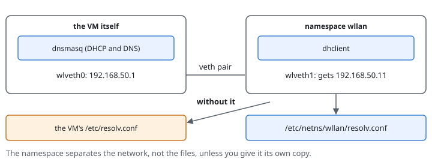

*Draft for owner review.* A home network usually gets its names and addresses from a router you do not control. Running **your own DNS and DHCP server** gives you names for your lab machines (`nas.lab.test`), a place to see what is being asked, and a way to block names you do not want. This lesson uses **dnsmasq**, a small combined DNS forwarder and DHCP server, on the two lab VMs, tests the DNS part on loopback, and tests the DHCP part on a **private virtual network inside the VM** (a network namespace), so no real network is touched. It also records a mistake that broke the AlmaLinux VM's name resolution.

**What was tested, and where.** As root on **Ubuntu 24.04.5** (dnsmasq **2.91**, systemd-resolved running, ISC `dhclient` 4.4.3-P1) and **AlmaLinux 9.8** (dnsmasq **2.85**, `dhclient` 4.4.2b1), with `dig` from `dnsutils` and `bind-utils` (`tests/verification/homelab/hl1.sh`, run three times; output is real). **Not tested:** a real LAN with real clients, **two DHCP servers on one network** (the classic mistake; see below), IPv6 and router advertisements, DNSSEC, DNS over TLS or HTTPS, `unbound` or Pi-hole, split-horizon setups, dnsmasq with SELinux on non-default ports, dnsmasq as the machine's *own* resolver, and anything on Windows. `.test` is a top-level domain reserved for testing, so it can never collide with a real one; I rely on that from memory of RFC 6761 and did not re-read the RFC for this lesson.

## DNS in thirty seconds

A **resolver** turns a name into an address. Your computer asks a configured DNS server; that server either **knows** the answer (it is authoritative for that name, or it has it cached) or **forwards** the question to another server. dnsmasq does three of these jobs: answers for names you define, answers for hosts that got an address from its own DHCP server, and **forwards** everything else, **caching** the results. See the `networking.dns` lesson for the protocol itself.

## Install, and the first surprise on Ubuntu

```text
Ubuntu:    sudo apt-get install dnsmasq dnsutils
AlmaLinux: sudo dnf install dnsmasq bind-utils
```

On AlmaLinux the install finished quietly. On Ubuntu, `apt` reported a failure at the end because the package's **service failed to start**:

```text
dnsmasq: failed to create listening socket for port 53: Address already in use
failed to create listening socket for port 53: Address already in use
FAILED to start up
dnsmasq.service: Failed with result 'exit-code'.
Failed to start dnsmasq.service - dnsmasq - A lightweight DHCP and caching DNS server.
```

Cause, from `ss -ulnp | grep ':53 '`: **`systemd-resolved` is already listening on port 53** (on `127.0.0.53` and `127.0.0.54`), and dnsmasq by default wants port 53 on *every* address. Two programs cannot share the same address and port. The fix is to tell dnsmasq to bind **only the addresses you name** (`bind-interfaces` plus `listen-address`), which do not clash with the resolver's two:

```text
UNCONN 0 0 127.0.0.1:53        0.0.0.0:* users:(("dnsmasq",pid=46557,fd=4))
UNCONN 0 0 127.0.0.54:53       0.0.0.0:* users:(("systemd-resolve",pid=543,fd=16))
UNCONN 0 0 127.0.0.53%lo:53    0.0.0.0:* users:(("systemd-resolve",pid=543,fd=14))
```

(On AlmaLinux dnsmasq also listened on `[::1]:53`, which my file did not ask for; I did not look into why. The packaged `/etc/dnsmasq.conf` is the first suspect and I did not read it.)

## A small lab zone

`/etc/dnsmasq.d/lab.conf`, one directive per line (see the [dnsmasq manual](https://thekelleys.org.uk/dnsmasq/docs/dnsmasq-man.html) for each option; I checked that the page loads and that the options named below appear in it):

```text
listen-address=127.0.0.1          # only this address (so it does not collide with systemd-resolved)
bind-interfaces                   # bind exactly that address, not a wildcard
no-resolv                         # do not read /etc/resolv.conf to find upstream servers
server=10.0.2.3                   # forward everything else to this upstream (the VM's own network's resolver)
domain=lab.test                   # the lab's domain
local=/lab.test/                  # questions for lab.test are answered here only, never forwarded
address=/nas.lab.test/192.168.50.10     # a name and its address
host-record=pi.lab.test,192.168.50.11   # a name, its address, and the matching reverse (PTR) record
cname=files.lab.test,nas.lab.test       # an alias
address=/ads.example/0.0.0.0            # block a name by answering with a useless address
cache-size=1000
log-queries                       # log every question (use sparingly: it is a record of who asked what)
```

`dnsmasq --test` checks the syntax; then `systemctl restart dnsmasq`. Questions with `dig @127.0.0.1` (`@server` says whom to ask):

```text
$ dig @127.0.0.1 nas.lab.test +short
192.168.50.10
$ dig @127.0.0.1 files.lab.test +noall +answer
files.lab.test.   0   IN   CNAME   nas.lab.test.
$ dig @127.0.0.1 -x 192.168.50.11 +short          (reverse lookup of the host-record)
pi.lab.test.
$ dig @127.0.0.1 -x 192.168.50.10 +short          (reverse lookup of the plain address= record)
                                                  (nothing)
$ dig @127.0.0.1 nobody.lab.test | grep status
;; ->>HEADER<<- opcode: QUERY, status: NXDOMAIN, ...
$ dig @127.0.0.1 ads.example +short
0.0.0.0
```

What each result teaches:

- **`address=` gives a forward answer only.** The reverse lookup for `.10` returned nothing; `host-record=` made the PTR record for `.11`. If you want both directions, use `host-record`.
- **`local=/lab.test/` is why `nobody.lab.test` is `NXDOMAIN`** ("no such name") answered immediately. Without it dnsmasq would forward the question upstream and wait for the answer, which would leak your private names to the outside.
- **Blocking is a lie told on purpose.** `ads.example` resolves to `0.0.0.0`, so a client that connects goes nowhere. Real blocklists do this at scale.
- **A public name is forwarded, and then cached:**

```text
$ dig @127.0.0.1 example.com +noall +answer +stats | grep -E 'IN|Query time'
example.com.   153   IN   A   172.66.147.243
example.com.   153   IN   A   104.20.23.154
;; Query time: 17 msec
$ dig @127.0.0.1 example.com ... | grep 'Query time'
;; Query time: 0 msec
$ journalctl -u dnsmasq | grep -E 'example.com|cached'
query[A] example.com from 127.0.0.1
forwarded example.com to 10.0.2.3
reply example.com is 172.66.147.243
query[A] example.com from 127.0.0.1
cached example.com is 172.66.147.243
```

The second answer took 0 ms, not 17, and the log says `cached`. (The `153` is the remaining time to live in seconds; it counts down.) The log is exactly what `log-queries` is for, and exactly why you should think about who can read it.

**An Ubuntu trap in `--test`.** I made a bad file, `echo 'bogus-option=1' > /etc/dnsmasq.d/bad.conf`, and ran the check:

```text
Ubuntu:    $ dnsmasq --test                              ->  dnsmasq: syntax check OK.      (exit 0, but the file was not even read)
Ubuntu:    $ dnsmasq --test --conf-dir=/etc/dnsmasq.d    ->  dnsmasq: bad option at line 1 of /etc/dnsmasq.d/bad.conf   (exit 1)
AlmaLinux: $ dnsmasq --test                              ->  dnsmasq: bad option at line 1 of /etc/dnsmasq.d/bad.conf   (exit 1)
```

On Ubuntu `/etc/dnsmasq.conf` has its `conf-dir` lines commented out, and the **service** reads `/etc/dnsmasq.d` because `/etc/default/dnsmasq` sets `CONFIG_DIR=/etc/dnsmasq.d,.dpkg-dist,.dpkg-old,.dpkg-new` and the unit's start script passes it (`ExecStartPre=/usr/share/dnsmasq/systemd-helper checkconfig` is the packaged check). A bare `dnsmasq --test` checked a configuration that does **not include your file** and said OK. A check that passes for the wrong reason is worse than none.

## DHCP, on a private network inside the VM

**DHCP** hands a client an address, a router, a DNS server and a lease time when it joins a network. Testing it on a real LAN risks starting a *second* DHCP server on a network that already has one, which makes clients get random answers (I did **not** test that). So I built a tiny network that exists only inside the VM: a **network namespace** (a separate set of interfaces and routes; [ip-netns(8)](https://man7.org/linux/man-pages/man8/ip-netns.8.html)) joined to the host side by a **veth pair** (a virtual cable with two ends).

```bash
ip netns add wllan
ip link add wlveth0 type veth peer name wlveth1
ip link set wlveth1 netns wllan                       # one end goes into the namespace
ip addr add 192.168.50.1/24 dev wlveth0; ip link set wlveth0 up
ip netns exec wllan ip link set wlveth1 up
MAC=$(ip netns exec wllan cat /sys/class/net/wlveth1/address)
```



```text
 [VM: dnsmasq, wlveth0 192.168.50.1] ==veth== [namespace wllan: dhclient, wlveth1]
 /etc/resolv.conf  <--- written by the client unless /etc/netns/wllan/resolv.conf exists
```

A second dnsmasq instance, serving **only** that interface:

```text
interface=wlveth0
bind-interfaces
no-resolv
domain=lab.test
local=/lab.test/
dhcp-range=192.168.50.100,192.168.50.150,12h      # the pool, and a 12-hour lease
dhcp-option=option:router,192.168.50.1
dhcp-option=option:dns-server,192.168.50.1
dhcp-host=<the client's MAC>,pi,192.168.50.11     # a fixed address and name for this device
dhcp-leasefile=/tmp/wl-dnsmasq.leases
log-dhcp
```

The client (inside the namespace) asked for an address with `ip netns exec wllan dhclient -v -1 wlveth1`:

```text
DHCPDISCOVER on wlveth1 to 255.255.255.255 port 67 interval 3 (xid=0x21f09f77)
DHCPOFFER of 192.168.50.11 from 192.168.50.1
DHCPREQUEST for 192.168.50.11 on wlveth1 to 255.255.255.255 port 67 (xid=0x779ff021)
DHCPACK of 192.168.50.11 from 192.168.50.1 (xid=0x21f09f77)
bound to 192.168.50.11 -- renewal in 20197 seconds.
```

That is the four-step **DORA** exchange (Discover, Offer, Request, Acknowledge). The client got `.11`, not something from the pool, because the `dhcp-host` line matched its hardware address. The lease file and the name:

```text
$ cat /tmp/wl-dnsmasq.leases
1795396901 c2:cd:2e:cb:d2:c6 192.168.50.11 pi *          (expiry time, MAC, address, name, client id)
$ dig @192.168.50.1 pi.lab.test +short                    ->  192.168.50.11
$ dig @192.168.50.1 -x 192.168.50.11 +short               ->  pi.lab.test.
```

The same dnsmasq that leased the address now answers for the name, which is the main reason to run DHCP and DNS together. AlmaLinux behaved the same (`bound to 192.168.50.11`, same lease line shape). (`log-dhcp` messages appear in the journal with the identifier `dnsmasq-dhcp`; they showed the `DHCPDISCOVER`, `DHCPOFFER` and the options the client requested.)

### The mistake: `dhclient` rewrote the host's `/etc/resolv.conf`

After the first run, **`dnf` on the AlmaLinux VM could not resolve any name** ("Could not resolve host: mirrors.almalinux.org"). The cause:

```text
$ cat /etc/resolv.conf
; generated by /usr/sbin/dhclient-script
search lab.test
nameserver 192.168.50.1
```

`dhclient` runs a helper script (`dhclient-script`) that writes the DNS settings it receives into `/etc/resolv.conf`. Running the client in a network namespace changes its **network**, not the **files**: it wrote the real, host-wide `/etc/resolv.conf`, pointing the whole VM at a DNS server that existed only inside my test (and that I had since stopped). Ubuntu was not affected: there `/etc/resolv.conf` is a symlink to a file managed by `systemd-resolved` and was unchanged (I did not trace why the helper did not touch it).

Two fixes. **Recover** by restarting whatever manages the file (`systemctl restart NetworkManager` rewrote it with `nameserver 10.0.2.3` on AlmaLinux). **Prevent** with the convention in the `ip-netns` manual page: "the convention is to look for global network configuration files first in /etc/netns/NAME/ then in /etc/", and `ip netns exec` "creat[es] a mount namespace and bind mount[s]" those files. I created an empty `/etc/netns/wllan/resolv.conf` before running the client:

```text
$ mkdir -p /etc/netns/wllan; : > /etc/netns/wllan/resolv.conf
$ ip netns exec wllan dhclient -v -1 wlveth1
$ grep -c 192.168.50.1 /etc/resolv.conf                   ->  0      (the host's file is untouched)
$ ip netns exec wllan cat /etc/resolv.conf
search lab.test
nameserver 192.168.50.1                                   (the namespace's own copy got the settings)
```

On Ubuntu the namespace's file stayed empty (no helper wrote to it). **Lesson: a namespace isolates the network, and only a bind-mounted `/etc/netns/NAME/` isolates these files.** Test code that edits global state needs the same care as production code.

## Using it for real

To make dnsmasq the DNS server of your LAN you point the router's DHCP server at it, **or** you turn the router's DHCP off and let dnsmasq do DHCP. **Never run both**: two DHCP servers on one network answer the same question differently. Give the server a fixed address first (a DHCP server cannot get its own address from itself), keep the router as the default gateway, and keep a way back (the router's settings page) before you change anything. I did not test any of this on a real LAN.

## Common mistakes

- **Installing dnsmasq on Ubuntu and ignoring the failed start.** Port 53 is already taken by `systemd-resolved`: bind named addresses.
- **Trusting `dnsmasq --test` on Ubuntu without `--conf-dir`.** It did not read `/etc/dnsmasq.d`.
- **`address=` when you wanted reverse records too.** Use `host-record`.
- **Leaving out `local=/domain/`.** Private names leak upstream and slow answers.
- **Two DHCP servers on one LAN.** Disable the other first (not tested).
- **Running `dhclient` in a namespace without `/etc/netns/NAME/resolv.conf`.** It rewrites the host's DNS settings.
- **Logging every query without thinking about it.** `log-queries` records what each device looks up.

## Check yourself

1. Install dnsmasq on Ubuntu. Why did the service fail, and what two lines in your config fix it?
2. Add a name with `address=` and another with `host-record=`. Which one has a reverse record?
3. Query a public name twice. How do you know the second answer came from the cache?
4. In the namespace test, what would have happened to your host's DNS if you had skipped `/etc/netns/wllan/resolv.conf`?
5. Why is a bare `dnsmasq --test` on Ubuntu not proof that your file is valid?

## Not tested, and honest limits

A real LAN with real clients; replacing a router's DHCP; two servers on one network; IPv6; DNSSEC; DNS over TLS; unbound or Pi-hole; blocklists at scale; split-horizon; dnsmasq on a machine that also uses it for its own lookups; SELinux for non-default ports; Windows clients. The upstream server `10.0.2.3` is QEMU's built-in resolver for the VM's user-mode network and means nothing on a real network. The `[::1]` listener on AlmaLinux is unexplained.
