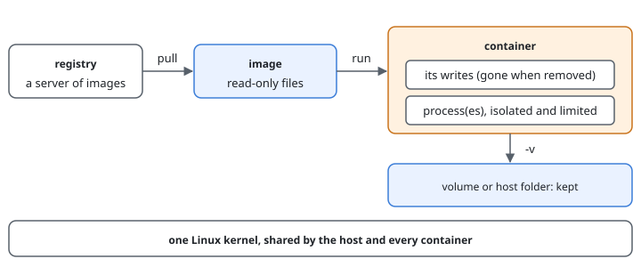

*Draft for owner review.* A **container** is an ordinary process (or group of processes) that the Linux kernel **isolates** (with namespaces) and **limits** (with cgroups), started from an **image**: a read-only bundle of files. It is not a small virtual machine: it shares the host's kernel. On AlmaLinux and other Red Hat family systems the standard tool is **Podman** ([documentation](https://docs.podman.io/)). It needs no always-running daemon, and ordinary users can run containers without root.

Every output below is from an **AlmaLinux 9.8** lab VM with **Podman 5.8.2**, using `tests/verification/bash/podman1.sh`. The image was already on the machine. **Not tested:** pulling from a registry in this run, other distributions, user (rootless) services, and reboots.



```text
 registry --pull--> image (read-only) --run--> container = processes + its own writes (gone when removed)
                                                    |  -v
                                                    v
                                         volume or host folder (kept)
 one kernel, shared by the host and every container
```

## Images and containers

An **image** is the template; a **container** is a running or stopped instance of it. Images come from a **registry** and have names such as `quay.io/almalinux/almalinux:9`: registry, namespace, name and **tag**. A tag like `:9` picks a version. Prefer a specific tag to `latest`. A tag can still be **moved** to a newer image by whoever publishes it, so record the image ID or digest when you must have exactly the same one. [`podman pull`](https://docs.podman.io/en/latest/markdown/podman-pull.1.html) downloads; `podman images` lists what you have:

```text
REPOSITORY                   TAG         IMAGE ID      CREATED      SIZE
quay.io/almalinux/almalinux  9           b0b3f56026dd  3 years ago  193 MB
```

**Read `CREATED`.** It is when the image was **built**, not when you downloaded it. An old image is missing years of security fixes. This lab image says "3 years ago" and reports AlmaLinux **9.1**, on a 9.8 host. Pulling a tag again, and rebuilding what is based on it, is part of patching.

### The same kernel, different files

```text
$ uname -r
5.14.0-687.61.1.el9_8.x86_64                      (the host)
$ podman run --rm quay.io/almalinux/almalinux:9 uname -r
5.14.0-687.61.1.el9_8.x86_64                      (inside: the same kernel)
$ podman run --rm quay.io/almalinux/almalinux:9 head -2 /etc/os-release
NAME="AlmaLinux"
VERSION="9.1 (Lime Lynx)"                         (but the image's own files)
```

The host can see a container's process like any other:

```text
$ podman run -d --name wl-demo quay.io/almalinux/almalinux:9 sleep 300
$ ps -eo pid,user,args | grep "[s]leep 300"
   2022 root     /usr/bin/coreutils --coreutils-prog-shebang=sleep /usr/bin/sleep 300
```

Images are often minimal. `podman exec wl-demo ps` failed with ``executable file `ps` not found``: the tool you expect may simply not be in the image. (`cat /proc/1/cmdline` still showed what the main process was.)

### The everyday commands

| Command | What it does |
|---|---|
| [`podman run`](https://docs.podman.io/en/latest/markdown/podman-run.1.html)` --rm IMAGE CMD` | Run once, then delete the container |
| `podman run -d --name demo IMAGE CMD` | Run in the background (detached) |
| [`podman ps`](https://docs.podman.io/en/latest/markdown/podman-ps.1.html) / `podman ps -a` | Running containers / **all** containers |
| [`podman logs`](https://docs.podman.io/en/latest/markdown/podman-logs.1.html)` demo` | What its main process printed |
| [`podman exec`](https://docs.podman.io/en/latest/markdown/podman-exec.1.html)` -it demo /bin/sh` | A shell inside a **running** container |
| [`podman inspect`](https://docs.podman.io/en/latest/markdown/podman-inspect.1.html)` demo` | Every setting and state, as JSON |
| `podman stop demo && podman rm demo` | Stop and delete |

### Why did my container stop?

**A container lives exactly as long as its main process.** When that process ends, the container stops. After three one-off runs, plain `podman ps` listed **nothing**. `podman ps -a` told the story:

```text
NAMES       STATUS                             COMMAND
wl-ok       Exited (0) 1 second ago            echo hello
wl-false    Exited (1) Less than a second ago  false
wl-typo     Created                            nosuchprogram
```

| What you see | Meaning |
|---|---|
| `Exited (0)` | The program finished successfully. A "service" that does this ran a command that ends by itself |
| `Exited (1)` or another number | The program failed: read `podman logs` |
| `Created` | It **never started**. For `wl-typo`, `podman run` printed ``executable file `nosuchprogram` not found in $PATH`` and returned **127**, and `podman inspect wl-typo --format "{{.State.Error}}"` still held that message |

`podman run`'s own exit status distinguishes these: its manual page gives **125** for an error in Podman itself, **126** when the command cannot be invoked, **127** when it is not found, and otherwise the program's own status. In my runs, a mounted folder that did not exist gave 125.

**Stopping can be slow.** Removing the `sleep` container printed `StopSignal SIGTERM failed to stop container wl-demo in 10 seconds, resorting to SIGKILL`. The program was **process 1** inside the container, and Linux does not apply a signal's default action to process 1, so a program with no handler for `SIGTERM` ignores it. A real server should handle the signal. `podman run --init` adds a small init process for this (not tested here).

### Publishing a port

A container has its own network. `-p HOST:CONTAINER` forwards a port on the host to one in the container:

```text
$ podman run -d --name wl-web -p 8080:8000 quay.io/almalinux/almalinux:9 python3 -m http.server 8000
$ podman ps --format "table {{.Names}}\t{{.Status}}\t{{.Ports}}"
NAMES       STATUS        PORTS
wl-web      Up 3 seconds  0.0.0.0:8080->8000/tcp
$ curl -s -o /dev/null -w "%{http_code}\n" http://127.0.0.1:8080/
200
$ curl -sS -o /dev/null http://127.0.0.1:8000/
curl: (7) Failed to connect to 127.0.0.1 port 8000: Connection refused
```

The service is reached on the **left** number, 8080; port 8000 exists only inside. `0.0.0.0` means **every** address of the host, so other machines can reach it if the firewall allows; write `-p 127.0.0.1:8080:8000` for this machine only. `podman logs wl-web` showed the web server's request line for the `curl`.

A second container asking for the same host port failed with `listen tcp4 :8080: bind: address already in use` (exit 126), and was left behind as `Created`. Find what holds a port with `ss -ltnp`; here it showed `conmon`, Podman's small process that watches a container, so use `podman ps` to see which container it is.

### Data disappears with the container

```text
$ podman exec wl-demo sh -c 'echo important > /root/note.txt; cat /root/note.txt'
important
$ podman rm -f wl-demo
$ podman run --name wl-demo quay.io/almalinux/almalinux:9 cat /root/note.txt
cat: /root/note.txt: No such file or directory
```

The new container started from the image again. **Anything written inside a container disappears with it** (it survives a stop and start of the **same** container, but not its removal). Keep data outside:

- A **named volume**, managed by Podman ([`podman volume`](https://docs.podman.io/en/latest/markdown/podman-volume.1.html)): `-v wl-vol:/data`. A file written by one container was read by the next. `podman volume inspect` showed it stored under `/var/lib/containers/storage/volumes/wl-vol/_data`.
- A **bind mount** of a host folder: `-v /srv/wl-data:/data`.

### SELinux and `:Z`

AlmaLinux runs **SELinux** in `Enforcing` mode, which controls access using **labels**, in addition to ordinary permissions. I mounted a world-readable file:

```text
$ ls -lZ /srv/wl-data
-rw-r--r--. 1 root root unconfined_u:object_r:var_t:s0 14 Nov 26 20:28 file.txt
$ podman run --rm -v /srv/wl-data:/data quay.io/almalinux/almalinux:9 cat /data/file.txt
cat: /data/file.txt: Permission denied
$ podman run --rm -v /srv/wl-data:/data:Z quay.io/almalinux/almalinux:9 cat /data/file.txt
from the host
$ ls -lZ /srv/wl-data
-rw-r--r--. 1 root root system_u:object_r:container_file_t:s0:c79,c943 14 Nov 26 20:28 file.txt
```

The permissions `rw-r--r--` never changed, and `chmod` would not help: the **label** did. **`:Z` relabels the folder on the host** to `container_file_t` with a private category (`c79,c943`). A lower-case `:z` is the shared form for several containers. Because it **changes the host's files**, never use it on a system folder or a home directory: other programs can lose access to them. Give containers their own folder.

## Rootless and rootful

Run Podman as an ordinary user and the container is **rootless** ([tutorial](https://github.com/containers/podman/blob/main/docs/tutorials/rootless_tutorial.md)). As the user `labadmin`:

```text
$ podman exec wl-rootless id
uid=0(root) gid=0(root) groups=0(root)                    (inside it looks like root)
$ ps -eo user,args | grep "[s]leep 200"                   (on the host)
labadmin /usr/bin/coreutils --coreutils-prog-shebang=sleep /usr/bin/sleep 200
$ podman unshare cat /proc/self/uid_map
         0       1000          1
         1     100000      65536
```

Read the map as *inside ID, outside ID, how many*: inside user 0 **is** user 1000 (`labadmin`) outside, and inside users 1 to 65536 are otherwise unused host IDs starting at 100000. A program that breaks out has only an ordinary user's rights.

Practical differences I saw:

- **Separate storage.** `labadmin`'s `podman images` was **empty** although root had the image, and root's `podman ps -a` did **not** show `labadmin`'s container. If something is "missing", check **which user** you are: `sudo podman ps -a` and `podman ps -a` are different lists.
- **Low ports.** Publishing port 80 failed: `Failed to bind port 80 (Permission denied)`. By default, unprivileged users cannot listen below 1024. Publish a high port and forward to it, or have an administrator change that setting.

Use rootful containers when a task really needs it, and be able to say why.

## Containers as services

A container that must survive restarts should be run by **systemd**. The current method is a **Quadlet** file ([`podman-systemd.unit`](https://docs.podman.io/en/latest/markdown/podman-systemd.unit.5.html)): a short description from which systemd **generates** a service.

```ini
# /etc/containers/systemd/web.container
[Unit]
Description=Demo web container

[Container]
Image=quay.io/almalinux/almalinux:9
ContainerName=web
Exec=python3 -m http.server 8000
PublishPort=8080:8000

[Service]
Restart=on-failure

[Install]
WantedBy=multi-user.target
```

```bash
sudo systemctl daemon-reload      # (re)generate web.service from the file
sudo systemctl start web.service
systemctl status web.service
journalctl -u web.service
```

What I saw with a test unit, `wl-quad`:

- After `daemon-reload` it existed but was `inactive`; after `start`, `active`. `status` said `Loaded: ... (/etc/containers/systemd/wl-quad.container; generated)`.
- `systemctl cat wl-quad.service` showed the **generated** file in `/run/systemd/generator/`, whose `ExecStart` was a long `podman run --name wl-quad --replace --rm ...`. Reading it shows exactly what will run. **Edit the `.container` file**, never the generated one.
- **`systemctl enable` fails** for a Quadlet: `Unit ... is transient or generated.` (`is-enabled` said `generated`). Starting at boot comes from the **`[Install]` section in the `.container` file**: with `WantedBy=multi-user.target`, the generator had already created the link. (I did not reboot to test it.)
- The generated command has `--rm`, so after a stop the container is **gone** from `podman ps -a`. Its output is in the **journal**.

### When it will not start

Treat it like any service first:

| Step | Command | Looking for |
|---|---|---|
| 1 | `systemctl status web.service` | Loaded? Active, failed, or restarting again and again? |
| 2 | `journalctl -u web.service -n 50` | The error text from Podman or the program |
| 3 | `podman ps -a`, `podman logs web` | Whether a container exists and what it printed |

Two failures I made on purpose:

**An image that cannot be fetched** (`Image=localhost/wl-nope:1`). `start` failed. A moment later `status` showed `activating (start)`, not `failed`, because `Restart=on-failure` was **trying again**. The journal had the reason (`image pull-error ... connection refused`, then retries) and `Scheduled restart job, restart counter is at 1`. `podman ps -a` showed **nothing**. With a restart policy, always read the journal, not only the current state.

**A misspelled key** (`ContainerNme=`). `systemctl start` said only:

```text
Failed to start wl-quad.service: Unit wl-quad.service not found.
```

The generator had **rejected the whole file**, so no service existed. Ask it why:

```text
$ /usr/libexec/podman/quadlet -dryrun
... converting "wl-quad.container": unsupported key 'ContainerNme' in group 'Container' ...
```

**"Unit not found" after writing a Quadlet means: run `daemon-reload`, check the file's folder and its `.container` ending, then run the dry run.**

Other usual causes: a wrong command (the container exits at once), a missing image, a port already in use, a volume folder that does not exist or has the wrong SELinux label, and a main process that simply **finishes**.

## Building images, briefly

A `Containerfile` lists the steps that make an image: a base (`FROM`), files copied in (`COPY`), commands run while building (`RUN`) and what to run when a container starts (`CMD`). [`podman build`](https://docs.podman.io/en/latest/markdown/podman-build.1.html):

```text
FROM quay.io/almalinux/almalinux:9
COPY message.txt /srv/message.txt
RUN date > /srv/built.txt
CMD ["cat", "/srv/message.txt"]
```

`podman build --pull=never -t wl-hello .` ran the four steps and `podman run --rm wl-hello` printed my message. (`--pull=never` used the local base image.) Building **again** printed `Using cache` for **every** step, including `RUN date`: the step was **not run again**, so the date in the image was the old one. The cache is why rebuilds are fast, and why a `RUN dnf update` line can silently keep old packages. Rebuild with `--no-cache` when a step must run again.

Both `wl-hello` and its base listed as 193 MB: layers are **shared**, so the total on disk is not the sum. `podman history wl-hello` lists the layers and the command that made each, which also means that **a secret copied in and deleted in a later step is still in an earlier layer.** Put nothing secret in an image.

## Common mistakes

- **Looking only at `podman ps`** and concluding the container "disappeared".
- **Mixing `sudo podman` and `podman`** and looking in the wrong list.
- **Keeping data inside the container.**
- **Using `chmod 777`** to fix what is an SELinux label problem.
- **Using `:Z` on a system or home folder.**
- **Editing a generated service file**, or trying to `systemctl enable` a Quadlet.
- **Never pulling or rebuilding**, and running years-old images.
- **Publishing to every address** when only the local machine needs the port.

## Check yourself

1. What is the difference between an image and a container?
2. A container writes a file, then is removed and recreated. Where did the file go?
3. A container service fails on every start. Name the first three commands you run.
4. `podman ps` shows nothing, but you started a container a minute ago. What do you run, and what could `Exited (0)` mean?
5. A mounted file is world-readable but the container gets "Permission denied". Why, and what do you add?
6. After writing a new `.container` file, `systemctl start` says "Unit not found". What do you check?
7. A rebuild printed `Using cache` for your `RUN dnf update` step. What happened?

**Expected answers:** (1) an image is a read-only template; a container is a running or stopped instance of it with its own writes; (2) it is gone with the removed container; keep data in a volume or bind mount; (3) `systemctl status`, `journalctl -u`, then `podman ps -a` and `podman logs`; (4) `podman ps -a` (as the same user); the main program finished successfully, so the container stopped; (5) its SELinux label does not allow container access; add `:Z` (or `:z` to share) on a folder meant for containers; (6) that you ran `daemon-reload`, the folder and file ending, and `/usr/libexec/podman/quadlet -dryrun` for a rejected key; (7) the step was not run again, so no new updates were installed; use `--no-cache`.
