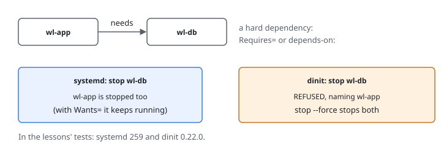

*Draft for owner review.* You now know two service managers: **systemd** (`linux.systemd`, `linux.systemd-advanced`) and **dinit** (the three `linux.dinit-*` lessons). This lesson puts them side by side so you can move between a Ubuntu or AlmaLinux server and a Chimera system without relearning everything, and so you can see **what is a general idea and what is one tool's choice**. Every behaviour in the tables was tested on both systems in this course; where I did not test one side, the cell says so.

**What was tested, and where.** **systemd 259** (Ubuntu 26.04 in WSL2, as root) and **dinit 0.22.0** (Chimera Linux 20261103 in a QEMU VM, as root and as an ordinary user). The batteries are `tests/verification/systemd/sd1.sh` to `sd5.sh` and `tests/verification/dinit/dn1.sh` to `dn6.sh`. **Not tested:** AlmaLinux or any Red Hat family system, systemd under a real boot, dinit 0.23.0, any distribution other than these two, and anything marked "not tested" below. The upstream manuals: systemd's at [freedesktop.org](https://www.freedesktop.org/software/systemd/man/latest/systemd.service.html), dinit's at [davmac.org](https://davmac.org/projects/dinit/). dinit is **pre-1.0**; systemd is mature: do not expect the dinit column to stay still.

## The same ideas, different words

| Idea | systemd | dinit |
|---|---|---|
| Something managed | **unit** (`.service`, `.target`, ...) | **service** (one file, a `type =`) |
| A group or stage | `.target` units | `type = internal` services (`boot`, `system`, `login.target`, `network.target`) |
| The control tool | `systemctl` | `dinitctl` |
| Check a file | `systemd-analyze verify` | `dinit-check` |
| Logs | `journalctl` (structured journal) | text files, syslog (`/var/log/messages` with `syslog-ng`), per-service `logfile` / `catlog` |
| Packages' files | `/usr/lib/systemd/system` | `/usr/lib/dinit.d` |
| Your files | `/etc/systemd/system` | `/etc/dinit.d` |
| What starts at boot | symlinks in `*.target.wants` | symlinks in `boot.d` (`/etc/dinit.d/boot.d`) |
| The default target | `default.target` link | the service named `boot` |

## The file

```text
systemd (INI sections)                    dinit (flat key = value)
[Unit]                                    # /etc/dinit.d/wl-app
Description=WinLab app                    type = process
After=network.target                      command = /usr/local/bin/wl-app.sh
[Service]                                 run-as = nobody
ExecStart=/usr/local/bin/wl-app.sh        restart = on-failure
User=nobody                               depends-on: network.target
Restart=on-failure
[Install]
WantedBy=multi-user.target
```

| Setting | systemd | dinit |
|---|---|---|
| Program | `ExecStart=` | `command =` |
| Type | `Type=simple` / `exec` / `forking` / `oneshot` / `notify` | `type = process` / `bgprocess` / `scripted` / `internal` / `triggered` |
| Stop command | `ExecStop=` | `stop-command =` |
| Run as | `User=` | `run-as =` |
| Environment | `Environment=`, `EnvironmentFile=` | `env-file =` (and `dinitctl setenv`) |
| Hard dependency | `Requires=` | `depends-on:` |
| Soft dependency | `Wants=` | `waits-for:` |
| Order | `After=` / `Before=` | `after:` / `before:` (and **every dependency also orders**) |
| Restart | `Restart=` | `restart =` |
| Stop timeout | `TimeoutStopSec=` (default 1 min 30 s) | `stop-timeout =` (default 10 s) |
| Stop signal | `KillSignal=` (default 15) | `term-signal =` (default TERM) |
| Enable | `[Install] WantedBy=` | a link in a `waits-for.d` directory (`@meta enable-via` chooses it) |
| Template instance | `name@.service`, `%i` | file `name`, started as `name@arg`, `$1` |

The **format** is the most visible difference: INI sections against flat lines, `ExecStart=` against `command =`. Both run a program **without a shell** (pipes need `/bin/sh -c`), and both treat **`$$`** specially, but not alike:

| Variable rule | systemd (tested) | dinit (tested) |
|---|---|---|
| `$VAR` | substituted only as a **whole word**; `[$QUOTED]` stayed literal | substituted **even inside a word**: `word[$GREETING]` became `word[hello]` |
| `${VAR}` | works inside a word | works; also `${VAR:-w}`, `${VAR:+w}`, and `$/VAR` to split into several arguments |
| `$$` | a literal `$` (`echo "pid $$"` printed `pid $`) | a literal `$` (`$$HOME` printed `$HOME`) |
| `%` | specifiers (`%i`, `%n`, `%H`); `%%` is a literal `%` | not special |
| When | at each start | **at load only**: a changed `setenv` value is not seen until `unload` |
| Quotes | single **and** double quotes work (`sh -c 'while ...'`) | **only double quotes**: single quotes are ordinary characters |

Both lessons record the same trap: a `$` meant for the shell is eaten by the manager (`kill -9 $$` became `kill -9 $` in systemd; `echo consumed:$l` printed `consumed:` in dinit). **Put real shell code in a script file.**

## Starting, stopping, and what the commands return

| Action | systemd | dinit |
|---|---|---|
| Start | `systemctl start X` | `dinitctl start X` (waits until started) |
| Stop | `systemctl stop X` | `dinitctl stop X` (**refused** if running dependents need it) |
| Restart | `systemctl restart X` | `dinitctl restart X` |
| State for scripts | `is-active` (0 active, 3 inactive, **4 no such unit**) | `is-started` (0 started, **1** otherwise, 1 also for a missing service, and the state is printed except for a missing one) |
| Failed? | `is-failed` (0 only if failed) | `is-failed` (0 for a startup failure, timeout or dependency failure; a crashed process gave 1) |
| Everything | `systemctl list-units` | `dinitctl list` (`[{+}     ]`, `[     {X}]`) |
| The definition | `systemctl cat X` | read the file |
| Enable | `enable` (link only), `--now` to also start | `enable` (link **and start**); `disable` (link removed and stopped) |

**A missing program, with the default type**, is where they differ most (both tested):

```text
systemd, Type=simple:   systemctl start wl-bad     ->  (no output) rc=0        then the unit is "failed" a moment later (status 203/EXEC)
systemd, Type=exec:     systemctl start wl-bad     ->  Job for wl-bad.service failed ...   rc=1
dinit, process:         dinitctl start wl-bad      ->  Service 'wl-bad' failed to start.
                                                       Reason: execution of service process failed:
                                                               Stage: executing command
                                                               Error: No such file or directory          rc=1
```

dinit's `start` fails immediately and **names the stage and the system error**; systemd's default `start` returns success and you must read `status` or the journal.

### Stopping a dependency

Same situation, opposite behaviour:

```text
systemd:  wl-req has Requires=wl-db + After=wl-db.   systemctl stop wl-db   ->  wl-req is stopped too           (Wants=: wl-wants keeps running)
dinit:    wl-need has depends-on: wl-db.             dinitctl stop wl-db     ->  REFUSED:  cannot stop service 'wl-db' due to the following dependents: wl-need
                                                     dinitctl stop --force wl-db   ->  both stopped          (waits-for / depends-ms dependents keep running)
```

systemd propagates a stop to the dependents; dinit asks you to stop the dependents or to say `--force`. And **who started a service matters in dinit** (**explicit activation**): `start wl-need` pulls in `wl-db`, and stopping `wl-need` stops `wl-db` again unless you had started `wl-db` yourself. systemd's `Wants=` and `Requires=` tests in this course did not include stopping the unit that pulled a dependency in, so I cannot say what systemd does in that case.



```text
 wl-app --needs--> wl-db
 systemd: stop wl-db  -> wl-app stops too          (Wants= would keep it running)
 dinit:   stop wl-db  -> refused, names wl-app     (stop --force stops both)
```

### A failing dependency

Both agree: a hard dependency that cannot start stops the dependent (`A dependency job for ... failed`, rc 1 / `a dependency of the service failed to start`, rc 1); a soft one does not (`Wants=` and `waits-for` both started the dependent, rc 0). dinit's `depends-ms` ("it must start once, then may go away") has no single systemd keyword.

## Restart: the default is the opposite

| | systemd | dinit |
|---|---|---|
| Default | **`Restart=no`** | **`restart = yes`** |
| After a manual stop | stays stopped | stays stopped (a manual stop inhibits restart) |
| "Clean" exits (no restart on failure) | SIGHUP, SIGINT, SIGTERM, SIGPIPE are clean; the result is `success` | SIGHUP, SIGINT, SIGUSR1, SIGUSR2, SIGTERM are "deliberate" |
| `on-failure` restarts | exit 1, SIGKILL, SIGABRT (SIGTERM did not) | exit 1, SIGKILL, SIGABRT (SIGTERM and SIGUSR1 did not) |
| Rate limit | `StartLimitBurst` / `StartLimitIntervalSec` (I set 3 and 10; the defaults were not tested) | `restart-limit-count` (default 5) / `restart-limit-interval` (default 10 s) |
| After the limit | `failed`; `Start request repeated too quickly`; clear with **`reset-failed`** | `STOPPED (terminated; exited - status 1)`; **no `reset-failed` command**; how long the limit lasts was not tested |
| Restart without disturbing dependents | not tested | **`smooth-recovery = true`** (tested: the dependent's PID did not change) |

(The tables in the two lessons are the evidence. For both, a service that is stopped by SIGTERM is not a failure: that shared idea is why `on-failure` is the usual setting.)

## Changing a file

| After editing a service file | systemd | dinit |
|---|---|---|
| What you must run | **`systemctl daemon-reload`** (everything) | **`dinitctl reload X`** (one service) or `stop`, `unload`, `start` |
| What happens if you forget | `Warning: ... changed on disk. Run 'systemctl daemon-reload'` and the **old** definition runs | `dinitctl: warning: service description may have changed; use 'dinitctl reload X'` and the **old** definition runs |
| Customising a packaged unit | a **drop-in** in `NAME.service.d/*.conf`; `systemctl edit` (`--stdin` without a terminal); `revert` | I found **no drop-in mechanism** in the manual pages: put your own file in `/etc/dinit.d`, which is searched before `/usr/lib/dinit.d` (the manual's order; I did not test an override), or use `@include` inside your own file |
| Lists | an empty `ExecStart=` clears the list first | `command += ...` appends; dependencies add with `:` |
| Load model | all units read at `daemon-reload` | each service read **on first use** and then **kept** until `unload` |

## Targets and stages

systemd's `multi-user.target` and dinit's `boot`/`system`/`login.target`/`network.target` do the same job: **a name for a state that other services attach to**. Stopping a target is **not** the same in the two: in systemd, stopping `wl-grp.target` left the units it `Wants=` running (they had been started by the target and by name); in dinit, stopping the `internal` service `wl-int` **also stopped its dependency** (`wl-int-dep`), because nothing else had activated it. In dinit an `internal` service with dependencies is a group whose members follow the explicit-activation rule. The boot sequence of a Chimera machine is **readable in its service files** (42 `early-*` steps, then `pre-local.target`, `local.target`, `network.target`, `login.target`, `system`, `boot`); systemd's is `sysinit.target` → `basic.target` → `multi-user.target` / `graphical.target` (the `list-dependencies multi-user.target` tree is in the first systemd lesson). Both can be asked for a **repair mode** (`rescue.target` / `emergency.target` against dinit's `recovery` and `single` services, both `sulogin`): none of these boot paths was run in the tests.

## What systemd has that dinit (0.22.0) did not show

From the **manual pages** and the tests; I looked for each in `dinit-service(5)` and found none, but a pre-1.0 project changes:

| systemd feature | dinit |
|---|---|
| **Timers** (`OnCalendar=`, `OnActiveSec=`, `systemd-run --on-active`) | no timer units; scheduling is cron's job (I did not look for a cron service on Chimera) |
| **Socket and path activation** (`.socket`, `.path`) | `socket-listen` **pre-opens** a socket (the manual says that "by itself does not give so called socket activation"); no path units; neither tested |
| **Conditions and assertions** (`ConditionPathExists=`) | none found |
| **Sandboxing** (`ProtectSystem=`, `PrivateTmp=`, `PrivateNetwork=`, `DynamicUser=`, `systemd-analyze security`: **9.6 UNSAFE → 5.2 MEDIUM** in the test) | process settings only: `run-as`, `working-dir`, `rlimit-*`, `oom-score-adj`, `capabilities`, `no-new-privs` (all tested but `rlimit-core`, `-data`, `-addrspace`) |
| **Resource control** by cgroup (`CPUQuota=20%` held a busy loop to 20 % CPU; `MemoryMax=` with `MemorySwapMax=0` OOM-killed) | `run-in-cgroup` puts a process in an existing cgroup; **not tested**; no quota settings in the manual |
| **Structured journal**, `journalctl -u/-p/-b/--since` | text logs; `logfile`, `log-type = buffer` and `catlog`, syslog |
| **`mask`** (a link to `/dev/null`; `masked-runtime`) | `disable` only removes the boot link, and **a disabled service can still start as a dependency**; `start --pin` on a stopped service is described in the manual as preventing it from starting, which I did not test |
| **`systemd-analyze blame` / `critical-chain`** | `dinit-check` only checks files; nothing for timings was tested |
| **Transient units** (`systemd-run`) | none |
| **`OnFailure=` / `OnSuccess=`** | none found; `chain-to` starts another service when one **terminates successfully** (tested: a `process` service, not a `scripted` one) |

## What dinit makes simpler

- **The whole format fits on one manual page**, and the service files of the whole system are short and readable (`cat /usr/lib/dinit.d/sshd` is seven lines; `boot` and `system` explain the start-up in a dozen).
- **`dinitctl start` tells you why it failed**, with the stage (`executing command`, `opening log file`, `changing directory`).
- **Explicit activation** gives a clear rule for what stays up (`release`, `wake`, `--pin`).
- **`smooth-recovery`** restarts a crashed daemon without bouncing its dependents.
- **`ready-notification`** with a plain pipe is simple to implement in any language (the systemd equivalent is `Type=notify` with `sd_notify`).
- **`@include` and templates** need no extra directory structure.

## User services

| | systemd | dinit with turnstile |
|---|---|---|
| Manager | `systemctl --user` (`user@UID.service`; tested as root in WSL) | `dinitctl --user` (a `dinit --user` started by `turnstiled` at login; tested for an SSH login) |
| Files | `~/.config/systemd/user/` | `~/.config/dinit.d/` (`boot.d` there for `enable`) |
| Survive logout | decided by **linger**: `loginctl show-user root -p Linger` gave `Linger=no`; `loginctl enable-linger` is the documented way (**not tested**) | decided by a **file** in `/var/lib/turnstiled/linger/`: without it everything was gone 3 s after logout; with it all stayed (**tested**) |

## A command translation

| I want to... | systemd | dinit |
|---|---|---|
| see what is running | `systemctl list-units --type=service --state=running` | `dinitctl list` |
| see one service | `systemctl status X` | `dinitctl status X` |
| read the definition | `systemctl cat X` | `cat /etc/dinit.d/X` or `/usr/lib/dinit.d/X` |
| start now | `systemctl start X` | `dinitctl start X` |
| start at boot | `systemctl enable X` | `dinitctl enable X` |
| both | `systemctl enable --now X` | `dinitctl enable X` |
| stop and do not start at boot | `systemctl disable --now X` | `dinitctl disable X` |
| stop it from ever starting | `systemctl mask X` | (no equivalent found) |
| apply a changed file | `systemctl daemon-reload` | `dinitctl reload X` / `unload` |
| check a file | `systemd-analyze verify X` | `dinit-check X` |
| why did it fail | `systemctl status X`, `journalctl -u X` | `dinitctl status X`, `/var/log/messages`, `dinit-check X` |
| clear a failed state | `systemctl reset-failed X` | (no equivalent; start again) |
| send a signal | `systemctl kill -s HUP X` | `dinitctl signal HUP X` |
| who needs it | `systemctl list-dependencies --reverse X` | `dinitctl stop X` lists the dependents |

(`systemctl kill` was not tested in the systemd lessons; the other systemd commands in the table were.)

## Practice

1. **Translate a service.** Take the `wl-app` service from `linux.dinit-in-practice` and write it for systemd (including `[Install]`); then do the reverse with a systemd service of your own (`Type=notify` becomes `ready-notification`).
2. **Compare the failure.** Break the program path in both, record what `start` prints and returns, and what `status` shows, in a two-column table.
3. **Stop a dependency** in both and record the difference; then use `--force` in dinit and `Wants=` in systemd.
4. **The default restart.** Kill a service with `kill -9` in both with the defaults and say what happens; then set `on-failure` in both and kill it with SIGTERM.
5. **Reload.** Change a value in a loaded service in both; show the warning, the old behaviour, and the fix.
6. **Variables.** Write the same command line with a `$VAR` inside a word in both and compare; then put a `$` that is meant for the shell in each.
7. **A user service** in both, and a logout check with a root-owned watcher (with and without linger in each, the systemd side being untested).
8. **Find what is missing.** Pick three systemd features from the table that dinit lacks and say how you would get the same result on Chimera.
9. **Read the manual.** For `restart-limit-count` and `StartLimitBurst`, read both manual pages and say which defaults apply.
10. **Find the bug.** (a) a dinit service file using single quotes (b) a unit that "worked on Ubuntu" with `ExecStart=/bin/sh -c 'echo $HOME'` but not on dinit (c) `systemctl mask` translated to `dinitctl disable` (d) `systemctl reset-failed` translated to nothing. Explain each.

## Check your understanding

Take the quiz for this lesson (it draws twelve from the bank). After a wrong answer, reread the section named in the review line.
