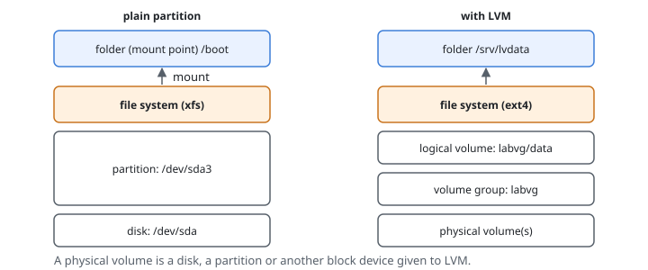
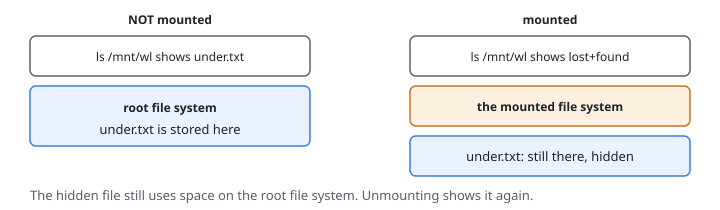

*Draft for owner review.* A server's data lives on **block devices** that carry **file systems**. This lesson shows how to see what is there, how a file system gets mounted, how a mount survives a restart, how to grow a volume with LVM, and how to work out why a disk is "full". Every output below is from an **AlmaLinux 9.8** lab VM, run as root by `tests/verification/bash/storage1.sh`. **Not tested:** a second physical disk, Ubuntu's output, XFS growth, shrinking any file system, and what happens at boot with a broken `/etc/fstab`.

You will practise on a Linux lab VM. Commands that change storage need `sudo`. **Some of them destroy data**, so practise only on the lab VM.



```text
 plain:    disk -> partition -> file system -> mounted at a folder
 with LVM: disk or partition -> physical volume -> volume group -> logical volume -> file system -> folder
```

A **block device** is anything the kernel treats as a disk: a disk (`/dev/sda`), a partition (`/dev/sda1`), a logical volume, or a file attached through a loop device (`/dev/loop0`). A **file system** (ext4, XFS) is the structure written onto it that holds files and folders. A **mount point** is the folder where that file system appears. When something is wrong, find **which layer** is wrong.

## Seeing the storage

Look before you change anything.

| Question | Command |
|---|---|
| What disks and partitions exist, and how do they stack? | [`lsblk`](https://man7.org/linux/man-pages/man8/lsblk.8.html) |
| What is on each: type, label, UUID? | `lsblk -f`, or [`blkid`](https://man7.org/linux/man-pages/man8/blkid.8.html) |
| How full is each mounted file system? | [`df -hT`](https://man7.org/linux/man-pages/man1/df.1.html) |
| What is mounted where, from what, with which options? | [`findmnt`](https://man7.org/linux/man-pages/man8/findmnt.8.html) |

### `lsblk`: the tree

```text
$ lsblk
NAME         MAJ:MIN RM  SIZE RO TYPE MOUNTPOINTS
loop0          7:0    0  200M  0 loop
`-labvg-data 253:0    0   40M  0 lvm  /srv/lvdata
sda            8:0    0   20G  0 disk
|-sda1         8:1    0    1M  0 part
|-sda2         8:2    0  200M  0 part /boot/efi
|-sda3         8:3    0    1G  0 part /boot
`-sda4         8:4    0 18.8G  0 part /
```

Read it as a tree: `sda` is a 20 GB **disk** with four **partitions**. `loop0` is a 200 MB file acting as a disk (the lab uses one so that it needs no extra hardware), with a 40 MB **LVM** volume on it. `RO` is 1 for read-only and `RM` is 1 for removable. An empty `MOUNTPOINTS` means **not mounted**; `sda1` is a small boot partition that normally is not.

`lsblk -f` adds what is on each device:

```text
NAME         FSTYPE      LABEL UUID                                   FSAVAIL FSUSE% MOUNTPOINTS
loop0        LVM2_member       Y3nvUd-nWbs-5C5E-aKuv-LZo7-Dczz-q5mC7F
`-labvg-data ext4              ecc8171d-102f-4207-9589-d51988fb8f9c         0    98% /srv/lvdata
sda
|-sda2       vfat              1560-8FDA                               192.1M     4% /boot/efi
|-sda3       xfs               c3e7137b-182e-4c4f-b9cb-14018782047e    815.8M    15% /boot
`-sda4       xfs               9a722aa8-1420-4287-939d-8b17de48d486     17.7G     6% /
```

(Columns trimmed.) `LVM2_member` means the device belongs to LVM rather than holding files itself. A **UUID** is an identifier written when the file system was created. `blkid` on a device with nothing recognisable printed **nothing** and exited with status 2.

### `df` and `findmnt`

```text
$ df -hT -x tmpfs -x devtmpfs
Filesystem             Type  Size  Used Avail Use% Mounted on
/dev/sda4              xfs    19G  1.1G   18G   6% /
/dev/sda3              xfs   960M  145M  816M  16% /boot
/dev/sda2              vfat  200M  7.7M  193M   4% /boot/efi
/dev/mapper/labvg-data ext4   33M   32M     0 100% /srv/lvdata
```

(`-x` hides memory-based file systems.) The last line is the problem: **100 %, 0 available**. Note that the 40 MB volume shows as **33 M** of size: the file system keeps some space for its own structures. `/dev/mapper/labvg-data` is the logical volume `labvg/data` under another name. Writing there failed:

```text
dd: error writing '/srv/lvdata/x': No space left on device
```

**`df` on a folder tells you which file system the folder is on.** That is a trap when you expect a mount: with nothing mounted at `/mnt/wl`, `df -h /mnt/wl` happily showed the **root** file system (`/dev/sda4 ... /`). `findmnt /mnt/wl` answers the real question: it printed **nothing** and exited **1** when nothing was mounted there, and printed this when something was:

```text
TARGET  SOURCE     FSTYPE OPTIONS
/mnt/wl /dev/loop1 ext4   rw,relatime,seclabel
```

In scripts use `mountpoint -q /srv/data` or `findmnt`, never `df`, to test whether something is mounted. In the options, look for `ro`: a file system that should be writable but is mounted **read-only** is a sign to read the system log for disk errors.

## Why is it full?

Work through these in order.

### 1. Is it really that file system, and what is using it?

`df -h <folder>` names the file system. Then [`du`](https://man7.org/linux/man-pages/man1/du.1.html) adds up the files you can see: `du -xh --max-depth=1 /srv/lvdata | sort -h` (`-x` stays on one file system).

### 2. A deleted file that is still open

I wrote a 50 MB file, left a program (`tail -f`) holding it open, and deleted it:

```text
df -h  before rm:   51M used
df -h  after rm:    51M used          <- nothing was freed
du -sh after rm:    13K               <- du cannot see the file any more
```

A file's space is freed only when it has **no name and no open handle**. The holder shows in `/proc`:

```text
$ ls -l /proc/1233/fd | grep deleted
lr-x------. 1 root root 64 Nov 26 20:24 3 -> /mnt/wl/big.log (deleted)
```

When the program ended, `df` dropped to 14K. **A big gap between `df` and `du` is the clue.** Usually the fix is to **restart the service** that holds the old log. Where it is installed, [`lsof +L1`](https://man7.org/linux/man-pages/man8/lsof.8.html) lists such files (`lsof` was not installed here).

### 3. Out of inodes

An **inode** is the record that describes one file. An ext4 file system gets a fixed number when it is made. I made one with very few and created empty files:

```text
failed at file 94
touch: cannot touch '/mnt/wl/f94': No space left on device

$ df -h /mnt/wl
Filesystem      Size  Used Avail Use% Mounted on
/dev/loop1       95M   16K   88M   1% /mnt/wl

$ df -i /mnt/wl
Filesystem     Inodes IUsed IFree IUse% Mounted on
/dev/loop1        104   104     0  100% /mnt/wl
```

**"No space left on device" with the disk 1 % full.** `df -i` shows why. On a real server the cause is usually millions of tiny files (a cache, a mail queue, session files).

## Mounting by hand

```bash
sudo mount /dev/sdb1 /srv/data     # attach a file system at a folder
sudo umount /srv/data              # detach it
```

([`mount`](https://man7.org/linux/man-pages/man8/mount.8.html), [`umount`](https://man7.org/linux/man-pages/man8/umount.8.html). Neither printed anything when it worked: check with `findmnt`.) A mount made this way is **gone after a restart**.

### "target is busy"

```text
$ umount /mnt/wl
umount: /mnt/wl: target is busy.                         (exit status 32)

$ fuser -vm /mnt/wl
                     USER        PID ACCESS COMMAND
/mnt/wl:             root     kernel mount /mnt/wl
                     root       1226 ..c.. sleep
```

[`fuser -vm`](https://man7.org/linux/man-pages/man1/fuser.1.html) lists what is using the file system. The `c` in `ACCESS` means the process has its **current directory** there: it need not have any file open. The most common culprit is **your own shell**, sitting in that folder; `cd /` and try again. If it is a service, stop it properly. Do not kill processes until you know what they are.

### A mount hides what is underneath

I wrote a file into `/mnt/wl` while nothing was mounted, then mounted a file system there:

```text
before mount:   ls /mnt/wl   ->  under.txt
after mount:    ls /mnt/wl   ->  lost+found        (under.txt has "disappeared")
after umount:   ls /mnt/wl   ->  under.txt         (it is back)
```



```text
 not mounted:  /mnt/wl -> root file system        (under.txt visible)
 mounted:      /mnt/wl -> the new file system     (under.txt hidden, still using root's space)
```

## Making a mount persistent: /etc/fstab

Each line of [`/etc/fstab`](https://man7.org/linux/man-pages/man5/fstab.5.html) has six fields:

```text
UUID=87359030-...   /mnt/wl      ext4    defaults   0      2
what to mount       mount point  type    options    dump   fsck order
```

| Field | Notes |
|---|---|
| what | Prefer `UUID=` or `LABEL=`: names such as `/dev/sdb1` can change between boots |
| mount point | The folder must exist |
| type | Must match what `blkid` reports |
| options | `defaults`, or a list separated by commas |
| dump | Almost always `0` |
| fsck order | `1` for the root file system, `2` for others that should be checked, `0` for no check |

Back the file up first (`sudo cp /etc/fstab /etc/fstab.bak`), edit it, then **test before you reboot**:

```bash
sudo findmnt --verify          # checks the lines without mounting
sudo systemctl daemon-reload   # systemd builds mount units from fstab
sudo mount -a                  # mounts whatever is listed and not yet mounted
findmnt /mnt/wl                # proof
```

With a correct line, `findmnt --verify` said `Success, no errors or warnings detected`, `mount -a` printed nothing, and systemd listed the unit `mnt-wl.mount` as `active mounted`.

### What the mistakes look like

| Mistake | `findmnt --verify` | `mount -a` |
|---|---|---|
| Type typed `etx4` | `[W] etx4 seems unsupported by the current kernel` and `[E] etx4 does not match with on-disk ext4` | `mount: /mnt/wl: unknown filesystem type 'etx4'.` (exit 32) |
| A UUID that matches nothing | `[E] unreachable on boot required source: UUID=0000...` | `mount: /mnt/wl: can't find UUID=0000...` (exit 32) |
| The same wrong UUID **with `nofail`** | (not run) | **printed nothing, exit status 0, and mounted nothing** |

Read the last row twice. [`nofail`](https://man7.org/linux/man-pages/man5/fstab.5.html) means "do not report errors for this device if it does not exist". It stops a missing non-essential disk from holding up the boot, and it also hides your typing mistake. So **success from `mount -a` is not proof; `findmnt <mount point>` is.**

Why test at all: a broken line for a required file system can stop the next boot in **emergency mode**, where you need the console to repair it (I did not reproduce that).

## Creating a file system

```bash
sudo mkfs.ext4 -L wldata /dev/sdb1      # or mkfs.xfs
```

This **destroys** whatever was on the device. Look first:

```bash
lsblk -f /dev/sdb1          # is there a file system, and is it mounted?
sudo wipefs /dev/sdb1       # lists signatures on it; with no options it only reads
```

On a used device, [`wipefs`](https://man7.org/linux/man-pages/man8/wipefs.8.html) printed `loop1  0x438  ext4  87359030-...  second`: something is already there.

**Do not count on the tool to stop you.** I ran [`mkfs.ext4`](https://man7.org/linux/man-pages/man8/mke2fs.8.html) on a device that already held ext4, with nothing to answer a question (input from `/dev/null`, as in a script). It **overwrote it without asking**, with a new UUID and label, and exited 0. (I did not test what it does at an interactive prompt.) [`mkfs.xfs`](https://man7.org/linux/man-pages/man8/mkfs.xfs.8.html) refused: `appears to contain an existing filesystem (xfs). Use the -f option to force overwrite.` Check the device name yourself, every time. A new file system also has a **new UUID**, so any old fstab line stops matching.

To practise safely without a spare disk, make a disk from a file ([`losetup`](https://man7.org/linux/man-pages/man8/losetup.8.html)):

```bash
truncate -s 100M disk.img
sudo losetup -f --show disk.img      # prints the device, for example /dev/loop1
```

## LVM: volumes you can grow

**LVM** (Logical Volume Manager, [`lvm`](https://man7.org/linux/man-pages/man8/lvm.8.html)) puts a flexible layer between disks and file systems:

| Layer | Meaning | Look with |
|---|---|---|
| **PV**, physical volume | A block device given to LVM | [`pvs`](https://man7.org/linux/man-pages/man8/pvs.8.html) |
| **VG**, volume group | A pool made of one or more PVs | [`vgs`](https://man7.org/linux/man-pages/man8/vgs.8.html) |
| **LV**, logical volume | A "partition" cut from the pool; holds the file system | [`lvs`](https://man7.org/linux/man-pages/man8/lvs.8.html) |

For the full volume above:

```text
$ pvs
  PV         VG    Fmt  Attr PSize   PFree
  /dev/loop0 labvg lvm2 a--  196.00m 156.00m
$ vgs
  VG    #PV #LV #SN Attr   VSize   VFree
  labvg   1   1   0 wz--n- 196.00m 156.00m
$ lvs
  LV   VG    Attr       LSize
  data labvg -wi-ao---- 40.00m
```

**`VFree` is the line to read:** the pool has 156 MB unused, so the volume can grow without a new disk. There are **two** things to grow: the logical volume, and the file system inside it. [`lvextend -r`](https://man7.org/linux/man-pages/man8/lvextend.8.html) does both:

```text
$ lvextend -r -L 80M /dev/labvg/data
  Size of logical volume labvg/data changed from 40.00 MiB (10 extents) to 80.00 MiB (20 extents).
  Extending file system ext4 to 80.00 MiB (83886080 bytes) on labvg/data...
  Logical volume labvg/data successfully resized.

$ df -h /srv/lvdata
Filesystem              Size  Used Avail Use% Mounted on
/dev/mapper/labvg-data   70M   32M   34M  50% /srv/lvdata
```

(Some lines trimmed.) It ran while the file system was **mounted**, and the files stayed. Note the size syntax: **`-L 80M` means "make it 80 MB in total"; `-L +80M` means "add 80 MB"**. LVM allocates in **extents** (4 MB here). Asking for more than the pool has fails and changes nothing:

```text
$ lvextend -r -L +500M /dev/labvg/data
  Insufficient free space: 125 extents needed, but only 29 available       (exit status 5)
```

If you leave out `-r`, the volume grows but **`df` shows no more space** until the file system is grown too. Growing is the routine operation. **Shrinking** is far riskier, is not covered here, and should never be tried without a tested backup.

## The problem pattern

"The files are on the wrong disk" is a classic: **the mount did not happen**, so the application wrote into the folder on the root file system. Evidence: `findmnt` shows nothing at the mount point, and `df` for that folder names the root volume, which is filling.

1. Find out **why** it is not mounted: is there an fstab line, is it correct (`findmnt --verify`), and does the device exist (`lsblk -f`)?
2. Stop the application so it stops writing.
3. Look at the files that landed underneath and **decide** what to do with them. Once you mount, they are hidden. Move them aside first, mount, then copy what belongs on the volume, without overwriting newer data.
4. Fix fstab, run `mount -a`, **prove it with `findmnt`**, start the application and check where it writes. Reboot in a maintenance window to prove it persists.

## Common mistakes

- **Using `df` to check whether something is mounted.**
- **Believing a silent `mount -a`**, especially with `nofail`.
- **Editing fstab and rebooting without testing.**
- **Running `mkfs` on a device chosen from memory.**
- **Deleting a big log that a service still has open** and wondering why nothing was freed.
- **Checking only `df -h`**, not `df -i`.
- **Growing a logical volume without its file system.**

## Check yourself

1. What does the sixth field of an fstab line control?
2. Why is `UUID=` safer than `/dev/sdb1`?
3. A volume is mounted, but missing after a restart. Where do you look first?
4. `df` says 51 MB used and `du` says 13 KB. What would you suspect?
5. Writes fail with "No space left on device" but `df -h` shows 1 % used. What do you run?
6. `mount -a` printed nothing. Is the volume mounted?
7. What is the difference between `lvextend -L 80M` and `lvextend -L +80M`, and what does `-r` add?

**Expected answers:** (1) the order of file system checks at boot (`fs_passno`): 1 for root, 2 for others, 0 for none; (2) device names can change between boots, while the UUID belongs to the file system; (3) `/etc/fstab` (is there a correct line?), checked with `findmnt --verify`; (4) a deleted file still held open by a process; (5) `df -i`, because it has probably run out of inodes; (6) not necessarily (with `nofail`, a missing device is silent): check with `findmnt`; (7) the first sets the total size and the second adds to it; `-r` also grows the file system.
