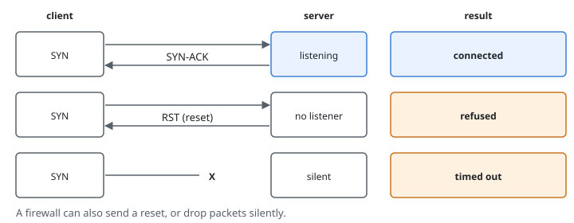

*Draft for owner review.* Most "the network is down" reports are really one of four things: no address, wrong gateway, wrong DNS, or a blocked port. This lesson gives you the model and the routine to tell them apart, using only tools that ship with Windows and Linux. It is the overview; the lessons on subnetting, DHCP, DNS, routing and ports go deep on each layer, and this one shows how to use them together.

**What was tested.** The output in the sections marked *from the lab* comes from the **Windows Server 2022** and **AlmaLinux 9.8** lab VMs (`tests/verification/powershell/net1.ps1`, `tests/verification/bash/net1.sh`). Their network is a **virtual** one provided by the virtual machine software, so addresses begin `10.0.2.` and some things, such as reply times and TTL values, say nothing about a real network. Other addresses in the examples are samples, and the worked example is invented.

## The layers you actually use

| Layer | Question it answers | Typical evidence | Deep lesson |
|---|---|---|---|
| Link | Is there a connection to the local network? | adapter status, cable or Wi-Fi state | models and protocols |
| Address (IP) | Does this machine have a usable address and mask? | `ipconfig`, `ip addr` | subnetting, DHCP |
| Routing | Can it reach other networks? | default gateway, `route print`, `ip route` | routing and gateways |
| Names (DNS) | Does a name turn into an address? | `nslookup`, `Resolve-DnsName`, `getent hosts` | DNS |
| Transport | Is the service port reachable? | `Test-NetConnection -Port`, `ss -tln` | ports and firewalls |

Test from the bottom up. Each layer you prove narrows the problem, and a fault at a lower layer makes every layer above it look broken. A dead cable looks like "DNS is down" to the user.

## Addresses

An IPv4 address has four numbers (`192.168.1.20`) and a **prefix length** (`/24`, the mask `255.255.255.0`) that says which part names the network ([RFC 791](https://www.rfc-editor.org/rfc/rfc791) defines IPv4; the subnetting lesson covers the arithmetic). Machines on the same network talk directly; anything else goes to the **default gateway**.

Private ranges, not routed on the internet ([RFC 1918](https://www.rfc-editor.org/rfc/rfc1918)): `10.0.0.0/8`, `172.16.0.0/12`, `192.168.0.0/16`. An address starting `169.254` is **link-local** ([RFC 3927](https://www.rfc-editor.org/rfc/rfc3927)): the machine asked for one by DHCP and got no answer, so it made one up. Windows calls that APIPA.

**DHCP** hands out an address, mask, gateway and DNS servers automatically. A **static** address is typed in by an administrator. Two machines with the same address cause intermittent failures that are hard to read from either one.

### Reading your own configuration

Windows, Command Prompt and PowerShell:

```
ipconfig /all
Get-NetIPConfiguration
Get-NetIPAddress -AddressFamily IPv4 | Format-Table InterfaceAlias,IPAddress,PrefixLength,PrefixOrigin
```

```
InterfaceAlias IPAddress    PrefixLength PrefixOrigin
-------------- ---------    ------------ ------------
Wi-Fi          192.168.1.20           24         Dhcp
```

`PrefixOrigin` tells you where the address came from: `Dhcp`, `Manual`, or `WellKnown` for the link-local fallback. See [`ipconfig`](https://learn.microsoft.com/windows-server/administration/windows-commands/ipconfig) and [`Get-NetIPConfiguration`](https://learn.microsoft.com/powershell/module/nettcpip/get-netipconfiguration).

**From the lab**, `ipconfig /all` (shortened):

```text
Ethernet adapter Ethernet:
   Physical Address. . . . . . . . . : 52-54-00-12-34-56
   DHCP Enabled. . . . . . . . . . . : Yes
   IPv4 Address. . . . . . . . . . . : 10.0.2.15(Preferred)
   Subnet Mask . . . . . . . . . . . : 255.255.255.0
   Lease Obtained. . . . . . . . . . : Thursday, November 26, 2026 9:15:05 PM
   Lease Expires . . . . . . . . . . : Friday, November 27, 2026 9:15:06 PM
   Default Gateway . . . . . . . . . : fe80::2%4
                                       10.0.2.2
   DHCP Server . . . . . . . . . . . : 10.0.2.2
   DNS Servers . . . . . . . . . . . : 10.0.2.3
```

Read it in this order:

| Line | Ask | Here |
|---|---|---|
| Which adapter | Is this the one in use? A machine often has several | `Ethernet` |
| `IPv4 Address`, `Subnet Mask` | A sensible address, not `169.254`? | `10.0.2.15/24` |
| `Default Gateway` | Present, and inside the same subnet? | `10.0.2.2` (the other line is IPv6) |
| `DNS Servers` | The ones this network should use? | `10.0.2.3` |
| `DHCP Enabled`, `DHCP Server`, `Lease` | Where did the settings come from, and when? | DHCP from `10.0.2.2` |

`Get-NetIPAddress` also showed the **loopback** address `127.0.0.1/8` with `PrefixOrigin : WellKnown`. `WellKnown` means an address fixed by a standard, so check **which** address it is before reading it as the link-local fallback.

Linux:

```
ip -br addr
ip route show
```

```
lo       UNKNOWN  127.0.0.1/8 ::1/128
wlan0    UP       192.168.1.20/24
```

The brief (`-br`) form shows each interface, its state and its addresses on one line. See [ip(8)](https://man7.org/linux/man-pages/man8/ip.8.html).

**From the lab:**

```text
$ ip -br addr
lo      UNKNOWN   127.0.0.1/8 ::1/128
eth0    UP        10.0.2.15/24 ...
$ ip route show
default via 10.0.2.2 dev eth0 proto dhcp src 10.0.2.15 metric 100
10.0.2.0/24 dev eth0 proto kernel scope link src 10.0.2.15 metric 100
$ grep -v "^#" /etc/resolv.conf
nameserver 10.0.2.3
```

`default via` is the gateway; the second line says that `10.0.2.0/24` is reached **directly** through `eth0`. `proto dhcp` and, in `ip -4 addr`, the word `dynamic` show that DHCP set them. `lo` showing `UNKNOWN` is normal for loopback.

## Names

**DNS** turns a name into an address (the DNS lesson explains how). Before asking DNS, machines check a local list (`C:\Windows\System32\drivers\etc\hosts`, `/etc/hosts`); a stale line there overrides DNS silently. On Linux `/etc/nsswitch.conf` sets the order ([nsswitch.conf(5)](https://man7.org/linux/man-pages/man5/nsswitch.conf.5.html)).

```
nslookup example.com                  # Windows and Linux; asks a DNS server directly
Resolve-DnsName example.com           # PowerShell, returns objects
getent hosts example.com              # Linux, follows nsswitch like applications do
```

If you can reach an address but not a name, the problem is names. If neither works, go lower. Note that `nslookup` ignores the hosts file, while applications do not.

### Which tool obeys the hosts file?

I added a line `192.0.2.77 wl-test.example` to the hosts file in both VMs:

| Command | Answer for `wl-test.example` | Uses the hosts file? |
|---|---|---|
| Windows `Resolve-DnsName` | `192.0.2.77` | yes |
| Windows `Resolve-DnsName -NoHostsFile` | `DNS name does not exist` | no |
| Windows `nslookup` | `Non-existent domain` (it asked the DNS server) | **no** |
| Windows `ping` | pinged `192.0.2.77` | yes |
| Linux `getent hosts` | `192.0.2.77` | yes |
| Linux `ping` | pinged `192.0.2.77` | yes |

So **`nslookup` can say a name does not exist while programs connect somewhere**, or give the right answer while programs go to a stale address. When an application and `nslookup` disagree, read the hosts file.

**Read the kind of failure**, too:

| Message | Meaning | Look at |
|---|---|---|
| `DNS name does not exist` / `Could not resolve host` | A server **answered**: no such name (or no source had it) | The spelling, which DNS server, the DNS record |
| `This operation returned because the timeout period expired` | The DNS server **did not answer** (I pointed at an address that never replies; 7 s) | The server's address, the path to it, firewalls |

On Linux, `getent hosts` printed **nothing** and exited **2** for an unknown name. The AlmaLinux image had **no** `nslookup`, `dig` or `host` installed; `getent` is always there.

## Ports and services

A service listens on a **port** (HTTP 80, HTTPS 443, SSH 22, RDP 3389, DNS 53). Reaching the machine does not mean reaching the service. The official list is the [IANA port registry](https://www.iana.org/assignments/service-names-port-numbers/service-names-port-numbers.xhtml).

```
Test-NetConnection server01 -Port 3389     # Windows
ss -tln                                    # Linux: what is listening here
```

Three outcomes: connected; refused (the host answered, nothing is listening or it was rejected); timed out (usually a firewall dropping packets). Telling refused from timed out is the most useful single skill here, and the ports and firewalls lesson develops it. See [`Test-NetConnection`](https://learn.microsoft.com/powershell/module/nettcpip/test-netconnection).



```text
 SYN -> listening      <- SYN-ACK        connected
 SYN -> nothing there  <- RST            refused    (someone answered)
 SYN -> ...nothing comes back            timed out  (dropped on the way, or no such host)
```

### What each looks like

**Linux** says it in words, with an exit status ([`curl`](https://man7.org/linux/man-pages/man1/curl.1.html)):

| Test | Output | Exit | Time |
|---|---|---|---|
| Nothing listening | `curl: (7) Failed to connect to 127.0.0.1 port 8999: Connection refused` | 7 | 0.02 s |
| Address that never answers, `curl -m 5` | `curl: (28) Connection timed out after 5001 milliseconds` | 28 | 5 s |
| Name that does not exist | `curl: (6) Could not resolve host` | 6 | |

Without `curl` or `nc` (the lab image had no `nc`), Bash can open a TCP connection itself: `bash -c 'exec 3<>/dev/tcp/127.0.0.1/22 && head -1 <&3'` printed the SSH server's greeting, `SSH-2.0-OpenSSH_9.9`.

**Windows: `Test-NetConnection` does not tell you which failure it was.**

```text
Test-NetConnection 127.0.0.1 -Port 8999       (nothing listens)       TcpTestSucceeded : False    after 3.4 s
Test-NetConnection 10.255.255.1 -Port 80      (never answers)         TcpTestSucceeded : False    after 27.1 s
```

Both print the warning `TCP connect ... failed`. It adds a **ping** result, which is a different test. To get the real reason, ask .NET:

```powershell
$c = New-Object Net.Sockets.TcpClient
try { $c.Connect('127.0.0.1', 8999); 'connected' }
catch { $e = $_.Exception; while ($e.InnerException) { $e = $e.InnerException }; $e.SocketErrorCode }
finally { $c.Close() }
```

| Target | Result | Time |
|---|---|---|
| nothing listening | `ConnectionRefused` | **2.1 s** |
| never answers | `TimedOut` | 21.2 s |
| listening | `connected` | 0 s |

Notice that on this Windows machine even a **refusal took two seconds**, where Linux took a hundredth of one. A short delay does **not** mean a timeout: read the error, not the stopwatch.

`ping` is a separate matter. It sends ICMP, not TCP to your port: a reply shows something answered at that address, **not** that the service works; no reply may only mean ICMP is blocked.

## A bottom-up routine

Run these in order and stop at the first failure.

| Step | Windows | Linux | Passing looks like |
|---|---|---|---|
| 1. Link and address | `ipconfig`, `Get-NetAdapter` | `ip -br addr` | adapter up; a sensible address and prefix, not `169.254` |
| 2. Gateway | `ping <gateway>` | `ping <gateway>` | replies; the gateway is inside your subnet |
| 3. Beyond the gateway | `ping 1.1.1.1` | `ping 1.1.1.1` | replies (if ping is blocked, try `Test-NetConnection 1.1.1.1 -Port 443`) |
| 4. A name | `Resolve-DnsName example.com` | `getent hosts example.com` | an address comes back |
| 5. The port | `Test-NetConnection host -Port N` | `curl -v telnet://host:N`, or `nc -vz host N` where installed | `TcpTestSucceeded : True`; Linux reports that it connected |

Write down which step first fails. That is your finding, and it picks the lesson to open next:

| First failing step | Probable cause | Next lesson |
|---|---|---|
| 1 | no link, DHCP failure, wrong static address | DHCP, subnetting |
| 2 | wrong gateway or mask, gateway down | routing and gateways |
| 3 | no default route, upstream fault, ICMP blocked | routing and gateways |
| 4 | DNS server wrong, hosts-file override | DNS |
| 5 | service down, bound to loopback, firewall | ports and firewalls |

## A worked example

A user reports "I can't open the intranet site". You run the routine:

1. `ipconfig` shows `192.168.1.20`, mask `255.255.255.0`. Fine.
2. `ping 192.168.1.1` replies. The gateway is up.
3. `ping 1.1.1.1` replies. Routing out works.
4. `Resolve-DnsName intranet.corp.example` returns "DNS name does not exist". **First failure: names.**
5. You try the configured server's address directly: `nslookup intranet.corp.example 192.168.1.1` also fails, but `nslookup intranet.corp.example 10.0.0.53` (the company DNS) answers.

Finding: this laptop's DHCP handed out the router as DNS server instead of the company server, so internal names are unknown to it. Not a network outage at all. The fix is in the DHCP options or the adapter's DNS setting, and you reached it in five commands.

## Common mistakes

- **Starting at the top.** Testing the website first and guessing, instead of climbing from the address.
- **Trusting `ping` as the only test.** It can be blocked while the service works, and it proves nothing about a port.
- **Reading `169.254` as "the network is down".** It says DHCP failed for this machine; check the link and the server.
- **Forgetting the hosts file.** It overrides DNS and `nslookup` will not show it.
- **Changing several things at once.** You then cannot tell which one fixed it.

## Check yourself

1. A machine has `169.254.7.9`. What happened?
2. Ping to an IP works, ping to its name fails. Which layer is at fault?
3. Connection refused versus timed out: what does each suggest?
4. `Get-NetIPAddress` shows `PrefixOrigin : Manual`. What does that mean for DHCP troubleshooting?
5. Which step of the routine do you reach for after steps 1 to 3 pass but a website name will not open?

**Answers.** (1) It asked for an address by DHCP, got no answer, and gave itself a link-local one. (2) Names (DNS, or the hosts file). (3) Refused: the host is reachable but nothing listens on that port; timed out: packets were dropped on the way, usually by a firewall or a routing fault. (4) The address was typed in, not leased, so DHCP is not the cause. (5) Step 4, resolving the name, then step 5 for the port.

## Practice

Work through the routine on a lab VM: record the output of each step and write down the first one that fails, or that none does. Then open the lab `labs.gateway-route-override` and use the table above to say which step it should break before you run it.
