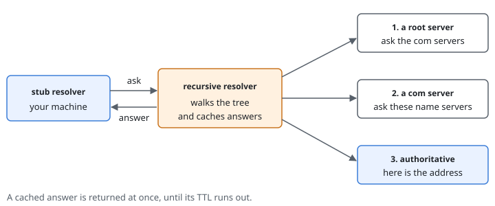

*Draft for owner review.* Nearly every network action starts with a name. If names stop resolving, "the internet is down" even though the link, the address and the gateway are fine. This lesson explains how DNS works, then teaches you to query it directly so you can tell a DNS fault from every other kind.

**What was tested.** The sections marked *measured* use an **AlmaLinux 9.8** lab VM with `dig` 9.16 and a private test DNS server (dnsmasq, made-up names under `wl.test`), and a **Windows Server 2022** lab VM (`tests/verification/networking/dns1.sh`, `tests/verification/powershell/dns2.ps1`). Other output shows the layout with sample names and addresses.

## What DNS is

The **Domain Name System** ([RFC 1034](https://www.rfc-editor.org/rfc/rfc1034) for the concepts, [RFC 1035](https://www.rfc-editor.org/rfc/rfc1035) for the message format) is a distributed database that maps names to data, most often a name to an IP address. No single server holds it all. The name space is a **tree**, read right to left:

```
www.example.com.
 |    |      |  +-- the root (the final dot, usually left off)
 |    |      +----- com   top-level domain (TLD)
 |    +------------ example   second-level domain, owned by one organisation
 +----------------- www   a host name inside that domain
```

Each level can **delegate** the level below to different servers. The root is served by 13 named server identities run by many operators; IANA lists them at [IANA root servers](https://www.iana.org/domains/root/servers). The `com` servers know which servers answer for `example.com`; those servers know the address of `www`. Names are not case-sensitive, and each label is at most 63 characters.

## The three roles

| Role | What it does | Example |
|---|---|---|
| **Stub resolver** | The small client built into the OS. Asks one configured server and caches the answer. | the DNS Client service on Windows, `systemd-resolved` or glibc on Linux |
| **Recursive resolver** | Does the work for the client: walks from the root down, follows delegations, caches. | your router, your ISP, a company DNS server, `1.1.1.1`, `8.8.8.8` |
| **Authoritative server** | Holds the real records for a zone and answers only for it. | the servers that publish `example.com` |

When your machine looks up `www.example.com`, the stub resolver asks its configured server (usually handed out by DHCP, see the DHCP lesson). That recursive server asks a root server, then a `com` server, then an `example.com` server, and returns the final answer. The next person to ask gets it from the recursive server's cache.



```text
 stub (your machine) <--> recursive resolver --> 1. root --> 2. com --> 3. authoritative for example.com
                          (caches the answer until its TTL runs out)
```

## Record types

A **resource record** is one entry in a zone. The ones you will meet constantly:

| Type | Holds | Example |
|---|---|---|
| **A** | an IPv4 address | `www  A  93.184.216.34` |
| **AAAA** | an IPv6 address | `www  AAAA  2606:2800:220:1::` |
| **CNAME** | an alias to another name | `ftp  CNAME  www` |
| **MX** | a mail server for the domain, with a preference number (lower is tried first) | `MX 10 mail.example.com` |
| **NS** | the authoritative servers for a zone | `NS  ns1.example.com` |
| **PTR** | the reverse mapping, address to name | `34.216.184.93.in-addr.arpa  PTR  www.example.com` |
| **TXT** | free text; used for domain verification, SPF and similar | `"v=spf1 -all"` |
| **SOA** | start of authority: the zone's primary server, contact and timing values | one per zone |

Two details trip people up. A **CNAME** cannot sit beside other records of the same name, so it is never used at the zone apex. A **PTR** record lives in a special tree: for IPv4 the address is written backwards under `in-addr.arpa`, so `192.0.2.10` is looked up as `10.2.0.192.in-addr.arpa`.

## Caching, TTL and why changes are slow

Every record carries a **TTL** (time to live) in seconds. A resolver may keep the answer that long and must then ask again. This is what makes DNS fast, and also why a change is not seen everywhere at once: anyone who looked the name up a minute ago keeps the old answer until its TTL runs out.

Failure is cached too. [RFC 2308](https://www.rfc-editor.org/rfc/rfc2308) describes **negative caching**: a "that name does not exist" answer (`NXDOMAIN`) is remembered for a time taken from the zone's SOA. If you query a name before you have created it, you may keep seeing "does not exist" after you create it.

Practical rule: **lower the TTL a day before a planned change, make the change, then raise it again.**

### Watching a TTL count down (measured)

An answer that comes from a cache shows the time **left**. `dig example.com A` twice, five seconds apart (a later run, so the numbers had already dropped):

```text
example.com.   48   IN   A   104.20.23.154
example.com.   36   IN   A   104.20.23.154
```

On Windows, `Get-DnsClientCache -Entry example.com` showed `TimeToLive 285`, then `280`. The addresses of public names change over time; do not expect these. The gap between the two dig answers was more than five seconds, because the commands themselves take time.

## The local lookup order

Before any server is asked, the OS checks local sources.

On **Windows** the order is: the DNS client's cache, then the **hosts file**, then the configured DNS servers. The hosts file is `C:\Windows\System32\drivers\etc\hosts`.

On **Linux** the order comes from `/etc/nsswitch.conf` (see [nsswitch.conf(5)](https://man7.org/linux/man-pages/man5/nsswitch.conf.5.html)). A typical line:

```
hosts: files dns
```

reads "check the files (that is `/etc/hosts`, see [hosts(5)](https://man7.org/linux/man-pages/man5/hosts.5.html)) first, then DNS". A line in the hosts file therefore **silently overrides DNS** on that machine. It is also why a forgotten test entry makes one machine disagree with all the others.

Which servers are asked is in `/etc/resolv.conf` ([resolv.conf(5)](https://man7.org/linux/man-pages/man5/resolv.conf.5.html)), which on many distributions is generated and points at a local `systemd-resolved` stub; do not edit it by hand where it says it is generated.

## Querying from the command line

Use a tool that lets you choose the server. That is what separates "the name does not exist" from "my resolver is broken".

### nslookup (Windows, and Linux if installed)

[`nslookup`](https://learn.microsoft.com/windows-server/administration/windows-commands/nslookup) is on every Windows machine:

```
nslookup example.com
Server:  UnKnown
Address:  10.139.249.137

Name:    example.com
Addresses:  2606:4700:10::ac42:93f3
          2606:4700:10::6814:179a
          172.66.147.243
          104.20.23.154
```

`Server: UnKnown` is normal: nslookup tried to find a name for its own DNS server's address (a reverse lookup) and there is none. It is not an error with your query. The `Address` line is the server that actually answered.

Ask a specific server by naming it last, and a record type with `-type=`:

```
nslookup -type=MX example.com 1.1.1.1
nslookup -type=NS example.com
nslookup 192.0.2.10
```

The last form does a reverse (PTR) lookup. `nslookup` talks straight to a DNS server, so it does **not** read the hosts file.

### Resolve-DnsName (PowerShell)

[`Resolve-DnsName`](https://learn.microsoft.com/powershell/module/dnsclient/resolve-dnsname) returns objects, so you can filter and sort them:

```
Resolve-DnsName example.com -Type MX

Name        Type TTL Section NameExchange Preference
----        ---- --- ------- ------------ ----------
example.com MX   300 Answer  .            0
```

Useful options, all described in the cmdlet's documentation:

| Option | Effect |
|---|---|
| `-Server 1.1.1.1` | ask this server instead of the configured ones |
| `-Type AAAA` | ask for a record type |
| `-DnsOnly` | use only the DNS protocol (no LLMNR or NetBIOS fallback) |
| `-NoHostsFile` | skip the hosts file |
| `-CacheOnly` | answer only from the local cache |

Comparing the plain query with `-NoHostsFile` shows a hosts-file override at once.

### Linux

```
getent hosts example.com            # the way applications resolve: nsswitch, hosts file, then DNS
resolvectl query example.com        # systemd-resolved: shows which server and interface answered
resolvectl status                   # per-interface DNS servers and search domains
dig example.com MX @1.1.1.1         # if the dig tool is installed (bind-utils / dnsutils)
```

**Tested** (2026-11-22; `tests/verification/networking/nl1.sh`). On **Ubuntu 24.04.5** `getent`, `resolvectl query`, `resolvectl status`, `nslookup` and `dig` all worked (`resolvectl status` showed `resolv.conf mode: stub` and `Current DNS Server: 10.0.2.3`; `nslookup` reported `Server: 127.0.0.53`, the local stub, which forwards to 10.0.2.3). On the **AlmaLinux 9.8** lab image `nslookup`, `dig` and `resolvectl` were **not installed** (`nslookup` and `dig` come from the `bind-utils` package; AlmaLinux does not run systemd-resolved by default, so there is no `resolvectl` to use), but `getent hosts example.com` worked. I did not install `bind-utils` and run `dig` there. Note `dig example.com MX @1.1.1.1 +short` printed `0 .` on Ubuntu: example.com publishes a null MX record, meaning "does not receive mail".

[`getent`](https://man7.org/linux/man-pages/man1/getent.1.html) and [`resolvectl`](https://man7.org/linux/man-pages/man1/resolvectl.1.html) are the tools to learn first because they follow the same path as real programs. `dig` and `nslookup` talk straight to a server and ignore the hosts file, so they answer a different question. Knowing which question each tool answers is the skill.

## Reading dig's answer (measured)

```text
$ dig @127.0.0.1 -p 5353 app.wl.test
;; ->>HEADER<<- opcode: QUERY, status: NOERROR, id: 23711
;; flags: qr aa rd ra; QUERY: 1, ANSWER: 1, AUTHORITY: 0, ADDITIONAL: 1

;; QUESTION SECTION:
;app.wl.test.               IN    A

;; ANSWER SECTION:
app.wl.test.        60      IN    A    192.0.2.10

;; Query time: 0 msec
;; SERVER: 127.0.0.1#5353(127.0.0.1)
```

| Line | Read it as |
|---|---|
| `status:` | **Read this first.** What kind of answer this is (next table) |
| `flags: ... aa` | **Authoritative answer**: the server holds this data itself. Without `aa` it usually came from a cache or another server |
| `ANSWER: 1` | How many records answer the question |
| `QUESTION SECTION` | What was actually asked: check the name and the type |
| `60  IN  A  192.0.2.10` | TTL, class, record type, value |
| `SERVER:` | **Who answered.** If it is not the server you meant, fix that first |

(`@server` and `-p port` choose where to ask; `+noall +answer` shows only the answers, and `+short` only the values.) For an alias, the answer holds **both** records: `www.wl.test CNAME app.wl.test.` and then the `A` record.

### The different kinds of "no"

| What `dig` showed | Meaning | Look at |
|---|---|---|
| `status: NOERROR`, `ANSWER: 1` or more | Here is the answer | |
| `status: NXDOMAIN` | **The name does not exist** | Spelling, the zone, which server you asked |
| `status: NOERROR`, **`ANSWER: 0`** | **The name exists, but has no record of the type you asked for** (I asked a name with only an `A` record for `AAAA`) | The record type. This is not an error |
| `status: REFUSED` | The server **will not** answer this (my server was asked about a name outside its zone and had nowhere to send it) | Whether you are asking the right server, and its access rules |
| `connection timed out; no servers could be reached` (exit **9**) | **No answer at all** | The server's address, the path, UDP and TCP 53, whether it is running |

I got the same "timed out" for an address with nothing there **and** for a port on this machine with no DNS server: `dig`'s message does not tell those apart.

**`+short` hides the difference.** For the name that **does not exist** and the name with **no `AAAA` record**, `dig ... +short` printed **nothing**, and `dig` exited 0 for these answers. In a script, "empty output" is not a diagnosis: read the `status`.

**Windows hides it differently.** I asked `Resolve-DnsName example.com -Type SRV`, a type that name does not have. There was **no error**, and the result was **not empty**: it returned the zone's `SOA` record, in the `Authority` section. So `if (Resolve-DnsName $name -Type SRV)` would be **true**. Test for the type you need:

```powershell
$srv = @(Resolve-DnsName $name -Type SRV -ErrorAction SilentlyContinue | Where-Object Type -eq 'SRV')
if (-not $srv.Count) { 'no SRV records' }
```

And do not assume how a missing **name** will be reported: when I asked for a made-up name under `example.com`, its servers' answer arrived as "no records" rather than "no such name" (`nslookup` printed the name with no address, and the Windows cache recorded status `9501`, no records). I did not investigate why. A made-up name under my own test zone gave `NXDOMAIN`.

### Tools that skip the hosts file

With `198.51.100.7 app.wl.test` added to `/etc/hosts`, `dig ... app.wl.test +short` still printed the DNS answer `192.0.2.10`, while `getent hosts app.wl.test` printed `198.51.100.7`, which is what programs would use.

## Seeing and changing the DNS settings

**Windows, PowerShell:**

```
Get-DnsClientServerAddress -AddressFamily IPv4
Set-DnsClientServerAddress -InterfaceAlias "Ethernet" -ServerAddresses 1.1.1.1,9.9.9.9
Set-DnsClientServerAddress -InterfaceAlias "Ethernet" -ResetServerAddresses   # back to DHCP
```

See [Get-DnsClientServerAddress](https://learn.microsoft.com/powershell/module/dnsclient/get-dnsclientserveraddress) and [Set-DnsClientServerAddress](https://learn.microsoft.com/powershell/module/dnsclient/set-dnsclientserveraddress). Changing settings needs an elevated session. `ipconfig /all` also lists the DNS servers and the **DNS Suffix Search List**: the suffixes added to a short name such as `fileserver` so it becomes `fileserver.corp.example.com`.

**Windows, the cache:**

```
Get-DnsClientCache                  # what this machine has remembered (PowerShell)
ipconfig /displaydns                # the same, from Command Prompt (elevated)
Clear-DnsClientCache                # forget it (PowerShell)
ipconfig /flushdns                  # the same, from Command Prompt
```

See [Get-DnsClientCache](https://learn.microsoft.com/powershell/module/dnsclient/get-dnsclientcache), [Clear-DnsClientCache](https://learn.microsoft.com/powershell/module/dnsclient/clear-dnsclientcache) and [ipconfig](https://learn.microsoft.com/windows-server/administration/windows-commands/ipconfig). On a standard (non-elevated) session `ipconfig /displaydns` answers "The requested operation requires elevation." Flushing the cache only affects this machine; it does nothing about the recursive resolver's cache.

**Linux:** with systemd-resolved, `resolvectl flush-caches` clears the local cache and `resolvectl dns eth0 1.1.1.1` sets a server for one interface until the next reconnect. Permanent settings belong in the network manager (for NetworkManager, `nmcli connection modify` the `ipv4.dns` property), not in a generated `resolv.conf`.

## A DNS troubleshooting routine

Goal: decide whether the fault is DNS at all.

1. **Reach an address directly.** `ping 1.1.1.1` or `Test-NetConnection 1.1.1.1 -Port 443`. If this fails, it is not DNS; go back down the layers.
2. **Resolve a name the ordinary way.** `Resolve-DnsName example.com` or `getent hosts example.com`. Note the answer, or the error.
3. **Resolve it bypassing local overrides.** `Resolve-DnsName example.com -NoHostsFile` or `nslookup example.com`. A different answer from step 2 means a hosts-file line.
4. **Ask a different resolver.** `nslookup example.com 1.1.1.1`. Works there but not on your configured server means your resolver is at fault (down, filtered, or has a stale negative answer).
5. **Ask the authoritative server.** `nslookup -type=NS example.com`, then `nslookup example.com <one of those servers>`. If even it is wrong, the zone is wrong and only its owner can fix it.
6. **Check the cache and the order.** Flush the cache; read the hosts file.

| What you see | Meaning |
|---|---|
| `Non-existent domain` / `NXDOMAIN` | the name does not exist (or is cached as missing) |
| `DNS request timed out` / `timeout` | the server did not answer: unreachable, down, or port 53 blocked |
| `SERVFAIL` | the server tried and failed, for example a broken delegation or DNSSEC problem (not reproduced here) |
| `NOERROR` with no answers | the name exists but has no record of that type |
| `REFUSED` | the server will not answer you, usually an access list |
| right address, wrong site | a hosts-file line, a stale cache, or a changed record not yet expired |
| works by address, fails by name | DNS (or the hosts file) |

DNS normally uses **UDP port 53**, falling back to **TCP port 53** for large answers and zone transfers. A firewall that allows only UDP 53 will break some lookups in ways that look random.

## Common mistakes

- **Testing with `ping name` and believing a failure means "no network".** Ping may be blocked even when DNS works; use the resolver tools above.
- **Forgetting the hosts file.** `nslookup` and `dig` ignore it, so they say everything is fine while the application fails.
- **Reading empty `+short` output as "no such name".**
- **Treating any result from `Resolve-DnsName` as the record you asked for.**
- **Editing a generated `resolv.conf`.** Your change disappears at the next network event.
- **Flushing the local cache and expecting the world to update.** The recursive servers and TTL decide that.
- **Using a public resolver for internal names.** Names that exist only inside the company are answered only by the company's DNS, so DHCP should hand out the internal server.
- **Putting a CNAME at the zone apex.** Not allowed; the apex needs an address record.

## Check yourself

1. What is the difference between a recursive resolver and an authoritative server?
2. You created a record and a colleague still gets "does not exist" ten minutes later. Give two reasons.
3. `nslookup` shows `Server: UnKnown`. Is the lookup broken?
4. `Resolve-DnsName app.corp.example` returns `10.0.0.5` but adding `-NoHostsFile` returns `10.0.0.9`. What explains it?
5. What record type would you query to find a domain's mail server? To find the name for an IP address?
6. Which command shows what this Windows machine has cached? Which clears it?

**Answers.** (1) A recursive resolver does the lookup work for clients by walking the tree and caching; an authoritative server holds the actual records for a zone and answers only for it. (2) The negative answer is cached (RFC 2308) until its time runs out, and the resolver the colleague uses may still hold an old answer for the TTL. (3) No. It only means the reverse lookup of the DNS server's own address found no name. (4) A hosts-file line overrides DNS for that name on this machine. (5) MX; PTR. (6) `Get-DnsClientCache` or `ipconfig /displaydns`; `Clear-DnsClientCache` or `ipconfig /flushdns`.

## Practice

Lab VMs resolve through QEMU's built-in resolver on their private network, so a broken-DNS scenario needs the multi-VM network in decision record 0008. Until then, on a lab VM run the routine above against one name: record the answer from the ordinary lookup, from `-NoHostsFile` (or `nslookup`), and from a second server, and say which step first shows a difference, or that there is none.
