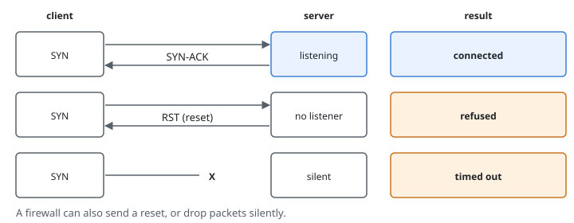

*Draft for owner review.* Reaching a machine is not the same as reaching a service on it. Between "the host answers ping" and "the website loads" sit ports, the program listening on one, and one or more firewalls. This lesson teaches you to see all three, and above all to tell the two ways a connection can fail, because they point at different causes.

Output is real in layout; names, addresses and process IDs are samples. Changing a firewall needs an **elevated** (Windows) or **root** (Linux) session, and you should make changes only on machines you administer, such as your lab VMs.

## What a port is

An IP address finds a machine. A **port** (a number from 0 to 65535) finds a program on it. A connection is identified by four things: source address, source port, destination address, destination port. A web server listens on port 443; your browser connects from a random high port to it.

Two transports carry most traffic:

| | TCP ([RFC 9293](https://www.rfc-editor.org/rfc/rfc9293)) | UDP ([RFC 768](https://www.rfc-editor.org/rfc/rfc768)) |
|---|---|---|
| Connection | set up first with a three-way handshake (SYN, SYN-ACK, ACK) | none; each datagram stands alone |
| Delivery | ordered, retransmitted if lost | best effort, no ordering or retry |
| Used for | web, SSH, mail, file transfer | DNS queries, DHCP, time, streaming, VoIP |

A TCP port and a UDP port with the same number are different things: "port 53" must say which.

### Well-known ports

Ports 0 to 1023 are **well known**, 1024 to 49151 **registered**, and 49152 and up **dynamic** (the ones clients pick at random). The authority is the [IANA registry](https://www.iana.org/assignments/service-names-port-numbers/service-names-port-numbers.xhtml). The ones every administrator knows:

| Port | Service | Notes |
|---|---|---|
| 22/tcp | SSH | secure remote shell and file copy |
| 53/udp, 53/tcp | DNS | UDP first, TCP for large answers |
| 67, 68/udp | DHCP | server, client |
| 80/tcp | HTTP | |
| 123/udp | NTP | time |
| 135/tcp | Windows RPC endpoint mapper | |
| 389/tcp | LDAP | directory |
| 443/tcp | HTTPS | |
| 445/tcp | SMB | Windows file sharing |
| 3389/tcp | RDP | Windows Remote Desktop |

Do not memorise by rote what you can look up; learn the ten above and read the registry for the rest.

## Listening and connecting

A **server** program opens a socket and **listens** on a port, on one address or on all of them. A **client** connects to it. "Is anything listening?" and "is the connection allowed?" are separate questions with separate tools.

### What is listening here

Windows:

```
Get-NetTCPConnection -State Listen | Sort-Object LocalPort | Format-Table LocalAddress,LocalPort,OwningProcess

LocalAddress LocalPort OwningProcess
------------ --------- -------------
0.0.0.0            135          1924
0.0.0.0            445             4
::                3389          1100
```

or from Command Prompt, with `netstat -ano`:

```
  Proto  Local Address          Foreign Address        State           PID
  TCP    0.0.0.0:135            0.0.0.0:0              LISTENING       1924
  TCP    0.0.0.0:445            0.0.0.0:0              LISTENING       4
```

See [Get-NetTCPConnection](https://learn.microsoft.com/powershell/module/nettcpip/get-nettcpconnection) and [netstat](https://learn.microsoft.com/windows-server/administration/windows-commands/netstat). The **PID** (`OwningProcess`) is the process that owns the socket. Turn it into a name with `Get-Process -Id 1924` or `tasklist /fi "pid eq 1924"`.

Linux:

```
ss -tlnp
State   Recv-Q  Send-Q  Local Address:Port  Peer Address:Port  Process
LISTEN  0       128           0.0.0.0:22         0.0.0.0:*     users:(("sshd",pid=701,fd=3))
LISTEN  0       511                 *:80               *:*     users:(("nginx",pid=912,fd=6))
```

The flags in [ss(8)](https://man7.org/linux/man-pages/man8/ss.8.html): `-t` TCP, `-l` listening, `-n` numbers instead of names, `-p` the process (needs root to see other users' processes). Add `-u` for UDP.

### Read the local address

The address a service listens on matters as much as the port:

| Local address | Meaning |
|---|---|
| `0.0.0.0` or `::` / `*` | all addresses: reachable from the network (if the firewall lets it) |
| `127.0.0.1` or `::1` | **loopback only**: reachable only from this machine |
| a specific address, e.g. `192.168.1.20` | only on that interface |

A service that works locally but not from other machines is very often bound to `127.0.0.1`. No firewall setting will fix that; the service's own configuration must change.

### Test a connection from a client

```
Test-NetConnection server01 -Port 443

ComputerName     : server01
RemoteAddress    : 192.168.1.50
RemotePort       : 443
InterfaceAlias   : Ethernet
SourceAddress    : 192.168.1.20
TcpTestSucceeded : True
```

`TcpTestSucceeded : True` means the TCP handshake completed: the host is reachable, something is listening, and nothing is blocking it. See [Test-NetConnection](https://learn.microsoft.com/powershell/module/nettcpip/test-netconnection).

On Linux, `nc -vz server01 443` (if netcat is installed) or `curl -v telnet://server01:443` do the same.

## Refused or timed out

This is the most useful diagnosis in the lesson.

| Result | What happened | What it means |
|---|---|---|
| **Connected** | handshake completed | reachable, listening, allowed |
| **Refused** | the host answered at once with a reset (RST) | the machine is reachable but **nothing is listening** on that port, or the firewall explicitly rejects |
| **Timed out** | no answer at all | something **dropped** the packets: a firewall set to drop, a wrong address, no route, or the host is down |

So:

- **Refused** usually says "I am here, but not on that port". Start with the service: is it running, and listening on the right address and port? Then check for a rule that **rejects**.
- **Timed out** says nothing came back. Check the path: routing, then firewalls on the way, including the host's own.



```text
 SYN -> listening      <- SYN-ACK        connected
 SYN -> nothing there  <- RST            refused
 SYN -> ...nothing comes back            timed out
```

**On Windows, `Test-NetConnection` does not tell you which it was:** both end in `TcpTestSucceeded : False`. In a lab test even a refusal took about two seconds, so **do not judge by speed**; read the socket error, as shown in the addressing and names lesson. If a **ping succeeds but the port fails**, the host is up and something about the port is the problem.

### What a firewall block looks like: measured

"Blocked means timed out" is often wrong, because a firewall can **answer**. I split an AlmaLinux 9.8 VM into two network namespaces joined by a virtual cable (so one acted as a separate client), ran a web server, and changed only the firewall (`tests/verification/networking/ns1.sh`). The client used `curl -m 5`:

| On the server | `curl` said | Exit | Time |
|---|---|---|---|
| Listening on `0.0.0.0`, no rule | HTTP 200 | 0 | 0.01 s |
| Listening on `127.0.0.1` only | `Connection refused` | 7 | 0.01 s |
| Nothing listening | `Connection refused` | 7 | 0.01 s |
| nftables `drop` | `Connection timed out` | 28 | 5.01 s |
| nftables `reject with tcp reset` | **`Connection refused`** | 7 | 0.01 s |
| nftables `reject` (default: port unreachable) | **`Connection refused`** | 7 | 0.01 s |
| nftables `reject with icmpx type admin-prohibited` | **`No route to host`** | 7 | 0.01 s |
| **firewalld 1.3.4**, default zone `public`, port not opened | **`No route to host`** | 7 | 0.01 s |

Three lessons from this table:

1. **`No route to host` often is not a routing fault.** The route was fine (the same address connected as soon as the port was opened). It is what **firewalld's default** told the client. If you can **ping** a host, or reach another port on it, suspect its firewall.
2. **A rejecting firewall can look exactly like "nothing listening".** So "refused" does not clear the firewall: check the server's rules as well as its listeners.
3. **A listener on `127.0.0.1` is refused from outside** and answers on the server. From the server itself, a connection to its **network address** (`10.99.0.1`) was also refused: test `127.0.0.1` and the real address separately.

With firewalld running, `--add-port=8081/tcp` made the client connect at once, and after `--reload` it said `No route to host` again, because the rule had been added to the **runtime** only.

**Counters show whether packets arrive.** With `counter drop` on the rule, `nft list chain` showed `counter packets 3 bytes 180 drop` after one attempt. Packets reached the server and the rule dropped them. A counter that stays at zero points **earlier on the path**. (Three packets because the client retried.)

**UDP is harder.** There is no handshake, so:

| UDP case | What the client saw |
|---|---|
| Nothing listening, no rule | `ConnectionRefusedError` (an ICMP "port unreachable" came back) |
| Dropped by a rule | timeout |
| **Listening, but sending no reply** | **timeout** |

For UDP, **silence proves nothing**. Check the server: is it listening (`ss -ulnp`), do the packets arrive (a counter or a packet capture), does its log show the request?

These results are for this Linux setup. Other firewalls, and devices between networks, are configured to drop or reject as their administrators chose. **Windows Defender Firewall was not tested from a second machine.**


## Firewalls

A **firewall** allows or blocks traffic by rules: direction, protocol, port, address, sometimes program. A **host firewall** runs on the machine itself; a **network firewall** sits between networks. Both can apply, and **every one on the path must allow the traffic**. The default stance is the key idea: modern host firewalls **block inbound** connections that are not explicitly allowed and **allow outbound**.

### Windows Defender Firewall

Windows keeps **three profiles** and applies the one that matches the network the adapter is on:

| Profile | When |
|---|---|
| **Domain** | the machine can reach its Active Directory domain controller |
| **Private** | a network you marked as trusted (home, work) |
| **Public** | everything else; the strictest, for cafes and airports |

```
Get-NetFirewallProfile | Format-Table Name,Enabled,DefaultInboundAction,DefaultOutboundAction

Name    Enabled DefaultInboundAction DefaultOutboundAction
----    ------- -------------------- ---------------------
Domain     True        NotConfigured         NotConfigured
Private    True        NotConfigured         NotConfigured
Public     True        NotConfigured         NotConfigured
```

`NotConfigured` means the built-in default applies: block inbound, allow outbound. The same from Command Prompt:

```
netsh advfirewall show allprofiles
```

See [Get-NetFirewallProfile](https://learn.microsoft.com/powershell/module/netsecurity/get-netfirewallprofile), [netsh advfirewall](https://learn.microsoft.com/windows-server/administration/windows-commands/netsh-advfirewall) and the [Windows Firewall overview](https://learn.microsoft.com/windows/security/operating-system-security/network-security/windows-firewall/).

**List and add rules (elevated):**

```
Get-NetFirewallRule -Enabled True -Direction Inbound | Select-Object -First 5 DisplayName,Profile,Action

New-NetFirewallRule -DisplayName "Lab web 8080" -Direction Inbound -Protocol TCP -LocalPort 8080 -Action Allow -Profile Private
Remove-NetFirewallRule -DisplayName "Lab web 8080"
```

```
netsh advfirewall firewall add rule name="Lab web 8080" dir=in action=allow protocol=TCP localport=8080 profile=private
netsh advfirewall firewall delete rule name="Lab web 8080"
```

See [Get-NetFirewallRule](https://learn.microsoft.com/powershell/module/netsecurity/get-netfirewallrule) and [New-NetFirewallRule](https://learn.microsoft.com/powershell/module/netsecurity/new-netfirewallrule). Always limit a rule by **profile** and, when you can, by **remote address**, rather than opening a port to everyone on every network.

**Do not turn the firewall off to "see if that is the problem".** It tells you less than a targeted rule would, and people forget to turn it back on. The lab `labs.firewall-profiles-off` is exactly that mistake. Test with a narrow allow rule, then remove it.

### Linux: firewalld (Red Hat family)

firewalld groups interfaces into **zones** and keeps two sets of rules: **runtime** (active now, lost at reload or reboot) and **permanent** (saved, applied at the next reload). See the [firewalld documentation](https://firewalld.org/documentation/) and the [firewall-cmd manual](https://firewalld.org/documentation/man-pages/firewall-cmd.html).

```
sudo firewall-cmd --state
sudo firewall-cmd --get-active-zones
sudo firewall-cmd --list-all
sudo firewall-cmd --add-service=http                 # runtime only
sudo firewall-cmd --permanent --add-service=http     # saved
sudo firewall-cmd --reload                           # apply the saved rules
sudo firewall-cmd --permanent --add-port=8080/tcp
```

**Tested** (AlmaLinux 9.8, firewalld 1.3.4, 2026-11-22; `nl1.sh`). **firewalld was not installed on the lab image**: I installed it with `dnf install firewalld` and started it with `systemctl enable --now firewalld`. Then `--state` printed `running`, `--get-active-zones` showed `public` with `eth0`, and `--list-all` showed `services: cockpit dhcpv6-client ssh`. After `--add-service=http` the runtime list had `http` and the permanent list did not; after `--reload` the runtime rule was **gone**; after `--permanent --add-service=http` and `--reload` it stayed; `--permanent --add-port=8080/tcp` plus a reload listed `8080/tcp`. I removed what I added afterwards.

The classic mistake is adding a rule at runtime, seeing it work, then losing it at the next reboot because it was never made permanent. The lab `labs.alma-firewalld-http` is this scenario.

### Linux: ufw (Debian and Ubuntu)

```
sudo ufw status verbose
sudo ufw allow 22/tcp
sudo ufw allow from 192.168.1.0/24 to any port 8080 proto tcp
sudo ufw delete allow from 192.168.1.0/24 to any port 8080 proto tcp   # the same words you added it with
sudo ufw status numbered                                              # then: sudo ufw delete 2
sudo ufw enable
```

Allow SSH **before** you `enable` ufw on a remote machine, or you lock yourself out. See [ufw(8)](https://manpages.ubuntu.com/manpages/noble/en/man8/ufw.8.html).

**Tested** (Ubuntu 24.04.5, ufw 0.36.2 installed with `apt-get install ufw`, 2026-11-22; `tests/verification/networking/nl1.sh` and `nl2.sh`). Four things the short examples hide:

- Rules added while ufw is **inactive** are stored, but `ufw status` still prints `Status: inactive` and lists nothing until you enable it.
- **A delete must name the rule the way you added it.** After `ufw allow from 192.168.1.0/24 to any port 8080 proto tcp`, the command `ufw delete allow 8080/tcp` answered `Could not delete non-existent rule` (and `... (v6)`). The full form (`ufw delete allow from 192.168.1.0/24 to any port 8080 proto tcp`) printed `Rule deleted`, and so did a numbered delete (`ufw status numbered`, then `ufw --force delete 2`). The short form works only for a rule added the short way (`ufw allow 8080/tcp`).
- **`ufw delete` exits with status 0 even when it deleted nothing**, so a script that checks `$?` will not notice. Read the output or check `ufw status` afterwards.
- With 22 allowed first, `ufw --force enable` printed `Firewall is active and enabled on system startup`, `ufw status verbose` showed `Default: deny (incoming), allow (outgoing), disabled (routed)`, and sshd was still listening and reachable. I did not test locking yourself out by enabling first.

## A bottom-up port check

Combine this lesson with the previous ones. For a service that "does not work":

1. **Is it listening?** On the server: `Get-NetTCPConnection -State Listen` or `ss -tlnp`. Right port, right address (not only `127.0.0.1`)?
2. **Does it work locally?** From the server itself, connect to `127.0.0.1` on that port.
3. **Is the host firewall allowing it?** Look for an inbound allow rule on that port and that profile.
4. **Can the client reach the server?** From the client, ping, then `Test-NetConnection server -Port N`.
5. **Refused or timed out?** Refused: the service. Timed out: something drops it; check the host firewall, then network firewalls and routes.
6. **Prove the fix** from the client again, and remove any temporary rule.

## Common mistakes

- **Treating "ping works" as "the service is reachable".** Ping is ICMP and has no port.
- **Disabling the firewall** instead of adding a narrow rule.
- **Opening a port on the wrong profile**, so it works at the desk and not on the Public network.
- **A service bound to `127.0.0.1`,** blamed on the firewall.
- **Reading `No route to host` as a routing fault** without checking the destination's firewall.
- **Deciding a firewall is not involved because the connection was refused.**
- **A firewalld rule that is runtime-only,** lost at reboot.
- **Enabling ufw over SSH without allowing SSH first.**
- **Forgetting UDP:** a rule for 53/tcp does not allow 53/udp.

## Check yourself

1. What four values identify a TCP connection?
2. `Test-NetConnection` shows `PingSucceeded : True` and `TcpTestSucceeded : False`. What does that tell you, and what does it not tell you?
3. `curl` says `No route to host` for a server that answers ping. What do you suspect?
4. `ss -tlnp` shows `127.0.0.1:8080`. A colleague cannot reach it. Is the firewall the problem?
5. Why must you allow SSH before `ufw enable` on a remote server?
6. You ran `firewall-cmd --add-service=http`, it worked, and after a reboot it stopped. Why?

**Answers.** (1) Source address, source port, destination address, destination port. (2) The host is up and the TCP connection failed; it does not say whether it was refused or timed out. (3) A firewall on that host (or on the way) rejecting the connection: firewalld's default answers this way. (4) No. The service listens only on loopback; its configuration must change. (5) Enabling the firewall applies the default "deny inbound" at once and would block your own SSH session. (6) The rule was runtime only; it needs `--permanent` (then `--reload`).

## Practice

Three labs cover this lesson: `labs.rdp-firewall` (a service that is configured correctly but blocked), `labs.firewall-profiles-off` (a firewall turned off, and how to restore it properly) and `labs.alma-firewalld-http` (a web server reachable locally but not from outside). For each, write down first whether the connection is refused or timed out, which side you suspect, and which command proves it, then run the lab.
