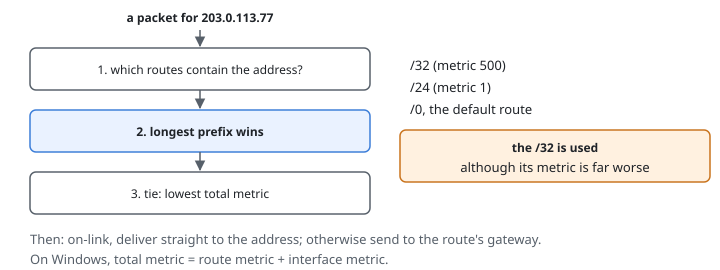

*Draft for owner review.* Every machine, even a laptop, makes a routing decision for every packet it sends: deliver it directly, or hand it to a router. Most "I can reach the printer but not the internet" faults are a wrong answer to that one question. This lesson teaches you to read the table that holds the answer, predict where a packet will go, and change the table safely.

**What was tested.** The sections marked *measured* come from the **Windows Server 2022** and **AlmaLinux 9.8** lab VMs (`tests/verification/powershell/route1.ps1`, `tests/verification/bash/route1.sh`), on their virtual network. Other addresses and outputs are samples that show the layout. `tracert` was not tested.

## What a router does

A **router** connects networks and forwards packets between them ([RFC 1812](https://www.rfc-editor.org/rfc/rfc1812) is the formal requirements document for IPv4 routers; [RFC 1122](https://www.rfc-editor.org/rfc/rfc1122) covers what ordinary hosts must do). A router has an address on each network it joins. A packet's destination address never changes along the way; at each hop the router picks the **next hop** and re-sends it.

Your PC is a small router of one decision. For each destination it asks: **is this address on a network I am directly connected to?**

- **Yes (on-link):** send straight to it, finding its hardware address with ARP.
- **No:** send to the **default gateway**, which is a router on your own network, and let it deal with the rest.

You met the "same network?" test in the subnetting lesson: apply your own mask to your address and to the destination. The routing table is that test written down, with exceptions.

## The routing table

### Windows

`route print` (or the PowerShell cmdlet [`Get-NetRoute`](https://learn.microsoft.com/powershell/module/nettcpip/get-netroute)) shows it. The IPv4 part of `route print -4`, trimmed, with sample addresses:

```
IPv4 Route Table
===========================================================================
Active Routes:
Network Destination        Netmask          Gateway       Interface  Metric
          0.0.0.0          0.0.0.0      192.168.1.1     192.168.1.20     55
        127.0.0.0        255.0.0.0         On-link         127.0.0.1    331
      192.168.1.0    255.255.255.0         On-link      192.168.1.20    311
     192.168.1.20  255.255.255.255         On-link      192.168.1.20    311
    192.168.1.255  255.255.255.255         On-link      192.168.1.20    311
===========================================================================
```

Each row is one route: a **destination network**, its **netmask**, a **gateway** (the next hop, or `On-link` for "deliver directly"), the **interface** (our own address on the link used) and a **metric** (a cost; lower wins).

Reading the rows:

| Row | Meaning |
|---|---|
| `0.0.0.0` / `0.0.0.0` via `192.168.1.1` | the **default route**: any destination not matched by anything better goes to the gateway |
| `192.168.1.0` / `255.255.255.0` `On-link` | the local subnet; deliver directly |
| `192.168.1.20` / `255.255.255.255` | a /32 host route for this machine's own address |
| `192.168.1.255` / `255.255.255.255` | the subnet's broadcast address |
| `127.0.0.0` / `255.0.0.0` | loopback; traffic to yourself never leaves the machine |

The PowerShell view of the same information:

```
Get-NetRoute -AddressFamily IPv4 | Format-Table DestinationPrefix,NextHop,RouteMetric,InterfaceAlias

DestinationPrefix NextHop     RouteMetric InterfaceAlias
----------------- -------     ----------- --------------
0.0.0.0/0         192.168.1.1          25 Wi-Fi
192.168.1.0/24    0.0.0.0             281 Wi-Fi
```

PowerShell writes the route as a **prefix** (`0.0.0.0/0`, `192.168.1.0/24`) and uses `0.0.0.0` as the next hop for an on-link route. Same data, different notation.

**The two metrics are not the same number (measured).** On Windows each interface has a metric too. `route print` shows the **sum**; `Get-NetRoute`'s `RouteMetric` is only **one part**:

```text
route print:   0.0.0.0   0.0.0.0   10.0.2.2   10.0.2.15   25

DestinationPrefix NextHop  RouteMetric IfMetric
10.0.2.0/24       0.0.0.0          256       25
0.0.0.0/0         10.0.2.2           0       25        <- 0 + 25 = the 25 above
```

So **sorting `Get-NetRoute` by `RouteMetric` alone can put the wrong route first** when there are several adapters. To compare, add the interface's metric:

```powershell
Get-NetRoute -DestinationPrefix 0.0.0.0/0 |
    Select-Object NextHop, InterfaceAlias, RouteMetric,
        @{ n = 'Total'; e = { $_.RouteMetric + (Get-NetIPInterface -InterfaceIndex $_.ifIndex -AddressFamily IPv4).InterfaceMetric } } |
    Sort-Object Total
```

### Linux

```
ip route show
default via 192.168.1.1 dev wlan0 proto dhcp src 192.168.1.20 metric 600
192.168.1.0/24 dev wlan0 proto kernel scope link src 192.168.1.20 metric 600
```

`default via 192.168.1.1` is the default route. A line with no `via` is on-link. `proto dhcp` says the route came from DHCP and `proto kernel` that the kernel added it for a connected network. `ip route get 8.8.8.8` asks the kernel which route it would pick for one destination, which is more reliable than guessing from the table. See [ip-route(8)](https://man7.org/linux/man-pages/man8/ip-route.8.html) and [ip(8)](https://man7.org/linux/man-pages/man8/ip.8.html).

## Choosing between routes

Several rows can match the same destination. The rules, in order:

1. **Longest prefix wins.** The most specific matching route is used. A `/24` beats a `/16`, and anything beats the default route `/0`.
2. If two matching routes have the **same prefix length**, the lowest **metric** wins.

Example table (Linux notation):

```
default via 192.168.1.1
10.0.0.0/8 via 192.168.1.2
10.20.0.0/16 via 192.168.1.3
192.168.1.0/24 dev eth0
```

| Destination | Matching routes | Used |
|---|---|---|
| `10.20.5.9` | `10.20.0.0/16`, `10.0.0.0/8`, default | `10.20.0.0/16` via `192.168.1.3` (longest prefix, /16) |
| `10.99.1.1` | `10.0.0.0/8`, default | `10.0.0.0/8` via `192.168.1.2` |
| `192.168.1.77` | `192.168.1.0/24`, default | `192.168.1.0/24`, on-link |
| `8.8.8.8` | default only | the default gateway `192.168.1.1` |

A **metric** is a cost. Windows computes automatic metrics from link speed, so a faster adapter gets a lower number and wins; that is why plugging in Ethernet while on Wi-Fi quietly moves your traffic. You can set a metric by hand when you want to force a preference.



```text
 routes containing the address -> LONGEST PREFIX -> (tie only) lowest total metric
 /32 metric 500  beats  /24 metric 1
```

### Ask the system which route it would use (measured)

Do not work it out by eye when the machine will tell you. Linux: `ip route get <address>`. Windows: [`Find-NetRoute`](https://learn.microsoft.com/powershell/module/nettcpip/find-netroute):

```powershell
Find-NetRoute -RemoteIPAddress 1.1.1.1 | Select-Object IPAddress, DestinationPrefix, NextHop, InterfaceAlias
```

It returns **two** objects: the **source address** that would be used, and the **route**:

```text
IPAddress DestinationPrefix NextHop  InterfaceAlias
10.0.2.15                            Ethernet
          0.0.0.0/0         10.0.2.2 Ethernet
```

For `10.0.2.3` the route was `10.0.2.0/24` with next hop `0.0.0.0` (on-link); on Linux, `ip route get 10.0.2.3` showed no `via`, and `ip route get 1.1.1.1` showed `via 10.0.2.2`.

I added two routes to test the order, a `/24` with metric 1 and a `/32` **inside it** with metric 500. Both systems chose the **`/32`** for its address and the `/24` for the address next to it.

## The default gateway must be on your subnet

The gateway is reached by direct delivery, so it **must be inside the local network**. With `192.168.1.20/24` a gateway of `192.168.2.1` cannot work: the machine would have to route to the gateway to reach the gateway. This is the classic result of a typo in a static configuration, and of a wrong mask. The symptom is distinctive: the machine reaches everything on its own subnet and nothing beyond it.

### What each system does with a bad gateway (measured)

**A gateway outside your subnet.**

| System | What happened |
|---|---|
| Linux (`ip route add ... via 192.168.1.3` on `10.0.2.15/24`) | Refused: `Error: Nexthop has invalid gateway.` |
| Windows Server 2022 (`route add ... 192.168.1.3`) | **Accepted**: printed `OK!`, exit code 0, and the route appeared in `Get-NetRoute` |

So on Windows, **`OK!` does not mean the gateway makes sense**. Check it against your own subnet.

**A gateway inside the subnet that does not exist.** I pointed a route for the single address `1.1.1.1` at `10.0.2.50`, where nothing was:

- Linux: `ping` lost **every** packet, and the neighbour table showed why: `10.0.2.50 dev eth0 INCOMPLETE`, meaning no machine answered when asked for that address's hardware (MAC) address. Working neighbours showed `REACHABLE`.
- Windows: the first ping **timed out**, and the **second received a reply**, although `Find-NetRoute` still showed the route via `10.0.2.50`. I did not find out why. The lesson to keep: **one successful ping does not prove a route is right.** Send several, and check which route is chosen.

Addresses reached by other routes went on working. On Linux, `ip neigh` (Windows: `arp -a`) is the check for "is anything really there at the gateway's address?"

A **blackhole** route (`ip route add blackhole 203.0.113.0/24`) throws traffic away on purpose. `ip route get` and `ping` to such an address answered `Invalid argument`, which does not sound like a routing message at all.

## TTL and traceroute

Every IP packet carries a **TTL** (time to live) field that each router decreases by one. A router that receives a packet with TTL 1 discards it and sends back an ICMP "time exceeded" message ([RFC 792](https://www.rfc-editor.org/rfc/rfc792)). This stops packets circling in routing loops.

`tracert` (Windows) and `traceroute` (Linux) exploit that. They send probes with TTL 1, 2, 3 and so on, and each router that discards one reveals itself:

```
tracert -d 8.8.8.8

Tracing route to 8.8.8.8 over a maximum of 30 hops

  1     2 ms     1 ms     2 ms  192.168.1.1
  2     9 ms     8 ms     9 ms  100.64.0.1
  3    11 ms    10 ms    10 ms  203.0.113.5
  4     *        *        *     Request timed out.
  5    14 ms    13 ms    13 ms  8.8.8.8

Trace complete.
```

`-d` skips reverse DNS and makes it much faster. See [tracert](https://learn.microsoft.com/windows-server/administration/windows-commands/tracert) and [traceroute(8)](https://man7.org/linux/man-pages/man8/traceroute.8.html); [`pathping`](https://learn.microsoft.com/windows-server/administration/windows-commands/pathping) adds loss statistics per hop but takes minutes.

How to read it:

- **Hop 1 is your gateway.** If hop 1 fails, the problem is local.
- **`* * *` in the middle** with later hops answering is normal: that router just does not reply to probes. Only worry if everything after a point is silent.
- **Latency that jumps and stays high** after one hop marks where the slow link is.
- A **repeating pair of addresses** is a routing loop.

PowerShell offers `Test-NetConnection -TraceRoute`. See [Test-NetConnection](https://learn.microsoft.com/powershell/module/nettcpip/test-netconnection).

## Private addresses and NAT

Private ranges ([RFC 1918](https://www.rfc-editor.org/rfc/rfc1918): `10.0.0.0/8`, `172.16.0.0/12`, `192.168.0.0/16`) are not routed on the internet. A home or office router performs **NAT** ([RFC 3022](https://www.rfc-editor.org/rfc/rfc3022)): it rewrites outgoing packets to use its own public address and keeps a table to send replies back. Consequences: inside machines are not reachable from outside unless you forward a port, and a traceroute shows the NAT router as an early hop with a private address.

## Changing routes

You rarely need to. Reach for a static route when a second router leads to a network the default gateway does not know about (a lab network behind another router, a VPN's internal subnet).

### Windows

```
route add 10.20.0.0 mask 255.255.0.0 192.168.1.3
route delete 10.20.0.0
```

or in PowerShell (elevated):

```
New-NetRoute -DestinationPrefix 10.20.0.0/16 -NextHop 192.168.1.3 -InterfaceAlias "Ethernet"
Remove-NetRoute -DestinationPrefix 10.20.0.0/16 -Confirm:$false
```

Both need an elevated session. See [route](https://learn.microsoft.com/windows-server/administration/windows-commands/route_ws2008), [New-NetRoute](https://learn.microsoft.com/powershell/module/nettcpip/new-netroute) and [Remove-NetRoute](https://learn.microsoft.com/powershell/module/nettcpip/remove-netroute).

**Will it survive a restart? The two tools have opposite defaults (measured).** I counted the route in the persistent store after each command:

| Command | In the persistent store? |
|---|---|
| `New-NetRoute` (no `-PolicyStore`) | **Yes** (and active) |
| `route add` | **No** |
| `route -p add` | Yes (listed under `Persistent Routes` in `route print`) |
| `New-NetRoute -PolicyStore ActiveStore` | (use this for a temporary route) |

`Remove-NetRoute` removed it from both stores. So a "quick temporary test" with `New-NetRoute` **stays on the machine** unless you remove it. I did not restart the VM to watch them come back.

### Linux

```
sudo ip route add 10.20.0.0/16 via 192.168.1.3
sudo ip route del 10.20.0.0/16
```

**Tested** (Ubuntu 24.04.5, 2026-11-22; `tests/verification/networking/nl1.sh`). The gateway must be **on a network the machine is directly attached to**. On a lab VM whose address was `10.0.2.15/24`, `ip route add 10.20.0.0/16 via 192.168.1.3` failed with `Error: Nexthop has invalid gateway.` (exit status 2), and the later `ip route del` said `RTNETLINK answers: No such process`, because nothing had been added. Substitute a gateway on your own subnet; with the VM's own default gateway (`10.0.2.2`) the add worked silently, `ip route show 10.20.0.0/16` printed `10.20.0.0/16 via 10.0.2.2 dev enp0s3`, and `ip route del` removed it. AlmaLinux 9.8 gave the same `invalid gateway` error. I did not test that the route vanishes at reboot.

Routes added with `ip route add` are **not saved**; they vanish at reboot or when the interface restarts. To keep one, put it in the network manager (for NetworkManager, the connection's `ipv4.routes` property) rather than a script that you will forget.

### Safe habits

- **Do not change the default route over a remote session.** Deleting or replacing it can cut the session that you are using to repair it.
- **Prove a new route** with `tracert` / `traceroute` to a host behind it, and check hop 1.
- **Remove temporary routes** when finished, and write down any permanent ones.

## Troubleshooting by symptom

| Symptom | Likely cause | Check |
|---|---|---|
| reaches the local subnet, nothing beyond | no default gateway, or a gateway outside the subnet | `route print` or `ip route`: is there a `0.0.0.0` / `default` row, and is its gateway inside your subnet? |
| reaches the internet, but not one remote subnet | missing static route for that subnet | `route print` for that destination; ask `ip route get` |
| internet works by address, fails by name | not routing: DNS | the DNS lesson |
| one-way traffic: requests arrive, replies vanish | the remote end has no route back to you | trace from the other side |
| traffic goes out the "wrong" adapter | two default routes; the lower metric wins | compare the metrics of both `0.0.0.0` rows |
| long delays then failure with hops repeating | routing loop | `tracert` shows the same addresses repeating |
| hop 1 never answers | local link or gateway down | the gateway's own address with `ping` |

## Common mistakes

- **Two default gateways** on one machine (Wi-Fi and Ethernet, or a VM adapter), so traffic takes a path you did not choose.
- **A gateway not inside the subnet**, usually from a mask typo.
- **Adding a route and not proving it.**
- **Assuming `route add` is permanent on Windows.** Without `/p` it is lost when TCP/IP restarts.
- **Expecting `ip route add` to survive a reboot on Linux.** It does not.
- **Reading `* * *` as "broken"** when later hops still answer.
- **Comparing Windows routes by `RouteMetric` alone.**
- **Taking `OK!` from `route add` as proof** that the route works.
- **Leaving a "temporary" `New-NetRoute` behind.**

## Check yourself

1. A machine has `192.168.1.20/24`. Is `192.168.2.5` on-link? Where does the packet go?
2. Two routes match a destination: `10.0.0.0/8` (metric 10) and `10.20.0.0/16` (metric 500). Which wins, and why?
3. A PC can reach its own subnet but nothing else. Which row of the routing table do you check first?
4. What does a router do with a packet whose TTL reaches zero?
5. Why does `tracert -d` finish so much faster than `tracert`?
6. You add a route with `ip route add` on Linux. What happens at the next reboot?

**Answers.** (1) No: with `/24` the network is `192.168.1.0`, and `192.168.2.5` is elsewhere, so the packet goes to the default gateway. (2) `10.20.0.0/16`: longest prefix wins before metric is considered. (3) The default route, `0.0.0.0` / `default`: is it present, and is its gateway inside the subnet? (4) It discards the packet and sends an ICMP time-exceeded message to the sender. (5) `-d` skips the reverse-DNS lookup of each hop, which can wait for a timeout per hop. (6) The route is gone; it was never saved.

## Practice

The lab `labs.gateway-route-override` covers a wrong default gateway on a Windows VM, and its fix. Before running it, read the VM's routing table with `route print -4` and predict which row is wrong; afterwards record the first hop in a `tracert` to an outside address.
