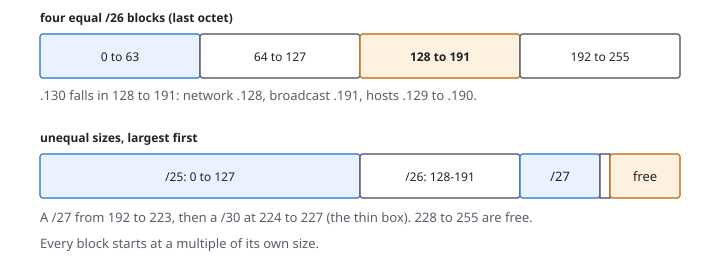

*Draft for owner review.* Every network problem that starts "it can reach some machines but not others" needs one skill: looking at an address and a mask and knowing who is on the same network. That skill is subnetting. It looks like maths, but with a handful of numbers memorised it is quick and mechanical, and you can check every answer with a built-in tool.

Addresses here are samples from private and documentation ranges. The worked answers were checked with a small calculator in Windows PowerShell 5.1 and 7.6 (`tests/verification/powershell/subnet1.ps1`), and the different-masks case was run in an AlmaLinux 9.8 lab VM (`tests/verification/networking/mask1.sh`).

## An address and a mask

An IPv4 address is 32 bits, written as four **octets** (8 bits each) in decimal: `192.168.1.130`. It has two parts: a **network** part that names the network, and a **host** part that names the machine on it. The **subnet mask** says where the split is. Wherever the mask has a 1 bit, that bit belongs to the network.

The mask is written two ways, and you must read both:

- **Dotted decimal**: `255.255.255.0`
- **Prefix length** (CIDR, [RFC 4632](https://www.rfc-editor.org/rfc/rfc4632)): `/24`, the number of 1 bits. `255.255.255.0` is 24 ones followed by 8 zeros.

```
192.168.1.130   = 11000000.10101000.00000001.10000010
255.255.255.192 = 11111111.11111111.11111111.11000000     (/26)
network part    = first 26 bits        host part = last 6 bits
```

Masks are always a run of ones followed by zeros, so only a few octet values are possible. Learn them:

| Octet value | 128 | 192 | 224 | 240 | 248 | 252 | 254 | 255 |
|---|---|---|---|---|---|---|---|---|
| Ones in octet | 1 | 2 | 3 | 4 | 5 | 6 | 7 | 8 |

And the prefixes you will meet most:

| Prefix | Mask | Addresses | Usable hosts |
|---|---|---|---|
| /8 | 255.0.0.0 | 16,777,216 | 16,777,214 |
| /16 | 255.255.0.0 | 65,536 | 65,534 |
| /24 | 255.255.255.0 | 256 | 254 |
| /25 | 255.255.255.128 | 128 | 126 |
| /26 | 255.255.255.192 | 64 | 62 |
| /27 | 255.255.255.224 | 32 | 30 |
| /28 | 255.255.255.240 | 16 | 14 |
| /29 | 255.255.255.248 | 8 | 6 |
| /30 | 255.255.255.252 | 4 | 2 |

**Usable hosts = 2 to the power of (32 minus prefix), minus 2.** The two removed addresses are reserved in every subnet:

- the **network address**: all host bits 0. It names the subnet itself.
- the **broadcast address**: all host bits 1. A packet sent to it goes to every host on the subnet.

(A `/31` is allowed for point-to-point links ([RFC 3021](https://www.rfc-editor.org/rfc/rfc3021)) and uses both addresses, and a `/32` is a single host. You will see both on routers.)

## The block-size method

You do not need binary to find a subnet. Look at the one octet where the mask is neither 255 nor 0 (the **interesting octet**) and use the **block size**: 256 minus the mask value in that octet.

| Mask octet | 128 | 192 | 224 | 240 | 248 | 252 |
|---|---|---|---|---|---|---|
| Block size | 128 | 64 | 32 | 16 | 8 | 4 |

Subnets start at multiples of the block size. Find the multiple at or below your address; that is the network address. The broadcast address is the next multiple minus 1.

### Worked example 1: 192.168.1.130/26

The mask is `255.255.255.192`. The interesting octet is the last (192), so the block size is 256 - 192 = 64. Subnets start at 0, 64, 128, 192. The address ends in 130, which is at or above 128 and below 192.

| | |
|---|---|
| Network address | 192.168.1.128 |
| Broadcast address | 192.168.1.191 |
| Usable range | 192.168.1.129 to 192.168.1.190 |
| Usable hosts | 62 |

### Worked example 2: 172.16.45.200/21

A `/21` mask is `255.255.248.0`. The interesting octet is the *third* (248), so the block size is 256 - 248 = 8 and it applies to the third number. Subnets in the third octet start at 0, 8, 16, ... 40, 48. The address has 45 there, so it sits in the block starting at 40.

| | |
|---|---|
| Network address | 172.16.40.0 |
| Broadcast address | 172.16.47.255 |
| Usable range | 172.16.40.1 to 172.16.47.254 |
| Usable hosts | 2,046 (2 to the 11th, minus 2) |

Notice the broadcast ends in `.255` and spans into the next third-octet value: the "next multiple minus 1" applies to the interesting octet, and all octets after it become 255.



```text
 /26 blocks:  | 0-63 | 64-127 | 128-191 | 192-255 |        .130 is in 128-191
 unequal:     |     0-127     | 128-191 | 192-223 |224-227| 228-255 free
```

## Check your answer with the system

You can ask PowerShell to do the binary AND of an address and a mask. The result is the network address:

```
$ip   = [IPAddress]'192.168.1.130'
$mask = [IPAddress]'255.255.255.192'
([IPAddress]($ip.Address -band $mask.Address)).IPAddressToString
192.168.1.128
```

That matches example 1. This works for IPv4 only. (Computing the broadcast with a bitwise NOT overflows in PowerShell, so use the block-size method for that.)

For the broadcast and range too, do the same arithmetic on whole numbers:

```powershell
function Get-Subnet([string]$Cidr) {
    $address, $prefix = $Cidr -split '/'
    $b = ([Net.IPAddress]$address).GetAddressBytes(); [array]::Reverse($b)
    $ip = [uint64][BitConverter]::ToUInt32($b, 0)
    $size = [uint64][math]::Pow(2, 32 - [int]$prefix)
    $network = $ip - ($ip % $size)                      # round down to a multiple of the block size
    function Dotted([uint64]$v) { (24, 16, 8, 0 | ForEach-Object { [math]::Floor($v / [math]::Pow(2, $_)) % 256 }) -join '.' }
    [pscustomobject]@{ Network = Dotted $network; Broadcast = Dotted ($network + $size - 1); Hosts = $size - 2 }
}
Get-Subnet 172.16.45.200/21        # Network 172.16.40.0, Broadcast 172.16.47.255, Hosts 2046
```

Look at its one real step, `$ip - ($ip % $size)`: it **is** the block-size method. (It is not meant for `/31` or `/32`.)

On Linux, `ipcalc` (see `man ipcalc`) does it where installed. It was present on the AlmaLinux image, though versions differ between distributions:

```text
$ ipcalc -n -b -m 172.16.45.200/21
NETMASK=255.255.248.0
BROADCAST=172.16.47.255
NETWORK=172.16.40.0
```

**Use a calculator to check, not instead of understanding:** in a fault you need to see at a glance whether two addresses share a network.

To see the mask a machine really uses ([`Get-NetIPAddress`](https://learn.microsoft.com/powershell/module/nettcpip/get-netipaddress)):

```
Get-NetIPAddress -AddressFamily IPv4 | Format-Table InterfaceAlias, IPAddress, PrefixLength

InterfaceAlias IPAddress      PrefixLength
-------------- ---------      ------------
Wi-Fi          192.168.1.20             24
Loopback ...   127.0.0.1                 8
```

[`ipconfig`](https://learn.microsoft.com/windows-server/administration/windows-commands/ipconfig) prints the same thing as a dotted mask (`Subnet Mask . . . : 255.255.255.0`). On Linux:

```
ip -br addr

lo               UNKNOWN        127.0.0.1/8 ::1/128
eth0             UP             192.168.1.20/24 fe80::a00:27ff:fe4e:66a1/64
```

`-br` is brief form. Here the prefix is written after a slash, so you read the mask straight from the address.

## Same network or not?

Before a host sends anything, it ANDs the destination with its **own** mask and compares the result to its own network address. Same network: send directly, by finding the destination's MAC with ARP. Different network: send to the **default gateway** (the router) instead.

This is why a **wrong mask** causes strange failures. Take two hosts:

- A is `192.168.1.20` with mask `255.255.255.0` (`/24`). It thinks `192.168.1.200` is local.
- B is `192.168.1.200` with mask `255.255.255.128` (`/25`). B's network is `192.168.1.128/25`, so B thinks `192.168.1.20` is **not** local and sends its replies to the gateway.

A sends directly to B; B answers via the router, or not at all if there is no route. One side works, the other does not, and traffic may flow one way only. When two hosts disagree, compare their masks first.

**Measured, with no router at all:** I connected two hosts with those two settings.

| Question | Answer |
|---|---|
| A: `ip route get 192.168.1.200` | `dev vea`: local, send directly |
| B: `ip route get 192.168.1.20` | `Network is unreachable` |
| A pings B | 100 % loss |
| What B received | A's `ARP, Request who-has 192.168.1.200` |
| What B sent back | **Nothing**, not even an ARP reply |
| After giving B a `/24` | Replies arrive |

So here it did not get as far as a one-way ping: A never learned B's hardware address, because B, with no route back to A, did not answer. From A this looks like **"the host is down"**, although it is up, connected and received the question. (Other operating systems, or a router on the wire, can behave differently.)

## Special ranges

| Range | Name | Meaning |
|---|---|---|
| 10.0.0.0/8 | private | not routed on the internet; large networks |
| 172.16.0.0/12 | private | 172.16.0.0 to 172.31.255.255 |
| 192.168.0.0/16 | private | home and small office |
| 127.0.0.0/8 | loopback | this machine talking to itself; `127.0.0.1` |
| 169.254.0.0/16 | link-local (APIPA) | a machine's self-chosen address when DHCP did not answer |
| 224.0.0.0/4 | multicast | one sender, a group of receivers |
| 0.0.0.0 | "any" or "this host" | as a route, `0.0.0.0/0` is the default route |
| 192.0.2.0, 198.51.100.0, 203.0.113.0 (each /24) | documentation ([RFC 5737](https://www.rfc-editor.org/rfc/rfc5737)) | for examples like these; never on real networks |

Private addresses ([RFC 1918](https://www.rfc-editor.org/rfc/rfc1918)) reach the internet through **NAT** (network address translation, [RFC 3022](https://www.rfc-editor.org/rfc/rfc3022)), where a router rewrites them to its own public address. Because many sites reuse the same private ranges, two private networks that join (a VPN between offices) must not overlap.

An address in `169.254.0.0/16` ([RFC 3927](https://www.rfc-editor.org/rfc/rfc3927)) is a clue, not a fix: the machine did not hear from a DHCP server. The `networking.dhcp` lesson picks that up.

## Splitting a network

To divide a block into equal subnets, borrow host bits. Each borrowed bit doubles the number of subnets and halves each one's size.

Split `192.168.1.0/24` into four equal subnets: you need 2 bits (2 to the 2nd is 4), so the prefix grows from `/24` to `/26`, block size 64:

| Subnet | Network | Usable range | Broadcast |
|---|---|---|---|
| 1 | 192.168.1.0/26 | .1 to .62 | .63 |
| 2 | 192.168.1.64/26 | .65 to .126 | .127 |
| 3 | 192.168.1.128/26 | .129 to .190 | .191 |
| 4 | 192.168.1.192/26 | .193 to .254 | .255 |

For a different need, ask "how many hosts?": for 50 hosts you need at least 52 addresses, which means a block of 64 (`/26`). A block of 32 (`/27`, 30 usable) is too small. Always round up to the next power of two, and remember the two reserved addresses.

### Different sizes: largest first

Real networks need blocks of **different** sizes (this is **VLSM**, variable-length subnet masks). The rule that avoids mistakes: **place the largest first, and start every block at a multiple of its own size.**

`192.168.1.0/24` for 100 office PCs, 50 phones, 25 printers and one router-to-router link:

| Need | Smallest block | Subnet | Range of the block | Usable |
|---|---|---|---|---|
| 100 | 128 (`/25`) | `192.168.1.0/25` | .0 to .127 | 126 |
| 50 | 64 (`/26`) | `192.168.1.128/26` | .128 to .191 | 62 |
| 25 | 32 (`/27`) | `192.168.1.192/27` | .192 to .223 | 30 |
| 2 | 4 (`/30`) | `192.168.1.224/30` | .224 to .227 | 2 |

`.228` to `.255` remain free for growth.

**Not every address can start a block.** `192.168.1.96/26` is not a subnet: blocks of 64 start at 0, 64, 128 and 192, so 96 is a **host inside `192.168.1.64/26`**. If a plan or a command gives a "network address" that is not a multiple of the block size, something is wrong.

## IPv6 in one page

IPv6 addresses ([RFC 4291](https://www.rfc-editor.org/rfc/rfc4291)) are 128 bits, written as eight groups of four hexadecimal digits separated by colons: `2001:0db8:0000:0000:0000:0000:0000:0001`. Two rules shorten them: drop leading zeros in a group, and replace **one** run of all-zero groups with `::`. That address becomes `2001:db8::1`. The prefix length works the same way as in IPv4 (`/64` is the usual size of one subnet).

| Prefix | Type | Meaning |
|---|---|---|
| `::1/128` | loopback | this machine |
| `fe80::/10` | link-local | every interface has one; works on the local link only; not routed |
| `2000::/3` | global unicast | routable internet addresses |
| `fc00::/7` (in practice `fd00::/8`) | unique local | the IPv6 counterpart of private addresses |
| `ff00::/8` | multicast | groups; IPv6 has **no broadcast** |
| `2001:db8::/32` | documentation | examples only |

You will see the link-local address in `ipconfig` output, followed by `%` and a number that identifies the interface: `fe80::8076:7428:c04a:3a1f%15`. The `%15` is the interface index, needed because every interface has an `fe80::` address, so the address alone is ambiguous.

IPv6 replaces ARP with **Neighbor Discovery** ([RFC 4861](https://www.rfc-editor.org/rfc/rfc4861)), and hosts usually configure themselves with **SLAAC** ([RFC 4862](https://www.rfc-editor.org/rfc/rfc4862)) (they build their own address from the router's announced prefix), so you rarely type IPv6 addresses by hand. Both IPv4 and IPv6 are usually active together ("dual stack"); if a name resolves to both, your computer usually prefers IPv6, which is one reason a broken IPv6 setup makes sites slow even though IPv4 works.

## Common mistakes

- **Counting the network and broadcast addresses as hosts.** Subtract two.
- **Using the block size on the wrong octet.** Find the octet where the mask is neither 255 nor 0.
- **Assuming a gateway can be anywhere.** A host's default gateway must be an address inside its own subnet, or the host cannot even reach it.
- **Trusting only the address.** Two hosts can have addresses that look like neighbours and still be on different subnets. Read the mask.
- **Overlapping subnets.** Two interfaces on one router in overlapping ranges make routing ambiguous.
- **Typing `/255.255.255.0` or `255.255.255.0/24`.** Use one form or the other.

## Check yourself

Work these without a calculator, then check with the PowerShell snippet above (for the network address) or by reasoning with block sizes.

1. `10.20.30.40/24`: network, broadcast, usable range.
2. `192.168.5.77/27`: network, broadcast, usable range, number of hosts.
3. `172.31.9.130/25`: network, broadcast, usable range.
4. Can `192.168.10.62/26` talk directly to `192.168.10.65/26`?
5. `10.0.12.201/22`: network, broadcast, number of usable hosts.
6. You need a subnet for 100 devices. What is the smallest prefix that fits? How many would be left over?
7. A machine in `192.168.0.0/16` space has the address `169.254.18.7`. What most likely happened?
8. Is `10.1.1.40/27` a network address? If not, which subnet is it in?

**Answers.**

1. Network `10.20.30.0`, broadcast `10.20.30.255`, usable `10.20.30.1` to `10.20.30.254`.
2. `/27` has block size 32. 77 falls in the block starting at 64. Network `192.168.5.64`, broadcast `192.168.5.95`, usable `192.168.5.65` to `192.168.5.94`, 30 hosts.
3. `/25` has block size 128. 130 is in the block starting at 128. Network `172.31.9.128`, broadcast `172.31.9.255`, usable `172.31.9.129` to `172.31.9.254`.
4. No. `/26` block size 64: 62 is in `192.168.10.0` to `.63`, and 65 is in `.64` to `.127`. They are on different subnets, so traffic needs a router.
5. `/22` mask is `255.255.252.0`, block size 4 in the third octet. 12 is a multiple of 4, so the network is `10.0.12.0` and the broadcast is `10.0.15.255`. Usable hosts: 2 to the 10th, minus 2 = 1,022.
6. 100 plus 2 reserved needs at least 102 addresses, so a block of 128: `/25` (126 usable). 26 usable addresses would be left over.
7. The machine asked for an address by DHCP and got no answer, so it gave itself a link-local `169.254.x.x` address. Look at the DHCP server, the network path to it, and the cable or Wi-Fi.
8. No: blocks of 32 start at 0, 32, 64 and so on. It is a host in `10.1.1.32/27`.

## Practice

The labs for this track put these ideas under pressure: a wrong default gateway (`labs.gateway-route-override`) and a bad DNS server (`labs.dns-broken`) are both found faster once you can read an address and mask at a glance. Before starting either, write down the machine's address, prefix and gateway, and say which addresses are on its local network.
