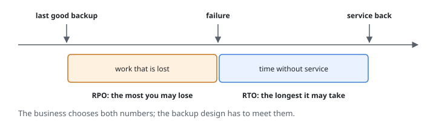
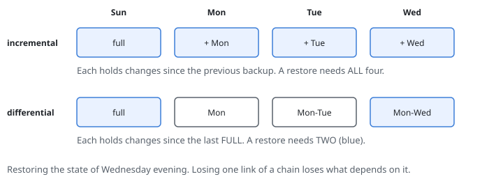

*Draft for owner review.* Technical skill gets a fault fixed; **procedure** keeps the fix from causing the next one, and lets someone else follow what you did. These habits separate an administrator from someone who knows commands. Each section has a worked example to copy.

**What was tested.** The backup and restore experiment was run on Windows in Windows PowerShell 5.1 and PowerShell 7.6.10 (`tests/verification/powershell/restore1.ps1`). The record, change request and other examples are **invented to show the shape**; they are not from a real system. Safety and disposal rules differ by country and workplace: yours take priority.

## Documentation

Write **while** you work, not afterwards: afterwards you remember a tidier story than what happened. A **problem record** answers four questions:

- what the problem was, **in the user's words** and in yours
- what you checked, **in order**, and what each check **showed**
- what you **changed**, on which machine, at what time
- how you **confirmed** it was fixed, and how to **undo** the change

### A weak record and a useful one

Weak:

```text
Printing broken. Fixed the spooler. Works now.
```

It cannot answer any follow-up: broken how, for whom, what was changed, and what to do when it happens again.

Useful:

```text
Reported : 09:05, user: "nothing prints since this morning"
Observed : PC-014, all printers; jobs stay in the queue
Scope    : one PC; a colleague prints to the same printer
Checked  : 09:12 printer answers ping and its status page shows ready
           09:15 Get-Service Spooler -> Stopped, StartType Disabled
           09:18 System log: start type changed yesterday 17:40
Changed  : 09:21 PC-014: Spooler start type Disabled -> Automatic; started it
Verified : 09:23 user printed a page; service Running after a restart at 09:30
Undo     : Set-Service Spooler -StartupType Disabled
Open     : who changed the start type yesterday, and why? (assigned to: me)
```

Notice **exact times**, **what each check showed** (not only that you did it), the **old value** before the change, and an **open question**. "It works now" and "we know why" are different claims.

Keep **inventory facts** (hostnames, addresses, owners, warranty, install dates) in one maintained place, not in memory. **Never put passwords or keys in a ticket or a record**, and cut personal data out of logs and screenshots before attaching them.

## Change management

Changing a system that people depend on is a controlled act ([NIST's guide to configuration management](https://csrc.nist.gov/pubs/sp/800/128/upd1/final) describes the idea in depth; IT service frameworks such as [ITIL](https://www.axelos.com/certifications/itil-service-management) call it change enablement):

1. **Request:** what is changing, why, who asked.
2. **Risk assessment:** what could break, who is affected, can it be undone?
3. **Approval** from whoever owns the system.
4. **Plan and back-out plan:** the steps, and how to return to the previous state (a snapshot, a backup, the old setting written down).
5. **Window:** when the impact is smallest, and tell the affected people.
6. **Verify and record:** test the result and close the request.

### A worked change request

```text
What      : move the file server's share to a new, larger volume
Why       : old volume 94 % full; reaches 100 % in about three weeks
Risk      : users cannot open files during the copy; wrong permissions afterwards
Affected  : accounts team (12 people)
Window    : Saturday 08:00-12:00; users told on Tuesday
Steps     : 1. confirm last night's backup restores one chosen file
            2. stop sharing  3. copy with permissions  4. compare counts and hashes
            5. share the new volume  6. test as an ordinary user
Back-out  : the old volume stays untouched; point the share back to it (5 minutes)
Decide by : 11:00. If step 6 has not passed, back out
Success   : an ordinary user opens, saves and deletes a file; permissions match
```

A good back-out plan says **how**, **how long it takes**, and **the time by which you will decide**. "Restore from backup" is not a plan until you know that the restore works and how long it takes. Also note **the point of no return**: here, once users start saving to the new volume, going back loses their new work unless you copy it across.

An **emergency change** skips the queue, **not** the record: get approval from whoever can give it, and write it down.

This course's labs follow the same shape: a snapshot is the back-out plan, and the check is the verification.

## Backups and recovery

The **3-2-1 rule** ([CISA's note on backup options](https://www.cisa.gov/sites/default/files/publications/data_backup_options.pdf)): **three** copies of the data, on **two** kinds of media, **one** of them off-site. Ask one more question: can the account or machine that makes the backups also **delete** them? If it can, so can ransomware that takes over that account. Keep a copy that is offline or cannot be changed.

A **synchronised folder** or a **mirrored disk** (RAID) is **not** a backup: a deletion or an encrypted file is copied too, and a mirror protects only against a failed disk.

### Two numbers the business chooses



```text
 last good backup ----(work lost: limit is the RPO)---- FAILURE ----(downtime: limit is the RTO)---- service back
```

- [**RPO**, recovery point objective](https://csrc.nist.gov/glossary/term/recovery_point_objective): the point in time to which data must be recovered. "We can lose at most four hours of orders" means backups at least every four hours.
- [**RTO**, recovery time objective](https://csrc.nist.gov/glossary/term/recovery_time_objective): how long recovery may take before the harm is unacceptable. If a restore takes nine hours and the RTO is four, the design fails even though every backup is good.

See [NIST SP 800-34](https://csrc.nist.gov/pubs/sp/800/34/r1/upd1/final) for contingency planning.

### Full, incremental and differential

| Kind | Copies | Backup | Restore needs |
|---|---|---|---|
| Full | Everything | Slowest, largest | The one full |
| Incremental | Changes since the **previous backup** of any kind | Small and fast | The full **and every incremental** since |
| Differential | Changes since the **last full** | Grows each day | The full **and the latest differential** |



```text
 incremental : full + Mon + Tue + Wed        (all needed)
 differential: full + latest differential    (two needed)
```

Products use these words in their own ways: read what yours does.

### A restore test finds what the backup hid

**A backup that has never been restored is a hope, not a backup.** I backed up a small folder with PowerShell's [`Compress-Archive`](https://learn.microsoft.com/powershell/module/microsoft.powershell.archive/compress-archive). It held four files, one with the **Hidden** attribute, and an empty folder:

```powershell
Compress-Archive -Path "$src\*" -DestinationPath $zip      # reported success
Expand-Archive -Path $zip -DestinationPath $out
```

Then I compared a list of **paths and hashes** from both sides:

```text
source files: 4   restored files: 3
<= secret.cfg                     (in the source, missing from the restore)
empty folder restored: False
```

**Success, and a file was missing**, in both PowerShell versions. Microsoft documents that `Compress-Archive` **ignores hidden files and folders**. Configuration files are often exactly the hidden ones. Neither "the job succeeded" nor "the archive exists" would have found it.

(When a file was **locked** by another program, the command failed with an error and left no archive. That failure is loud; the hidden file was silent.)

The comparison to reuse ([`Get-FileHash`](https://learn.microsoft.com/powershell/module/microsoft.powershell.utility/get-filehash)):

```powershell
function Get-Manifest($root) {
    Get-ChildItem -LiteralPath $root -Recurse -File -Force | ForEach-Object {   # -Force includes hidden files
        [pscustomobject]@{
            Path = $_.FullName.Substring($root.Length + 1)
            Hash = (Get-FileHash -LiteralPath $_.FullName).Hash
        }
    }
}
Compare-Object (Get-Manifest $src) (Get-Manifest $out) -Property Path, Hash   # no output = same files
```

It compares file contents, **not** permissions, ownership, timestamps or empty folders: test what matters to you. On a live system the source changes after the backup, so compare with a list **made at backup time**.

A **restore test plan**: restore to a **separate** place (never over the original), restore something chosen at random as well as something important, have the application **open** it, **time** it (compare with the RTO), and record the result and date.

## Communication and professionalism

- Tell the user **what you found and what happens next** in plain words.
- **Do not blame**, do not guess aloud, and **do not promise a time** you cannot keep. Promise the next **update** instead, and send it, even to say there is no news.
- Treat what you see on a user's machine as **confidential**, and open only what the job needs.
- Say when something is outside your authority, and **escalate with your problem record attached**.

| Instead of | Say |
|---|---|
| "You must have clicked something." | "The setting was changed. I'm checking how." |
| "It'll be fixed in ten minutes." | "I'll update you by 10:00, sooner if it is fixed." |
| "The DNS resolver cache is poisoned." | "Your computer has wrong address information for that site. I'm clearing it." |
| "Not my job." | "That is handled by the network team. I've passed them what I found; your reference is 4121." |

## Safety and the work environment

- **Power off and unplug** before opening equipment, and follow the maker's instructions. **Do not open power supplies** or old CRT displays: they can hold a dangerous charge after unplugging.
- Use **anti-static** precautions with circuit boards and memory.
- **Lift** with your legs, and get help with heavy items. Tidy cables so nobody trips.
- A **swollen, hot or damaged battery** is a fire risk: stop using it, do not puncture or charge it, and follow your site's procedure.
- Follow local rules for **disposal** of batteries and electronics.
- **Before a disk leaves your control**, its data must be sanitised. Deleting files or a quick format is not enough ([NIST SP 800-88](https://csrc.nist.gov/pubs/sp/800/88/r2/final)).
- **Do not run unfamiliar scripts on a production machine.**

## Scripts and automation as procedure

A script is a written, repeatable procedure, so the same rules apply: keep scripts under **version control**, give them clear names, **test** on a lab machine first, **log** what they change, make them safe to run twice, and offer a preview (`-WhatIf`) before changes. A scheduled script that fails silently is a procedure nobody is following: make failures visible.

## Common mistakes

- **Writing the record afterwards** from memory.
- **Recording what you did, but not what you saw** or the old values.
- **A back-out plan of "restore from backup"** that has never been tried.
- **Trusting the backup job's success message.**
- **Calling a mirror or synced folder a backup.**
- **Promising fix times.**
- **Pasting secrets or personal data** into tickets.

## Check yourself

1. What are the two things a change request needs beyond "what we will do"?
2. Why is an untested backup a risk?
3. What belongs in a problem record that you will hand to another technician?
4. With a full backup on Sunday and incrementals Monday to Wednesday, what is needed to restore Wednesday's state? And with differentials?
5. A backup runs every night. The business can lose at most one hour of data. Is this design good enough?
6. A backup job said "success". Name one way files could still be missing, and how you would find out.

**Expected answers:** (1) a risk assessment and a back-out plan (also approval, a window and verification); (2) you do not know that it can be restored, or that it holds everything, until you need it; (3) the problem in the user's words and yours, what was checked in order and what each check showed, what changed where and when (with old values), how it was verified and how to undo it, and open questions; (4) the full and all three incrementals; the full and Wednesday's differential; (5) no: it can lose up to about a day, which misses an RPO of one hour; (6) for example the tool skipped hidden files; restore to a separate place and compare paths and hashes.
