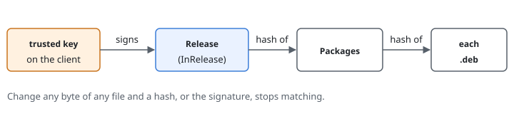

*Draft for owner review.* A **package repository** is a folder of packages plus a signed index that tells clients what is in it. That is all: no database, no special server. If you can put files on a web server, you can publish packages. This lesson builds a complete, **signed** apt (Debian and Ubuntu) repository by hand with standard tools, serves it as static files, installs from it, publishes an update, and then breaks it three ways to see what a client says. It is the first of three format lessons (apt, dnf, apk) followed by one on hosting; the format that matters for Chimera-style distributions is apk, in the third.

**What was tested, and where.** **Ubuntu 24.04.5 LTS** (dpkg **1.22.6**, apt **2.8.4**, GnuPG **2.4.4**), as root, with the repository served from `127.0.0.1` by Python's `http.server`, one tiny package built from nothing, in a throwaway GnuPG home (`tests/verification/repo/rp1.sh`; output is real, the key IDs and hashes shortened or omitted). **Not tested:** other Debian-family systems or releases, **`reprepro`** or **`aptly`** (the tools people use to manage real repositories), more than one architecture or suite, source packages, **`by-hash`** metadata, **`Valid-Until`** (the expiry date of a `Release` file), repository **mirroring**, a repository on a real network, HTTPS, key **rotation**, and what `apt` does with `[trusted=yes]` (a setting that skips signature checks; **do not use it**, I did not test it).

## What is in a repository

Two parts, and clients read them in this order:

1. **The index and its signature**: a small tree under `dists/SUITE/` (the `Release` file lists every index with its hash and size; `InRelease` is the same text wrapped in a signature; `Release.gpg` is a detached signature of it), and one `Packages` file per component and architecture with the package metadata.
2. **The pool**: the `.deb` files, under `pool/`.

The [Debian repository format](https://wiki.debian.org/DebianRepository/Format) wiki page describes all of this (I confirmed it loads and skimmed its structure; I did not read it end to end). The trust chain is: the client trusts **one key**; that key signs `Release`; `Release` holds the hash of `Packages`; `Packages` holds the hash of every `.deb`. Change any byte anywhere and a hash stops matching.



```text
 trusted key --signs--> Release --hash of--> Packages --hash of--> each .deb
```

## Make a signing key

Use a key that exists **only for this repository**, in its own GnuPG home so it never mixes with your personal keys:

```text
$ export GNUPGHOME=/var/tmp/wl-gpg; mkdir -p $GNUPGHOME; chmod 700 $GNUPGHOME
$ gpg --batch --pinentry-mode loopback --passphrase '' --quick-generate-key "WinLab Test Repo <repo@lab.test>" ed25519 sign never
$ gpg --list-keys --keyid-format long
pub   ed25519/169E3A44D3EC0D47 2026-11-22 [SC]
uid           [ultimate] WinLab Test Repo <repo@lab.test>
$ gpg --export > wl-repo.gpg            (binary keyring, 236 bytes: what apt wants)
$ gpg --export --armor > wl-repo.asc    (text form, 400 bytes: what you put on a web page)
```

I used an **empty passphrase and no expiry** because this is a throwaway test key; **a real signing key deserves a passphrase, a plan for expiry and rotation, and a place the build server cannot be robbed of it** (the hosting lesson returns to this). Whoever holds this key can publish anything your clients will trust.

## Build a package and the index

A `.deb` needs a `DEBIAN/control` file and the files to install. `dpkg-deb` ([dpkg-deb(1)](https://manpages.debian.org/stable/dpkg/dpkg-deb.1.en.html)) packs them:

```bash
mkpkg() {   # version
  d=/var/tmp/wl-pkg/wl-hello_$1; mkdir -p $d/DEBIAN $d/usr/bin
  printf '#!/bin/sh\necho "wl-hello %s"\n' "$1" > $d/usr/bin/wl-hello; chmod 755 $d/usr/bin/wl-hello
  printf 'Package: wl-hello\nVersion: %s\nArchitecture: all\nMaintainer: WinLab Test <repo@lab.test>\nDescription: test package %s\n' "$1" "$1" > $d/DEBIAN/control
  dpkg-deb --root-owner-group --build $d $R/pool/main/w/wl-hello/
}
```

(`--root-owner-group` makes the files in the package owned by root regardless of who built it, which is almost always what you want.) Then the index. `dpkg-scanpackages` ([man page](https://manpages.debian.org/stable/dpkg-dev/dpkg-scanpackages.1.en.html)) reads the pool and writes `Packages`; `apt-ftparchive` ([man page](https://manpages.debian.org/stable/apt-utils/apt-ftparchive.1.en.html)) writes `Release`; `gpg` signs it:

```bash
publish() {
  cd $R; mkdir -p dists/stable/main/binary-amd64
  dpkg-scanpackages --arch all pool 2>/dev/null > dists/stable/main/binary-amd64/Packages
  gzip -9fk dists/stable/main/binary-amd64/Packages
  apt-ftparchive -o APT::FTPArchive::Release::Origin=WinLab -o APT::FTPArchive::Release::Label=WinLab \
    -o APT::FTPArchive::Release::Suite=stable -o APT::FTPArchive::Release::Codename=stable \
    -o APT::FTPArchive::Release::Architectures=amd64 -o APT::FTPArchive::Release::Components=main \
    release dists/stable > dists/stable/Release
  gpg --batch --yes --pinentry-mode loopback --passphrase '' -abs -o dists/stable/Release.gpg dists/stable/Release
  gpg --batch --yes --pinentry-mode loopback --passphrase '' --clearsign -o dists/stable/InRelease dists/stable/Release
}
```

The result is eight files:

```text
dists/stable/InRelease
dists/stable/Release
dists/stable/Release.gpg
dists/stable/main/binary-amd64/Packages
dists/stable/main/binary-amd64/Packages.gz
pool/main/w/wl-hello/wl-hello_1.0_all.deb
wl-repo.asc
wl-repo.gpg
```

The `Packages` entry is the package's `control` data plus **where it is, how big and its hashes**:

```text
Package: wl-hello
Version: 1.0
Architecture: all
Maintainer: WinLab Test <repo@lab.test>
Filename: pool/main/w/wl-hello/wl-hello_1.0_all.deb
Size: 534
MD5sum: ddb51e28...
SHA1: 46c85730...
SHA256: 58fd538c1eac4bbe8f6b8215b781cf87324b2f4299ab8123fc216b7fdd67750b
Description: test package 1.0
```

and `Release` lists each index file with sizes and hashes (shortened here):

```text
Architectures: amd64
Codename: stable
Components: main
Origin: WinLab
Suite: stable
SHA256:
 d2017f3fde7d...              343 main/binary-amd64/Packages
 478fa2063437...              287 main/binary-amd64/Packages.gz
```

My `Release` has a `Date` line (added by `apt-ftparchive`) and no `Valid-Until`. A real repository can set `Valid-Until` so that a stale mirror stops being trusted; I did not test it.

## Serve it, and use it

Serve the folder as plain files. This is only for the test (a real server is in the hosting lesson):

```text
$ systemd-run --unit=wl-repo-http --quiet python3 -m http.server 8081 --directory /srv/wl-repo --bind 127.0.0.1
$ curl -s -o /dev/null -w 'Release over http: %{http_code}\n' http://127.0.0.1:8081/dists/stable/Release
Release over http: 200
```

On the client: put the **public key** in `/etc/apt/keyrings/` and write a source that **names that key**:

```text
$ mkdir -p /etc/apt/keyrings; cp wl-repo.gpg /etc/apt/keyrings/wl-repo.gpg
$ cat /etc/apt/sources.list.d/wl-repo.sources
Types: deb
URIs: http://127.0.0.1:8081
Suites: stable
Components: main
Signed-By: /etc/apt/keyrings/wl-repo.gpg
```

`Signed-By` pins **this** key to **this** source: in test (b) below a repository signed by a different key was refused with `NO_PUBKEY`. As I remember it, the older way was a global trusted keyring (`apt-key add`) that trusted a key for every source; I did not test that. The syntax is documented in [sources.list(5)](https://manpages.debian.org/stable/apt/sources.list.5.en.html), whose examples use `Signed-By:` with a keyring path (I looked at those examples; I did not read the page through).

```text
$ apt-get update 2>&1 | grep -E '127.0.0.1|Err'
Get:1 http://127.0.0.1:8081 stable InRelease [1723 B]
Get:2 http://127.0.0.1:8081 stable/main amd64 Packages [287 B]
$ apt-cache policy wl-hello
wl-hello:
  Installed: (none)
  Candidate: 1.0
  Version table:
     1.0 500
        500 http://127.0.0.1:8081 stable/main amd64 Packages
$ apt-get install -y wl-hello
Get:1 http://127.0.0.1:8081 stable/main amd64 wl-hello all 1.0 [534 B]
Setting up wl-hello (1.0) ...
$ wl-hello
wl-hello 1.0
```

Notice what `apt` fetched: the **signed `InRelease`** first, then `Packages` (checked against `Release`), then the `.deb` (checked against `Packages`). The repository's **suite** (`stable`) and **component** (`main`) in the source line are just directory names under `dists/`.

## Publish an update

Build `1.1`, rebuild the index and sign it again. The client sees it on the next update:

```text
$ mkpkg 1.1; publish
$ apt-get update 2>&1 | grep -E '127.0.0.1|Err'
Get:1 http://127.0.0.1:8081 stable InRelease [1723 B]
Get:3 http://127.0.0.1:8081 stable/main amd64 Packages [287 B]
$ apt list --upgradable 2>/dev/null | grep wl-hello
wl-hello/stable 1.1 all [upgradable from: 1.0]
$ apt-get install -y --only-upgrade wl-hello; wl-hello
wl-hello 1.1
```

The old `.deb` stays in the pool until you remove it, but **`dpkg-scanpackages` lists only the newest version by default**: my later health check found one package file listed for a pool holding two. Its `--multiversion` option ("Include all found packages in the output", per the man page) lists them all; I did not test it. Either way, repositories grow unless you prune the pool.

## What the client says when something is wrong

Three deliberate failures, each starting from a working repository. The messages are the real ones; you will meet them in the field.

**(a) The index changed after it was signed.** I appended junk to `Packages.gz` without re-signing. To make `apt` fetch it I first removed its cached copy (`rm /var/lib/apt/lists/127.0.0.1*`): **my first attempt printed nothing, because the cached index was still current and `apt` never downloaded the tampered file**. Then:

```text
Err:2 http://127.0.0.1:8081 stable/main amd64 Packages
  File has unexpected size (315 != 284). Mirror sync in progress?
  Hashes of expected file:
E: Failed to fetch http://127.0.0.1:8081/dists/stable/main/binary-amd64/Packages.gz  File has unexpected size (315 != 284). Mirror sync in progress? ...
E: Some index files failed to download. They have been ignored, or old ones used instead.
```

`Release` (signed) says the file is 284 bytes; the server sent 315. (The 284 here and the 287 in the `Release` excerpt above come from two different runs of the test; I did not look into why the compressed size differed.) "Mirror sync in progress?" is `apt`'s guess at the most **common innocent** cause: a repository being updated while you fetch. That is also the **symptom of a bad publishing order** (see the hosting lesson).

**(b) Signed by a key the client does not trust.** I generated a second key and re-signed with it:

```text
Err:1 http://127.0.0.1:8081 stable InRelease
  The following signatures couldn't be verified because the public key is not available: NO_PUBKEY 4D9C8B1A1B589FCD
W: An error occurred during the signature verification. The repository is not updated and the previous index files will be used. GPG error: http://127.0.0.1:8081 stable InRelease: ...
W: Some index files failed to download. They have been ignored, or old ones used instead.
```

`NO_PUBKEY` with a key ID is the classic message when a repository's key changed or was never installed. The ID tells you **which** key signed it. It is a warning (`W:`) with the previous index kept, so installs from the old list still work, which is why such errors are easy to ignore for months.

**(c) No signature at all.** I removed `InRelease` and `Release.gpg`:

```text
E: The repository 'http://127.0.0.1:8081 stable Release' is no longer signed.
```

`apt` **refuses**, and says "no longer signed" because it had a signed copy before. The tempting "fix" in forum posts is to mark the source trusted and skip the check; that removes the protection entirely and I did not test it.

## Publish without breaking clients

A client can `update` at any moment, including **halfway through your publish**. Two safe habits, both tested:

1. **Order: files first, index last.** I published the *index* for `1.1` first and the `.deb` later. In between, `apt-get update` saw `Candidate: 1.1`, and `apt-get install` failed: `404 Not Found [IP: 127.0.0.1 8090]` for the `1.1` file (that run used the nginx server of the hosting lesson). Once the file arrived the same client succeeded. **Copy the new `.deb`, then update the index and its signature.**
2. **Swap a whole tree at once.** Build the new repository in a new directory, then change a symlink atomically:

```text
$ ln -sfn r1 current.new; mv -T current.new current; readlink current
r1
$ ln -sfn r2 current.new; mv -T current.new current; readlink current
r2
```

`mv -T` renames the symlink in one step, so a client sees either the old tree or the new one and never a mixture. (This needs a web server configured to follow the symlink; the hosting lesson shows nginx doing so.)

## Common mistakes

- **Using one key for everything.** Give the repository its own key, in its own `GNUPGHOME`, and put only the public half on the web.
- **A global trusted key** instead of `Signed-By` on the one source.
- **An empty passphrase on a real key**, or a key that never expires and has no rotation plan.
- **Skipping signing** because "it is only my network". Your network is where the attacker will be.
- **Publishing the index before the package.** Clients then see a package that returns 404.
- **Editing files in the live tree.** Build elsewhere, swap at the end.
- **Forgetting to re-sign after changing any file** under `dists/`.
- **Leaving old versions forever.** Decide on retention.

## Check yourself

1. Build a package and a signed repository from scratch. List the files and say what each is for.
2. Install from it with `Signed-By`. What happens if the key file is empty, and which message do you get?
3. Publish a new version, then tamper with `Packages.gz`. Why did my first tamper attempt show no error?
4. Why does `apt` say "Mirror sync in progress?" about a bad index?
5. What are two safe publishing habits, and what does each prevent?

## Not tested, and honest limits

`reprepro`, `aptly`, `dak`; several suites or architectures; `Valid-Until`; `by-hash`; HTTPS; key rotation and expiry; source packages; very large repositories; Debian (as opposed to Ubuntu) clients; and `[trusted=yes]`. The package is trivial: it has no dependencies, scripts or conflicts. The hashes and key IDs in this lesson are from one run and will differ every time.
