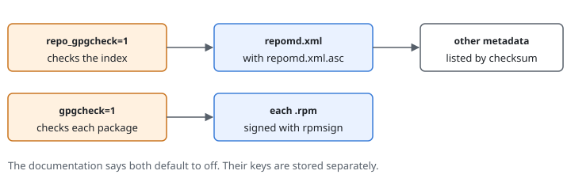

*Draft for owner review.* The Red Hat family (Fedora, RHEL, AlmaLinux, Rocky) uses **RPM** packages and **dnf** as the client. A dnf repository is the same idea as an apt one, files plus a signed index, with one important difference: **there are two separate signatures to understand**, one on the **packages** and one on the **repository metadata**. This lesson builds a signed repository with `createrepo_c`, signs a package with `rpmsign`, installs from it, publishes an update and breaks it, on AlmaLinux 9. It is the second of three format lessons; read `packaging.apt-repository` first, because the shape of the work is the same and I will not repeat it.

**What was tested, and where.** **AlmaLinux 9.8** (RPM **4.16.1.3**, `createrepo_c` **0.20.1**, GnuPG **2.3.3**, `rpm-build`, `rpm-sign`), as root, served from `127.0.0.1` by Python's `http.server`, with one tiny `noarch` package built from a spec file, in a throwaway GnuPG home (`tests/verification/repo/rp2.sh`; output is real, hashes and key IDs shortened or omitted). **Not tested:** Fedora, RHEL or Rocky, **module streams** (`modulemd`), delta RPMs, `createrepo_c` options for **large** repositories (`--update` on big trees, `--workers`, `--checksum`), **`mock`** and real **build systems** (Koji, COPR), repository **mirrors** and `metalink`, HTTPS, key rotation, SELinux effects on a real web server's document root, and **`zchunk`** metadata.

## The two signatures

dnf's documentation ([`dnf.conf` reference](https://dnf.readthedocs.io/en/latest/conf_ref.html)) lists them as two different settings, and I read both entries:

- **`gpgcheck`**: "Whether to perform GPG signature check on **packages** found in this repository. **The default is False.**"
- **`repo_gpgcheck`**: "Whether to perform GPG signature check on this repository's **metadata**. The default is False. Note that GPG keys for this check are stored separately from GPG keys used in package signature verification. Furthermore, they are also stored separately for each repository."

Three consequences, all of which the test below shows. **Each protects something different**: `gpgcheck` says this *RPM* was signed by a key you trust (so a changed or substituted package is rejected); `repo_gpgcheck` says the *index* is genuine (so the list of what is available and what hashes to expect cannot be swapped). **Neither is on unless you ask**, per that page: a hand-written `.repo` file that omits them verifies nothing (a distribution's own defaults may differ; I did not check AlmaLinux's global `dnf.conf`). And **the two keys can be the same key or different ones**; I used one key for both.



```text
 repo_gpgcheck=1 --> repomd.xml (+ .asc) --checksums--> other metadata
 gpgcheck=1      --> each .rpm (signed with rpmsign)
```

## Make a key, a package and a repository

The same repository-only key as in the apt lesson (an ed25519 key, `gpg --quick-generate-key ... ed25519 sign never`, empty passphrase because this one is a throwaway). Public half exported as text: `gpg --export --armor > wl-repo.asc` (400 bytes).

A package is described by a **spec file**, built with `rpmbuild` (package `rpm-build`):

```text
Name: wl-hello
Version: 1.0
Release: 1
Summary: test package 1.0
License: MIT
BuildArch: noarch
%description
test package 1.0
%install
mkdir -p %{buildroot}/usr/bin
printf '#!/bin/sh\necho "wl-hello 1.0"\n' > %{buildroot}/usr/bin/wl-hello
chmod 755 %{buildroot}/usr/bin/wl-hello
%files
/usr/bin/wl-hello
```

```text
$ rpmbuild -bb --define "_topdir $T" $T/wl-hello.spec
Wrote: RPMS/noarch/wl-hello-1.0-1.noarch.rpm
```

Look at the package before and after signing with `rpm -K` (check signature; [rpmsign(8)](https://manpages.debian.org/stable/rpm/rpmsign.8.en.html) is the signing tool):

```text
$ rpm -Kv wl-hello-1.0-1.noarch.rpm                    (before signing)
    Header SHA256 digest: OK
    Header SHA1 digest: OK
    Payload SHA256 digest: OK
    MD5 digest: OK                                      (digests only: no signature line)
$ rpmsign --addsign --define "_gpg_name $KEYID" ... wl-hello-1.0-1.noarch.rpm
$ rpm -Kv wl-hello-1.0-1.noarch.rpm                    (after signing)
    Header V4 EdDSA/SHA256 Signature, key ID 88152453: NOKEY
    Header SHA256 digest: OK
    ...
```

**`NOKEY` is not an error here**: it means "the signature is there, and made by key `88152453`, which is not in this machine's RPM database", so it cannot yet be *verified*. After the client imports the key it will say OK. (Two details of my run: `rpmsign` had to be told how to call `gpg` without a passphrase prompt, with a `__gpg_sign_cmd` macro containing `--pinentry-mode loopback --passphrase ''`, a throwaway-key trick; and `rpm -qp --qf '%{SIGPGP:pgpsig}'` printed `(none)` even after signing, because that tag does not hold this EdDSA signature. Use `rpm -K`.)

Now the repository. `createrepo_c` ([project page](https://rpm-software-management.github.io/createrepo_c/)) scans a folder of RPMs and writes a `repodata/` directory:

```text
$ createrepo_c --update /srv/wl-rpm
Pool finished
$ gpg --detach-sign --armor -o /srv/wl-rpm/repodata/repomd.xml.asc /srv/wl-rpm/repodata/repomd.xml
$ find /srv/wl-rpm -type f | sort
repodata/0d1cdf87...-other.xml.gz
repodata/1d092582...-primary.sqlite.bz2
repodata/2deaa454...-filelists.xml.gz
repodata/3c017308...-filelists.sqlite.bz2
repodata/7de33e66...-other.sqlite.bz2
repodata/a9d3d084...-primary.xml.gz
repodata/repomd.xml
repodata/repomd.xml.asc
wl-repo.asc
x86_64/wl-hello-1.0-1.noarch.rpm
```

The file a client has to fetch first is `repodata/repomd.xml`, because it is the one with a fixed name; it lists the other metadata files with their checksums. That is why **`repomd.xml` is the file you sign** (`repomd.xml.asc`): the signature covers the checksums of everything else. The `*.sqlite.bz2` files are an older style of index that `createrepo_c` 0.20.1 still wrote here; I did not check whether current dnf needs them. A glance at what `repomd.xml` records:

```text
<data type="primary">     <location href="repodata/a9d3d084...-primary.xml.gz"/>
<data type="filelists">   <location href="repodata/2deaa454...-filelists.xml.gz"/>
<data type="other">       <location href="repodata/0d1cdf87...-other.xml.gz"/>
<data type="primary_db">  <location href="repodata/1d092582...-primary.sqlite.bz2"/>
```

The other files' **names start with a checksum**, so a changed file gets a new name. (My reading is that this lets clients cache them safely; I did not find that in the documentation.)

## Serve it, and use it

Served as static files, as before (`python3 -m http.server 8082 --directory /srv/wl-rpm --bind 127.0.0.1`, `curl` showed `repomd.xml over http: 200`). The client side is a `.repo` file with **both checks on** and the public key's address:

```text
# /etc/yum.repos.d/wl.repo
[wl]
name=WinLab test repository
baseurl=http://127.0.0.1:8082/
enabled=1
gpgcheck=1
repo_gpgcheck=1
gpgkey=http://127.0.0.1:8082/wl-repo.asc
```

```text
$ dnf -y makecache --repo wl
WinLab test repository                           5.1 kB/s | 228  B     00:00
WinLab test repository                           287 kB/s | 400  B     00:00
Importing GPG key 0x88152453:
 Userid     : "WinLab Test Repo <repo@lab.test>"
 Fingerprint: 4C46 E1B0 9C7D 5DB2 2B9D 7CC5 B55B 8E93 8815 2453
 From       : http://127.0.0.1:8082/wl-repo.asc
WinLab test repository                           16 kB/s | 836  B     00:00
Metadata cache created.
$ dnf -y install wl-hello
Installing:
 wl-hello             noarch             1.0-1             wl             6.5 k
Importing GPG key 0x88152453:
Key imported successfully
  Installing       : wl-hello-1.0-1.noarch                                  1/1
$ wl-hello
wl-hello 1.0
```

Two key imports happened, because the two settings keep **two separate key stores**, exactly as the documentation says: once for the **repository metadata**, once for the **package**. `-y` answered "yes" to both: **in real use read the fingerprint and compare it with one you got by another route**, because accepting a key over the same untrusted HTTP connection that served the repository proves nothing. (I used `-y` in a test where I made the key a minute earlier.) The imported key is now in the RPM database as a pseudo-package:

```text
$ rpm -qa 'gpg-pubkey*' --qf '%{NAME}-%{VERSION}-%{RELEASE}  %{SUMMARY}\n' | grep -i winlab
gpg-pubkey-88152453-6b02efd3  WinLab Test Repo <repo@lab.test> public key
```

(`rpm -e gpg-pubkey-88152453-6b02efd3` removes it again; the test did that during cleanup.)

## Publish an update

Build `1.1`, **sign the package**, run `createrepo_c --update`, and sign `repomd.xml` again:

```text
$ dnf -y check-update --refresh --repo wl | grep wl-hello
wl-hello.noarch                             1.1-1                             wl
$ dnf -y upgrade wl-hello
Upgrading:
 wl-hello             noarch             1.1-1             wl             6.5 k
$ wl-hello
wl-hello 1.1
$ dnf repoquery --repo wl wl-hello
wl-hello-0:1.0-1.noarch
wl-hello-0:1.1-1.noarch
```

Both versions are listed because both RPMs are still in the folder. (`--update` is meant to reuse existing metadata and read only new or changed files, which matters for a large repository; I did not time it, and the only evidence in my run is the message `New and old repodata match, not updating` seen once.) The `0:` in `0:1.1-1` is the **epoch**, a number that overrides version comparison and is almost always 0.

## What the client says when something is wrong

**(a) A package that was not signed.** I built `1.2` and published it **without signing the RPM** (the index was updated and signed as usual):

```text
$ dnf -y install wl-hello-1.2
Package wl-hello-1.2-1.noarch.rpm is not signed
Error: GPG check FAILED
```

This is `gpgcheck=1` doing its job: the signed **index** was fine, and the **package** was refused anyway. I did not test the opposite case (`gpgcheck=0` with `repo_gpgcheck=1`).

**(b) `repomd.xml` changed after it was signed.** I edited the file (`sed -i 's/<revision>/<revision>9/'`) without re-signing:

```text
Error: Failed to download metadata for repo 'wl': repomd.xml GPG signature verification error: Bad GPG signature
```

**(c) The mistake I made next.** To "repair" it I re-ran my `publish` function: `createrepo_c --update` printed `New and old repodata match, not updating`, and then my function **signed `repomd.xml` again**. The client worked, and **the file it was now happy with was my edited one**: signing does not check what it signs. A signature says "the key holder approved *these bytes*", not "these bytes are right". In a real workflow the publish step should *build* the metadata fresh and sign **only** what it built, and it should be done by a machine nobody edits by hand.

## Common mistakes

- **Leaving `gpgcheck` and `repo_gpgcheck` out.** Per the documentation both default to off.
- **Accepting the key import without looking at the fingerprint.**
- **Signing the packages but not `repomd.xml`** (or the reverse). They protect different things.
- **Publishing the packages after the metadata.** The same ordering rule as apt: files first, index last.
- **Re-signing to "make the error go away".** The error was information.
- **Reusing one key for build servers and release.** A compromised build machine then signs releases.
- **Not checking `rpm -K` on the package before you publish it.** `NOKEY` is expected, `BAD` or no signature line is not.
- **Forgetting the epoch** when you compare versions by hand.

## Check yourself

1. Build and sign an RPM, then show with `rpm -K` the difference before and after.
2. Create the repository, sign `repomd.xml`, and install from it with both checks on. What are the two key imports for?
3. Publish an unsigned package and show which setting rejects it.
4. Tamper with `repomd.xml` and explain the error. Then explain why re-signing "fixed" it and why that is a trap.
5. Why does `repomd.xml` have a fixed name while the other metadata files have the checksum in the name?

## Not tested, and honest limits

Fedora, RHEL and Rocky clients; module streams; delta RPMs; large trees and `--workers`; Koji, COPR or `mock`; mirrors and `metalink`; HTTPS; key rotation; zchunk; SELinux for a real web server; and whether current dnf still needs the `*.sqlite.bz2` files. The package is trivial (no dependencies or scriptlets). I used one key for both signatures and an empty passphrase, which is acceptable only for a throwaway.
