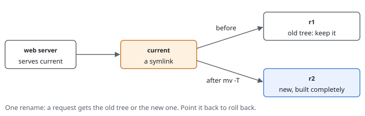

*Draft for owner review.* Hosting a package repository sounds like a big infrastructure problem and is, at its core, a small one: **serve a directory of files over HTTP, update it without ever showing clients a half-finished state, keep the signing key away from the web server, and have enough disk.** This lesson takes the storage question first, with **measured** sizes of real repositories (Chimera, AlmaLinux, Ubuntu), then serving, publishing, mirroring and checking. It builds on the three format lessons (`packaging.apt-repository`, `packaging.dnf-repository`, `packaging.apk-repository`) and on the backup lesson (`homelab.backups`). The owner is building a repository for FenrirOS and choosing storage for it; I know nothing about FenrirOS, so everything here is general and tested on Ubuntu, AlmaLinux and Chimera only.

**What was tested, and where.** **Ubuntu 24.04.5** with **nginx 1.24.0**, **rsync 3.2.7**, **curl 8.5.0** and **gpgv 2.4.4** (`tests/verification/repo/rp4.sh`, `rp4b.sh`, `rp6.sh`, `rp7.sh`); **AlmaLinux 9.8** for the size measurements (`rp5.sh`, `rp6.sh`) and the dnf checker (`rp8.sh`), **Chimera Linux** for the size measurements and the apk checker (`rp9.sh`, apk-tools 3.0.8). Output is real. **Not tested:** **object storage** (S3-compatible or others) or a **CDN** in front of a repository; **HTTPS** and certificate renewal; **load**, bandwidth, or how many clients one machine can serve; **ZFS or btrfs snapshots** and filesystem choice; geographic mirrors; `reprepro`, `aptly`, `pulp` and other repository managers; and anything about FenrirOS.

## What a repository host has to do

1. **Serve files**, mostly large, mostly read once per client per update. There is no application server and no database.
2. **Serve the small files fresh and the big files from cache.** The index changes with every publish and clients must see the new one; the packages never change once published (a new version is a new file).
3. **Publish atomically**: a client must never see an index that points at a file that is not there yet, or a half-copied tree.
4. **Keep the signing key off the web server.** The server only needs the public files.
5. **Have the disk**, now and for the growth you plan, and be able to **rebuild or restore** it.

## How big is a repository? Measured

An index tells you the size of every package, so you can add them up without downloading anything. From the machines in the lab (each by its own tool; the commands are in `rp5.sh` and `rp6.sh`):

| Repository | Packages | Total size of package files |
|---|---|---|
| Chimera Linux **main**, x86_64 (`apk adbdump` of the index, summing `file-size`) | 9,007 | 16,620,518,385 bytes = **15.5 GiB** |
| AlmaLinux 9 **BaseOS** (`dnf repoquery --available`, `downloadsize`) | 2,632 | 2.90 GiB |
| AlmaLinux 9 **AppStream** | 13,374 | 14.47 GiB |
| AlmaLinux 9 **EPEL** (extra packages) | 53,402 | 19.48 GiB |
| Ubuntu 24.04 `noble`, `-updates`, `-backports`, `-security`, all four components (`apt-cache dumpavail`, summing `Size:`) | 88,827 package versions | **408.4 GiB** (amd64 324.0 GiB, architecture-independent 84.4 GiB) |

How to read this honestly:

- **These are not like for like.** Chimera's number is *one* repository, *one* architecture, *one* release. The Ubuntu number counts **every version of every package in four suites** (one package can appear in `noble`, in `-updates` and in `-security`), so it is an upper bound on what a mirror would store. The AlmaLinux counts are what `dnf repoquery --available` reported; that may include more than one version of a package, and I did not limit it to the latest.
- **The index is tiny next to the data.** Chimera's `Packages.adb` was **1,215,483 bytes** (1.2 MB) describing 15.5 GiB, about 0.007 % of it. Clients download the index on every update, the packages only when they install them.
- **A few packages dominate.** Chimera's largest were `xonotic-data` (1.1 GiB), `sauerbraten-data` (0.9 GiB) and `fonts-noto-serif-cjk-extra-otf` (437 MiB); Ubuntu's were `qgis-api-doc` (2.9 GB), `0ad-data` (1.4 GB) and `flightgear-data-base` (1.4 GB); AlmaLinux's `linux-firmware` (721 MB). Game data, documentation and firmware are the heavy parts. **A smaller distribution, with a smaller package set, is a smaller repository.**

**Planning arithmetic** (arithmetic, not measurement): disk needed ≈ *size of one release and architecture* × *number of architectures* × *number of releases you keep* + *old package versions you keep* + *working space to publish*. For a Chimera-sized package set that is about 16 GiB per architecture per release before any history. If your publish method **copies** the tree to a new directory (like the symlink swap below), the working space is another full copy, unless you use **hard links** (the `rsync --link-dest` technique from the backup lesson shares unchanged files between trees; I did not test that for a repository, but the mechanism is the same).

**What this says about storage choice.** At the scale of tens of GiB the choice is not about capacity: any single disk holds it. It is about **what happens when something goes wrong**: whether you can restore the repository (the packages can be rebuilt from source, but only if you still have the sources, build recipes and **the signing key**), whether you can **keep old releases** cheaply, and whether corruption is **detected** (a damaged `.deb` is caught by clients through the hash in the index; a damaged *index* is caught by the signature). Filesystem features such as checksumming and snapshots (ZFS, btrfs) address those; I did not test them, so I cannot say how they behave under this workload.

## Serve it with nginx

nginx serves static files efficiently with a few lines. The configuration I tested, with the repository root a symlink (`/srv/wl-hosting/current`, explained under publishing) and a first attempt at cache rules:

```text
server {
    listen 127.0.0.1:8090;
    root /srv/wl-hosting/current;
    autoindex on;
    location ~ \.(deb|gz)$ { add_header Cache-Control "public, max-age=3600"; }
    location /dists/ { add_header Cache-Control "no-cache"; }
}
```

`nginx -t` said `syntax is ok`; `apt-get update` and `apt-get install` against it worked. What the server sends:

```text
$ curl -sI http://127.0.0.1:8090/dists/stable/InRelease
HTTP/1.1 200 OK
Server: nginx/1.24.0 (Ubuntu)
Content-Length: 1694
Last-Modified: Sun, 22 Nov 2026 13:56:56 GMT
ETag: "6b02f4a8-69e"
Cache-Control: no-cache
Accept-Ranges: bytes
$ curl -sI .../pool/main/w/wl-hello/wl-hello_1.0_all.deb
HTTP/1.1 200 OK
Content-Length: 532
Cache-Control: public, max-age=3600
ETag: "6b02f4a8-214"
```

Four things a repository server gets for free from a static file server, all tested:

- **`ETag` and `Last-Modified`** let a client ask "has this changed?". With `If-None-Match: "6b02f4a8-69e"` nginx answered **304** (no body sent): the cheap path for the index. Clients can use these for cheap re-checks; I did not capture what `apt` itself sends.
- **Range requests** (`curl -r 0-99`) returned **206** with exactly 100 bytes, so an interrupted download of a large package can resume.
- **A directory listing** (`autoindex on`) returned `href="dists/"`, `href="pool/"`. Nice for people, and not needed by `apt`, `dnf` or `apk`. Consider turning it off for a public server.
- **A path outside the root is not reachable**: `curl --path-as-is http://127.0.0.1:8090/../../etc/passwd` returned **400**.

### A bug in my first configuration

The two `location` blocks above look as if they say "files under `/dists/` are not cached, `.deb` and `.gz` files are cached for an hour". Test each kind of file:

```text
dists/stable/InRelease                       Cache-Control: no-cache
dists/stable/main/binary-amd64/Packages.gz   Cache-Control: public, max-age=3600     <-- the INDEX, cached for an hour
pool/main/w/wl-hello/x_1.0_all.deb           Cache-Control: public, max-age=3600
```

**The index was told to be cached for an hour.** `Packages.gz` lives under `/dists/`, but nginx tries **regular-expression locations after the longest matching prefix** and the regex wins unless the prefix carries `^~`, so `.(deb|gz)$` took precedence over `/dists/`. The [nginx `location` documentation](https://nginx.org/en/docs/http/ngx_http_core_module.html#location) says so: "Then regular expressions are checked, in the order of their appearance", and "If the longest matching prefix location has the "^~" modifier, then regular expressions and predicate locations are not checked." A client or proxy cache could keep serving an hour-old index. (I found it by testing each kind of file; my first full test used this configuration and did not notice, because it checked only that `apt` worked, not the headers.) The fix is the `^~` modifier, which makes a prefix match **final**:

```text
location ^~ /dists/ { add_header Cache-Control "no-cache"; }
location ~ \.(deb)$ { add_header Cache-Control "public, max-age=31536000, immutable"; }
```

```text
dists/stable/InRelease                       Cache-Control: no-cache
dists/stable/main/binary-amd64/Packages.gz   Cache-Control: no-cache
pool/main/w/wl-hello/x_1.0_all.deb           Cache-Control: public, max-age=31536000, immutable
```

Now the packages, which never change under the same name, are cacheable for a year and the index is not cacheable at all. **`immutable` is only true if you never overwrite a published file**; a repository where you replace `foo_1.0_all.deb` in place breaks that promise. (I also did not test what an `apt` or `dnf` client does with these headers beyond the update and install above.)

Python's `http.server`, which the earlier lessons used, is for **testing**. I did not load-test it or nginx. For a real server also consider HTTPS and a rate limit: not tested.

## Publish without showing clients a broken state

Two habits, both tested on this nginx:

**1. Files first, index last.** I published an index that listed `wl-hello 1.1` **before** the `.deb` existed. A client that updated in that window saw `Candidate: 1.1` and the install failed:

```text
Err:1 http://127.0.0.1:8090 stable/main amd64 wl-hello all 1.1
  404  Not Found [IP: 127.0.0.1 8090]
E: Failed to fetch http://127.0.0.1:8090/pool/main/w/wl-hello/wl-hello_1.1_all.deb  404  Not Found
```

When the file arrived the same client succeeded. **Copy the package files, then replace the index and its signature.**

**2. Swap a whole tree with a symlink.** Build the new tree in a new directory, then replace the symlink in one step:

```text
$ ln -sfn r2 /srv/wl-hosting/current.new; mv -T /srv/wl-hosting/current.new /srv/wl-hosting/current
```



```text
 server -> current -> r1   (old tree, kept for rollback)
 server -> current -> r2   after: mv -T current.new current
```

`mv -T` is one atomic rename, so a request sees the old tree or the new one. nginx followed the symlink in my tests (its default allows it; I did not test `disable_symlinks`). Keep the previous tree (`r1`) for a while: a client in the middle of a download may still be reading from it, and it is your **rollback**: point the symlink back.

## Mirror it

To put the same repository on a second server (for redundancy, or closer to users) the standard tool is `rsync` (see the rsync section of the backup lesson):

```text
$ rsync -a --delete $H/r2/ /srv/wl-mirror/
$ rsync -a --delete -i $H/r2/ /srv/wl-mirror/ | wc -l
0                                           (the second run changed nothing)
$ rsync -a --delete --delay-updates -v $H/r2/ /srv/wl-mirror/
dists/stable/InRelease
dists/stable/Release
...
$ diff -r $H/r2 /srv/wl-mirror && echo "mirror identical"
mirror identical
```

`--delay-updates` makes `rsync` put all updated files in place **together at the end** instead of one by one, which narrows the window where a mirror holds a mixed state (I did not observe the window itself). **A mirror inherits the publish-order problem**: if the index arrives before the packages, clients of the mirror see the same 404 as before. A safer sequence copies the pool first (`rsync` the `pool/` directory), then `dists/`.

## Check it from the outside

A repository can be unhealthy while the web server is perfectly fine. This script checks it **the way a client sees it** and uses only `curl`, `gpgv`, `sha256sum` and `awk`: that `InRelease` verifies against the public key, that the index named in `Release` has the size and hash promised, and that every package listed exists with the promised size. Run it after every publish and from a different machine on a schedule.

```bash
#!/bin/bash
# wl-aptcheck.sh BASEURL SUITE COMPONENT ARCH KEYRING
# Health check for an apt repository, from the outside, the way a client sees it:
#   1. InRelease verifies against KEYRING (a binary keyring made with gpg --export)
#   2. the Packages.gz named in Release has the size and SHA-256 that Release promises
#   3. every package listed in Packages exists on the server with the size Packages promises
# Prints ok/FAIL lines; exit status 0 if everything is fine, 1 if anything failed, 2 on a usage error.
[ $# -eq 5 ] || { echo "usage: wl-aptcheck.sh BASEURL SUITE COMPONENT ARCH KEYRING" >&2; exit 2; }
base=${1%/} suite=$2 comp=$3 arch=$4 keyring=$5
[ -r "$keyring" ] || { echo "wl-aptcheck: cannot read keyring $keyring" >&2; exit 2; }
tmp=$(mktemp -d) || exit 2; trap 'rm -rf "$tmp"' EXIT
fails=0
ok()  { printf 'ok    %s\n' "$*"; }
bad() { printf 'FAIL  %s\n' "$*"; fails=$((fails + 1)); }

# 1. the signed Release
curl -fsS -o "$tmp/InRelease" "$base/dists/$suite/InRelease" 2>"$tmp/curl.err" || { bad "cannot fetch InRelease: $(tr -d '\n' < "$tmp/curl.err")"; exit 1; }
if gpgv --keyring "$keyring" --output "$tmp/Release" "$tmp/InRelease" 2>"$tmp/gpgv.err"; then
  ok "InRelease signature: $(grep -o 'using [A-Z0-9 ]* key [0-9A-F]*' "$tmp/gpgv.err" | head -1)"
else
  bad "InRelease signature: $(grep -m1 -iE 'BAD|no public key|can.t check' "$tmp/gpgv.err")"; exit 1
fi

# 2. the index named in Release
rel="$comp/binary-$arch/Packages.gz"
read -r want_hash want_size < <(awk -v f="$rel" '/^SHA256:/ {s = 1; next} /^[A-Za-z]/ {s = 0} s && $3 == f {print $1, $2; exit}' "$tmp/Release")
[ -n "$want_hash" ] || { bad "$rel is not listed in Release"; exit 1; }
curl -fsS -o "$tmp/Packages.gz" "$base/dists/$suite/$rel" 2>"$tmp/curl.err" || { bad "cannot fetch $rel: $(tr -d '\n' < "$tmp/curl.err")"; exit 1; }
got_hash=$(sha256sum "$tmp/Packages.gz" | cut -d' ' -f1); got_size=$(stat -c %s "$tmp/Packages.gz")
if [ "$got_hash" = "$want_hash" ] && [ "$got_size" = "$want_size" ]; then ok "$rel matches Release ($got_size bytes)"
else bad "$rel differs from Release: size $got_size (Release says $want_size), hash ${got_hash:0:12} (Release says ${want_hash:0:12})"; exit 1; fi

# 3. every package on the server, with the promised size
n=0
while read -r file size; do
  n=$((n + 1))
  code_len=$(curl -sI -o /dev/null -w '%{http_code} %header{content-length}' "$base/$file")
  code=${code_len%% *}; len=${code_len#* }
  if [ "$code" != 200 ]; then bad "$file: HTTP $code"
  elif [ "$len" != "$size" ]; then bad "$file: $len bytes on the server, Packages says $size"
  fi
done < <(zcat "$tmp/Packages.gz" | awk '/^Filename:/ {f = $2} /^Size:/ {print f, $2}')
(( fails == 0 )) && ok "$n package file(s) present with the right size"
(( fails == 0 )) || printf '%d check(s) failed\n' "$fails"
exit $(( fails > 0 ))
```

(Bash shebang: it uses process substitution `< <( ... )` and `(( ))`. `%header{content-length}` in `curl -w` needs a reasonably new curl; 8.5.0 here.) I tested it against a healthy repository and four breakages, each with its own exit status:

```text
healthy:                  ok    InRelease signature: using EDDSA key 553DAF70...
                          ok    main/binary-amd64/Packages.gz matches Release (281 bytes)
                          ok    1 package file(s) present with the right size            exit status 0
package file missing:     FAIL  pool/main/w/wl-hello/wl-hello_1.1_all.deb: HTTP 404      exit status 1
file truncated:           FAIL  ...wl-hello_1.1_all.deb: 300 bytes on the server, Packages says 532    exit status 1
index changed after
signing:                  FAIL  main/binary-amd64/Packages.gz differs from Release: size 305 (Release says 281), hash ed8a0bb21b58 (Release says 4ea94b645384)    exit status 1
signed by another key:    FAIL  InRelease signature: gpgv: Can't check signature: No public key    exit status 1
wrong usage:              usage: ...  (exit status 2)      missing keyring: wl-aptcheck: cannot read keyring ...  (exit status 2)
```

Note `1 package file(s)` for a pool holding **two** package versions (1.0 and 1.1): `dpkg-scanpackages` lists only the newest by default, so the checker checks what clients can ask for, not every file in the pool. The checker checks one suite, one component and one architecture. It does **not** verify the package signatures or contents, only presence and size.

### The same check for a dnf repository

The three steps are the same with different files: **`repomd.xml` against its detached signature** `repomd.xml.asc`, **every metadata file against the size and SHA-256 `repomd.xml` lists**, and **every package in the primary metadata against its promised size**. This one uses `gpg` with a private temporary keyring (so it never touches the machine's own keys) and plain `awk`; it avoids `curl -w '%header{...}'` because **AlmaLinux 9.8's curl is 7.76.1, too old for it** (the apt version above ran on curl 8.5).

```bash
#!/bin/bash
# wl-dnfcheck.sh BASEURL KEYFILE
# Health check for a dnf/rpm repository, from the outside, the way a client sees it:
#   1. repomd.xml verifies against repomd.xml.asc with the public key in KEYFILE (ASCII-armored)
#   2. every metadata file named in repomd.xml has the size and SHA-256 that repomd.xml promises
#   3. every package listed in the primary metadata exists on the server with the size it promises
# Prints ok/FAIL lines; exit status 0 if everything is fine, 1 if anything failed, 2 on a usage error.
[ $# -eq 2 ] || { echo "usage: wl-dnfcheck.sh BASEURL KEYFILE" >&2; exit 2; }
base=${1%/} key=$2
[ -r "$key" ] || { echo "wl-dnfcheck: cannot read key file $key" >&2; exit 2; }
tmp=$(mktemp -d) || exit 2; trap 'rm -rf "$tmp"' EXIT
fails=0
ok()  { printf 'ok    %s\n' "$*"; }
bad() { printf 'FAIL  %s\n' "$*"; fails=$((fails + 1)); }

# 1. the signed repomd.xml (a private keyring, so the check never touches the machine's own)
curl -fsS -o "$tmp/repomd.xml" "$base/repodata/repomd.xml" 2>"$tmp/curl.err" || { bad "cannot fetch repomd.xml: $(tr -d '\n' < "$tmp/curl.err")"; exit 1; }
curl -fsS -o "$tmp/repomd.xml.asc" "$base/repodata/repomd.xml.asc" 2>"$tmp/curl.err" || { bad "cannot fetch repomd.xml.asc: $(tr -d '\n' < "$tmp/curl.err")"; exit 1; }
export GNUPGHOME=$tmp/gnupg; mkdir -m 700 "$GNUPGHOME"
gpg --batch --quiet --import "$key" 2>/dev/null || { echo "wl-dnfcheck: $key is not a usable public key" >&2; exit 2; }
if gpg --batch --verify "$tmp/repomd.xml.asc" "$tmp/repomd.xml" 2>"$tmp/gpg.err"; then
  ok "repomd.xml signature: $(grep -m1 -o 'using [A-Z0-9]* key [0-9A-F]*' "$tmp/gpg.err")"
else
  bad "repomd.xml signature: $(grep -m1 -iE 'BAD|no public key|can.t check' "$tmp/gpg.err")"; exit 1
fi

# 2. each metadata file: type, location, sha256 checksum, size
awk '/<data type=/ {match($0, /type="[^"]*"/); t = substr($0, RSTART + 6, RLENGTH - 7)}
     /<checksum type="sha256"/ {gsub(/.*">|<\/checksum>.*/, ""); h = $0}
     /<size>/ {gsub(/.*<size>|<\/size>.*/, ""); s = $0}
     /<location href=/ {match($0, /href="[^"]*"/); l = substr($0, RSTART + 6, RLENGTH - 7)}
     /<\/data>/ {print t, l, h, s}' "$tmp/repomd.xml" > "$tmp/data.txt"
[ -s "$tmp/data.txt" ] || { bad "repomd.xml lists no metadata files"; exit 1; }
primary=
while read -r type loc want_hash want_size; do
  f="$tmp/$(basename "$loc")"
  if ! curl -fsS -o "$f" "$base/$loc" 2>"$tmp/curl.err"; then bad "$loc: cannot fetch ($(tr -d '\n' < "$tmp/curl.err"))"; continue; fi
  got_hash=$(sha256sum "$f" | cut -d' ' -f1); got_size=$(stat -c %s "$f")
  if [ "$got_hash" = "$want_hash" ] && [ "$got_size" = "$want_size" ]; then ok "$type matches repomd.xml ($got_size bytes)"
  else bad "$type differs from repomd.xml: size $got_size (repomd.xml says $want_size), hash ${got_hash:0:12} (repomd.xml says ${want_hash:0:12})"; fi
  [ "$type" = primary ] && primary=$f
done < "$tmp/data.txt"
[ -n "$primary" ] || { bad "no primary metadata"; exit 1; }
(( fails == 0 )) || { printf '%d check(s) failed\n' "$fails"; exit 1; }

# 3. every package named in the primary metadata, with the promised size
case $primary in
  *.gz)  unpack="gzip -dc" ;;
  *.zst) unpack="zstd -dc" ;;
  *.xz)  unpack="xz -dc" ;;
  *.bz2) unpack="bzip2 -dc" ;;
  *)     unpack="cat" ;;
esac
n=0
while read -r file size; do
  n=$((n + 1))
  code_len=$(curl -sI "$base/$file" | tr -d '\r' | awk 'NR == 1 {c = $2} tolower($1) == "content-length:" {l = $2} END {print c, l}')
  code=${code_len%% *}; len=${code_len#* }
  if [ "$code" != 200 ]; then bad "$file: HTTP $code"
  elif [ "$len" != "$size" ]; then bad "$file: $len bytes on the server, the metadata says $size"
  fi
done < <($unpack "$primary" | awk '/<size package=/ {match($0, /package="[0-9]*"/); s = substr($0, RSTART + 9, RLENGTH - 10)}
                                    /<location href=/ {match($0, /href="[^"]*"/); print substr($0, RSTART + 6, RLENGTH - 7), s}')
(( fails == 0 )) && ok "$n package file(s) present with the right size"
(( fails == 0 )) || printf '%d check(s) failed\n' "$fails"
exit $(( fails > 0 ))
```

Tested on AlmaLinux 9.8 (curl 7.76.1, GnuPG 2.3.3, gawk 5.1.0) with a repository built by `createrepo_c` and signed with a detached signature as in `packaging.dnf-repository` (`tests/verification/repo/rp8.sh`):

```text
healthy:              ok    repomd.xml signature: using EDDSA key DE6B894D...
                      ok    primary matches repomd.xml (645 bytes)         (and filelists, other, primary_db, filelists_db, other_db)
                      ok    2 package file(s) present with the right size            exit status 0
package file missing: FAIL  x86_64/wl-hello-1.1-1.noarch.rpm: HTTP 404               exit status 1
file truncated:       FAIL  x86_64/wl-hello-1.1-1.noarch.rpm: 300 bytes on the server, the metadata says 6467    exit status 1
metadata changed:     FAIL  primary differs from repomd.xml: size 676 (repomd.xml says 645), hash 1a41e19fad06 (repomd.xml says ace1df2e3f48)
repomd.xml changed:   FAIL  repomd.xml signature: gpg: BAD signature from "WinLab Test Repo <repo@lab.test>" [unknown]
other key:            FAIL  repomd.xml signature: gpg: Can't check signature: No public key
no .asc file:         FAIL  cannot fetch repomd.xml.asc: curl: (22) The requested URL returned error: 404
usage errors:         usage: ...  /  cannot read key file ...  /  ... is not a usable public key   (exit status 2 each)
```

My first version of the metadata parser was wrong: in `repomd.xml` the `<size>` line comes **after** `<location>`, so each file was compared with the previous file's size and a healthy repository reported six failures. The hashes matched all along. The fix was to print each entry at `</data>`. A checker needs its own test against a repository known to be good, and I only found this because I ran one. I did not run it against a real distribution mirror, and a repository that uses `zstd` or `xz` metadata is handled by the `case` on the file suffix but I only tested the `gz` that `createrepo_c` produced here.

### The same check for an apk repository

For apk the tool that knows the format is `apk` itself: **`apk verify`** checks a signature against a keys directory (it accepted the index, rejected an unsigned package with `UNTRUSTED signature`, and reported a truncated file with `unexpected end of file`), and **`apk adbdump`** prints each package's `name`, `version`, `arch` and `file-size`. The layout it assumes is the one from `packaging.apk-repository`: the index at `BASE/ARCH/Packages.adb`, and **`noarch` packages under `BASE/noarch/`** (a finding from that lesson). Chimera has no `curl` by default, so the battery ran `apk add curl` first. This script also has an optional **deep mode** (`WL_DEEP=1`) that downloads each package and runs `apk verify` on it, because, as the tests below show, the size check alone cannot catch an unsigned package in a signed index.

```bash
#!/bin/bash
# wl-apkcheck.sh BASEURL ARCH KEYSDIR
# Health check for an apk (v3) repository laid out as BASEURL/ARCH/Packages.adb with noarch packages in BASEURL/noarch/,
# from the outside, the way a client sees it:
#   1. Packages.adb verifies against the public keys in KEYSDIR (apk verify)
#   2. every package listed in the index exists on the server with the file-size the index promises
#   3. with WL_DEEP=1 in the environment, each package is also downloaded and verified (signature and structure)
# Prints ok/FAIL lines; exit status 0 if everything is fine, 1 if anything failed, 2 on a usage error.
[ $# -eq 3 ] || { echo "usage: wl-apkcheck.sh BASEURL ARCH KEYSDIR   (WL_DEEP=1 also downloads and verifies every package)" >&2; exit 2; }
base=${1%/} arch=$2 keys=$3
[ -d "$keys" ] || { echo "wl-apkcheck: $keys is not a directory" >&2; exit 2; }
tmp=$(mktemp -d) || exit 2; trap 'rm -rf "$tmp"' EXIT
fails=0
ok()  { printf 'ok    %s\n' "$*"; }
bad() { printf 'FAIL  %s\n' "$*"; fails=$((fails + 1)); }

# 1. the signed index
curl -fsS -o "$tmp/Packages.adb" "$base/$arch/Packages.adb" 2>"$tmp/curl.err" || { bad "cannot fetch $arch/Packages.adb: $(tr -d '\n' < "$tmp/curl.err")"; exit 1; }
if out=$(apk --keys-dir "$keys" verify "$tmp/Packages.adb" 2>&1); then ok "$arch/Packages.adb signature: ${out#*: }"
else bad "$arch/Packages.adb: ${out#*: }"; exit 1; fi

# 2. every package in the index
n=0
while read -r parch file size; do
  n=$((n + 1))
  dir=$arch; [ "$parch" = noarch ] && dir=noarch
  url="$base/$dir/$file"
  code_len=$(curl -sI "$url" | tr -d '\r' | awk 'NR == 1 {c = $2} tolower($1) == "content-length:" {l = $2} END {print c, l}')
  code=${code_len%% *}; len=${code_len#* }
  if [ "$code" != 200 ]; then bad "$dir/$file: HTTP $code"; continue
  elif [ "$len" != "$size" ]; then bad "$dir/$file: $len bytes on the server, the index says $size"; continue
  fi
  # 3. optional: the package itself
  if [ -n "$WL_DEEP" ]; then
    curl -fsS -o "$tmp/pkg.apk" "$url" 2>/dev/null
    if out=$(apk --keys-dir "$keys" verify "$tmp/pkg.apk" 2>&1); then :
    else bad "$dir/$file: ${out#*: }"; fi
  fi
done < <(apk adbdump "$tmp/Packages.adb" | awk '/^  - name:/ {n = $3} /^    version:/ {v = $2} /^    arch:/ {a = $2} /^    file-size:/ {print a, n "-" v ".apk", $2}')
(( n > 0 )) || bad "the index lists no packages"
if (( fails == 0 )); then
  ok "$n package file(s) present with the right size${WL_DEEP:+, each verified}"
else printf '%d check(s) failed\n' "$fails"; fi
exit $(( fails > 0 ))
```

Tested on Chimera Linux with apk-tools 3.0.8 and curl 8.23.0 (`tests/verification/repo/rp9.sh`):

```text
healthy:              ok    x86_64/Packages.adb signature: OK
                      ok    2 package file(s) present with the right size            exit status 0
healthy, WL_DEEP=1:   ok    2 package file(s) present with the right size, each verified    exit status 0
package file missing: FAIL  noarch/wl-hello-1.1-r0.apk: HTTP 404                     exit status 1
file truncated:       FAIL  noarch/wl-hello-1.1-r0.apk: 300 bytes on the server, the index says 564    exit status 1
index changed:        FAIL  x86_64/Packages.adb: file format is invalid or inconsistent    exit status 1
checker's wrong keys: FAIL  x86_64/Packages.adb: UNTRUSTED signature                 exit status 1
unsigned package in a signed index (index built with --allow-untrusted):
  size check only:    ok    3 package file(s) present with the right size            exit status 0   <- not caught
  WL_DEEP=1:          FAIL  noarch/wl-unsigned-1-r0.apk: UNTRUSTED signature        exit status 1
index missing:        FAIL  cannot fetch x86_64/Packages.adb: curl: (22) The requested URL returned error: 404
usage errors:         exit status 2 each
```

The unsigned-package row matters: it is the case where, in `packaging.apk-repository`, a client **installed** the package, so the cheap check passing on it is not good enough for a repository you publish. A deep check downloads every package on every run, which for a 15 GiB repository is a lot of traffic; run the cheap one after every publish and the deep one occasionally or on the publishing machine.

## Where the signing key lives

- **Not on the web server.** The server needs only public files; if it is compromised an attacker can *delete* or *corrupt* things (and your checks will notice) but cannot *sign* anything new.
- **On a machine that does the signing**, ideally one that does not run untrusted build steps. In the apk test the **index-signing key was the trust root** (see `packaging.apk-repository`), so that key and the machine holding it need the most protection.
- **With a passphrase, an expiry and a rotation plan** for a real key; the keys in these lessons were throwaway.
- **Backed up separately** from the repository. Losing it means every client must be given a new trusted key (the repository's own `.asc` or `.rsa.pub` file is where clients get the public half; I did not test rotation).
- **Public key distribution is itself a trust problem.** A client that fetches the public key from the same server it is about to trust gains nothing. Put the fingerprint somewhere independent (a signed release note, a separate site, a printed card).

## Backing up the repository

The pool is **immutable once published** (a changed package is a new file), so a backup tool that deduplicates or syncs by file name copies each package once. `rsync -a` to a second disk, or a restic repository (see `homelab.backups`), both fit. What you cannot recover from the published files alone is the **signing key** and the **sources and build recipes**: back those up on their own schedule, and **test a restore of the whole chain** by building a fresh repository from a backup and running the health check against it. I did not run that end-to-end test.

## Common mistakes

- **Letting a regex location swallow your index rule.** Test the cache headers of each kind of file; use `^~` for the prefix.
- **Cache headers that promise `immutable` for files you overwrite.**
- **Index first, files later.** Clients see 404s.
- **Editing the live tree.** Build elsewhere and swap a symlink; keep the old tree for rollback.
- **The signing key on the web server**, or only on the machine that builds untrusted code.
- **Serving the public key from the same place as the repository and calling that trust.**
- **No outside check.** The web server being up does not mean the repository is valid.
- **Counting capacity from one number.** Multiply by architectures and releases kept, add history, add working space.
- **Treating a mirror as a backup.** A mirror copies your mistakes too.
- **Directory listings left on** for a server that does not need them.

## Check yourself

1. Add up the package sizes of a repository you use (from its index) and estimate the disk for three architectures and two releases with history.
2. Configure nginx for a repository and prove with `curl -I` that the index is not cacheable and a `.deb` is. Then break it with a regex location and show the difference.
3. Publish in the wrong order, show the client's 404, then publish in the right order.
4. Swap two trees with the symlink method and roll back.
5. Run the health checker against a healthy and a broken repository and explain each failure line.
6. Where does your signing key live, who can reach it, and how would you rotate it?

## Not tested, and honest limits

Object storage and CDNs; HTTPS and certificates; load and bandwidth; filesystem features (ZFS, btrfs, inodes); geographic mirrors; repository managers; a restore of the whole repository from backup; the dnf and apk checkers against a real distribution mirror; key rotation; and FenrirOS. The size table mixes different tools and different kinds of count and is a guide to the order of magnitude, not a comparison.
