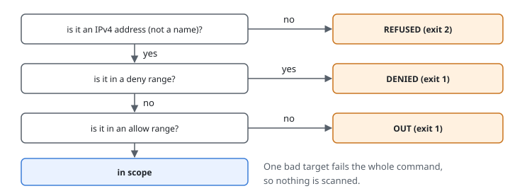

*Draft for owner review.* This is the first lesson of the cybersecurity track and the shortest in commands, on purpose. Every later lesson in the track runs tools that look like an attack when pointed at the wrong machine (port scans, log searches, evidence collection), so this one is about **permission**: whose machine it is, what you may do to it, and how to make the computer refuse to let you go outside that. **This is not legal advice.** Laws differ by country and change; the references below are where to start reading, not a verdict on what is lawful where you live.

**What was tested, and where.** The one script in this lesson, `wl-scope.sh` (about 60 lines of bash), was run on **Ubuntu 24.04.5** (bash 5.2.21) and **AlmaLinux 9.8** (bash 5.1.8) in the WinLab lab VMs, with the same results on both (`tests/verification/security/sc5.sh`). Output below is real. **Not tested:** nothing about the law, and nothing on Windows. The legal and standards statements come from the pages cited, which I fetched and read for the quoted parts only (checked 2026-11-22).

## Why this lesson comes first

Scanning, probing and collecting evidence are normal parts of defending a network, and they are also exactly what an intruder does. The difference is **permission**, not the command. The Nmap project's own legal page opens with the warning that "when used improperly, Nmap can (in rare cases) get you sued, fired, expelled, jailed, or banned by your ISP" ([Nmap: Legal Issues](https://nmap.org/book/legal-issues.html)), and the two statutes below are written around the same idea.

- The United States computer fraud statute, [18 U.S.C. § 1030](https://www.law.cornell.edu/uscode/text/18/1030), makes it an offence to intentionally access "a computer without authorization or exceeds authorized access" and thereby obtain information (that is one of several offences in the section; read the section, not my sentence).
- The UK [Computer Misuse Act 1990, section 1](https://www.legislation.gov.uk/ukpga/1990/18/section/1) is headed "Unauthorised access to computer material".

Two words in those quotations matter for a learner: **without authorization** (you were never allowed) and **exceeds authorized access** (you were allowed some things, and did others). Both are about what someone with the right to decide said you could do.

## What "authorized" means in practice

A professional security test is agreed **in writing before it starts**. NIST's [SP 800-115, Technical Guide to Information Security Testing and Assessment](https://csrc.nist.gov/pubs/sp/800/115/final) includes, in Appendix B, a template for **Rules of Engagement** (ROE). I read that appendix; its sections include the purpose, the **scope** ("test boundaries in terms of actions and expected outcomes"), assumptions and limitations, **risks**, **personnel** (contacts for the test team, management and the incident response team) and the **test schedule** (including the hours during which testing may happen). The template itself says it is "illustrative"; organisations structure their own.

For a home lab the document is one page, but it has the same parts. Write it before you test, and keep it with the results:

| Part | A home-lab answer |
|---|---|
| Who owns the systems and agrees? | You, and anyone else whose machines or network are involved (family, a flatmate, an employer's laptop on your Wi-Fi: **their** permission, not yours). |
| What is in scope? | Exact addresses or ranges, not "my network". |
| What is excluded? | The router your ISP manages, a neighbour's Wi-Fi, anything reached through the internet, any service run by someone else (a cloud account, a game server). |
| What may you do? | Port scan, log review, change configuration, *not* password guessing against a real account, *not* denial of service. |
| When? | A time window. |
| Who do you stop for? | Whom to call if something breaks. |
| What happens to the data? | Where results are stored and when they are deleted. |

**What WinLab's own lab is.** The training VMs are **yours** (they run on your computer), they sit on QEMU user-mode networking (the guest's `10.0.2.x` network is private to each VM and the only way in is the SSH port the app forwards to `127.0.0.1`), and nothing in this course asks you to touch any other machine. Everything in the cybersecurity track is written for that setting: **your own lab, defensive first.**

## Make the computer enforce the scope

A written scope is only as good as the moment of use. Typing the wrong address into a scan is the usual accident, and it is easy to guard against. `wl-scope.sh` reads a scope file and **refuses** unless every target is inside it. (Bash, so the shebang says bash; it uses `[[ =~ ]]`, arithmetic and arrays.)

```bash
#!/bin/bash
# wl-scope.sh: stop unless every target is inside the allowed ranges of a scope file.
# Usage:  wl-scope.sh SCOPEFILE TARGET...
# Scope file: one rule per line, "allow CIDR" or "deny CIDR"; blank lines and # comments are ignored. A deny wins over an allow.
# Exit status: 0 every target is in scope, 1 something is out of scope, 2 bad input.
# Targets must be IPv4 addresses, not names: a name can resolve to something else tomorrow.
set -u

die() { printf 'wl-scope: %s\n' "$*" >&2; exit 2; }

ip2int() {                       # 10.0.2.15 -> 167772687 ; returns 1 for anything that is not a dotted quad
  local ip=$1 a b c d
  [[ $ip =~ ^([0-9]{1,3})\.([0-9]{1,3})\.([0-9]{1,3})\.([0-9]{1,3})$ ]] || return 1
  a=${BASH_REMATCH[1]} b=${BASH_REMATCH[2]} c=${BASH_REMATCH[3]} d=${BASH_REMATCH[4]}
  (( a < 256 && b < 256 && c < 256 && d < 256 )) || return 1
  echo $(( (a << 24) | (b << 16) | (c << 8) | d ))
}

in_cidr() {                      # in_cidr INT CIDR : is the address inside the range?
  local ipint=$1 net=${2%/*} bits=32 netint mask
  [[ $2 == */* ]] && bits=${2#*/}
  [[ $bits =~ ^[0-9]+$ ]] && (( bits <= 32 )) || return 2
  netint=$(ip2int "$net") || return 2
  mask=$(( bits == 0 ? 0 : (0xFFFFFFFF << (32 - bits)) & 0xFFFFFFFF ))
  (( (ipint & mask) == (netint & mask) ))
}

(( $# >= 2 )) || die "usage: wl-scope.sh SCOPEFILE TARGET..."
scope=$1; shift
[[ -r $scope ]] || die "cannot read scope file: $scope"

allow=() deny=() n=0
while read -r verb cidr rest; do
  n=$((n + 1))
  [[ -z $verb || $verb == \#* ]] && continue
  [[ $verb == allow || $verb == deny ]] || die "$scope: rule $n: unknown word '$verb'"
  in_cidr 0 "$cidr" 2>/dev/null; (( $? != 2 )) || die "$scope: rule $n: '$cidr' is not an IPv4 address or range"
  if [[ $verb == allow && $cidr == */* ]] && (( ${cidr#*/} < 16 )); then die "$scope: rule $n: refusing to allow a range wider than /16 ($cidr)"; fi
  [[ $verb == allow ]] && allow+=("$cidr") || deny+=("$cidr")
done < "$scope"
(( ${#allow[@]} > 0 )) || die "$scope has no allow rules"

status=0
for t in "$@"; do
  ti=$(ip2int "$t") || { printf 'REFUSED  %-18s not an IPv4 address (names are not accepted)\n' "$t"; status=2; continue; }
  verdict=OUT
  for c in "${allow[@]}"; do in_cidr "$ti" "$c" && { verdict=IN; break; }; done
  for c in "${deny[@]}";  do in_cidr "$ti" "$c" && { verdict=DENIED; break; }; done
  case $verdict in
    IN) printf 'in scope  %s\n' "$t" ;;
    DENIED) printf 'DENIED    %-18s inside an excluded range\n' "$t"; (( status == 2 )) || status=1 ;;
    OUT) printf 'OUT       %-18s not in any allowed range\n' "$t"; (( status == 2 )) || status=1 ;;
  esac
done
exit $status
```

The scope file for the lab (written first, then used):

```text
# WinLab home lab, written down before any testing
allow 127.0.0.1          # this machine
allow 10.0.2.0/24        # the VM's own network
allow 192.168.50.0/24    # the lab LAN
deny  192.168.50.1       # the router: not part of the exercise
```

Real runs (Ubuntu 24.04.5; AlmaLinux 9.8 printed the same):

```text
$ wl-scope.sh lab.scope 127.0.0.1 10.0.2.15
in scope  127.0.0.1
in scope  10.0.2.15
exit status 0
$ wl-scope.sh lab.scope 192.168.50.10 192.168.50.1
in scope  192.168.50.10
DENIED    192.168.50.1       inside an excluded range
exit status 1
$ wl-scope.sh lab.scope 192.168.50.10 8.8.8.8
in scope  192.168.50.10
OUT       8.8.8.8            not in any allowed range
exit status 1
$ wl-scope.sh lab.scope example.com
REFUSED  example.com        not an IPv4 address (names are not accepted)
exit status 2
$ wl-scope.sh lab.scope 10.0.2.256
REFUSED  10.0.2.256         not an IPv4 address (names are not accepted)
exit status 2
```



```text
 IPv4 address? no -> REFUSED (2)
 in a deny range? yes -> DENIED (1)
 in an allow range? no -> OUT (1)
 otherwise -> in scope          one bad target fails the whole command
```

Three design choices are the point of the exercise:

- **Deny wins.** `192.168.50.1` is inside the allowed `/24` and still refused, because the exclusion is more specific than the permission. Exclusions are how you say "not the router".
- **Names are refused.** A name can resolve to a different address tomorrow, or to one you were never allowed to touch. Decide the address, write the address.
- **The guard also checks the scope file.** My **first** version of the lab scope file said `allow 127.0.0.0/8`, and the script refused it (`refusing to allow a range wider than /16 (127.0.0.0/8)`): I had written a range of sixteen million addresses where I meant one. The same checks reject `0.0.0.0/0`, `10.0.0.0/8`, an unknown word (`permit`), an impossible address (`10.0.0.999`), a file with only `deny` lines and a file that does not exist; all six returned status 2 with a message.

Use it as a gate in front of anything that touches the network:

```bash
scan() {
  wl-scope.sh lab.scope "$@" >/dev/null || { echo "not scanning: out of scope"; return 1; }
  for h in "$@"; do (exec 3<>/dev/tcp/$h/22) 2>/dev/null && echo "$h:22 open" || echo "$h:22 closed"; done
}
$ scan 127.0.0.1            ->  127.0.0.1:22 open
$ scan 127.0.0.1 8.8.8.8    ->  not scanning: out of scope
```

The second call scanned **nothing**, not even the in-scope first address: one bad target stops the whole batch, so a typo cannot half-run. (The `/dev/tcp` check is a bash feature; the next lessons use it and `nmap`.)

**Limits of the guard.** It protects against **accidents**, not against a person who edits the scope file; it checks addresses you type, not where a tool decides to connect (a tool that follows redirects or resolves names can go elsewhere); it handles IPv4 only. A scope file is a seatbelt, not a lock.

## Other kinds of permission you still need

- **Accounts and data.** Authorization to test a server is not authorization to read people's mail on it. Decide beforehand what you will do if you see personal data (stop, note where, report).
- **Third-party services.** A cloud provider's terms, a hosting company's acceptable-use policy and your ISP's contract may forbid scanning even your own resources hosted there. Read them before you start. This course never asks you to.
- **Employer and school systems.** Your own authorization is still not theirs. A WinLab VM on a work laptop is on the employer's network; ask.
- **Hands off real accounts.** Guessing passwords against a real login, even your own, can lock it. Test against accounts made for the lab.

## Common mistakes

- **"It's my network, so everything on it is mine."** The router belongs to your ISP in most homes; other devices belong to the people who own them.
- **Scope in your head.** Write it down before the test; a scope you remember is a scope you will quietly widen.
- **Scanning by name.** Use addresses, and check which addresses the name gives *before* the test and write them in the scope.
- **Allowing a wide range "just in case".** The guard above refuses it; do not remove that check.
- **Treating a guard as permission.** `in scope` means "inside what I wrote", not "allowed". The permission is the decision behind the file.

## Check yourself

1. Write the scope file for your own lab: which addresses, which exclusions. Run the guard on three in-scope and three out-of-scope addresses and explain every result.
2. Add a rule `allow 172.16.0.0/12` and run it. What happens, and why is that the right behaviour for a *guard*?
3. Why does one out-of-scope target stop the batch instead of scanning the others?
4. Name two things a ROE says that a list of IP addresses does not.

## Not tested, and honest limits

Nothing here is legal advice. I did not read the full statutes, only the sections quoted. I did not test the script on a shell other than bash 5.1 and 5.2, on IPv6, or on other Linux distributions. The Rules-of-Engagement summary is of NIST's template, not of any specific engagement. The cited pages were fetched on 2026-11-22; laws and guidance change.
