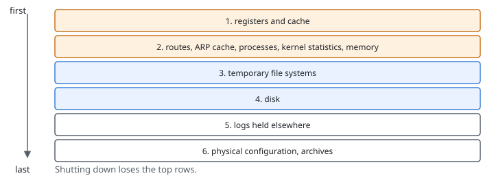

*Draft for owner review.* An **incident** is an event that threatens the confidentiality, integrity or availability of your systems: a suspicious login, an unexpected program, a changed file. **Incident response** is what you do about it, in an order that does not destroy the evidence you will need. This lesson builds and tests a small **triage collector** in bash on a lab VM that I deliberately "compromised" with five planted artifacts, then shows what the collector found, how to seal the evidence, how to recover a deleted program from memory, and what containment looks like. **Only your own lab VMs**, and everything planted here is fake and removed afterwards.

**What was tested, and where.** **Ubuntu 24.04.5** and **AlmaLinux 9.8** lab VMs, as root (`tests/verification/security/sc4.sh`, `wl-triage.sh`). The collector ran in 1.6 s on Ubuntu and 0.65 s on AlmaLinux and wrote 23 files. Output is real; process IDs vary. **Not tested:** a real compromise, memory capture (`LiME`, `avml`), disk imaging, a rootkit (the lesson says why this matters), other distributions, Windows (a later lesson), time synchronisation, off-host collection, chain-of-custody paperwork and the legal side. The incident-response frameworks cited were not read in full, only the parts named.

## Order matters: volatile first

Evidence disappears at different speeds. The IETF's [RFC 3227, Guidelines for Evidence Collection and Archiving](https://www.rfc-editor.org/rfc/rfc3227) (read in full; it is short) says: "When collecting evidence you should proceed from the volatile to the less volatile", and gives an example order: registers and cache; **routing table, ARP cache, process table, kernel statistics, memory**; temporary file systems; **disk**; remote logging data; physical configuration; archival media. It also lists **things to avoid**: "Don't shutdown until you've completed evidence collection" (the attacker may have altered the shutdown scripts to destroy evidence), "Don't trust the programs on the system. Run your evidence gathering programs from appropriately protected media", and don't run programs that modify the access time of every file.



```text
 registers -> routes, ARP, processes, memory -> temporary file systems -> disk -> remote logs -> archives
 (most volatile first)
```

That is the template for the collector: running processes and network sockets first (they vanish when the process or machine stops), then persistence mechanisms and logs on disk. **My collector breaks the second rule above on purpose, and that is a limitation, not a recommendation**: it runs from the suspect machine's own disk and uses the machine's own `ps`, `ss` and `find`. On a real compromise a rootkit can make those programs lie. It is a practice tool for the *shape* of triage; a real one would run from read-only media.

The older NIST incident-response model had four phases: **preparation; detection and analysis; containment, eradication and recovery; post-incident activity**. The current revision, [SP 800-61 Rev. 3](https://csrc.nist.gov/pubs/sp/800/61/r3/final), maps incident response onto the NIST Cybersecurity Framework 2.0 functions (it includes a table relating the previous phases to the CSF functions Govern, Identify, Protect, Detect, Respond and Recover). I read that table and the lines around it; I did not read the rest. This lesson is about the middle of the older model: analysing and containing.

## The collector

`wl-triage.sh OUTDIR` collects, in volatility order: time, uptime, logged-in users, process tree, sockets, addresses, routes, kernel modules, **processes running a deleted or temporary file**; then persistence (accounts, sudoers, SSH keys, cron, timers, local unit files, enabled units); then logs; then recently changed files; then it **seals** the result with SHA-256 sums. It only reads, and writes into `OUTDIR`. Run as root. It has a bash shebang (it uses `local` and `bash -c`); I did not test it under dash.

```bash
#!/bin/bash
# wl-triage.sh: collect volatile and persistent evidence on a Linux host, most volatile first.
# Usage: wl-triage.sh OUTDIR   (run as root; it only reads, and writes into OUTDIR)
# Write the evidence to a different disk or a mounted share when you can: writing to the suspect disk changes it.
set -u
out=${1:?usage: wl-triage.sh OUTDIR}
mkdir -p "$out" && chmod 700 "$out"
run() { local name=$1; shift; { echo "# $(date -u +%FT%TZ)  $*"; "$@" 2>&1; } > "$out/$name.txt"; }

# 1. most volatile first: time, who is on, processes, network, kernel
run 00-time        date -u
run 01-uptime      uptime
run 02-who         w
run 03-processes   ps -eo pid,ppid,user,lstart,stat,args --forest
run 04-sockets     ss -tunap
run 05-addresses   ip -br addr
run 06-routes      ip route
run 07-modules     lsmod
# processes running a deleted or temporary file
{ echo "# processes whose executable is deleted or in a temp directory"
  for p in /proc/[0-9]*; do
    exe=$(readlink "$p/exe" 2>/dev/null) || continue
    case $exe in *" (deleted)"|/tmp/*|/var/tmp/*|/dev/shm/*) echo "${p#/proc/} $exe";; esac
  done; } > "$out/08-odd-exe.txt"

# 2. persistence: the places a foothold survives a reboot
run 10-passwd      getent passwd
run 11-uid0        awk -F: '$3 == 0 { print $1 }' /etc/passwd
run 12-sudoers     grep -rHv '^#\|^$' /etc/sudoers /etc/sudoers.d
{ echo "# authorized_keys files"; for f in /root/.ssh/authorized_keys /home/*/.ssh/authorized_keys; do [ -f "$f" ] && { echo "== $f ($(stat -c '%y' "$f"))"; cut -c1-80 "$f"; }; done; } > "$out/13-authkeys.txt"
run 14-cron        bash -c 'for f in /etc/crontab /etc/cron.d/* /var/spool/cron/* /var/spool/cron/crontabs/*; do [ -f "$f" ] && { echo "== $f"; grep -v "^#" "$f"; }; done'
run 15-timers      systemctl list-timers --all --no-pager
run 16-units-local bash -c 'ls -l --time-style=long-iso /etc/systemd/system/*.service /etc/systemd/system/*.timer 2>/dev/null'
run 17-enabled     systemctl list-unit-files --state=enabled --no-pager

# 3. logs: copy, do not trust the originals alone
run 20-last        last -F -n 30
run 21-lastb       lastb -F -n 30
run 22-journal-auth journalctl --no-pager -o short-iso -n 300 _COMM=sshd _COMM=sudo _COMM=su

# 4. files changed recently under the places attackers write
run 30-recent-etc  find /etc /usr/local /root /home /tmp /var/tmp -xdev -type f -mtime -2 -printf '%TY-%Tm-%Td %TH:%TM  %u:%g  %m  %p\n'
run 31-suid        find / -xdev -type f -perm -4000 -printf '%m %u %p\n'

# 5. seal the evidence
( cd "$out" && sha256sum *.txt > SHA256SUMS )
echo "collected $(ls "$out" | wc -l) files in $out"
```

Every file starts with a comment line holding the **UTC time and the exact command**: later you must be able to say what was run, when. This script is systemd-specific in four lines (`systemctl` twice, `journalctl`, and the listing of `/etc/systemd/system`); on a dinit system such as Chimera Linux those lines would fail and the other sections would still run (I did not run it there).

## Plant a pretend intruder

Before running it I created five things an intruder might leave, all fake, in the lab VM only:

```text
a user "wl-svc" with an SSH key from "attacker@evil.example" in its authorized_keys
/etc/cron.d/wl-update          */5 * * * * root /tmp/.wl-update >/dev/null 2>&1
/tmp/.wl-beacon                a copy of /bin/sleep, running as "/tmp/.wl-beacon 100000"
/tmp/.wl-gone                  the same, started and then DELETED while still running
/etc/systemd/system/wl-backdoor.service   "Totally normal update helper", enabled, listening on 0.0.0.0:4444
```

A listening Python web server stands in for a real implant. The two `/tmp` programs show running code that is not where it should be.

## What the collector showed

Each plant appeared in the file you would expect, on both VMs:

```text
--- 08-odd-exe.txt
45021 /tmp/.wl-beacon
45024 /tmp/.wl-gone (deleted)
```

**A program running from `/tmp`, or whose file was deleted after it started, is a classic sign.** The kernel still knows the path; `readlink /proc/PID/exe` says `(deleted)`.

```text
--- 13-authkeys.txt
== /home/wl-svc/.ssh/authorized_keys (2026-11-22 13:20:52.195589463 +0000)
ssh-ed25519 AAAAC3NzaC1lZDI1NTE5AAAAIWLLABFAKEKEYWLLABFAKEKEYWLLABFAKEKEYAAAA at...
--- 14-cron.txt      (among the distribution's own entries)
== /etc/cron.d/wl-update
*/5 * * * * root /tmp/.wl-update >/dev/null 2>&1
--- 16-units-local.txt   (the symlinks are the distribution's; the plain file is not)
-rw-r--r-- 1 root root 157 2026-11-22 13:20 /etc/systemd/system/wl-backdoor.service
--- 04-sockets.txt
tcp LISTEN 0 5 0.0.0.0:4444 0.0.0.0:* users:(("python3",pid=45116,fd=3))
--- 03-processes.txt (the process tree with start times)
 45021 45003 root Sun Nov 22 13:20:52 2026 S \_ /tmp/.wl-beacon 100000
 45116 1 root Sun Nov 22 13:20:53 2026 Ss /usr/bin/python3 -m http.server 4444 --bind 0.0.0.0
--- 30-recent-etc.txt
2026-11-22 13:20  root:root  644  /etc/cron.d/wl-update
2026-11-22 13:20  root:root  644  /etc/systemd/system/wl-backdoor.service
```

Notice how the **listing of local unit files** works: on a clean system `/etc/systemd/system` holds mostly symlinks to the vendor's units; a regular file, newly dated, with a friendly description is worth reading. The authorized-keys check shows the **file's modification time**, which dates when the key was added (the attacker can alter timestamps with `touch`, so treat times as hints). And the **timeline** (`30-recent-etc`, from `find -mtime`) puts four artifacts into one minute.

What the collector did **not** reveal: `11-uid0.txt` said only `root`, so there was no second UID-0 account (the other lesson's check) and that is a *negative* finding that is worth recording too. The pretend intruder's cron job refers to `/tmp/.wl-update`, a file I never created, so that cron line is **dangling**: it would do nothing, and still tells you what the intruder intended. A real intruder's files are often incomplete.

**The collector contaminated its own timeline.** `30-recent-etc` listed `/root/wl-evidence/...`, the evidence directory itself, among the "recently changed files", because I wrote the evidence under `/root`, which the `find` also searches. Also, writing evidence to the suspect disk changes it. Both are reasons to write to **another disk or a mounted share** and to exclude that path.

## Seal the evidence

```text
$ ( cd /root/wl-evidence && sha256sum -c SHA256SUMS | grep -vc ': OK$' )
0
$ echo tampered >> /root/wl-evidence/11-uid0.txt
$ ( cd /root/wl-evidence && sha256sum -c SHA256SUMS | grep -v ': OK$' )
11-uid0.txt: FAILED
sha256sum: WARNING: 1 computed checksum did NOT match
```

A checksum list proves the files did not change **after** sealing, **if the list itself is protected** (copy `SHA256SUMS` somewhere separate, or sign it, or write it down); someone who can edit the files can edit the sums beside them. Chain-of-custody records (who held the evidence, when) are the human part; I did not test any of that.

## Recover a deleted program from memory

`/tmp/.wl-gone` was deleted while running. The kernel keeps the program's image open through `/proc`:

```text
$ for p in /proc/[0-9]*; do readlink $p/exe 2>/dev/null | grep -q 'wl-gone (deleted)' && echo ${p#/proc/}; done
45024
$ ls -l /proc/45024/exe | sed 's/.*-> //'
/tmp/.wl-gone (deleted)
$ cp /proc/45024/exe /root/wl-evidence/recovered-wl-gone
$ sha256sum /root/wl-evidence/recovered-wl-gone /bin/sleep | awk '{print $1}' | uniq -c
      2 8ac215ec4c1ce4a9c23a10cd3e5898d60419bdfab1ac7444d6bdd1690701de24
```

The recovered file's hash is the same as `/bin/sleep`'s (`uniq -c` collapsed the two identical lines to one with a count of 2), which is what I copied. Copy the file **before** killing the process; once it exits, the data is gone. (On AlmaLinux the hash was `6f6167...`, a different `sleep`.) In a real incident, a hash is what you look up in a malware database; I did not do that, and this is not malware analysis.

## Contain, then clean up

**Containment** stops the harm without destroying evidence. In the lab:

```text
$ systemctl disable --now wl-backdoor        Removed "/etc/systemd/system/multi-user.target.wants/wl-backdoor.service".
$ pkill -f wl-beacon; pkill -f wl-gone
$ usermod -L wl-svc; passwd -S wl-svc
wl-svc L 2026-11-22 0 99999 7 -1             (AlmaLinux: wl-svc LK 2026-11-22 0 99999 7 -1 (Password locked.))
                                             (this locked the password only: see the test below)
```

**Locking the password is not enough to stop an SSH key login.** I tested it (`tests/verification/security/sc8.sh`, both VMs, `UsePAM yes`): a throwaway account with an authorized key kept logging in after `usermod -L`, and so did a brand-new account that had no password at all (those start out locked, `passwd -S` printed `L` before I touched anything):

```text
1. before anything                         -> logged-in as wl-svc          (passwd -S: L)
2. password locked (usermod -L)            -> logged-in as wl-svc
3. + shell set to nologin                  -> This account is currently not available.
4. account expired (usermod -e 1)          -> Connection closed ...  "account wl-svc has expired" / "Access denied for user wl-svc by PAM account configuration"
5. authorized_keys moved away              -> Permission denied (publickey).
```

So for an account that may have a key, contain it with **`usermod -e 1`** (expire the account; `chage -l` then shows `Account expires: Jan 02, 1970`) and move its `authorized_keys` aside as evidence. A `nologin` shell stopped the shell but the key was still accepted (the message came from the login shell, and I did not test port forwarding). Still lock rather than delete, so you keep the account's files as evidence. Disable the service and kill the process **after** you have collected them. For a real incident the choice of what to isolate belongs in your plan before it happens: pulling the network cable (or the VM's network) keeps the machine running and its memory intact while stopping outside access, and is, in my reading of the RFC.s warning about shutdown, usually better than powering off (my judgement; not tested here). In a real compromise **assume the account's keys and passwords are exposed** and rotate them, and consider rebuilding the machine from a known-good image rather than cleaning it, because you cannot prove you found everything. **Eradication** and **recovery** (rebuild, restore from backup, verify) are outside what I tested. After the exercise I removed the unit, the cron file, the beacon, the account and the evidence directory.

## Lessons learned

The last phase is a short written review, within days: what happened, how it was found, how long before it was noticed, what worked, what to change. A home-lab version is five lines in a notes file. Typical outputs: a new detection (the logging lesson's report), a new check (the baseline script), a fix to the cause.

## Common mistakes

- **Rebooting first.** The processes, sockets and memory you needed are gone (RFC 3227).
- **Trusting the suspect's tools.** `ps` and `ls` on a rooted host can lie; use known-good copies from read-only media for real incidents.
- **Writing evidence to the suspect disk.** It overwrites things; write elsewhere.
- **Deleting the evidence while cleaning.** Copy the deleted binary out of `/proc` before killing the process.
- **Cleaning one artifact and stopping.** There were five places; check persistence everywhere (accounts, keys, cron, units, shell profiles, which this collector does not cover).
- **No timeline.** Without times you cannot connect the events; keep clocks right (not tested here).
- **Trusting timestamps.** They are hints that an intruder can change.

## Practice: the night visitor challenge

The lab **Challenge: the night visitor** (open it from the **Challenges** menu, or from this lesson's **Practice** menu) gives you a server where something happened and does not say what. You find five **flags** in the traces, then contain the intrusion while a real service keeps running, using what is above: the order of collection, the persistence places, recovering a deleted program, and containment that keeps the evidence. The collector will not find everything for you. The flags are different each time the challenge is prepared. Everything planted is a harmless stand-in, and the VM's network is isolated. It was built and solved with the reference commands on Ubuntu 24.04 only.

## Check yourself

1. Plant two artifacts of your own in a lab VM (a user, a cron line). Run the collector and say which file shows each.
2. Why is `/tmp/x (deleted)` suspicious, and how do you recover that file?
3. Put the first six steps of your response in order for a suspected intruder and say why the order matters (use RFC 3227).
4. Name three limits of running a collector from the suspect machine.
5. Edit one evidence file and prove it with `sha256sum -c`. What protects the checksum list itself?

## Not tested, and honest limits

A real intrusion; memory acquisition; disk imaging; rootkits; shell profile and `~/.ssh/rc` persistence; kernel-module and LD_PRELOAD tricks; the dinit variant; off-host collection; clock synchronisation; and what the law requires you to do and report. The planted artifacts are simple on purpose, and a real intruder would not name a service `wl-backdoor`.
