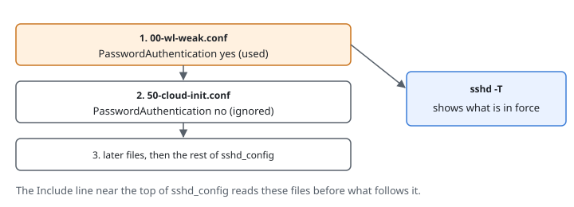

*Draft for owner review.* **Hardening** is making a machine harder to misuse: fewer open doors, tighter defaults, nobody with more access than they need. **Checking** is the part you can automate: ask the machine, in a repeatable way, whether it still matches what you decided. This lesson builds a small read-only checker in bash, plants the weaknesses it should find, fixes them and shows the checker agree, then runs **Lynis**, a ready-made auditor, and compares. Your own lab machines only; see `security.authorization-and-scope`.

**What was tested, and where.** The same two lab VMs as the logging lesson, as root (`tests/verification/security/sc2.sh`, `sc3.sh` and a small extra run):

- **Ubuntu 24.04.5 LTS**: OpenSSH 9.6p1, AppArmor, `ufw` present but inactive; Lynis **3.0.9** from the Ubuntu repository.
- **AlmaLinux 9.8**: OpenSSH 9.9, SELinux enforcing, no `firewalld` installed on this image; Lynis **3.1.7** and nmap 7.92 from EPEL (installed with `dnf install epel-release` first).

Output is real. **Not tested:** other distributions, a CIS Benchmark or a DISA STIG (I did not read either; they are catalogues of exactly this kind of check, see the references), Windows (later lesson), an unattended-upgrades or `dnf-automatic` setup, kernel-module blacklisting, boot-loader passwords, disk encryption, and `firewalld`/`ufw` rule sets (the `networking.ports-and-firewalls` lesson covers firewalls).

## A checker you can read in one sitting

The script below prints one line per check, `PASS`, `FAIL` or `INFO`, changes nothing, and exits with the number of failures (so a scheduler can act on it). It has a bash shebang (it uses `$(( ))` arithmetic, `case` and functions; I did not test it under dash). Run it as root because it reads `/etc/shadow`.

```bash
#!/bin/bash
# wl-baseline.sh: read-only checks of a few common Linux weaknesses. Prints PASS, FAIL or INFO per check.
# Run as root. It changes nothing. Exit status is the number of FAIL lines (255 at most).
fails=0
pass() { printf 'PASS  %s\n' "$1"; }
fail() { printf 'FAIL  %s\n' "$1"; fails=$((fails + 1)); }
info() { printf 'INFO  %s\n' "$1"; }

# 1. sshd effective settings (sshd -T prints what the daemon would use)
sshd_opt() { sshd -T 2>/dev/null | awk -v k="$1" '$1 == k { print $2; exit }'; }
v=$(sshd_opt permitrootlogin);       case $v in no|prohibit-password|without-password) pass "sshd permitrootlogin = $v";; *) fail "sshd permitrootlogin = $v";; esac
v=$(sshd_opt passwordauthentication); [ "$v" = no ] && pass "sshd passwordauthentication = no" || fail "sshd passwordauthentication = $v"
v=$(sshd_opt permitemptypasswords);   [ "$v" = no ] && pass "sshd permitemptypasswords = no" || fail "sshd permitemptypasswords = $v"
v=$(sshd_opt maxauthtries);           [ "${v:-99}" -le 4 ] && pass "sshd maxauthtries = $v" || fail "sshd maxauthtries = $v (want 4 or less)"

# 2. accounts
extra=$(awk -F: '$3 == 0 && $1 != "root" { print $1 }' /etc/passwd | paste -sd, -)
[ -z "$extra" ] && pass "only root has UID 0" || fail "other accounts with UID 0: $extra"
empty=$(awk -F: '$2 == "" { print $1 }' /etc/shadow | paste -sd, -)
[ -z "$empty" ] && pass "no account has an empty password" || fail "empty password: $empty"
nopw=$(grep -rhE '^[^#].*NOPASSWD' /etc/sudoers /etc/sudoers.d 2>/dev/null | wc -l)
info "sudoers lines with NOPASSWD: $nopw"

# 3. files
[ "$(stat -c %a /etc/shadow)" -le 640 ] && pass "/etc/shadow mode $(stat -c %a /etc/shadow)" || fail "/etc/shadow mode $(stat -c %a /etc/shadow)"
ww=$(find / -xdev \( -path /proc -o -path /sys \) -prune -o -type f -perm -0002 -print 2>/dev/null | head -5 | paste -sd' ' -)
[ -z "$ww" ] && pass "no world-writable regular files on the root filesystem" || fail "world-writable files: $ww"
nosticky=$(find / -xdev -type d -perm -0002 ! -perm -1000 -print 2>/dev/null | head -5 | paste -sd' ' -)
[ -z "$nosticky" ] && pass "every world-writable directory has the sticky bit" || fail "no sticky bit: $nosticky"
info "setuid files on the root filesystem: $(find / -xdev -type f -perm -4000 2>/dev/null | wc -l)"

# 4. network
listen=$(ss -H -tln | awk '{ print $4 }' | grep -vE '^(127\.|\[::1\]|::1)' | sort -u | paste -sd' ' -)
info "TCP listeners on non-loopback addresses: ${listen:-none}"
fwd=$(sysctl -n net.ipv4.ip_forward); [ "$fwd" = 0 ] && pass "net.ipv4.ip_forward = 0" || fail "net.ipv4.ip_forward = $fwd"

# 5. mandatory access control and firewall (whichever exists)
if command -v getenforce >/dev/null; then
  [ "$(getenforce)" = Enforcing ] && pass "SELinux Enforcing" || fail "SELinux $(getenforce)"
elif command -v aa-status >/dev/null; then
  aa-status --enabled 2>/dev/null && pass "AppArmor enabled" || fail "AppArmor not enabled"
fi
if command -v ufw >/dev/null; then info "ufw: $(ufw status | head -1)"; fi
if command -v firewall-cmd >/dev/null; then info "firewalld: $(firewall-cmd --state 2>&1)"; fi

printf '%s failed check(s)\n' "$fails"
exit $(( fails > 255 ? 255 : fails ))
```

Three habits in that script are worth copying. It asks `sshd -T` what the **running configuration would be** instead of grepping `sshd_config` (the file is not the answer: see "First value wins" below). It uses `find -xdev` so it stays on the root filesystem and does not wander into network mounts or `/proc`. And its exit status is a number a scheduler can test.

**What I got on the clean images** (both VMs, before any change):

```text
PASS  sshd permitrootlogin = without-password      (sshd -T spells prohibit-password this way)
PASS  sshd passwordauthentication = no
PASS  sshd permitemptypasswords = no
FAIL  sshd maxauthtries = 6 (want 4 or less)
PASS  only root has UID 0
PASS  no account has an empty password
INFO  sudoers lines with NOPASSWD: 1
PASS  /etc/shadow mode 640            (AlmaLinux: mode 0)
PASS  no world-writable regular files on the root filesystem
PASS  every world-writable directory has the sticky bit
INFO  setuid files on the root filesystem: 13       (AlmaLinux: 15)
INFO  TCP listeners on non-loopback addresses: 0.0.0.0:22 [::]:22      (AlmaLinux: also 0.0.0.0:111 [::]:111)
PASS  net.ipv4.ip_forward = 0
PASS  AppArmor enabled                (AlmaLinux: SELinux Enforcing)
INFO  ufw: Status: inactive           (AlmaLinux: no firewall line; firewalld is not installed)
1 failed check(s)
```

Things the checker told me that I did not expect:

- **`maxauthtries = 6` fails my own rule.** That is OpenSSH's default; "4 or less" is **my policy choice**, not a standard. A check is only as good as the rule behind it, so write the reason next to every rule.
- **AlmaLinux's `/etc/shadow` is mode `0`** (it prints as `000`) while Ubuntu's is `640` owned by group `shadow`. Both pass; root bypasses the permission bits. A checker with the rule "must be 640" would wrongly fail Red Hat systems: I wrote the test as "not more permissive than 640".
- **AlmaLinux listens on port 111** (`rpcbind`), which nobody asked for on a lab VM; Ubuntu does not. That is the kind of line `INFO` exists for: a **decision to make**, not a defect to fix blindly. `rpcbind` is the RPC port mapper (NFS is one user of it); if nothing on your lab needs it, stopping and disabling the service is the follow-up (I did not run that, and did not test what else depends on it).
- **The setuid list changes when you install packages.** The Ubuntu count was 13 in this run; after I later installed `cifs-utils` for the Samba lesson it contained `/usr/sbin/mount.cifs` as well. Keep the list and diff it over time.

## Plant weaknesses, then find them

Checks that only ever pass prove little. I planted seven weaknesses (on a lab VM, with real files, never on a machine that matters):

```bash
printf 'PermitRootLogin yes\nPasswordAuthentication yes\nMaxAuthTries 10\n' > /etc/ssh/sshd_config.d/00-wl-weak.conf
useradd -m -o -u 0 -g 0 wl-rootalias            # a second account with UID 0
useradd -m wl-nopass; passwd -d wl-nopass        # an account with an empty password
echo 'wl-nopass ALL=(ALL) NOPASSWD:ALL' > /etc/sudoers.d/wl-weak
touch /usr/local/share/wl-open.conf; chmod 666 /usr/local/share/wl-open.conf
mkdir /srv/wl-shared; chmod 777 /srv/wl-shared   # world-writable, no sticky bit
```

The checker, run again (identical on both VMs):

```text
FAIL  sshd permitrootlogin = yes
FAIL  sshd passwordauthentication = yes
PASS  sshd permitemptypasswords = no
FAIL  sshd maxauthtries = 10 (want 4 or less)
FAIL  other accounts with UID 0: wl-rootalias
FAIL  empty password: wl-nopass
INFO  sudoers lines with NOPASSWD: 2
FAIL  world-writable files: /usr/local/share/wl-open.conf
FAIL  no sticky bit: /srv/wl-shared
7 failed check(s)
```

**Seven for seven.** (`PermitEmptyPasswords` stayed `no`: an empty password was set, but `sshd` refuses empty passwords unless told otherwise, a good example of two settings protecting one thing.)

**First value wins.** My drop-in is named `00-wl-weak.conf`. `sshd_config` starts with `Include /etc/ssh/sshd_config.d/*.conf` (line 12 on Ubuntu, line 15 on AlmaLinux), and `sshd` uses the **first** value it reads for a keyword, so `00-` is read **before** the image's own `50-cloud-init.conf`, which says `PasswordAuthentication no`. My file won:

```text
$ sshd -T | grep -iE '^(permitrootlogin|passwordauthentication|maxauthtries) '
maxauthtries 10
permitrootlogin yes
passwordauthentication yes
$ ls /etc/ssh/sshd_config.d/
00-wl-weak.conf  50-cloud-init.conf  60-cloudimg-settings.conf
```



```text
 00-wl-weak.conf: PasswordAuthentication yes  (first, so used)
 50-cloud-init.conf: PasswordAuthentication no (ignored)
 ask the daemon: sshd -T
```

That is how a settings file nobody reviewed can quietly undo a hardening step, and why you ask `sshd -T` rather than reading one file. (`sshd -t` only checks syntax: it printed `sshd -t ok` for the weak configuration.) The sshd_config(5) page ([man.openbsd.org](https://man.openbsd.org/sshd_config)) documents `Include` and the first-value rule.

**Fixing, and a cleanup surprise.** `rm` the three files and `rmdir` the directory, then `userdel`. Removing the UID-0 alias needs `-f`: plain `userdel -r wl-rootalias` printed `userdel: user wl-rootalias is currently used by process 1` and **did not remove it**, because the account has the same user id as root, which owns process 1. `userdel -f -r wl-rootalias` removed it (and still printed the warning). After all that the checker was back to `1 failed check(s)`, the `maxauthtries` policy line.

## Look at what is exposed

Two views of the same fact, from inside the machine, and a bash-only probe:

```text
$ ss -tlnp                       (what is listening, and which process)
LISTEN 0 4096 0.0.0.0:22 ... users:(("sshd",pid=950,fd=3),("systemd",pid=1,fd=82))
$ (exec 3<>/dev/tcp/127.0.0.1/8080) && echo open       (no tools needed)
```

The next lesson, `security.own-lab-recon`, does this properly. For hardening the questions are: **which of these listeners do I use**, and **is each bound to the addresses it should be** (`0.0.0.0` means every interface; `127.0.0.1` means this machine only). A service you do not need should be stopped **and disabled**, not just ignored.

Kernel settings are another cheap category. A few values on both machines:

```text
                                   Ubuntu 24.04   AlmaLinux 9.8
kernel.randomize_va_space             2              2
fs.protected_symlinks                 1              1
kernel.dmesg_restrict                 1              0
net.ipv4.conf.all.rp_filter           2              0
net.ipv4.conf.all.accept_redirects    1              1
```

The two images differ in four of six values. Which are "right" depends on your threat model, which is the point: **hardening is not a single list**. I did not change any of them. (`sysctl` settings are persisted in `/etc/sysctl.d/*.conf`; I did not test persistence here.)

## Lynis, a ready-made auditor

[Lynis](https://cisofy.com/documentation/lynis/) is an open-source shell-script auditor. It runs hundreds of tests and prints a **hardening index** and suggestions. It is not a substitute for knowing your system, but it finds things you did not think of. Installing it from the distribution repositories:

```text
Ubuntu:     sudo apt-get install lynis            (3.0.9 on Ubuntu 24.04)
AlmaLinux:  sudo dnf install epel-release && sudo dnf install lynis      (3.1.7)
```

Running it (`lynis audit system --quick`, as root; `--quick` skips the "press enter" pauses) took a few seconds here and exited 0:

```text
                      Ubuntu 24.04 (3.0.9)     AlmaLinux 9.8 (3.1.7)
Hardening index              60                       66
Tests performed             258                      240
Warnings                      2                        (no Warnings line in the output)
Suggestions                  46                       39
```

The results are written to **`/var/log/lynis.log`** (the full trail) and **`/var/log/lynis-report.dat`** (key=value, easy to script against), both owned by root with mode `640` (`-rw-r-----`). Some suggestions from the report:

```text
suggestion[]=DEB-0880|Install fail2ban to automatically ban hosts that commit multiple authentication errors.
suggestion[]=BOOT-5122|Set a password on GRUB boot loader to prevent altering boot configuration (e.g. boot in single user mode without password)
suggestion[]=KRNL-5820|If not required, consider explicit disabling of core dump in /etc/security/limits.conf file
suggestion[]=AUTH-9286|Configure minimum password age in /etc/login.defs
suggestion[]=BOOT-5264|Consider hardening system services|Run '/usr/bin/systemd-analyze security SERVICE' for each service
suggestion[]=LYNIS|This release is more than 4 months old. Check the website or GitHub to see if there is an update available.
```

Read these critically: a **suggestion is not a defect**. `fail2ban` is a tool choice, a GRUB password matters if someone can touch the machine, and a high index on a machine nobody patches is a false comfort. The last suggestion is also a fact worth noticing: the version from the distribution repository was **older than the upstream release**, so the auditor itself had aged. (The `systemd-analyze security` hint connects to the sandboxing section of the `linux.systemd-advanced` lesson.) The two indexes (60 and 66) are **not comparable across distributions or Lynis versions**: different test sets ran (258 and 240), so use the index to compare **one machine against itself over time**.

## Common mistakes

- **Trusting one file.** Ask the running daemon: `sshd -T`, `ss -tlnp`, `systemctl is-enabled`, not just a config file.
- **A check with no reason.** Write why next to each rule, or you cannot tell policy from a standard.
- **Fixing every suggestion.** Decide per finding; some are risks you accept and write down.
- **Rules that assume one distribution.** A "must be 640" test failed Red Hat's mode 000 in principle; test "not more permissive than".
- **Planting weaknesses on a real machine.** Do it in a VM, restore it afterwards.
- **Disabling SELinux or AppArmor to "make it work".** Fix the label or profile (see the security fundamentals lesson).
- **Believing the index.** 66 is not "safer" than 60; compare a machine to its own past.

## Check yourself

1. Run the checker on a lab VM. Pick one `FAIL` and one `INFO` and decide what to do about each, and why.
2. Plant two of the seven weaknesses, confirm the checker finds them, fix them and confirm it passes again.
3. Add a check of your own (for example: is `PermitRootLogin` set in more than one file?) and say what rule it enforces.
4. Run Lynis. Pick three suggestions you would not apply on a lab VM and explain.
5. Why does `sshd -t` succeed on the weak configuration?

## Not tested, and honest limits

A CIS Benchmark or STIG comparison; other distributions; automatic updates; kernel-module and boot-loader hardening; disk encryption; firewall rule sets; sysctl persistence; and acting on the `rpcbind` finding. Lynis was run once per machine. The setuid count on AlmaLinux also rose (15 to 16) after I installed other packages and I did not identify which file. The "four or less" `MaxAuthTries` is my own choice.
