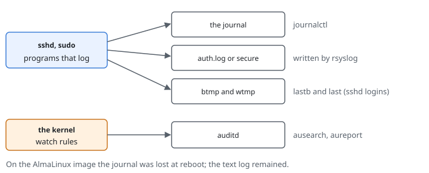

*Draft for owner review.* Detection starts with knowing **what your machine already writes down**. This lesson shows where a Linux system records logins, failed logins and `sudo`, how to turn those lines into a short report, and how to use the kernel audit system (`auditd`) to be told when a sensitive file such as `/etc/passwd` or `/etc/sudoers.d` is changed. Only your own lab machines; see `security.authorization-and-scope` first.

**What was tested, and where.** Two lab VMs, as root, with attempts generated against their own `sshd` over `127.0.0.1` (`tests/verification/security/sc1.sh`, `sc2.sh` step 6 and `sc6.sh`):

- **Ubuntu 24.04.5 LTS**: kernel 6.8.0-147, systemd 255, OpenSSH 9.6p1, rsyslog; `auditd` was **not installed**, I installed it with `apt-get install auditd`.
- **AlmaLinux 9.8**: kernel 5.14.0-687, systemd 252, OpenSSH 9.9, rsyslog, `auditd` running by default, SELinux enforcing.

The output is real; source ports are shown as `N` where they would distract. **Not tested:** other distributions, `syslog-ng` or other log daemons, shipping logs to another machine, `fail2ban` or similar (the lesson only *reads* failures, it does not block anyone), the Windows side (a later lesson), and rules surviving a reboot (see the audit section).

## Where Linux writes security events

Two places, with the same events in both on these machines:

| | Ubuntu 24.04 | AlmaLinux 9.8 |
|---|---|---|
| The SSH service unit | `ssh` | `sshd` |
| The journal | `journalctl -u ssh` | `journalctl -u sshd` |
| Text log from rsyslog | `/var/log/auth.log` | `/var/log/secure` |
| Failed-login database | `/var/log/btmp` (read with `lastb`) | the same |
| Successful-login database | `/var/log/wtmp` (read with `last`) | the same |
| Journal kept across reboots? | yes (`/var/log/journal` exists) | **no** (`/var/log/journal` does not exist) |



```text
 sshd, sudo -> journal, auth.log or secure; logins -> btmp (lastb), wtmp (last)
 kernel watch rules -> auditd (ausearch, aureport)
```

The last row matters: on the AlmaLinux image the journal is **volatile**, it lives in `/run` and is gone after a reboot (`Storage=auto` in `journald.conf` keeps a persistent journal only if `/var/log/journal` exists; see [journald.conf(5)](https://www.freedesktop.org/software/systemd/man/latest/journald.conf.html)). The text file `/var/log/secure` is what survives there. An attacker's first visit can be the last thing a volatile journal remembers, so decide where your evidence lives **before** you need it. The NIST log-management guide, [SP 800-92](https://csrc.nist.gov/pubs/sp/800/92/final), covers log rotation, archival and retention for exactly this reason (I read those sections' headings; the guide is long and I did not read it all). The `alma-journal-volatile` lab in this course covers the fix.

## What a failed SSH login looks like

I made four failed attempts, three as accounts that do not exist and one as an account that does but has no key:

```text
$ ssh -o BatchMode=yes admin@127.0.0.1 true      ->  admin@127.0.0.1: Permission denied (publickey).
```

On Ubuntu the journal (`journalctl -u ssh --since "-2min"`) then held:

```text
sshd[1256]: Invalid user admin from 127.0.0.1 port 45992
sshd[1256]: Connection closed by invalid user admin 127.0.0.1 port 45992 [preauth]
sshd[1260]: Invalid user oracle from 127.0.0.1 port 46002
...
sshd[1276]: Connection closed by authenticating user wl-victim 127.0.0.1 port 46016 [preauth]
```

AlmaLinux printed the same sentences from a differently named program, `sshd-session[1207]` instead of `sshd[1256]` (its OpenSSH 9.9 handles each connection in a separate `sshd-session` process, so a search for the program name `sshd` would miss these lines; I did not look up when OpenSSH made that change). Two different wordings to learn:

- **`Invalid user NAME from ADDRESS`**: the account does not exist. Scanners and password guessers produce these in bulk.
- **`Connection closed by authenticating user NAME ...`**: the account exists, the client gave up during authentication.

The text log has the same lines with a timestamp and host name in front (`grep -i 'invalid user' /var/log/auth.log`, or `/var/log/secure` on AlmaLinux).

**`lastb` and `last`.** `sshd` also writes failures for **non-existent** users into `/var/log/btmp`:

```text
$ lastb -n 5
test     ssh:notty    127.0.0.1        Sun Nov 22 13:15 - 13:15  (00:00)
oracle   ssh:notty    127.0.0.1        Sun Nov 22 13:15 - 13:15  (00:00)
admin    ssh:notty    127.0.0.1        Sun Nov 22 13:15 - 13:15  (00:00)
```

Notice what is **missing**: the attempt as the real account `wl-victim` did **not** appear in `lastb`, only in the journal. A failed key login to an existing account is not a "bad login" in the `btmp` sense. `last` is the other direction: logins and reboots from `/var/log/wtmp` ([last(1)](https://man7.org/linux/man-pages/man1/last.1.html)). Both tools truncate long names (a 9-character account `wl-victim` printed as `wl-victi`).

When passwords are allowed, failures are in the journal as well. I enabled `PasswordAuthentication yes` for a minute and used a wrong password (a program supplied through `SSH_ASKPASS` so no human had to type it) against `wl-victim` and against a name that does not exist:

```text
Failed password for wl-victim from 127.0.0.4 port N ssh2
Invalid user nosuchuser from 127.0.0.4 port N
Failed password for invalid user nosuchuser from 127.0.0.4 port N ssh2
```

A third shape to notice: an attempt as a non-existent user with a password produces **two lines**, `Invalid user nosuchuser ...` and then `Failed password for invalid user nosuchuser ...`. **My first version of the report below counted both and showed `nosuchuser` twice for one attempt**; the script now ignores the second line. (`lastb` listed these password failures too, by user and by source.)

Source addresses all being `127.0.0.1` makes for a dull report, so I gave attempts different sources with `ssh -b 127.0.0.2` (any `127.x.y.z` address is local on Linux, and `-b` picks the source address): a trick for **testing** your detection without a second machine.

## Turn the lines into a report

Reading logs by eye does not scale past a few screens. This script counts failures per source and per user and flags sources at or above a threshold. It reads only, and needs root or membership of the `systemd-journal` group to read the journal. (Bash shebang because it uses `systemctl` and a pipeline into `awk`; `awk` is GNU awk on both images, 5.2.1 on Ubuntu and 5.1.0 on AlmaLinux; I did not test `mawk` or busybox awk, and the `| sortcmd` output pipe is the part most likely to differ.)

```bash
#!/bin/bash
# wl-authreport.sh [MINUTES] [THRESHOLD]
# Summarise failed SSH logins from the journal: attempts per source address and per user name, and flag sources at or above THRESHOLD.
# Run as root (or a member of systemd-journal). Reads only. Exit status 1 if any source reached the threshold, else 0.
mins=${1:-60}; thr=${2:-5}
unit=ssh; systemctl cat sshd.service >/dev/null 2>&1 && unit=sshd     # Ubuntu calls it ssh, the Red Hat family sshd

journalctl -u "$unit" --since "-${mins}min" --no-pager -o cat | awk -v thr="$thr" '
  # One rule per kind of failure line; $N are the words of the message. "Failed password for invalid user" is
  # deliberately not counted: it always follows an "Invalid user" line for the same attempt.
  /^Invalid user /                                                  { who = $3; from = $5; hit = 1 }
  /^Failed password for / && !/^Failed password for invalid user /  { who = $4; from = $6; hit = 1 }
  /^Connection closed by authenticating user/                       { who = $6; from = $7; hit = 1 }
  hit { n++; byuser[who]++; bysrc[from]++; who = ""; from = ""; hit = 0 }
  END {
    sortcmd = "sort -rn"
    printf "%d failure lines in the window\n", n
    print "by source:"
    for (s in bysrc) { printf "  %5d  %s%s\n", bysrc[s], s, (bysrc[s] >= thr ? "   <-- at or above " thr : "") | sortcmd }
    close(sortcmd)
    print "by user:"
    for (u in byuser) { printf "  %5d  %s\n", byuser[u], u | sortcmd }
    close(sortcmd)
    for (s in bysrc) if (bysrc[s] >= thr) exit 1
  }'
```

Run on Ubuntu after 6 attempts from `127.0.0.2` and 2 from `127.0.0.3` (the second command has a threshold of 50):

```text
$ wl-authreport.sh 5 5          $ wl-authreport.sh 5 50
8 failure lines in the window   8 failure lines in the window
by source:                      by source:
      6  127.0.0.2   <-- at or above 5     6  127.0.0.2
      2  127.0.0.3                          2  127.0.0.3
by user:                        by user:
      2  admin                        ...
exit status 1                   exit status 0
```

Two things to notice. First, the exit status is the useful part: `0` and `1` let `cron`, a systemd timer or a monitoring tool act on it. Second, **it counts what `sshd` wrote, which is not everything attempted**: on Ubuntu the six attempts from `127.0.0.2` included `root` and the report counted six; on AlmaLinux the same loop counted **five** and no `root`. When I tried `root` again by itself, AlmaLinux logged `Connection closed by authenticating user root` while Ubuntu logged **nothing at all** for it (root's authorized keys differ on the two images). I did not work out why the first AlmaLinux run missed it. The lesson of the report is therefore not "the count is exact" but "a **spike** from one source is visible", which is what you alert on.

## `sudo` is logged

Privilege use appears in the same places. On both machines `sudo` writes one line for the command and one for the session:

```text
labadmin : PWD=/home/labadmin ; USER=root ; COMMAND=/usr/bin/bash -s
pam_unix(sudo:session): session opened for user root(uid=0) by labadmin(uid=1000)
pam_unix(sudo:session): session closed for user root
```

(`journalctl _COMM=sudo` finds them.) The first line says who ran what, as whom, and from which directory. A failed attempt by an account not allowed to use `sudo` printed `sudo: a password is required` to the terminal (with `-n`); I did not capture its log line.

## `auditd`: be told when a file changes

Logs record what programs chose to write down. The Linux **audit system** records what the **kernel** sees, regardless of the program: a process opened a file for writing, changed an attribute, ran a command. `auditd` writes the events; `auditctl` manages rules; `ausearch` and `aureport` read them ([auditctl(8)](https://man7.org/linux/man-pages/man8/auditctl.8.html), [ausearch(8)](https://man7.org/linux/man-pages/man8/ausearch.8.html), [aureport(8)](https://man7.org/linux/man-pages/man8/aureport.8.html)).

On Ubuntu it is a package; on AlmaLinux it was already running:

```text
$ systemctl is-active auditd; auditctl -s | head -3
active
enabled 1
failure 1
```

A **watch rule** says "tell me when this path is written (`w`) or its attributes change (`a`)", with a key (`-k`) to find the events again:

```text
$ auditctl -w /etc/passwd -p wa -k wl-passwd
$ auditctl -w /etc/sudoers.d -p wa -k wl-sudo
$ auditctl -l
-w /etc/passwd -p wa -k wl-passwd
-w /etc/sudoers.d -p wa -k wl-sudo
```

Then I did two things an intruder would: `useradd wl-newuser` and `echo 'wl-victim ALL=(ALL) NOPASSWD:ALL' > /etc/sudoers.d/wl-evil`. `ausearch -i` (the `-i` turns numbers into names) shows who did it and which file:

```text
$ ausearch -k wl-passwd -i | grep -E '^type=(SYSCALL|PATH)'
type=PATH msg=audit(11/22/26 13:15:27.461:129) : item=0 name=/etc/passwd ... mode=file,644 ouid=root ogid=root ... nametype=NORMAL
type=SYSCALL msg=audit(11/22/26 13:15:27.461:129) : arch=x86_64 syscall=openat success=yes exit=5 ... a2=O_RDWR|O_NOCTTY|O_NONBLOCK|O_NOFOLLOW ... auid=labadmin uid=root ...
type=PATH ... item=4 name=/etc/passwd ... nametype=CREATE
```

Read `auid=labadmin uid=root` carefully: `uid` is the user the process runs as (root, because of `sudo`), while **`auid`, the login user id, is the account that originally logged in** and survives `sudo` and `su`. It answers "who really did this". `aureport --key --summary -i` gives the counts:

```text
Key Summary Report
total  key
3  wl-passwd
1  wl-sudo          (AlmaLinux printed 2 for wl-sudo)
```

**A caution about that last number.** On Ubuntu my first run recorded **one** event for the `/etc/sudoers.d` watch, the directory being looked at, and **no** event for the file I then created; on AlmaLinux the same commands produced two events including the new file name. I could not explain the Ubuntu miss. When I repeated the test in a second run on Ubuntu, the creation of `wl-evil` **was** recorded (`item=1 name=/etc/sudoers.d/wl-evil ... nametype=CREATE`). So: **test every audit rule by doing the thing it is meant to catch, more than once**, and never assume a rule works because `auditctl -l` lists it.

**Rules added with `auditctl` live in the kernel**, so I expect them not to outlast a reboot (not tested). The persistent source is a file in `/etc/audit/rules.d/` that `augenrules` merges into `/etc/audit/audit.rules` (both locations exist on both images, and the auditctl page mentions `audit.rules`). I tested loading with `augenrules --load`, not a reboot:

```text
$ printf -- '-w /etc/passwd -p wa -k wl-passwd\n-w /etc/shadow -p wa -k wl-shadow\n' > /etc/audit/rules.d/wl.rules
$ augenrules --load
$ auditctl -l
-w /etc/passwd -p wa -k wl-passwd
-w /etc/shadow -p wa -k wl-shadow
```

(`auditctl` printed a warning `Old style watch rules are slower` on AlmaLinux: file watches work but newer syntax, `-a always,exit -F path=... -F perm=wa`, is the efficient form. I tested only `-w`.) The claim "the rules survive a reboot" was **not** tested here.

## From logs to detection

A **detection** is a question you ask the logs on a schedule, with a decision about what to do with the answer. Good first ones, all built from this lesson:

1. **A burst of failures from one source** (the report above with a threshold).
2. **A login that worked after a burst of failures** from the same source: `Accepted` follows many `Failed`.
3. **A new account or a changed sudoers file** (the audit keys above).
4. **A login at an odd time or from a new source** (`last`; `journalctl ... | grep Accepted`).
5. **The log itself stops** (no entries for an hour on a busy server).

Attackers delete logs, so the evidence has to be somewhere they cannot reach after they have root: another machine, or a write-once store. Shipping logs off the host is outside this lesson and untested.

## Common mistakes

- **Searching for `sshd` and missing `sshd-session`.** Search the unit (`journalctl -u sshd`), not the program name.
- **Counting `Failed password for invalid user` twice.** It follows an `Invalid user` line for the same attempt.
- **Trusting `lastb` for everything.** It does not list failed key logins for existing accounts.
- **Relying on a volatile journal.** Check `/var/log/journal`, and keep the text logs.
- **Adding an audit rule and never testing it.** Do what the rule should catch and look for the event.
- **Alerting on a count that is 0 because the log was empty.** Silence can mean "nothing happened" or "logging stopped".

## Check yourself

1. Make five failed logins from `127.0.0.2` as non-existent users and two from `127.0.0.3`. Run the report with threshold 5 and show the exit status.
2. Why does `lastb` not show a failed login for a real account that has no key?
3. Write an audit watch on `/etc/hosts` for writes, change the file, and use `ausearch -k ... -i` to name the user who changed it (`auid`, not `uid`).
4. Is the journal persistent on your machine? How do you know, and how would you change it?

## Not tested, and honest limits

Rules across a reboot, log shipping, other distributions and log daemons, `fail2ban`, and Windows (later lesson). The failed-`sudo` log line was not captured. The `root` attempt behaved differently on the two images and I did not find out why. The Ubuntu audit miss in one run is unexplained. The statement that rules in `rules.d` persist is how the tools are meant to work, not something I rebooted to confirm.
