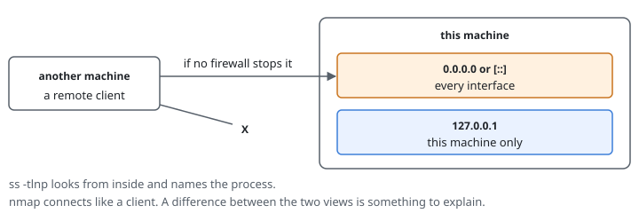

*Draft for owner review.* **Reconnaissance** is finding out what a system exposes. Defenders do it to their **own** machines to see what an attacker would see, and the same tools used without permission are an attack. So this lesson runs only against `127.0.0.1` inside the lab VMs, behind the scope guard from `security.authorization-and-scope`. You will answer one question three ways, from the inside with `ss`, with nothing but bash, and with `nmap`, and compare what each tells you.

**What was tested, and where.** **Ubuntu 24.04.5** (nmap **7.94SVN**, installed with `apt-get install nmap`) and **AlmaLinux 9.8** (nmap **7.92**, installed with `dnf install nmap`; I did not record which repository supplied it), as root, scanning `127.0.0.1` only (`tests/verification/security/sc3.sh`). Output is real. **Not tested:** scanning another machine or network (deliberately), UDP (`-sU`), IPv6, ping sweeps and host discovery, firewalls in the path (loopback is not filtered the way a real network is), script scanning (`--script`), OS detection (`-O`), timing options (`-T`), `nmap` on Windows, and `Test-NetConnection` (a stock Windows equivalent, not run here).

## The question: what is listening?

A machine **exposes** a service when a program is **listening** on a port and the network lets a connection reach it. From the inside, the kernel knows exactly what is listening: `ss` (socket statistics, replacement for `netstat`; [ss(8)](https://man7.org/linux/man-pages/man8/ss.8.html)).

```text
$ ss -tlnp                       (t = TCP, l = listening, n = numbers not names, p = process; needs root for p)
State  Recv-Q Send-Q Local Address:Port  Peer Address:Port Process
LISTEN 0      4096   127.0.0.53%lo:53    0.0.0.0:*         users:(("systemd-resolve",pid=543,fd=15))
LISTEN 0      4096       127.0.0.54:53    0.0.0.0:*         users:(("systemd-resolve",pid=543,fd=17))
LISTEN 0      4096          0.0.0.0:22    0.0.0.0:*         users:(("sshd",pid=950,fd=3),("systemd",pid=1,fd=82))
LISTEN 0      4096             [::]:22    [::]:*            users:(("sshd",pid=950,fd=4),("systemd",pid=1,fd=85))
```

That was Ubuntu 24.04 (AlmaLinux 9.8 showed `0.0.0.0:111` and `[::]:111` for `rpcbind` as well as port 22). Read the **Local Address** column: `127.0.0.x` means *this machine only*; `0.0.0.0` and `[::]` mean *every interface*, the ones other machines can reach. The `("systemd",pid=1,...)` next to `sshd` means systemd holds the socket (socket activation), which the `linux.systemd-advanced` lesson explains.



```text
 another machine ---> 0.0.0.0 / [::]     reachable (unless a firewall stops it)
 another machine -X-> 127.0.0.1          this machine only
```

I then started a listener on all addresses, the way a forgotten test server or a planted backdoor would:

```text
$ cd /tmp && python3 -m http.server 8080 --bind 0.0.0.0 &
$ ss -tlnp | grep 8080
LISTEN 0      5       0.0.0.0:8080   0.0.0.0:*   users:(("python3",pid=2399,fd=3))
```

A real accident from my own testing is worth telling. My first script stopped that listener with `kill %1`, which does nothing in a non-interactive shell (no job control). The server was still running when the next battery started, and `ss` showed `0.0.0.0:8080 python3` **before I had started anything**. The inventory found my own forgotten process. Use `kill $!` right after starting a background job, or a unit you can stop by name.

## Do it with only bash

You do not need a scanner to ask "is this port open?". Bash can open a TCP connection by itself through the special path `/dev/tcp/HOST/PORT` ([bash(1), Redirections](https://manpages.debian.org/stable/bash/bash.1.en.html): "If host is a valid hostname or Internet address, and port is an integer port number or service name, bash attempts to open the corresponding TCP socket."). The GNU manual page for the same section refused my download (HTTP 403), so I cite the Debian copy of the bash manual page.

```bash
check() { (exec 3<>/dev/tcp/$1/$2) 2>/dev/null && echo "$2 open" || echo "$2 closed"; }
for p in 22 80 8080 8081; do check 127.0.0.1 $p; done
```

```text
22 open
80 closed
8080 open
8081 closed
```

The `( ... )` subshell closes the connection when it ends; the redirection succeeds only if the connection did. Scanning the first 1024 ports this way:

```text
$ time ( for p in $(seq 1 1024); do (exec 3<>/dev/tcp/127.0.0.1/$p) 2>/dev/null && echo "open $p"; done )
open 22                                    (AlmaLinux: open 22 and open 111)
real    0m0.678s                           (AlmaLinux: 0.466 s)
```

That is a **TCP connect scan** in one line: it completes the full handshake for every port. It is slow on a real network (each closed or filtered port costs a timeout, and nothing here ran in parallel), it says nothing about *what* is on the port, and it would be noticed in the target's logs. (`/dev/tcp` is a bash feature; it does not exist in dash or busybox ash, so a `#!/bin/sh` script cannot use it.)

Gate every such command with the scope guard, so a typo in an address cannot reach outside your scope:

```bash
scan() { wl-scope.sh lab.scope "$@" >/dev/null || { echo "not scanning: out of scope"; return 1; }; for h in "$@"; do check "$h" 22; done; }
```

## Do it with nmap

[Nmap](https://nmap.org/book/man.html) is the standard network scanner. This is its **connect scan** (`-sT`), which needs no special privilege because it uses the normal `connect()` system call, the same thing the bash loop did, just faster and with better reporting:

```text
$ nmap -sT -p 1-1024,8080 127.0.0.1
Nmap scan report for localhost (127.0.0.1)          (AlmaLinux: winlab-alma (127.0.0.1))
Not shown: 1023 closed tcp ports (conn-refused)
PORT     STATE SERVICE
22/tcp   open  ssh
8080/tcp open  http-proxy
Nmap done: 1 IP address (1 host up) scanned in 0.05 seconds
```

AlmaLinux added `111/tcp open rpcbind`. Notice the **SERVICE** column says `http-proxy` for my Python web server. Without version detection, nmap does not look at the service; it **names the port from a table** (8080 is conventionally a web proxy). Ask it to look:

```text
$ nmap -sT -sV -p 22,8080 --reason 127.0.0.1
PORT     STATE SERVICE REASON  VERSION
22/tcp   open  ssh     syn-ack OpenSSH 9.6p1 Ubuntu 3ubuntu13.20 (Ubuntu Linux; protocol 2.0)
8080/tcp open  http    syn-ack SimpleHTTPServer 0.6 (Python 3.12.3)
Service Info: OS: Linux; CPE: cpe:/o:linux:linux_kernel
Nmap done: 1 IP address (1 host up) scanned in 6.22 seconds
```

(AlmaLinux: `OpenSSH 9.9 (protocol 2.0)` and `SimpleHTTPServer 0.6 (Python 3.9.25)`, 6.28 s.) Four things to learn from it:

- **`-sV` connects and talks to each open port** to find out what it is, which is why it took 6 seconds against 0.05 seconds for the plain scan, and why it is more noticeable and more intrusive.
- **`--reason` says why** nmap decided the state: `syn-ack` means the target answered the connection request, so the port is open. For a closed port the line above says `conn-refused`.
- **The version is information an attacker uses and a defender should know.** `OpenSSH 9.6p1 Ubuntu 3ubuntu13.20` tells both of you which package to patch.
- **The scan completes all 65,535 ports quickly on loopback** (`-p-`: 2.43 s on Ubuntu, 1.1 s on AlmaLinux) because nothing is filtered and nothing is slow to answer. On a real network a full-port scan takes much longer and **a firewall changes the answer** (a dropped packet is `filtered`, not `closed`). I did not test that here.

## Compare the three views

| | `ss -tlnp` | bash `/dev/tcp` | `nmap -sT` |
|---|---|---|---|
| Needs the target's cooperation | no (it is *on* the target) | no | no |
| Tells you **which process** | yes | no | no |
| Tells you what a **remote** machine would see | no | yes | yes |
| Names the service | by process name | no | by port table, or by asking with `-sV` |
| Needs root | for `-p` | no | no, for `-sT` |

The two methods answer different questions, and **the difference between them is a finding**. If `ss` shows a listener that `nmap` from another machine does not, a firewall is filtering it, which is a good sign if intended and a surprise if not. If `nmap` shows a port you cannot find in `ss`, you are looking at a different machine, a container, or something is forwarding. I tested only the loopback case, where the two agree.

## Common mistakes

- **Scanning something you did not write in the scope.** Use the guard and addresses, not names.
- **Believing the SERVICE column without `-sV`.** It is a guess from the port number.
- **Reading `0.0.0.0` as "this machine".** It means every interface.
- **Starting a background server in a test and not stopping it.** `kill %1` fails in a script; use `kill $!`.
- **Assuming `closed` and `filtered` are the same.** Closed: the host answered "nothing here". Filtered: no answer (something dropped it). Loopback never filters, so this lesson could not show it.
- **Running `-sV` or script scans on a production host without telling anyone.** They are louder than a plain connect scan and some services react badly.

## Check yourself

1. Write down every listener on a lab VM and, for each, whether you expect it, who owns it and whether it should be on `0.0.0.0`.
2. Start a listener on `0.0.0.0:8081`, find it with `ss`, then with the bash loop, then with nmap. Which view tells you the process?
3. Run `nmap -sT -p 1-1024 127.0.0.1` and then add `-sV`. What does the extra time buy?
4. Why does a plain scan label an unknown service on port 8080 `http-proxy`?

## Not tested, and honest limits

Anything beyond `127.0.0.1`, UDP, IPv6, filtered ports, script and OS scans, timing templates, stealth or SYN scans (`-sS`, which needs root and was not run), other scanners, and Windows. Timings are from a lab VM with nothing else running and say nothing about real networks. The two nmap versions differ (7.94SVN and 7.92), and I did not compare their output beyond what is shown.
