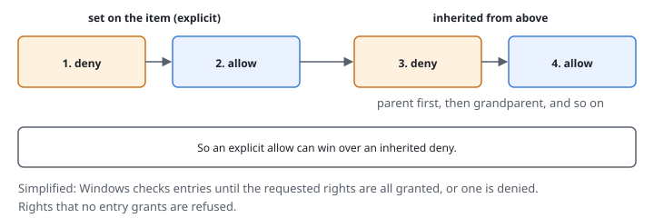

*Draft for owner review.* Security work on a server is mostly a few habits applied consistently: give each account only what it needs, expose only what must be reachable, keep software patched, and keep a record of who did what. This lesson shows where each habit lives on Windows and Linux, **how to check it**, and several places where the obvious assumption is **wrong**.

**What was tested.** Output is from the **Windows Server 2022** and **AlmaLinux 9.8** lab VMs (`tests/verification/powershell/secfund1.ps1`, `tests/verification/bash/secfund1.sh`), with temporary accounts and folders. **Not tested:** domain accounts, Windows share permissions, Linux POSIX ACLs, Ubuntu, and firewall filtering from another machine.

## Least privilege

An account should be able to **do its job and nothing more**. Daily work is done as a standard account; administrator rights are used only for the task that needs them. The reason: whatever your account can do, **a program you run by mistake can do too**.

| Idea | Windows | Linux |
|---|---|---|
| Who am I, with what? | `whoami /all` | `id`, `sudo -l` |
| Elevated rights | UAC prompt, "Run as administrator" | `sudo` |
| Group membership | `Get-LocalGroupMember Administrators` | `groups`, `getent group wheel` |

### Reading `whoami`

`whoami /groups` and `whoami /priv`, in the elevated lab session, included:

```text
BUILTIN\Administrators                    S-1-5-32-544     ... Enabled group, Group owner
Mandatory Label\High Mandatory Level      S-1-16-12288

SeDebugPrivilege         Debug programs                      Enabled
SeBackupPrivilege        Back up files and directories       Enabled
SeTakeOwnershipPrivilege Take ownership of files ...         Enabled
```

- **`High Mandatory Level` means this process is elevated.** With UAC, an administrator's ordinary window runs at **Medium**.
- **Privileges** are system-wide powers beyond file permissions. Debugging other processes, backing up any file and taking ownership are why an elevated session is so powerful.

On Linux, `id` lists your user and groups. Membership of `wheel` (AlmaLinux) or `sudo` (Ubuntu) usually grants `sudo`; `sudo -l` shows what you may actually run.

Shared administrator passwords and everyday use of an administrator account are the usual failures: with a shared account, the logs cannot say **who** did something.

## Permissions

Access is decided by **who you are** (your account and groups) against **the item's permission list**.

### Windows (NTFS)

Each item has an **access control list** (ACL) of entries. Read it with [`icacls`](https://learn.microsoft.com/windows-server/administration/windows-commands/icacls):

```text
C:\wlsec NT AUTHORITY\SYSTEM:(I)(OI)(CI)(F)
         BUILTIN\Administrators:(I)(OI)(CI)(F)
         BUILTIN\Users:(I)(OI)(CI)(RX)
         BUILTIN\Users:(I)(CI)(AD)
         BUILTIN\Users:(I)(CI)(WD)
         CREATOR OWNER:(I)(OI)(CI)(IO)(F)
```

| Code | Meaning |
|---|---|
| `(I)` | **Inherited** from a parent folder |
| `(OI)`, `(CI)` | Files, and folders, below inherit this entry |
| `(IO)` | Inherit only: it does not apply to this item itself |
| `(F)`, `(M)`, `(RX)`, `(R)`, `(W)` | Full control, modify, read and execute, read, write |
| `(RD)`, `(AD)`, `(WD)` | Read data, add subfolders, write data (create files) |
| `(DENY)` | A deny entry; without it the entry allows |

**Notice** that a new folder at the top of `C:` let ordinary `Users` **read** everything in it, and create files and folders. A new folder is **not** private.

### "Deny wins" is only half true

Windows normally orders entries like this ([order of entries](https://learn.microsoft.com/windows/win32/secauthz/order-of-aces-in-a-dacl)): **explicit** entries before inherited ones, and **within each level**, deny before allow.



```text
 explicit deny -> explicit allow -> inherited deny -> inherited allow (parent, then grandparent ...)
 so an EXPLICIT allow can win over an INHERITED deny
```

I tested it by denying `Everyone` the right to read data on a folder, then changing the file inside it:

| Entries on the file | Reading the file |
|---|---|
| **Inherited** deny for `Everyone`, inherited allows | **Refused** |
| The same, **plus an explicit allow** for my account | **Allowed** |
| **Explicit** deny for `Everyone` **and** explicit allow for me | **Refused** |
| Explicit deny removed again | **Allowed** |

So: on the **same level**, deny wins; an allow set **directly on the item** beats a deny that was only **inherited**. To answer "can this user read this?", check the entries for **every group** the user is in, and which are inherited, or use the **Effective Access** tab in the folder's advanced security settings. Deny entries make this hard to reason about: usually it is better to **grant to the right group** and not to deny.

### Linux

Every file has an **owner**, a **group** and **others**, each with read (`r`), write (`w`) and execute (`x`) ([`chmod`](https://man7.org/linux/man-pages/man1/chmod.1.html)). `ls -l` shows them; mode `700` means only the owner (and root).

**Only one of the three sets applies**: if you are the owner, the owner set; otherwise, if you are in the group, the group set; otherwise others. A file with mode `044` owned by `wlalice`:

```text
----r--r--. 1 wlalice wlalice  o.txt
wlalice: cat o.txt  ->  Permission denied       <- the OWNER set is empty, and the others are not consulted
wlbob:   cat o.txt  ->  secret
```

**On directories the letters mean something else** ([how paths are resolved](https://man7.org/linux/man-pages/man7/path_resolution.7.html)). `r` lists the names; `x` lets you **pass through** to reach what is inside:

| Directory mode for others | `ls dir` | `cat dir/known.txt` |
|---|---|---|
| `r` only (`744`) | lists the name | **Permission denied** |
| `x` only (`711`) | **Permission denied** | works, if you know the name |

**Deleting a file depends on the directory, not the file.** `roots.txt` was owned by root with mode `400`, in a directory with mode `777`:

```text
wlbob: rm -f roots.txt     ->  removed (status 0)
```

An ordinary user deleted root's read-only file, because he or she could write to the **directory**. The **sticky bit** (the `t` in `drwxrwxrwt`, mode `1777`, as on `/tmp`) stops that: the same command then failed with `Operation not permitted`.

A common ticket is a team that cannot read a folder because inheritance was removed or a mode is too tight. **Fix the group or entry** that should have access. Do not "fix" it with full control for Everyone or `chmod 777`.

## Accounts and passwords

**Disable accounts that are not in use rather than deleting them** (`Disable-LocalUser`): a disabled account can be turned back on, and its identity and history stay.

### Deleting is not reversible

Windows permissions refer to an account's [**SID**](https://learn.microsoft.com/windows-server/identity/ad-ds/manage/understand-security-identifiers), not its name. I granted `wlalice` access to a file and deleted the account. `icacls` then showed a bare number:

```text
S-1-5-21-...-1000:(R)
```

I created a new account **with the same name**. Its SID ended in **1001**, the old entry still showed `...-1000`, and the new account got **nothing** from it. "Recreate the user" does not restore access. Bare SIDs in a permission list are usually the traces of deleted accounts.

### Locking a Linux password does not lock the account

I gave `wlalice` an SSH key, then locked the password:

| Step | `passwd -S` | SSH login **with the key** |
|---|---|---|
| Before | `PS` (password set) | succeeded |
| After `passwd -l wlalice` | `LK` (locked) | **still succeeded** |
| After `usermod --expiredate 1 wlalice` | | **refused**: `account wlalice has expired` |
| After `usermod --expiredate "" wlalice` | | succeeded again |

[The `passwd` manual](https://man7.org/linux/man-pages/man1/passwd.1.html) says the same: locking the password **does not disable the account**, and the user may still log in another way, such as with an SSH key. **To disable a Linux account, expire it** ([`usermod`](https://man7.org/linux/man-pages/man8/usermod.8.html)), and then check what that does not cover: **sessions already open**, running processes, scheduled jobs, other keys (`authorized_keys` of **other** accounts) and application passwords.

### Passwords

**Length matters more than complexity rules.** [NIST SP 800-63B](https://pages.nist.gov/800-63-4/sp800-63b.html) says verifiers must **not** require mixtures of character types and must not force periodic changes (they should force one when there is evidence of compromise), and it asks for at least **15 characters** where a password is the only factor. Use a **different password** for each system, a password manager, and multifactor authentication. Your organisation's policy still applies.

### Reading a failed sign-in

Windows records a failed sign-in as Security event [**4625**](https://learn.microsoft.com/previous-versions/windows/it-pro/windows-10/security/threat-protection/auditing/event-4625) (success is **4624**), **if auditing records it** (`auditpol /get /subcategory:"Logon"` said `Success and Failure`). I used a wrong password against the lab's own file share:

```text
TargetUserName            = wlalice
LogonType                 = 3            (over the network)
Status                    = 0xc000006d   (sign-in failed)
SubStatus                 = 0xc000006a   (bad password)
IpAddress                 = 127.0.0.1
AuthenticationPackageName = NTLM
```

Read **who** was tried, **from where**, **how** (logon type) and **why** (`SubStatus`). One failure is a typing mistake; many, or many different names from one address, deserve attention. On Linux use `journalctl -u sshd` (`ssh` on Ubuntu), `last` and `lastb`.

## Firewalls and exposed ports

A firewall decides which connections reach a service. The safe default is to **deny, and allow only what is needed**. First find out **what is listening**:

```powershell
Get-NetTCPConnection -State Listen | Sort-Object LocalPort |
    Select-Object LocalAddress, LocalPort, @{n = 'Process'; e = { (Get-Process -Id $_.OwningProcess).Name } }
```

The lab server (ports below 6000):

```text
LocalAddress LocalPort Process
0.0.0.0             22 sshd        (SSH, the lab's control channel)
0.0.0.0            135 svchost     (RPC)
10.0.2.15          139 System      (NetBIOS)
::                 445 System      (file sharing)
::                5985 System      (WinRM remoting)
```

([`Get-NetTCPConnection`](https://learn.microsoft.com/powershell/module/nettcpip/get-nettcpconnection)) And on AlmaLinux, `sudo ss -tlnp` ([`ss`](https://man7.org/linux/man-pages/man8/ss.8.html)):

```text
LISTEN  0.0.0.0:22     users:(("sshd",pid=751,fd=7))
LISTEN  0.0.0.0:111    users:(("rpcbind",pid=661,fd=4),("systemd",pid=1,fd=35))
```

| Local address | Reachable from |
|---|---|
| `127.0.0.1` or `::1` | This machine only |
| `0.0.0.0` or `::` | Every address of the machine (if the firewall allows) |
| A specific address | That interface's network |

(Windows can show a service listening on `::` that also accepts IPv4.) For each line ask **two questions: is something supposed to be listening, and should this source be allowed to reach it?** Port 111 here is `rpcbind`, used by services such as NFS: if the server offers none, it is a candidate for removal.

Then read the firewall: `Get-NetFirewallProfile -PolicyStore ActiveStore` and `Get-NetFirewallRule` on Windows (see the device protection lesson), `sudo firewall-cmd --list-all` with firewalld, `sudo ufw status verbose` with Ubuntu's ufw. **Do not assume a firewall exists**: this AlmaLinux cloud image had **no** `firewall-cmd` at all. A service listening behind a blocking firewall is a different problem from a firewall that allows a port nothing uses.

## Patching and attack surface

Every installed program and enabled service is something that can be attacked. **Remove or disable what is not needed**, and keep what remains updated (`Get-HotFix` and the update history; `sudo dnf check-update`; `sudo apt update` then `apt list --upgradable`). Know whether an update needs a **restart** of a service or of the machine: an updated library does not change a program already running with the old one. Record what you changed.

## Mandatory access control on Linux

On AlmaLinux, **SELinux** gives every file and process a **label** and refuses whatever policy does not allow, **even to root**, in addition to ordinary permissions. A file's label depends on **how it got there**. I created two files in `/tmp`, **moved** one into `/var/www/html` and **copied** the other:

```text
$ ls -Z /var/www/html/
     unconfined_u:object_r:var_t:s0       wl-copied.html     (took the label of its new folder)
unconfined_u:object_r:user_tmp_t:s0       wl-moved.html      (KEPT its label from /tmp)
$ matchpathcon /var/www/html/wl-moved.html
/var/www/html/wl-moved.html  system_u:object_r:httpd_sys_content_t:s0        (what policy expects there)
$ restorecon -nv /var/www/html/wl-moved.html
Would relabel ... user_tmp_t:s0 to ... httpd_sys_content_t:s0
$ restorecon -v /var/www/html/wl-moved.html
Relabeled ... user_tmp_t:s0 to ... httpd_sys_content_t:s0
```

(The folder was one I had just made by hand, so it had the generic `var_t` itself.) Neither file had the label a web server needs, although `ls -l` would show nothing wrong. [`restorecon`](https://man7.org/linux/man-pages/man8/restorecon.8.html) sets the label policy expects for a path; **`-n` previews**. A `403 Forbidden` with correct permissions is a classic sign. Check `getenforce`, `ls -Z`, `matchpathcon`, and the denial log (`sudo ausearch -m avc -ts recent`). If policy itself must learn a new location, that is `semanage fcontext` followed by `restorecon` (the `semanage` tool was not installed on this image).

**Do not turn SELinux off to "fix" something**: correct the label or the policy.

## Common mistakes

- **Working as an administrator all day.**
- **Assuming a new folder is private.**
- **Believing "deny always wins"**, or adding deny entries to patch a wrong grant.
- **`chmod 777` or Everyone: Full control.**
- **Forgetting that directory write permission allows deletion.**
- **Locking a password and thinking the account is closed.**
- **Deleting an account** you may need again.
- **Looking at firewall rules without checking what is listening** (or the other way round).
- **Disabling SELinux.**

## Check yourself

1. Why is deleting a former employee's account usually worse than disabling it?
2. A file has an inherited deny for a group Alice is in, and an explicit allow for Alice. Can she read it?
3. A page returns 403 on AlmaLinux though the Unix permissions are fine. What do you check?
4. You ran `passwd -l bob`. Can Bob still log in, and what closes the account?
5. A user can delete a file they cannot even read. How is that possible, and what prevents it in `/tmp`?
6. In `ss` output, what is the difference between `127.0.0.1:5432` and `0.0.0.0:5432`?

**Expected answers:** (1) a disabled account can be enabled again, with the same identity and permissions; deleting loses it, and a new account of the same name has a different SID and none of the old access; (2) yes: the explicit allow comes before the inherited deny (an explicit deny would win); (3) the SELinux label (`ls -Z`, `matchpathcon`), `getenforce` and the denial log; correct it with `restorecon` (and policy if needed); (4) yes, for example with an SSH key; `usermod --expiredate 1 bob`, and then deal with sessions, jobs and keys that remain; (5) deletion needs write permission on the directory; the sticky bit lets only the file's owner (or the directory's owner, or root) remove it; (6) the first accepts connections only from the same machine, the second on every IPv4 address.
