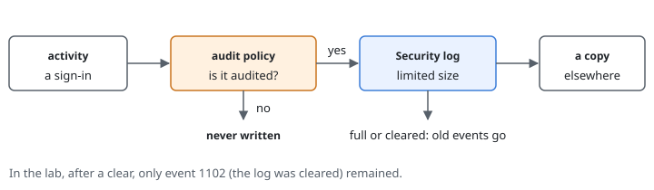

*Draft for owner review.* Windows records security events in the **Security event log**, but only for the activities the **audit policy** tells it to record. This lesson shows how to read that policy, how to find a failed logon, a successful one, a new account and a cleared log, and how to turn the events into a short report, with the built-in tools only (`auditpol`, `wevtutil`, `Get-WinEvent`). It is the Windows counterpart of `security.linux-logging-and-detection`. Lab machines only.

**What was tested, and where.** One VM: **Windows Server 2022 Standard Evaluation**, build 10.0.20348.0, Windows PowerShell **5.1.20348.558**, elevated, a throwaway local account (`tests/verification/security/win1.ps1`; output is real, with SIDs shortened). **Not tested:** **Windows 10 or 11** (default audit policy and event contents may differ), domain controllers and **domain** logons (event 4768 and 4771 for Kerberos, 4776 for NTLM validation), **PowerShell 7**, Group Policy-managed auditing, forwarding events to another machine (Windows Event Forwarding), **Sysmon**, RDP logons (type 10) and interactive logons (type 2), account lockout, and the **Advanced Audit Policy versus legacy audit policy** interaction. Event contents come from this one machine; the Microsoft pages cited were checked to load and read for the quoted parts only.

## The policy decides what exists

An event nobody asked for is never written. `auditpol /get` shows the policy by subcategory. On this fresh server, before I changed anything:

```text
Logon/Logoff
  Account Lockout                         Success
  Logoff                                  Success
  Logon                                   Success and Failure
Policy Change
  Audit Policy Change                     Success
Account Management
  Security Group Management               Success
  User Account Management                 Success
System
  Security State Change                   Success
```

So on **Server 2022** logons were already audited for success and failure. I did not check a Windows 10 or 11 machine, and you should not assume it is the same: look at yours. To change a setting: `auditpol /set /subcategory:"Logon" /success:enable /failure:enable` (I ran it; it printed the same line back). The page [Audit Logon Events](https://learn.microsoft.com/en-us/previous-versions/windows/it-pro/windows-10/security/threat-protection/auditing/basic-audit-logon-events) describes the setting; I only confirmed it loads.



```text
 activity -> audit policy? --yes--> Security log (limited size; can be cleared) -> copy elsewhere
                    |
                    no --> never written
```

## A failed logon: event 4625

I made a lab account (`net user wlvictim ... /add`), then tried to connect to the machine's own `IPC$` share twice with a wrong password: once as the real account and once as one that does not exist. `net use` answered both times `System error 1326` (the user name or password is incorrect), which tells the person nothing about *which* was wrong, which is the point. The log tells the defender more:

```text
15:52:43 id=4625 user=wlnosuchuser type=3 status=0xc000006d substatus=0xc0000064 ip=::1 process=-
15:52:43 id=4625 user=wlvictim     type=3 status=0xc000006d substatus=0xc000006a ip=::1 process=-
```

The fields, as read from [event 4625](https://learn.microsoft.com/en-us/previous-versions/windows/it-pro/windows-10/security/threat-protection/auditing/event-4625):

- **`LogonType` 3** is a **network** logon ("a user or computer logged on to this computer from the network"). The page has a table of all the types; the common ones to learn are 2 (interactive at the console), 3 (network), 10 (remote desktop).
- **`Status` and `SubStatus`** give the reason. Microsoft's table, which I read, lists `0xC0000064` as "User logon with misspelled or bad user account", `0xC000006A` as "User logon with misspelled or bad password", and `0xC000006D` as "This is either due to a bad username or authentication information". My two events fit: the same `Status` (`0xc000006d`, the general failure) but **different `SubStatus`**: `0xc0000064` when the account does not exist, `0xc000006a` when it exists and the password was wrong. The page adds that several bad-user events in a row "can be a sign of a user enumeration attack": a guesser trying names. **The substatus is how a defender tells "guessing names" from "guessing a password for a real account".**
- **`IpAddress`** is `::1` here because I attacked myself over loopback; in a real case it is the source of the attempt. **`ProcessName`** is `-` for this network logon.

`Get-WinEvent` with a hashtable filter is the efficient way to ask. The `Message` property is a text block; for fields use the **XML** (`[xml]$event.ToXml()`), as the battery does:

```powershell
Get-WinEvent -FilterHashtable @{ LogName='Security'; Id=4625; StartTime=(Get-Date).AddMinutes(-10) } |
  ForEach-Object {
    $d = @{}; foreach ($i in ([xml]$_.ToXml()).Event.EventData.Data) { $d[$i.Name] = $i.'#text' }
    '{0} user={1} type={2} status={3} substatus={4} ip={5}' -f $_.TimeCreated, $d.TargetUserName, $d.LogonType, $d.Status, $d.SubStatus, $d.IpAddress
  }
```

(The filter form is described in [Get-WinEvent](https://learn.microsoft.com/en-us/powershell/module/microsoft.powershell.diagnostics/get-winevent); I ran it on 5.1 only.) Counting failures per account is a `Group-Object`:

```text
Count Name
----- ----
    1 wlvictim
    1 wlnosuchuser
```

## A successful logon: event 4624

The right password produced:

```text
15:52:43 id=4624 user=wlvictim type=3 ip=::1 process=- auth=NTLM
```

An `AuthenticationPackageName` of `NTLM` for a local account over the network is normal. A detection worth building: **a 4624 for an account shortly after a run of 4625s for the same account**, which is what a successful password guess looks like.

## Account and group changes: 4720 and 4732

Adding an account and putting it in the Administrators group are exactly what an intruder does to stay in:

```text
15:52:42 id=4720 created=wlvictim by=Administrator            (user account created)
15:52:46 id=4732 member=S-1-5-21-...-1000 group=Administrators by=Administrator    (added to a security-enabled local group)
```

Note that 4732 shows the member as a **SID**, a security identifier; translate it with `([Security.Principal.SecurityIdentifier]'S-1-5-21-...-1000').Translate([Security.Principal.NTAccount])`, which I did not run. Both events say who did it (`SubjectUserName`). These two are on by default here (**User Account Management** and **Security Group Management** showed `Success` above). Both are high-value alerts on a machine where nobody should be adding administrators.

## The same query with `wevtutil`

`wevtutil` is the older, scriptable tool and is on every Windows installation ([wevtutil](https://learn.microsoft.com/en-us/windows-server/administration/windows-commands/wevtutil)). The query language is XPath:

```text
> wevtutil qe Security "/q:*[System[(EventID=4625)]]" /c:1 /rd:true /f:text
Event[0]
  Log Name: Security
  Source: Microsoft-Windows-Security-Auditing
  Date: 2026-11-22T15:52:43.7870000Z
  Event ID: 4625
  ...
> wevtutil gl Security
name: Security
enabled: true
  logFileName: %SystemRoot%\System32\Winevt\Logs\Security.evtx
  retention: false
  maxSize: 20971520
```

`/rd:true` reads **newest first**. The log's **maximum size is 20 MB** (`20971520` bytes) and `retention: false` means it **overwrites the oldest events when full**: on a busy server 20 MB can hold only hours of events, so **plan for size and for shipping the events elsewhere** before you need them (not tested; the logging lesson's evidence-off-the-host argument applies here too).

## Clearing the log is itself logged: event 1102

An intruder who clears the log leaves a mark:

```text
> wevtutil cl Security
15:52:48 id=1102 provider=Microsoft-Windows-Eventlog
The audit log was cleared.
Subject:
	Security ID:	S-1-5-21-...-500
events left in the Security log after the clear: 1
```

After the clear there was **exactly one event left in the Security log: the 1102 itself** ([event 1102](https://learn.microsoft.com/en-us/previous-versions/windows/it-pro/windows-10/security/threat-protection/auditing/event-1102) is titled "The audit log was cleared"). That makes "a 1102 appeared" an alert you should always want. It also shows the limit: **after a clear, everything before it exists only if you copied it somewhere else.** (I cleared the lab VM's log on purpose; the lab VM is restored from a snapshot afterwards.)

## Detections you can build from this

1. Several **4625s with `SubStatus 0xc0000064`** from one address: name guessing.
2. Several **4625s with `0xc000006a`** for one account, then a **4624** for it: a guessed password.
3. A **4720** or **4732** (to Administrators) outside a change window.
4. Any **1102**.
5. **Logon types you do not expect** (a type 10 remote-desktop logon from a machine that never uses it; I did not test type 10).
6. **A 4740** (account locked out): a run of bad guesses reached the lockout threshold. I saw it written in `security.windows-hardening-checks` (the account name and the machine it came from were in the event).

## Common mistakes

- **Assuming an event exists.** Check `auditpol /get` first; a policy that does not audit means a log with nothing in it.
- **Parsing the `Message` text.** Use the XML fields; the text is for people and varies with language.
- **Ignoring `SubStatus`.** It separates "no such account" from "wrong password".
- **Treating `::1` or `-` as "nothing known".** For a loopback or service logon they are the truth; for a remote attacker they should be an address.
- **A 20 MB log and no copy.** Size it and forward it.
- **Running an elevated query casually.** Reading the Security log needs administrative rights; I did not test a non-elevated read.
- **Trusting a clean log.** Look for 1102 and for a gap in time.

## Check yourself

1. Run `auditpol /get /category:*` on your machine. Which of the subcategories above are enabled?
2. Create a lab account, generate one bad-user and one bad-password attempt, and find both events. Which field tells them apart?
3. Write the `Get-WinEvent` command that lists 4624 events for one account in the last hour.
4. Add the lab account to a local group and find the event. Who did it, according to the event?
5. What is left in the Security log after `wevtutil cl Security`, and what does that mean for evidence?

## Not tested, and honest limits

Windows 10 and 11; domain controllers and Kerberos events; PowerShell 7; Group Policy; event forwarding; Sysmon; type 2 and type 10 logons; account lockout; and a non-elevated read. The numbers (20 MB, event times) are from one lab VM. `net use` to `localhost` produced a loopback network logon, so the source address in a real attack would differ.
