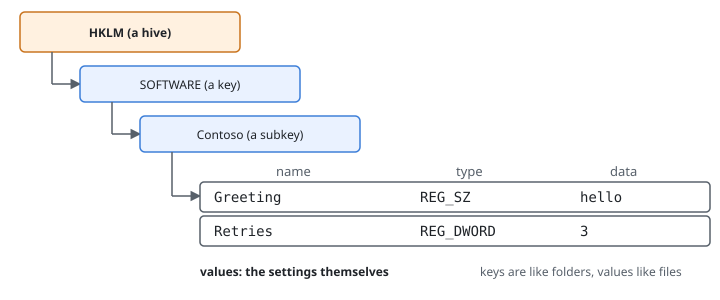
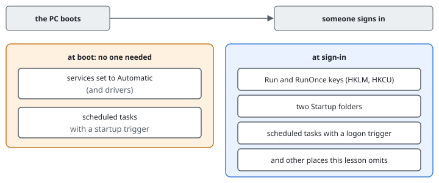
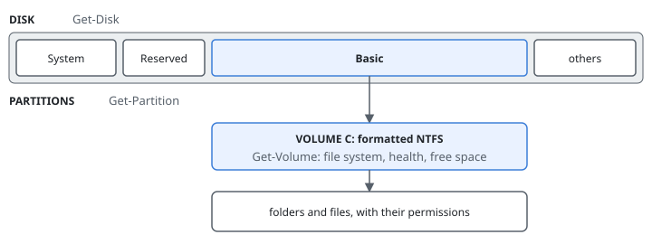
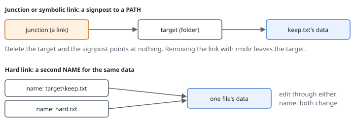

*Draft for owner review.* Two places hold most of a Windows machine's state: the **registry** for settings and the **file system** for everything else. When something starts misbehaving, the cause is very often a setting in one or a file in the other. This lesson covers how each is organised, how to **look without changing anything**, and how to change them without making the machine worse.

**What was tested, and where.** As a **standard user** on a Windows 11 Home PC (build 26300), Windows PowerShell 5.1 (`tests/verification/powershell/regfs1.ps1`); selected behaviours again in PowerShell 7.6.10 (`regfs3.ps1`). The **administrator** parts ran in a throwaway **Windows Server 2022** lab VM (`regfs2.ps1`). **Not tested:** the graphical tools (Registry Editor, Disk Management, Task Manager), Windows 10, FAT32, exFAT and ReFS volumes, and any repair. Some names in output are samples.

> **Before you try anything:** work on a test key of your own (this lesson uses `HKCU:\Software\WinLabDemo`) and in a new folder under `%TEMP%`, or in a lab VM. Reading is safe. Writing to the registry takes effect **at once**: there is no Save button and no Undo.

## The registry

The registry is a hierarchical database of settings ([registry](https://learn.microsoft.com/windows/win32/sysinfo/registry), [structure](https://learn.microsoft.com/windows/win32/sysinfo/structure-of-the-registry)). Its top-level branches are called **hives** in everyday talk (the formal term for each branch is a [predefined key](https://learn.microsoft.com/windows/win32/sysinfo/predefined-keys)):

| Hive | Holds |
|---|---|
| `HKLM` (HKEY_LOCAL_MACHINE) | Settings for the whole machine: services, drivers, installed software, policy |
| `HKCU` (HKEY_CURRENT_USER) | The signed-in user's settings (loaded from their `NTUSER.DAT`) |
| `HKCR` | File associations and COM; a merged view |
| `HKU`, `HKCC` | All loaded user hives; current hardware profile |

**Which one do you need?** If a problem affects **one person**, look in `HKCU` (that person's, not yours). If it affects **everyone**, look in `HKLM`. This is the same question you ask about folders.

Inside a hive are **keys** and subkeys, and keys hold **values**. Each value has a **name**, a **type** and **data**:



```text
HKLM  (a hive)
 +-- SOFTWARE          (a key)
      +-- Contoso      (a subkey)
           name         type         data
           Greeting     REG_SZ       hello
           Retries      REG_DWORD    3
```

### Value types

The type matters: a program that expects a number may ignore or choke on text ([value types](https://learn.microsoft.com/windows/win32/sysinfo/registry-value-types)).

| Type | PowerShell calls it | Holds |
|---|---|---|
| `REG_SZ` | `String` | Text |
| `REG_EXPAND_SZ` | `ExpandString` | Text containing variables such as `%TEMP%`, filled in when read |
| `REG_MULTI_SZ` | `MultiString` | A list of texts |
| `REG_DWORD` | `DWord` | A 32-bit number |
| `REG_QWORD` | `QWord` | A 64-bit number |
| `REG_BINARY` | `Binary` | Raw bytes |

### Reading without changing anything

PowerShell shows the registry as **drives**, `HKLM:` and `HKCU:` ([registry provider](https://learn.microsoft.com/powershell/module/microsoft.powershell.core/about/about_registry_provider)), so `Get-ChildItem` lists **subkeys** and [`Get-ItemProperty`](https://learn.microsoft.com/powershell/module/microsoft.powershell.management/get-itemproperty) reads **values**. Only those two drives existed by default.

```powershell
Get-ItemProperty 'HKLM:\SOFTWARE\Microsoft\Windows NT\CurrentVersion' |
    Select-Object ProductName, EditionID, DisplayVersion, CurrentBuild, UBR
```

On the **Windows 11** test PC:

```text
ProductName    : Windows 10 Home
EditionID      : Core
DisplayVersion : 26H2
CurrentBuild   : 26300
UBR            : 9974
```

Look at the first line. This is a Windows 11 machine (build 22000 or higher), and the value says **Windows 10**. **A registry value is only whatever was written there**; its name is not a promise that it is accurate. To decide the Windows version, use the build number. (On Server 2022 the same value read `Windows Server 2022 Standard Evaluation`, with build 20348.)

The same facts with [`reg query`](https://learn.microsoft.com/windows-server/administration/windows-commands/reg-query), which works in Command Prompt:

```text
reg query "HKLM\SOFTWARE\Microsoft\Windows NT\CurrentVersion" /v CurrentBuild

HKEY_LOCAL_MACHINE\SOFTWARE\Microsoft\Windows NT\CurrentVersion
    CurrentBuild    REG_SZ    26300
```

Notice `REG_SZ`: the build number is stored as **text**. Asking for a value that does not exist printed `ERROR: The system was unable to find the specified registry key or value.` and returned exit status **1**; success returned 0. A script can test that.

Note the two spellings: **`HKLM:\...` (with a colon)** is PowerShell's drive; **`HKLM\...` (no colon)** is what `reg.exe` expects.

Here is a test key with several types, read two ways. `Get-ItemProperty` gave:

```text
Greeting     : hello
Retries      : 3
Servers      : {web01, db01}
LogDir       : C:\Users\student\AppData\Local\Temp\logs
LogDirPlain  : %TEMP%\logs
PSPath       : Microsoft.PowerShell.Core\Registry::HKEY_CURRENT_USER\Software\WinLabDemo
PSParentPath : Microsoft.PowerShell.Core\Registry::HKEY_CURRENT_USER\Software
PSChildName  : WinLabDemo
PSDrive      : HKCU
PSProvider   : Microsoft.PowerShell.Core\Registry
```

- **The five `PS...` lines are not registry values.** PowerShell adds them to every result.
- **No types are shown.**
- `LogDir` and `LogDirPlain` were written with the same text, `%TEMP%\logs`. `LogDir` is `REG_EXPAND_SZ`, so it arrived **filled in**; the plain `REG_SZ` kept the percent signs.

`reg query` shows the types and the stored text:

```text
    Greeting    REG_SZ    hello
    Retries    REG_DWORD    0x3
    Servers    REG_MULTI_SZ    web01\0db01
    LogDir    REG_EXPAND_SZ    %TEMP%\logs
    LogDirPlain    REG_SZ    %TEMP%\logs
```

A `DWORD` is printed in **hexadecimal** (`0x3`; `0x10` would be sixteen), and `\0` separates the entries of a list. To read **one** value in a script, use `Get-ItemPropertyValue 'HKCU:\Software\WinLabDemo' -Name Retries`, which printed just `3`; for a missing name it raised `Property Nope does not exist at path HKEY_CURRENT_USER\Software\WinLabDemo.`

### Changing values, and three traps

```powershell
New-Item -Path 'HKCU:\Software\WinLabDemo'
New-ItemProperty -Path 'HKCU:\Software\WinLabDemo' -Name Greeting -Value 'hello' -PropertyType String
Set-ItemProperty -Path 'HKCU:\Software\WinLabDemo' -Name Greeting -Value 'hi'
Remove-ItemProperty -Path 'HKCU:\Software\WinLabDemo' -Name Greeting
```

[`New-ItemProperty`](https://learn.microsoft.com/powershell/module/microsoft.powershell.management/new-itemproperty) creates a value and refused to overwrite one (`The property already exists.`). [`Set-ItemProperty`](https://learn.microsoft.com/powershell/module/microsoft.powershell.management/set-itemproperty) changes one, creating it if needed.

**Trap 1: the type can change under you.** `Retries` was a `DWord`.

| Command | Result |
|---|---|
| `Set-ItemProperty ... -Name Retries -Value 5` | still `DWord`, 5 |
| `Set-ItemProperty ... -Name Retries -Value 'five'` | **became `String`**, `five`, with **no error** |
| `Set-ItemProperty ... -Name Brand -Value '7'` (new value) | `String` |
| the same with `-Type DWord` and `7` | `DWord` |

So say the type when it matters (`-Type` or `-PropertyType`), and check it afterwards:

```powershell
(Get-Item 'HKCU:\Software\WinLabDemo').GetValueKind('Retries')
```

**Trap 2: `New-Item -Force` empties an existing key.** `-Force` looks like "do it even if it exists". On an existing key that had a value and a subkey, [`New-Item`](https://learn.microsoft.com/powershell/module/microsoft.powershell.management/new-item) `-Force` left **no values and no subkey**, in both tested PowerShell versions. It made a fresh, empty key. To create a key only when it is missing:

```powershell
if (-not (Test-Path $key)) { New-Item -Path $key | Out-Null }
```

**This is the most destructive mistake in this lesson**: scripts copied from the web often use `New-Item -Force` on a `Policies` key that already holds other settings.

**Trap 3** is about restoring, next.

### Back up first: export and import

**Export the key before you change it** ([`reg export`](https://learn.microsoft.com/windows-server/administration/windows-commands/reg-export), [`reg import`](https://learn.microsoft.com/windows-server/administration/windows-commands/reg-import)):

```text
reg export "HKCU\Software\WinLabDemo" backup.reg /y
reg import backup.reg
```

The file is readable text. Open it and **check that it contains what you meant to save**:

```text
Windows Registry Editor Version 5.00

[HKEY_CURRENT_USER\Software\WinLabDemo]
"Greeting"="hello"
"Retries"=dword:00000003
```

(The exported file was saved as UTF-16: it began with the bytes 255 254.) The `/y` overwrites an existing backup file without asking, so give each backup its own name.

**Trap 3: import adds and overwrites; it does not remove.** After the export I changed `Greeting` and added a new value, `AddedLater`, then imported the backup:

```text
Greeting   : hello            <- restored
Retries    : 3
AddedLater : still here?      <- NOT removed
```

So `reg import` is **not** "put the key back exactly as it was". If your change **added** something, you must delete that yourself. Write down what you add.

**Never import a `.reg` file you have not read.** It is a list of changes, including whatever someone else decided to put in it.

A safe change, from start to finish:

1. **Read** the current value, and write it down.
2. **Export** the key, and open the file.
3. Change **one** value.
4. **Test** whether the symptom changed.
5. Record what you did. If it did not help, **undo it** before trying something else.

Do not "clean" the registry with third-party tools: they change many things at once, and you cannot reason about the result.

### Permissions

As a standard user, writing under `HKLM` failed: PowerShell said `Requested registry access is not allowed.` and `reg add` said `ERROR: Access is denied.` That is the permission check from the first lesson. In the **elevated** Administrator session in the VM, creating, exporting, changing and restoring a test key under `HKLM` all worked.

Elevation removes that safety net, so rehearse deletions. `Remove-Item 'HKLM:\SOFTWARE\WinLabDemo' -Recurse -WhatIf` printed what it **would** do:

```text
What if: Performing the operation "Remove Key" on target "Item: HKEY_LOCAL_MACHINE\SOFTWARE\WinLabDemo".
```

### Policy values

Keys containing `\Policies\` hold settings meant to be **enforced** by an administrator or by management tools. A value there is a signal that **something set it deliberately**. On the Server VM, `HKLM:\SOFTWARE\Microsoft\Windows\CurrentVersion\Policies` already had subkeys such as `Explorer` and `System`. Before removing a policy value, find out **what set it**: if Group Policy or a management service put it there, it can come back. `gpresult /r` reports applied Group Policy (not exercised here). The lab for this lesson is a policy value that stops a Windows tool from opening.

### 64-bit and 32-bit views

On 64-bit Windows, many settings of **32-bit** programs under `HKLM\SOFTWARE` are kept separately under **`HKLM\SOFTWARE\WOW6432Node`** (present on the test PC) ([which keys are shared or redirected](https://learn.microsoft.com/windows/win32/winprog64/shared-registry-keys)). If a setting "is not there", check the other view.

### Where the registry lives

Hives are loaded from files ([registry hives](https://learn.microsoft.com/windows/win32/sysinfo/registry-hives)). Most are in `C:\Windows\System32\config` (`SYSTEM`, `SOFTWARE`, `SAM`, `SECURITY`, `DEFAULT`); each user's `HKCU` comes from `NTUSER.DAT` in their profile folder. `reg query HKLM\SYSTEM\CurrentControlSet\Control\hivelist` shows which files are loaded now. **Do not copy or edit these files while Windows is using them**; use the tools above.

**In the graphical tool:** `regedit` shows the same tree, keys on the left and values with their types on the right; **File > Export** saves a `.reg` file. These steps were not tested.

## Startup locations

"It keeps coming back" is a common complaint: a program that reappears after every restart has something starting it. There are **many** places; these are the ones to check first.



```text
 the PC boots  ------------------------------>  someone signs in

 at boot: no one needed          at sign-in
   services set to Automatic       Run and RunOnce keys (HKLM, HKCU)
   (and drivers)                   two Startup folders
   scheduled tasks with a          scheduled tasks with a logon trigger
   startup trigger                 and other places this lesson omits
```

**The Run keys** start a program **every time** a user signs in; a `RunOnce` value runs **once** and is then deleted, by default **before** the program runs, so a program that fails is not retried ([Run and RunOnce keys](https://learn.microsoft.com/windows/win32/setupapi/run-and-runonce-registry-keys)). `HKLM` ones apply to every user, `HKCU` ones to that user:

```text
HKLM:\SOFTWARE\Microsoft\Windows\CurrentVersion\Run              (all users)
HKCU:\Software\Microsoft\Windows\CurrentVersion\Run              (this user)
HKLM:\SOFTWARE\WOW6432Node\Microsoft\Windows\CurrentVersion\Run  (32-bit view)
```

**The Startup folders** hold shortcuts or programs that run at sign-in:

```text
this user:   C:\Users\student\AppData\Roaming\Microsoft\Windows\Start Menu\Programs\Startup
all users:   C:\ProgramData\Microsoft\Windows\Start Menu\Programs\Startup
```

Typing `shell:startup` or `shell:common startup` in the Run box (**Win+R**) is the usual way to open them (not tested).

A quick overview comes from [`Win32_StartupCommand`](https://learn.microsoft.com/windows/win32/cimwin32prov/win32-startupcommand):

```powershell
Get-CimInstance Win32_StartupCommand | Format-List Name, Command, Location, User
```

`Command` is what runs, `Location` is **where it is registered** (so you know where to look), and `User` says whom it applies to.

**It is not the whole picture.** On the test PC it listed **3** entries, all from `Run` keys. The same PC had **85** services set to Automatic and **41** scheduled tasks with a boot or sign-in trigger, **none of which this class listed**. So when the short list shows nothing suspicious, check tasks and services too:

```powershell
Get-ScheduledTask |
    Where-Object { $_.Triggers | Where-Object { $_.CimClass.CimClassName -match 'Logon|Boot' } } |
    Select-Object TaskPath, TaskName, State
Get-Service | Where-Object StartType -eq 'Automatic'
```

**How to read what you find:** look at the **path** of the program. One under `C:\Program Files` or `C:\Windows` is ordinary, though not proof of good intent; one under a **temporary, download or `AppData` folder** deserves a closer look (many legitimate programs do install in `AppData`, so look, do not assume). If you disable something, **disable rather than delete** where you can, and note what you did.

## File systems

A **disk** is divided into **partitions**; a partition that holds a **volume** is formatted with a **file system**, which organises folders and files.



```text
DISK         Get-Disk
  PARTITIONS Get-Partition:   [System][Reserved][ Basic ........ ][others]
                                                    |
                                      VOLUME C:  formatted NTFS     Get-Volume
                                                    |
                                      folders and files, with permissions
```

### Comparing file systems

Windows uses **NTFS** for system and data volumes ([NTFS](https://learn.microsoft.com/windows-server/storage/file-server/ntfs-overview)). The main differences ([comparison](https://learn.microsoft.com/windows/win32/fileio/filesystem-functionality-comparison)):

| Feature | NTFS | exFAT | FAT32 |
|---|---|---|---|
| Permissions (access control lists) | Yes | No | No |
| Journaling (of file system structure) | Yes | No | No |
| Encryption (EFS) and built-in compression | Yes | No | No |
| Hard links, symbolic links | Yes | No | No |
| Maximum file size | 2^64-1 bytes | 2^64-1 bytes | **4 GiB** |

**ReFS** adds resilience for storage workloads, mainly on servers ([ReFS](https://learn.microsoft.com/windows-server/storage/refs/refs-overview)). **FAT32** and **exFAT** are simple formats for removable media that many other systems read. The practical consequences: a **copy of a large file to a FAT32 stick fails** because of the size limit, and **copying files to FAT32 or exFAT loses their permissions**.

### Looking at disks and volumes

```powershell
Get-Volume |
    Format-Table DriveLetter, FileSystemType, DriveType, HealthStatus,
        @{n='SizeGB'; e={[math]::Round($_.Size / 1GB, 1)}},
        @{n='FreeGB'; e={[math]::Round($_.SizeRemaining / 1GB, 1)}}
```

```text
DriveLetter FileSystemType DriveType HealthStatus SizeGB FreeGB
----------- -------------- --------- ------------ ------ ------
          C NTFS           Fixed     Healthy       793.2  592.1
```

([`Get-Volume`](https://learn.microsoft.com/powershell/module/storage/get-volume) listed a removable drive too; I show only `C`.) Read **FreeGB first**, then **HealthStatus**. `Healthy` means Windows is not currently reporting a problem with the volume; it is **not** a guarantee about the drive. `Get-Disk` shows each disk's **PartitionStyle** (`GPT` or the older `MBR`) and status, and `Get-Partition` the pieces. On that PC the system disk had five partitions: only one had a drive letter. **Partitions without letters are normal** (boot and recovery use them); do not delete them to "free space".

`Get-Volume`, `Get-Disk` and `Get-Partition` worked as a **standard user**. These did **not**:

| Command | As a standard user |
|---|---|
| `fsutil volume diskfree C:` | `Error 5: Access is denied.` |
| `chkdsk C:` | `Access Denied as you do not have sufficient privileges...` |

### Checking a volume

Elevated, in the Server VM, [`chkdsk`](https://learn.microsoft.com/windows-server/administration/windows-commands/chkdsk) with **no switches** announced that it would not change anything:

```text
The type of the file system is NTFS.
WARNING!  /F parameter not specified.
Running CHKDSK in read-only mode.
...
Windows has scanned the file system and found no problems.
No further action is required.
  50227199 KB total disk space.
...
         0 KB in bad sectors.
```

Read the **verdict** line and **bad sectors**. It took about 9 seconds on that nearly empty 48 GB virtual disk; do not expect that on a large, full one. The switches that **repair** (such as `/f` and `/r`) change the volume and may need a restart: **have a backup first**, and they were not run here. [`Repair-Volume -DriveLetter C -Scan`](https://learn.microsoft.com/powershell/module/storage/repair-volume) also only scans, and printed `NoErrorsFound`. If a disk reports errors repeatedly, **copy the data off first**: the hardware may be failing.

[`fsutil volume diskfree`](https://learn.microsoft.com/windows-server/administration/windows-commands/fsutil-volume) (elevated) reported `Total free bytes : 39,819,481,088 (37.1 GB)` and `Used bytes : 11,554,697,216 (10.8 GB)`. Remember that second figure.

### Finding what fills a disk

Disk free space affects updates, paging and logs; **a full system drive causes odd, unrelated-looking failures**. Find what is large **before** deleting anything. Work **from the top down**: first the size of each folder, then look inside the biggest.

```powershell
Get-ChildItem C:\ -Directory -Force -ErrorAction SilentlyContinue |
    Where-Object { -not $_.LinkType } |                        # skip links
    ForEach-Object {
        $bad = $null
        $sum = (Get-ChildItem $_.FullName -Recurse -File -Force -ErrorAction SilentlyContinue -ErrorVariable bad |
                Measure-Object Length -Sum).Sum
        [pscustomobject]@{ Folder = $_.Name; GB = [math]::Round($sum / 1GB, 2); Unreadable = @($bad).Count }
    } | Sort-Object GB -Descending
```

Elevated on the Server VM:

```text
Folder                 GB Unreadable
------                 -- ----------
Windows             12.58          0
Users                 5.2       1385
ProgramData           4.1        278
Program Files (x86)  2.72          0
Recovery             0.41          0
Program Files        0.15          0
```

**Now add them up: about 25 GB. But the volume had only 10.8 GB in use.** Both measurements ran on the same machine. Adding the lengths of the files you can list is **not** the same as measuring space used on the disk. One well-known reason is that **hard links** give one file's data several names, so it is counted once per name (see below); files can also be stored compressed or only partly present. I did not work out how much each cause contributed. And `Unreadable` shows that **even an administrator could not read everything**, so some content is missing from the sums.

Use these numbers to decide **where to look**, not as an exact account. For the real free and used space, trust the volume (`Get-Volume`, `fsutil`).

`-ErrorAction SilentlyContinue` hides "access denied" messages, which is why the script **counts** them with `-ErrorVariable`: a total with hidden errors is misleading.

For the largest single files in one folder:

```powershell
Get-ChildItem C:\Data -Recurse -File -Force -ErrorAction SilentlyContinue |
    Sort-Object Length -Descending |
    Select-Object -First 10 @{n='MB'; e={[math]::Round($_.Length / 1MB, 1)}}, FullName
```

On a test folder it listed `5 \data\db.bak`, `4 \data\old\db-old.bak`, `3 \logs\app.log` (paths shortened). **A large file is not automatically junk.** `db.bak` and `db-old.bak` might be the only backups. Before deleting: what is it, which program owns it, is it in use, and is there a supported way to clean it (an application's own settings, or Windows' Storage settings)? **Never delete files inside `C:\Windows` by hand** to save space.

## Paths, links and attributes

`C:\Windows`, `C:\Program Files`, `C:\Users` and `C:\ProgramData` hold the system, installed programs, user profiles and shared application data (the first lesson maps them). Use `%SystemRoot%` and friends instead of typing `C:\`.

### Junctions, symbolic links and hard links



```text
 junction / symlink  --->  target path  --->  the data        (a signpost to a PATH)

 name: target\keep.txt  --\
                           >---  one file's data              (two NAMES, one file)
 name: hard.txt         --/
```

Create them with [`mklink`](https://learn.microsoft.com/windows-server/administration/windows-commands/mklink), a Command Prompt command ([hard links and junctions](https://learn.microsoft.com/windows/win32/fileio/hard-links-and-junctions), [symbolic links](https://learn.microsoft.com/windows/win32/fileio/symbolic-links)):

| Command | Makes |
|---|---|
| `mklink /J link target` | A **junction** to a folder |
| `mklink /D link target` | A **symbolic link** to a folder |
| `mklink link target` | A symbolic link to a file |
| `mklink /H link target` | A **hard link** to a file |

All of the first, second and fourth worked as a standard user on the test PC, **but that PC had Developer Mode turned on**, which allows creating symbolic links without elevation. Without it, expect `/D` to need administrator rights (not tested here).

`Get-ChildItem` shows what is a link (`Mode` ends in `l`, and `LinkType` names it):

```text
Mode   LinkType     Name
----   --------     ----
d----l Junction     junction
d----l SymbolicLink symdir
d-----              target
-a---- HardLink     hard.txt
```

Writing through the hard link changed what `target\keep.txt` showed. Windows itself uses links: on the Server VM, `C:\Documents and Settings` is a hidden junction to `C:\Users`, kept for old programs.

**Be careful deleting around links.** What I observed on the tested versions:

| Action | The link | The target's files |
|---|---|---|
| `rmdir link` | removed | **kept** |
| `Remove-Item link -Recurse -Force` (5.1.26100) | removed | kept |
| removing a **parent folder** that contained a junction (5.1.26100 and 7.6.10) | removed | kept |
| `Get-ChildItem -Recurse` over a folder with a junction to a sibling | not followed: the file was counted once | |

These are results for **those versions**. Other tools and older versions have been reported to follow links when deleting, which I could not test. So: **know whether a folder contains links before deleting it** (`Get-ChildItem -Recurse -Force | Where-Object LinkType`), **remove a link itself with `rmdir`** (without `/S`), and try destructive clean-ups on a copy first.

### Attributes hide, they do not protect

Files have **attributes** such as read-only, hidden and system ([file attributes](https://learn.microsoft.com/windows/win32/fileio/file-attribute-constants)), shown and changed with [`attrib`](https://learn.microsoft.com/windows-server/administration/windows-commands/attrib):

```text
attrib +h secret.txt
attrib secret.txt
A   H                ...\secret.txt
```

After hiding it, `Get-ChildItem` showed **0** files and `Get-ChildItem -Force` showed **1**, and the contents were **still readable**. Hidden and system attributes **hide files without protecting them**. To protect a file, use permissions (the accounts and permissions lesson). When something "is not there", look again with `-Force`.

## Guided exercise

Do this on your own PC as a standard user. It changes only your test key and a temporary folder.

1. Read `ProductName` and `CurrentBuild`. Do they agree about which Windows you have?
2. Create `HKCU:\Software\WinLabDemo` with a `String`, a `DWord` and an `ExpandString` value. Compare `Get-ItemProperty` with `reg query`.
3. Change the `DWord` by assigning text, check its kind, then put it right.
4. Export the key, open the file, change one value, add another, and import. Which came back, and what is still there?
5. Run `New-Item 'HKCU:\Software\WinLabDemo' -Force`, **only on your test key**, and look at what is left. Then delete the key with `-WhatIf` first.
6. List your startup commands with `Win32_StartupCommand`, then your logon and boot tasks. Pick one entry and find out what it belongs to.
7. Run `Get-Volume`. Which volume has the least free space, and what is its file system?
8. In a new folder under `%TEMP%`, make a folder with a file, a junction to it and a hard link to the file. Identify each with `Get-ChildItem`, then remove the junction with `rmdir` and check the target.

## Common mistakes

- Editing the registry **without exporting** the key, or without opening the export to check it.
- Believing `reg import` restores a key exactly: added values stay.
- `New-Item -Force` on a key that already exists.
- Letting a value's **type** change by accident.
- Looking in your own `HKCU` for **another** user's problem, or ignoring `WOW6432Node`.
- Trusting a value's name (`ProductName`) over a reliable check.
- Concluding nothing starts a program because `Win32_StartupCommand` does not list it.
- Deleting large files without knowing what owns them, or partitions without letters.
- Treating folder sizes added together as the space used on the disk.
- Treating "hidden" as "protected".
- Running a repair on a failing disk before copying the data off.

## Check yourself

1. Why export a registry key before editing it, and what will importing that export **not** undo?
2. What does a `HKCU` value apply to, and what does an `HKLM` value apply to?
3. A machine behaves strangely and the C: drive has 200 MB free. What do you suspect?
4. A script runs `New-Item -Force` on an existing policy key before adding one value. What happens to the others?
5. `Retries` was a `DWord`; after a script ran it is a `String`. What probably happened, and how would you prevent it?
6. A program reappears after every restart but `Win32_StartupCommand` does not list it. Where else do you look?
7. Copying a 6 GiB file to a USB stick fails although it has 20 GB free. What is a likely reason?
8. Your per-folder totals add up to more than the disk uses. Is your script necessarily wrong?
9. A hidden file contains a password. Is it protected?

**Expected answers:** (1) so you can restore changed values if the change makes things worse; importing does not remove keys or values added after the export; (2) the signed-in user only; the whole machine; (3) the full system drive: it affects updates, paging and logs and causes odd, unrelated-looking failures, so free space safely after finding what is large; (4) they are removed, with any subkeys: the key is recreated empty; (5) something set it with text; give the type explicitly (`-Type DWord`) and check the kind afterwards; (6) scheduled tasks with logon or boot triggers, services, the Run keys of other users and the 32-bit view, and the Startup folders; (7) the stick is FAT32, whose maximum file size is 4 GiB; (8) no: hard links give one file's data several names, among other reasons, so summed lengths are not space used; some files may also have been unreadable; (9) no: attributes only hide it; permissions (or encryption) protect it.
