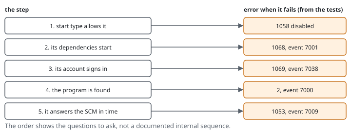

*Draft for owner review.* Much of what a Windows machine does happens in services and scheduled tasks: programs that run without anyone signed in. When something "just stopped working", a service is one of the first places to look. This lesson shows how to read, change and troubleshoot services and scheduled tasks from PowerShell and Command Prompt, with the graphical consoles as a second route.

**What was tested.** The failure messages, events and result codes come from a **Windows Server 2022** lab VM (Windows PowerShell 5.1, elevated), where I created each fault on purpose with throwaway services and tasks (`tests/verification/powershell/svc1.ps1` and `svc2.ps1`). The examples that mention a *Nightly Cleanup* task are invented to show the layout. Changing a service needs an **elevated** session; try it on a lab VM, not a machine you rely on.

## What a service is

A **service** is a long-running program managed by the **Service Control Manager** (SCM, `services.exe`; see [Service Control Manager](https://learn.microsoft.com/windows/win32/services/service-control-manager)). It has a **name** (short, used in scripts, for example `Spooler`), a **display name**, a **status** (Running, Stopped, and so on), a **startup type**, and an **account** it runs as.

| Startup type | Meaning |
|---|---|
| Automatic | Starts at boot |
| Automatic (Delayed Start) | Starts shortly after boot to keep boot fast |
| Manual | Starts when something asks for it |
| Disabled | Cannot start, even if asked |

The status says what is true *now*; the startup type says what happens after a restart. A service can be running now and be Disabled, so it will not return after a reboot. **Always check both.**

## Looking at services

### PowerShell

```
Get-Service Spooler | Format-List Name, DisplayName, Status, StartType

Name        : Spooler
DisplayName : Print Spooler
Status      : Running
StartType   : Automatic
```

```
Get-Service | Where-Object Status -eq 'Stopped' | Where-Object StartType -eq 'Automatic'
Get-Service Spooler -RequiredServices      # what it needs
Get-Service Spooler -DependentServices     # what needs it
```

The second command is a classic: automatic services that are stopped are candidates for "what failed at boot" (some are designed to stop after they finish, so read before acting). See [`Get-Service`](https://learn.microsoft.com/powershell/module/microsoft.powershell.management/get-service).

**Read that list with care.** On the freshly started lab server it showed six services. Asking CIM for their exit codes told a different story:

```powershell
Get-CimInstance Win32_Service -Filter "StartMode='Auto' AND State<>'Running'" |
    Format-Table Name, ExitCode, DelayedAutoStart
```

```text
Name          ExitCode DelayedAutoStart
DPS               1077             True
edgeupdate        1077             True
MSDTC             1077             True
UALSVC            1077             True
UsoSvc            1077             True
cbdhsvc_20772     1077             True
```

`net helpmsg 1077` translates it: **No attempts to start the service have been made since the last boot.** All were set to **delayed** start (or are per-user services), and the machine had only just started. Nothing had failed. `Get-Service` in Windows PowerShell 5.1 shows `StartType : Automatic` **for both** plain and delayed automatic; to tell them apart use `DelayedAutoStart` from CIM, or `sc.exe qc`, which prints `AUTO_START  (DELAYED)`.

To see the **account** a service runs as and its program, PowerShell's `Get-Service` does not say; ask WMI/CIM:

```
Get-CimInstance Win32_Service -Filter "Name='Spooler'" | Format-List Name,StartMode,StartName,PathName,State

Name      : Spooler
StartMode : Auto
StartName : LocalSystem
PathName  : C:\WINDOWS\System32\spoolsv.exe
State     : Running
```

`StartName` is the account (`LocalSystem`, `NT AUTHORITY\LocalService`, `NT AUTHORITY\NetworkService`, or a named account) and `PathName` the program. A service whose program path is somewhere unexpected, such as a temporary folder, deserves a close look.

### Command Prompt: `sc.exe`

Type `sc.exe`, with the extension. **In PowerShell, plain `sc` is an alias for `Set-Content`**, so `sc query Spooler` will not do what you expect there.

```
sc.exe qc Spooler           # configuration
sc.exe query Spooler        # status

[SC] QueryServiceConfig SUCCESS

SERVICE_NAME: Spooler
        TYPE               : 110  WIN32_OWN_PROCESS (interactive)
        START_TYPE         : 2   AUTO_START
        ERROR_CONTROL      : 1   NORMAL
        BINARY_PATH_NAME   : C:\WINDOWS\System32\spoolsv.exe
        LOAD_ORDER_GROUP   : SpoolerGroup
        TAG                : 0
        DISPLAY_NAME       : Print Spooler
        DEPENDENCIES       : RPCSS
                           : http
        SERVICE_START_NAME : LocalSystem
```

`START_TYPE` 2 is automatic, 3 manual, 4 disabled; `BINARY_PATH_NAME` is the program, `DEPENDENCIES` what must be running first, and `SERVICE_START_NAME` the account. `sc.exe query` shows the state:

```
SERVICE_NAME: Spooler
        TYPE               : 110  WIN32_OWN_PROCESS  (interactive)
        STATE              : 4  RUNNING
                                (STOPPABLE, NOT_PAUSABLE, IGNORES_SHUTDOWN)
        WIN32_EXIT_CODE    : 0  (0x0)
        SERVICE_EXIT_CODE  : 0  (0x0)
```

`WIN32_EXIT_CODE` is zero when all is well; a non-zero value on a stopped service is the reason it stopped. `net start` lists running services and `net start <name>` starts one. See [`sc config`](https://learn.microsoft.com/windows-server/administration/windows-commands/sc-config) and [`sc query`](https://learn.microsoft.com/windows-server/administration/windows-commands/sc-query).

### Graphical

`services.msc` lists every service with its status, startup type and "Log On As" column. Double-click one for its properties: General (startup type), Log On (account), Recovery (what to do on failure) and Dependencies.

## Changing services

```
Start-Service Spooler
Stop-Service Spooler -Force
Restart-Service Spooler
Set-Service Spooler -StartupType Automatic
Set-Service Spooler -StartupType Disabled
```

```
sc.exe config Spooler start= auto          # note the SPACE after '='
sc.exe config Spooler start= delayed-auto
sc.exe config Spooler start= demand        # manual
sc.exe config Spooler start= disabled
net start Spooler
net stop Spooler
```

See [`Start-Service`](https://learn.microsoft.com/powershell/module/microsoft.powershell.management/start-service), [`Restart-Service`](https://learn.microsoft.com/powershell/module/microsoft.powershell.management/restart-service) and [`Set-Service`](https://learn.microsoft.com/powershell/module/microsoft.powershell.management/set-service). **Write the space after `start=`**: [Microsoft documents it as required](https://learn.microsoft.com/windows-server/administration/windows-commands/sc-config), and older instructions fail without it. The lab's Server 2022 accepted `start=disabled` without the space, so do not rely on an error to catch it. Whatever you type, **read the result back** with `sc.exe qc`: `SUCCESS` only says the call was accepted. (Setting `delayed-auto` on the Spooler was refused with `FAILED 87: The parameter is incorrect`, and the start type stayed as it was; the same setting worked on my test service. I did not confirm the cause.)

**A service can be Running and Disabled at the same time.** After `Set-Service Spooler -StartupType Disabled`, `Get-Service` showed `Status : Running`, `StartType : Disabled`. Only after stopping it did starting fail.

Services depend on each other. A service will not start if one it depends on is stopped or disabled, and `Stop-Service` on a service that others depend on stops those too (or refuses without `-Force`). **Do not disable a service you do not understand**; look it up first, and write down what you change and how to undo it.

### Recovery: what happens when a service crashes

Services can be configured to restart themselves. `sc.exe qfailure` shows it:

```
sc.exe qfailure Spooler

SERVICE_NAME: Spooler
        RESET_PERIOD (in seconds)    : 3600
        FAILURE_ACTIONS              : RESTART -- Delay = 5000 milliseconds.
                                       RESTART -- Delay = 5000 milliseconds.
```

Here the Print Spooler is restarted after five seconds on its first two failures. A service that "keeps coming back" after you stop it may simply be restarted by its recovery actions: check them before concluding that something else is starting it.

I ended the Spooler's **process**, once with those actions and once with none:

| Recovery actions | After 9 seconds | System log |
|---|---|---|
| Restart configured | `Running` again | **7031**: terminated unexpectedly ... The following corrective action will be taken in 5000 milliseconds: Restart the service. Then 7036, running |
| None | `Stopped`, `WIN32_EXIT_CODE : 1067` | **7034**: terminated unexpectedly. It has done this 1 time(s). |

So **a service that is running now may have crashed a minute ago**. Look for 7031 and 7034 and count them; the recovery action hides the symptom, not the cause. Recovery acts when the process dies unexpectedly, not when you stop the service properly.

## When a service will not start



```text
 start type -> dependencies -> account -> program found -> answers in time
    1058          1068           1069          2               1053
```

### The error you see first says very little

For every fault below, `Start-Service` said only `Cannot start service ... on computer '.'`. **`sc.exe start` gave the real reason**, with a number, and the System log explained it:

| The fault I made | `sc.exe start` | Service Control Manager events |
|---|---|---|
| Service **disabled** | `FAILED 1058`: cannot be started, either because it is disabled or ... | |
| **Program file does not exist** | `FAILED 2`: The system cannot find the file specified | **7000** |
| A **dependency is disabled** | `FAILED 1068`: The dependency service or group failed to start | **7001**: names the service it depends on and why that one failed |
| The account's **password was changed** after the service was set up | `FAILED 1069`: did not start due to a logon failure | **7038** (unable to log on as `.\wlsvcuser` ... password) and **7000** |
| The program **is not a service** (`cmd.exe`) | `FAILED 1053`: did not respond ... in a timely fashion, **after the wait** | **7009** (a timeout of 30000 ms while waiting) and **7000** |

`net helpmsg <number>` turns any of these numbers into text. Creating a service with a wrong password failed at once, at creation, with `FAILED 1057`. Installing a service logs event **7045**, with its program and account: worth reading when you find a service you do not recognise.

1053 is common when a **script or ordinary program** has been registered directly as a service. A program must talk to the Service Control Manager to be one.

### The routine

1. **Read the error.** `Start-Service` gives one, and the System log has events from "Service Control Manager" (7000-series IDs). Event 7000 means the service failed to start, 7001 a dependency failed, 7023 the service ended with an error, 7034 that it ended unexpectedly, and 7045 that a new service was installed.
2. **Check the startup type** (Disabled is common) and the **dependencies**.
3. **Check the account.** An expired or changed password for the service account stops it, and so does an account that lost the "log on as a service" right.
4. **Check the binary path** exists, is the file you expect, and is not blocked or deleted by antivirus.
5. **Check the application's own log**, and for network services whether the port is already taken by something else.

```
Get-WinEvent -FilterHashtable @{LogName='System'; ProviderName='Service Control Manager'} -MaxEvents 10 |
    Format-Table TimeCreated,Id,Message -Wrap
```

Read the event for the **time of the failure**. Starting the service again before you know why it stopped hides the cause (see the troubleshooting method lesson).

## Scheduled tasks

A **scheduled task** runs a program on a **trigger**: a time, a boot, a sign-in, an event. It has an account, a trigger, an action and conditions. Windows itself uses hundreds of them. Documentation: [Task Scheduler](https://learn.microsoft.com/windows/win32/taskschd/task-scheduler-start-page) and the [ScheduledTasks module](https://learn.microsoft.com/powershell/module/scheduledtasks/get-scheduledtask).

### Reading tasks

```
Get-ScheduledTask | Where-Object State -ne 'Disabled' | Select-Object -First 5 TaskPath,TaskName,State
Get-ScheduledTask -TaskName 'Nightly Cleanup' | Get-ScheduledTaskInfo | Format-List TaskName,LastRunTime,LastTaskResult,NextRunTime

TaskName       : Nightly Cleanup
LastRunTime    : 11/21/2026 2:00:00 AM
LastTaskResult : 0
NextRunTime    : 11/22/2026 2:00:00 AM
```

`schtasks /query /tn "Nightly Cleanup" /v /fo list` is the Command Prompt equivalent ([`schtasks query`](https://learn.microsoft.com/windows-server/administration/windows-commands/schtasks-query)).

`LastTaskResult` of `0` means the task's program returned success. Other values are codes to look up. Two you will see on healthy systems: a value like **267009** (hex `0x41301`) is a *status* that means the task is currently running, not an error. Convert a decimal result to hex to look it up in the [Task Scheduler error and success constants](https://learn.microsoft.com/windows/win32/taskschd/task-scheduler-error-and-success-constants): `'{0:X}' -f 267009`. A `0` result also does **not** prove the job did its work: it says the program exited cleanly, not that it did the right thing.

### Results I produced

| What the task did | `LastTaskResult` | Hex | Meaning |
|---|---|---|---|
| A script ran `exit 3` | 3 | `0x3` | **Your program's own exit code** |
| `powershell.exe -File` pointed at a script that does not exist | 4294770688 | `0xFFFD0000` | PowerShell could not run the file |
| The program to run does not exist | 2147942402 | `0x80070002` | A Windows error: file not found (the last four hex digits, `0002`, are error 2) |
| Still running | 267009 | `0x41301` | A **status**, not a failure |
| A script that **failed inside** but did not exit with an error | **0** | `0x0` | Looks like success |

The last row matters most. My script tried to read `input.txt`, which sat **next to the script**. The task reported **0**. What the script actually got was:

```text
Cannot find path 'C:\Windows\system32\input.txt' because it does not exist.
```

A task running as SYSTEM started in **`C:\Windows\system32`**, as user `SYSTEM`, with `TEMP` set to `C:\Windows\TEMP`. A relative name is looked up there, not beside the script. With `-WorkingDirectory C:\wl` on the task's action, the same script read its file. Better still, build paths from `$PSScriptRoot`, and **make the script exit with a non-zero code when it fails**.

The detailed task history (the `Microsoft-Windows-TaskScheduler/Operational` log) was **disabled** on this server: `wevtutil gl Microsoft-Windows-TaskScheduler/Operational` showed `enabled: false`. If you need history, enable it **before** the problem happens. Starting a disabled task by hand failed with `The task is disabled.`

### Changing and running tasks

```
Enable-ScheduledTask  -TaskName 'Nightly Cleanup'
Disable-ScheduledTask -TaskName 'Nightly Cleanup'
Start-ScheduledTask   -TaskName 'Nightly Cleanup'
```

A disabled task never runs, silently, which is why "the nightly job did not run" often ends in `Enable-ScheduledTask`.

### Creating a task

```
$action  = New-ScheduledTaskAction -Execute 'powershell.exe' -Argument '-NoProfile -File C:\Scripts\cleanup.ps1'
$trigger = New-ScheduledTaskTrigger -Daily -At 2am
Register-ScheduledTask -TaskName 'Nightly Cleanup' -Action $action -Trigger $trigger -User 'SYSTEM' -RunLevel Highest
```

```
schtasks /create /tn "Nightly Cleanup" /tr "powershell.exe -NoProfile -File C:\Scripts\cleanup.ps1" /sc daily /st 02:00 /ru SYSTEM
```

See [`Register-ScheduledTask`](https://learn.microsoft.com/powershell/module/scheduledtasks/register-scheduledtask), [`New-ScheduledTaskAction`](https://learn.microsoft.com/powershell/module/scheduledtasks/new-scheduledtaskaction), [`New-ScheduledTaskTrigger`](https://learn.microsoft.com/powershell/module/scheduledtasks/new-scheduledtasktrigger) and [`schtasks create`](https://learn.microsoft.com/windows-server/administration/windows-commands/schtasks-create). A task that runs as SYSTEM can do anything on the machine, so give a script the **least privilege** that works (a dedicated account where possible) and use full paths: a task does not start in the folder you expect.

### A task that "does nothing"

If `LastTaskResult` is `0` but the job did not do its work:

1. Run it by hand as the **same account**, from the same folder, with the same arguments. The common causes are a relative path, a missing drive mapping, and an environment variable that exists in your session but not in the task's.
2. Add logging to the script (a log file with timestamps), because a task has no console.
3. Check **conditions**: "start only if on AC power" or "only if a network is available" silently prevent a run.
4. Check the **account's rights**: a task running as a user may need "log on as a batch job".

## Common mistakes

- **Reading `Status` and ignoring `StartType`.** A running Disabled service disappears at the next reboot.
- **Typing `sc` in PowerShell** and getting `Set-Content`. Use `sc.exe`.
- **Leaving out the space** in `sc.exe config x start= auto`, or not reading the result back.
- **Reading a stopped delayed-start service as a failure** without its exit code.
- **Stopping at `Start-Service`'s message** instead of asking `sc.exe start` and the System log.
- **Starting a stopped service to "see if that fixes it"** without reading why it stopped.
- **Disabling a service to fix a symptom** and breaking its dependents.
- **Running a scheduled task as SYSTEM** because it was easy, when a limited account would do.
- **Relative paths in a task action.** Use full paths.
- **Trusting `LastTaskResult : 0`** as proof that the job did its work.

## Check yourself

1. A service shows Running but is Disabled. What happens after a restart?
2. Why can a service fail to start when nothing is wrong with the service itself?
3. A task's `LastTaskResult` is 0 but the job did nothing. Where do you look next?
4. Which command shows the account a service runs as?
5. In `sc.exe config Spooler start= auto`, what is easy to get wrong?
6. A service keeps coming back after you stop it. What might restart it?
7. Which event ID tells you a service ended unexpectedly?

**Answers.** (1) It does not start: Disabled services cannot start, so it is gone after the reboot. (2) A dependency is stopped or disabled, its account's password expired or lost a right, its program is missing or blocked, or its port is taken. (3) Run it by hand under the same account and folder; check paths, environment, conditions and the script's own log. (4) `Get-CimInstance Win32_Service` (the `StartName` property) or `sc.exe qc <name>` (`SERVICE_START_NAME`). (5) The documented space after `start=` (check the result with `sc.exe qc`), and `sc` must be `sc.exe` in PowerShell. (6) Its recovery actions (`sc.exe qfailure`), another service that depends on it, or a scheduled task. (7) 7034.

## Practice

Three labs cover this lesson: `labs.spooler-stopped` (a stopped and disabled service), `labs.time-service-disabled` (a service that must survive a restart) and, on Linux, `labs.linux-service-disabled`. For each, write down the status *and* the startup type before you touch anything, run the lab, then write the record. After a fix, **restart the VM** and confirm the service is running again: that proves the startup type, not only the status.
